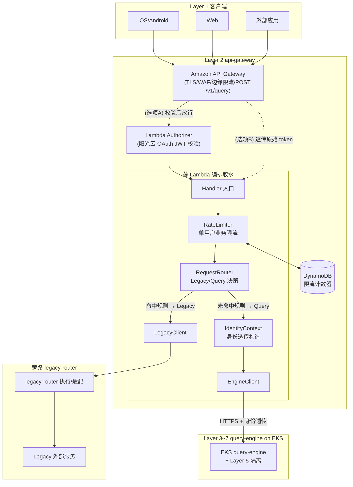
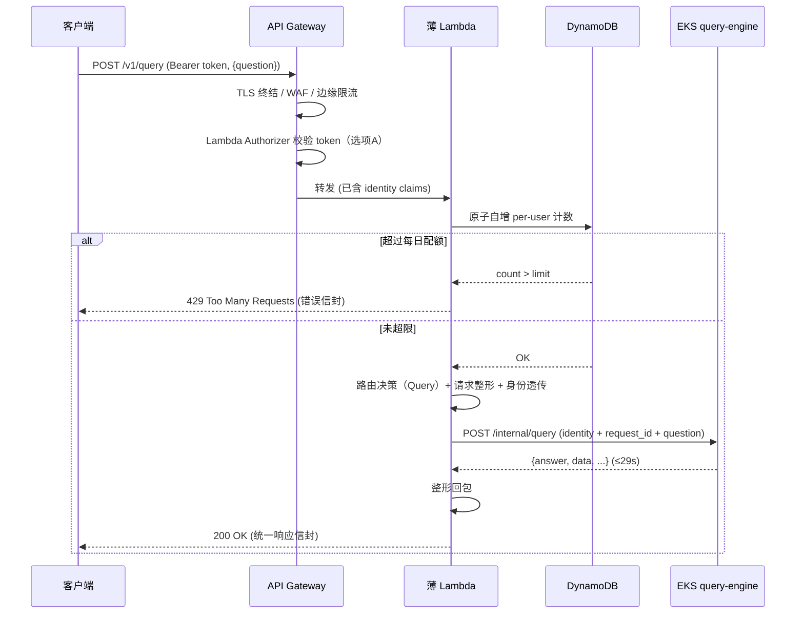
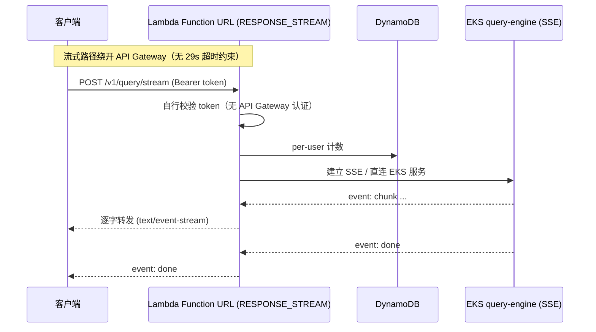

# 设计文档：Layer 2 —— api-gateway（统一入口 · 网关守门人）

> **所属系统**：智能问数系统 v2，见 `docs/smart-query-architecture-v2.md`
> **本文档范围**：仅覆盖 **Layer 2（api-gateway）** 及其旁路分支 **legacy-router 的路由决策部分** 的设计
> **设计形态**：高层设计（架构 / 请求流图 / 组件 / 接口 / 数据模型）+ 低层设计（Python 薄 Lambda 伪代码 / 接口签名 / 形式化规约：前置条件 / 后置条件 / 循环不变式 + API Gateway 配置草图）
> **语言约定**：团队以中文协作，本文档正文中文；编排层代码示例用 Python（薄 Lambda 运行于 AWS Lambda），入口层用 API Gateway 配置（REST API + Authorizer + WAF + Usage Plan）
> **下游契约**：本层调用 Layer 3 query-engine（EKS 上的 Python 服务），并把**已解析的调用方身份透传**下去，供 Layer 5 解析数据范围（org_ids / ps_ids）

---

## Overview

### 1.1 目的（Purpose）

Layer 2 是整个智能问数系统的**统一入口（unified entry）与守门人（gatekeeper）**。它由两部分组成：

- **Amazon API Gateway（边缘入口）**：对外暴露稳定公共 REST 契约 `POST /v1/query`，负责 TLS、WAF、边缘限流、（可选）认证终结。这是 iOS / Android / Web / 外部应用的**唯一公共入口**。
- **薄 Lambda（编排胶水，orchestration glue，不含业务智能）**：接住已过认证 / 边缘限流的请求，按序完成「单用户业务限流 → Legacy/Query 内容路由 → 请求整形 + 身份透传 → 调用 EKS query-engine 或 legacy-router → 整形回包」。

**查询引擎本身不在本层**——它运行于 EKS（Layer 3~7）。本层只做**「判断 + 转发 + 计数」**，绝不生成 SQL、不查库、不调 LLM。

### 1.2 核心设计洞察（必须落地）

- **薄（thin）**：Lambda 不含任何业务智能。它是「胶水」，不是「大脑」。凡涉及语义、SQL、数据的判断都不在本层。
- **不双重认证（no double-auth）**：认证只做一次。要么在 API Gateway 终结（Lambda Authorizer / JWT），要么透传到引擎侧统一校验，**二选一，严禁两层都校验**。
- **只做身份认证（authentication），不做数据授权（authorization）**：本层解析出「你是谁」（identity），但「你能看哪些 org_id/ps_id 的数据」由 **Layer 5 isolation-guard** 解析。本层的天职是**把可信身份完整透传下去**，让 Layer 5 有据可依。
- **限流分两层**：边缘限流（API Gateway，粗粒度、防洪水）+ 单用户业务限流（薄 Lambda + DynamoDB 计数器，细粒度、按用户按天）。API Gateway 的 Usage Plan 绑定 API Key，不适合面向 C 端终端用户，故按用户计数放在 Lambda。
- **路由决策在本层，执行在 legacy-router**：薄 Lambda 按问题内容做**路由判断**（规则匹配）；命中 Legacy 时委托给外部 legacy 服务执行。路由器**可插拔**（规则注册表）。
- **流式是待决点（OPEN issue）**：API Gateway 不支持真流式且有 29s 集成超时。设计必须同时容纳「一次性 JSON（走 API Gateway）」与「SSE 流式（绕开 API Gateway）」两条路径，并把它清晰标注为配置 / 决策点（见 §12）。

### 1.3 边界：Layer 2 拥有什么 / 不拥有什么

明确边界是本设计的第一原则。

| 维度 | 归属 | 说明 |
|------|------|------|
| **对外公共 REST 契约 / TLS / WAF / 边缘限流** | ✅ **Layer 2（API Gateway）** | `POST /v1/query`，稳定公共契约 |
| **认证（Token 验证 · 身份）** | ✅ **Layer 2** | 阳光云 OAuth 2.0；仅认证，不做数据授权 |
| **单用户业务限流（按用户按天计数）** | ✅ **Layer 2（薄 Lambda + DynamoDB）** | 429 限流 |
| **Legacy/Query 内容路由「决策」** | ✅ **Layer 2（薄 Lambda）** | 规则匹配，命中委托 legacy-router 执行 |
| **请求整形 + 身份透传** | ✅ **Layer 2** | 把可信身份透传给引擎，供 Layer 5 解析 scope |
| **调用引擎 / legacy 并整形回包** | ✅ **Layer 2** | EngineClient / LegacyClient |
| 术语归一化 / 语义缓存 | ❌ **Layer 3** | query-engine（EKS） |
| 上下文改写 / 多轮 | ❌ **Layer 3** | AgentCore Memory |
| Schema Linking / SQL 生成 / 选择 / 修复 | ❌ **Layer 4** | 本层绝不生成 SQL |
| **数据隔离 / 权限解析（scope=org_ids/ps_ids）** | ❌ **Layer 5** | 本层只透传身份，不解析数据范围 |
| 连接池 / 只读执行 / 方言 | ❌ **Layer 6/7** | ProxySQL / DatasourceAdapter |

> **铁律**：Layer 2 的输出**要么是「已认证 + 已限流 + 已路由 + 已透传身份的下游调用结果」，要么是「明确的错误信封（401 / 429 / 5xx）」**。本层永不接触 SQL、永不接触数据库、永不调用 LLM。

### 1.4 运行载体约束

- **托管无服务器（managed serverless）**：API Gateway + Lambda。引擎在 EKS。**不使用 ECS Fargate**。
- **AgentCore 是下游能力提供方**（Memory / Identity），供 Layer 3~5 经 SDK 调用，**不是本网关的宿主运行时**。

---

## Architecture

## 2. 高层架构（High-Level Architecture）

### 2.1 组件拓扑图



### 2.2 请求处理主流程（薄 Lambda 内部按序）

薄 Lambda 内部**严格按序**执行，且**认证已在入口完成**（请求进入 Lambda 时已可信）：

```
入口（已过认证 + 边缘限流）
  → 1. 解析请求 + 提取身份（IdentityContext）
  → 2. 单用户业务限流（DynamoDB 计数，超限 → 429）
  → 3. Legacy/Query 内容路由决策（规则匹配）
  → 4. 请求整形 + 身份透传（reshape，注入 identity + request_id）
  → 5a. 命中 Query → EngineClient 调 EKS 引擎
     5b. 命中 Legacy → LegacyClient 调 legacy-router
  → 6. 整形响应（reshape response，统一信封）
出口（下游结果 或 错误信封）
```

> **顺序不可换**：限流必须在路由 / 调用下游之前（否则超限请求仍会打到引擎，防洪水失效）；身份透传必须在调用下游之前（否则 Layer 5 无据可依）。

### 2.3 两种数据流变体（流式 vs 一次性）

**变体 A：一次性 JSON（默认推荐，≤10s，走 API Gateway）**



**变体 B：SSE 流式（绕开 API Gateway）**



> **决策点**：见 §12「流式取舍」。若本期一次性返回，则只落地变体 A；变体 B 作为配置分支预留，且**必须自行完成变体 A 中由 API Gateway 承担的认证与边缘限流**。

---

## Components and Interfaces

## 3. 组件与接口（Components and Interfaces）

### 3.1 API Gateway（边缘入口）

**职责**：对外公共 REST 契约、TLS、WAF、边缘限流、（选项A下）认证终结。

**配置要点**：

| 配置项 | 值 / 说明 |
|--------|-----------|
| 类型 | REST API（Regional 或 Edge-optimized，视 CDN 策略） |
| 资源 / 方法 | `POST /v1/query`（可选 `POST /v1/query/stream` 指向 Function URL 变体） |
| 集成类型 | `AWS_PROXY`（Lambda Proxy Integration，把原始请求整体交给薄 Lambda） |
| Authorizer | `REQUEST` 型 Lambda Authorizer（阳光云 OAuth JWT 校验）——**选项 A** |
| WAF | 关联 AWS WAF WebACL（IP 速率、地域、SQLi/XSS 托管规则） |
| 边缘限流 | Method 级 `throttlingRateLimit` / `throttlingBurstLimit`（账户 / 阶段级粗粒度） |
| 集成超时 | 默认 29s（硬上限），一次性 JSON 路径需保证引擎 ≤29s 返回 |
| Usage Plan | 绑定 API Key（面向合作方 / 外部应用的粗粒度配额），**不用于 C 端逐用户计数** |

### 3.2 薄 Lambda Handler（编排入口）

**职责**：编排 §2.2 的 6 步。**只判断 + 转发 + 计数**。

**接口签名**（Python，AWS Lambda handler）：

```python
def handler(event: dict, context: "LambdaContext") -> dict:
    """API Gateway Proxy Integration 入口。
    输入 event: API Gateway 代理事件（含 headers / body / requestContext.authorizer）
    输出:      API Gateway 代理响应（statusCode / headers / body）
    """
```

**职责边界**：不解析业务语义、不生成 SQL、不查询数据库、不调用 LLM。任何异常都转成统一错误信封（见 §4.5 / §10）。

### 3.3 RateLimiter（单用户业务限流）

**职责**：按用户按天（或按滑动窗口）计数，超限抛 `RateLimitExceeded`。计数存 DynamoDB，使用条件更新做原子自增。

```python
class RateLimiter:
    def check_and_increment(self, user_id: str, request_id: str) -> "RateLimitDecision":
        """对 user_id 的当期窗口计数 +1，并判断是否超限。
        - 前置条件: user_id 非空（来自可信身份）
        - 后置条件: 返回 allowed=True 时计数已持久化自增；allowed=False 时不放行下游
        - 副作用:   对 DynamoDB 计数项做原子 +1（首次 PutItem，之后条件 UpdateItem）
        """
```

### 3.4 RequestRouter（Legacy/Query 路由决策）

**职责**：按问题内容做**路由判断**（规则匹配）。**决策在此，执行不在此**。可插拔规则注册表。

```python
class RequestRouter:
    def route(self, question: str, identity: "IdentityContext") -> "RouteDecision":
        """对问题做规则匹配，决定走 Query（引擎）还是 Legacy。
        - 前置条件: question 非空
        - 后置条件: 返回 target ∈ {QUERY, LEGACY}；命中 LEGACY 时附带 matched_rule_id
        - 不变式:   未命中任何规则 ⟹ target == QUERY（默认走引擎，fail-to-query）
        - 无副作用: 纯函数式判断（规则注册表只读）
        """
```

### 3.5 IdentityContext（身份透传）

**职责**：从认证结果构造**可信身份上下文**，随下游请求透传。**只承载身份，不含数据范围**。

```python
@dataclass(frozen=True)
class IdentityContext:
    user_id: str          # 阳光云 OAuth subject（稳定用户标识）
    tenant_id: str | None # 租户/组织标识（若 token 携带）
    scopes: tuple[str, ...]  # OAuth scope（认证层面，非数据授权）
    raw_claims: dict      # 透传给引擎的原始 claims（供 Layer 5 解析）
    request_id: str       # 贯穿全链路的追踪 id
```

> **关键**：本层**不**把 `raw_claims` 解析成 `org_ids/ps_ids`。那是 Layer 5 的职责。本层只保证身份**完整、可信、可追踪**地到达引擎。

### 3.6 EngineClient（调用 EKS 引擎）

```python
class EngineClient:
    def invoke(self, payload: "EngineRequest", identity: "IdentityContext") -> "EngineResponse":
        """以 HTTPS 调用 EKS query-engine 内部端点。
        - 前置条件: identity 已构造完成（user_id 非空）
        - 后置条件: 透传 identity + request_id；返回引擎响应或抛下游异常（→5xx）
        - 副作用:   一次对 EKS 的出站 HTTPS 调用（受 29s 约束，见变体 A）
        """
```

### 3.7 LegacyClient（调用 legacy-router）

```python
class LegacyClient:
    def invoke(self, payload: "LegacyRequest", identity: "IdentityContext", rule_id: str) -> "LegacyResponse":
        """命中 Legacy 规则时，委托 legacy-router（外部执行/适配层）执行。
        - 前置条件: rule_id 来自 RequestRouter 的命中结果
        - 后置条件: 返回整形前的 legacy 响应；识别 identity 透传
        """
```

---

## Data Models

## 4. 数据模型（Data Models）

### 4.1 `/v1/query` 请求契约（公共 REST）

```python
@dataclass
class QueryRequest:
    question: str                 # 自然语言问题，必填，非空
    session_id: str | None = None # 多轮会话 id（透传给引擎，供 AgentCore Memory）
    stream: bool = False          # 是否要求流式（True → 走变体 B / Function URL）
    client_meta: dict | None = None  # 客户端元信息（端类型/版本，仅观测用）
```

**校验规则**：`question` 非空且长度 ≤ 上限（如 2000 字符）；`stream=True` 时若部署未启用流式路径则返回明确错误。

### 4.2 `/v1/query` 响应契约（统一信封）

```python
@dataclass
class QueryResponse:
    request_id: str               # 与请求贯通的追踪 id
    status: str                   # "ok" | "error"
    data: dict | None = None      # 引擎/legacy 整形后的业务结果
    error: "ErrorEnvelope | None" = None
    source: str = "query"         # "query" | "legacy"，指示由谁处理
```

### 4.3 IdentityContext（身份上下文）

见 §3.5。序列化为下游 HTTP 头 / body 字段透传（如 `X-Identity-User-Id`、`X-Request-Id`，及 body 内 `identity.raw_claims`）。

### 4.4 限流计数记录（DynamoDB）

```python
# DynamoDB 表: api_gateway_rate_limit
# 主键设计: pk = "USER#{user_id}#{yyyy-mm-dd}"（按用户按天）
@dataclass
class RateLimitRecord:
    pk: str          # "USER#<user_id>#<window>" 分区键
    count: int       # 当期窗口累计请求数
    window: str      # "2026-04-21"（按天）或滑动窗口标识
    limit: int       # 该用户当期配额（可来自用户等级配置）
    ttl: int         # DynamoDB TTL，窗口过期自动清理（epoch 秒）
```

**表设计要点**：
- 分区键把「用户 + 窗口」编码进 `pk`，天然按天分片，避免热点。
- 用 `UpdateItem` + `ADD count :one` + 条件表达式 `count < :limit` 做**原子自增 + 超限拒绝**。
- 配 `ttl` 属性，窗口过期自动回收，无需清理任务。

### 4.5 路由规则（RoutingRule，可插拔注册表）

```python
@dataclass(frozen=True)
class RoutingRule:
    rule_id: str                  # 规则唯一 id（命中后回填响应 source 追踪）
    matcher: "Callable[[str], bool]"  # 对 question 的匹配谓词（关键词/正则/前缀）
    target: str                   # "legacy"（Query 为默认，无需规则）
    priority: int                 # 多规则命中时的优先级（小者先）
    description: str              # 人类可读说明
```

**注册表**：`RuleRegistry` 持有有序规则列表；`route()` 按 `priority` 遍历，首个命中即返回；全不命中 → `QUERY`。规则可来自配置文件 / DynamoDB，热更新不改代码。

### 4.6 错误信封（ErrorEnvelope）

```python
@dataclass
class ErrorEnvelope:
    code: str        # "UNAUTHORIZED" | "RATE_LIMITED" | "DOWNSTREAM_ERROR" | "BAD_REQUEST"
    message: str     # 面向客户端的安全文案（不泄露内部细节）
    request_id: str  # 便于用户报障时定位
    retry_after: int | None = None  # 429 时提示重试秒数
```

HTTP 状态码映射：`UNAUTHORIZED→401`、`RATE_LIMITED→429`、`BAD_REQUEST→400`、`DOWNSTREAM_ERROR→502/503/504`。

---

## 5. 认证设计（Authentication Design）

### 5.1 两个互斥选项

阳光云 OAuth 2.0 的 token 校验**只能做一次**。两个位置二选一：

| 选项 | 位置 | 机制 | 优点 | 缺点 |
|------|------|------|------|------|
| **A. 网关终结（terminate-at-gateway）** | API Gateway | `REQUEST` 型 Lambda Authorizer 校验 JWT，通过后把 claims 注入 `requestContext.authorizer`，薄 Lambda 直接信任 | 认证与业务解耦；无效 token 在边缘即被拒，不进 Lambda（省成本、抗洪水）；薄 Lambda 更薄 | 流式变体 B 绕开 API Gateway 时，Authorizer 不生效，需另行校验 |
| **B. 透传到引擎（pass-through-to-engine）** | 引擎侧（EKS） | API Gateway 与薄 Lambda 只透传原始 `Authorization` 头，由引擎统一校验 | 流式 / 非流式路径认证逻辑统一；单点维护 | 无效 token 也会消耗 Lambda + 引擎资源；边缘无法早拒 |

### 5.2 推荐

**采用选项 A（网关终结）作为 v2 唯一主路径**，理由：无效 token 在边缘即被拒，最省成本、最抗洪水，且让薄 Lambda 保持「已认证」的干净前提。

**关于流式变体 B（v2 不实现，见 §12）**：未来若引入流式，因其绕开 API Gateway，须在 Function URL 前置一段**等价的 token 校验**（复用同一 Authorizer 校验库 / 同一阳光云 OAuth 校验逻辑），保证**「认证只做一次，但流式路径也必须做这一次」**——不违反「勿双层」，因为两条路径互斥、同一请求只走其一。为此本期须按 §12.3 把认证校验抽为传输无关的共享库。

> **不变式**：任一请求到达引擎前，**有且仅有一次**成功的身份校验。选项 A 与 B 对同一请求互斥。

### 5.3 身份传播（Identity Propagation）

1. 校验通过 → 从 JWT claims 构造 `IdentityContext`（§3.5）。
2. 薄 Lambda 把身份透传给引擎：HTTP 头 `X-Identity-User-Id` / `X-Request-Id` + body 内 `identity.raw_claims`。
3. 引擎侧 Layer 5 从透传身份**解析** `scope = {org_ids, ps_ids}`。

> **本层绝不解析数据范围**。透传是本层的终点，解析是 Layer 5 的起点。

---

## 6. 限流设计（Rate Limiting Design）

### 6.1 两层限流

| 层 | 位置 | 粒度 | 目的 |
|----|------|------|------|
| **边缘限流** | API Gateway（Method throttle + WAF rate rule） | 粗（阶段 / IP） | 防洪水、防 DDoS、保护后端整体 |
| **单用户业务限流** | 薄 Lambda + DynamoDB | 细（按用户按天） | 公平配额、防单用户滥用、成本控制 |

**为何按用户计数放在 Lambda**：API Gateway 的 Usage Plan 绑定 **API Key**，适合合作方 / 外部应用的粗粒度配额，但**不适合 C 端逐用户**（终端用户无独立 API Key）。故按用户按天计数在薄 Lambda 用 DynamoDB 实现。

### 6.2 DynamoDB 计数器 schema

见 §4.4。核心是 `pk = USER#<user_id>#<window>`、原子 `ADD count :one`、条件 `count < :limit`、`ttl` 自动回收。

### 6.3 超限行为（429）

- 超限 → 返回 `429 Too Many Requests`，错误信封 `code=RATE_LIMITED`，头部 `Retry-After` 提示下一窗口秒数。
- **超限请求不进入路由 / 不调用下游**（限流在编排序列第 2 步，早于路由与下游调用）。

---

## 7. Legacy/Query 路由设计

- **决策在薄 Lambda**（`RequestRouter` + `RuleRegistry`），**执行在 legacy-router**（外部服务 / 适配层）。
- **可插拔规则注册表**（§4.5）：规则 = 匹配谓词 + 目标 + 优先级；配置驱动、热更新、不改代码。
- **默认走引擎（fail-to-query）**：任何问题若不命中 Legacy 规则，一律路由到 query-engine。这是安全默认——新问题默认走主链路，而非误入 legacy。

---

## Correctness Properties

以下属性以「对所有输入普遍成立」的形式陈述（§8），是本层的行为契约，也是后续属性测试（property-based testing）的目标。

### Property 1: 认证前置（Auth Before Engine）

对所有到达引擎 / legacy 的请求 `r`，存在且仅存在一次成功的身份校验发生在下游调用之前。
`∀ r reaching engine: authenticated(r) == True ∧ auth_count(r) == 1`

**Validates: Requirements 2.1, 2.2, 2.3, 2.4, 2.5**

### Property 2: 薄层零智能（No Business Intelligence）

对所有请求，薄 Lambda 的执行轨迹中**不含** SQL 生成、数据库查询、LLM 调用。
`∀ r: ¬generates_sql(r) ∧ ¬queries_db(r) ∧ ¬calls_llm(r)`

**Validates: Requirements 3.2, 3.3, 3.4, 3.5, 11.2**

### Property 3: 身份必达（Identity Always Propagated）

对所有路由到引擎的请求，`IdentityContext.user_id` 非空且被透传到引擎调用中。
`∀ r routed to QUERY: propagated_identity(r).user_id ≠ ∅`

**Validates: Requirements 6.1, 6.2, 6.3**

### Property 4: 不解析数据范围（No Scope Resolution in Layer 2）

薄 Lambda 永不产出 `org_ids/ps_ids`（数据范围解析属于 Layer 5）。
`∀ r: resolved_scope_in_layer2(r) == ∅`

**Validates: Requirements 2.6, 6.4, 11.3**

### Property 5: 单用户限流生效（Per-User Limit Enforced）

对同一 `user_id` 在同一窗口内的第 `n` 次请求，若 `n > limit`，则返回 429 且不调用下游。
`∀ user, window: request_index > limit ⟹ status == 429 ∧ ¬downstream_called`

**Validates: Requirements 4.1, 4.2, 4.3, 4.4, 4.5, 4.7**

### Property 6: 路由确定性（Deterministic Routing）

未命中任何 Legacy 规则 ⟹ 路由到 query-engine；命中 ⟹ 路由到 legacy-router（按优先级取首个命中）。
`∀ q: matched_rule(q) == ∅ ⟹ target == QUERY ; matched_rule(q) ≠ ∅ ⟹ target == LEGACY`

**Validates: Requirements 5.1, 5.2, 5.3, 5.4**

### Property 7: 限流早于路由与下游（Rate-Limit Ordering）

在执行轨迹中，限流检查的时刻严格早于路由决策与任何下游调用。
`∀ r: t(rate_check) < t(route) < t(downstream_call)`

**Validates: Requirements 3.1, 3.6, 4.5**

### Property 8: 错误信封统一（Uniform Error Envelope）

任何失败路径都产出带 `request_id` 的统一错误信封，且状态码符合 §4.6 映射。
`∀ r failing: response.error ≠ ∅ ∧ response.error.request_id == r.request_id`

**Validates: Requirements 7.3, 7.4, 7.5, 8.4**

### Property 9: request_id 贯通（Request ID Propagation）

响应的 `request_id` 恒等于该请求分配 / 透传的 `request_id`（含下游调用透传）。
`∀ r: response.request_id == r.request_id == propagated_request_id(r)`

**Validates: Requirements 8.1, 8.2, 8.3, 8.4**

---

## Low-Level Design

## 9. 低层设计（薄 Lambda Python 伪代码 + 形式化规约）

> 以下为**设计级伪代码**（Python 风格），用于表达算法与形式化规约（前置条件 / 后置条件 / 循环不变式），非交付实现代码。

### 9.1 Handler 主流程

```python
def handler(event: dict, context) -> dict:
    """
    前置条件:
      - event 为 API Gateway Proxy 事件
      - (选项A) event["requestContext"]["authorizer"] 含已校验 claims；
        (选项B) event["headers"]["Authorization"] 含原始 token（下游校验）
    后置条件:
      - 返回 API Gateway Proxy 响应；statusCode ∈ {200, 400, 401, 429, 5xx}
      - 成功路径: 身份已透传下游，request_id 贯通
      - 失败路径: 统一错误信封（含 request_id）
    不变式:
      - 本函数不生成 SQL / 不查库 / 不调 LLM（P2）
      - 限流检查早于路由与下游调用（P7）
    """
    request_id = _extract_or_new_request_id(event)      # P9 起点
    try:
        # 步骤1: 解析请求 + 构造可信身份（认证已在入口完成）
        req = parse_query_request(event)                # 校验 question 非空/长度
        identity = build_identity_context(event, request_id)  # P1/P3
        assert identity.user_id, "identity must be present"   # P3

        # 步骤2: 单用户业务限流（早于路由与下游 —— P7）
        decision = rate_limiter.check_and_increment(identity.user_id, request_id)
        if not decision.allowed:                        # P5
            return error_response(429, "RATE_LIMITED", request_id,
                                  retry_after=decision.retry_after)

        # 步骤3: Legacy/Query 路由决策（决策在此，执行在下游 —— P6）
        route = router.route(req.question, identity)

        # 步骤4+5: 请求整形 + 身份透传 + 调用下游
        if route.target == "LEGACY":
            resp = legacy_client.invoke(reshape_legacy(req), identity, route.rule_id)
            source = "legacy"
        else:
            resp = engine_client.invoke(reshape_engine(req), identity)  # 透传 identity
            source = "query"

        # 步骤6: 整形回包（统一信封，request_id 贯通 —— P9）
        return ok_response(reshape_response(resp), request_id, source)

    except BadRequest as e:
        return error_response(400, "BAD_REQUEST", request_id, detail=str(e))
    except Unauthorized as e:                           # 仅选项B下游校验失败会到这
        return error_response(401, "UNAUTHORIZED", request_id)
    except DownstreamError as e:
        return error_response(e.http_status or 502, "DOWNSTREAM_ERROR", request_id)
    except Exception:
        log.exception("unhandled", extra={"request_id": request_id})
        return error_response(500, "DOWNSTREAM_ERROR", request_id)
```

### 9.2 RateLimiter.check_and_increment（DynamoDB 原子自增）

```python
def check_and_increment(self, user_id: str, request_id: str) -> RateLimitDecision:
    """
    前置条件: user_id 非空（来自可信身份）
    后置条件:
      - allowed=True  ⟹ DynamoDB 计数已原子 +1 且 ≤ limit
      - allowed=False ⟹ 未放行；计数不超过 limit（条件写失败即拒）
    副作用: 一次 DynamoDB UpdateItem（原子）
    不变式: 同一 (user_id, window) 的并发请求，计数严格单调递增、无丢失自增（原子性保证）
    """
    window = today_utc()                       # 例如 "2026-04-21"
    pk = f"USER#{user_id}#{window}"
    limit = resolve_user_limit(user_id)        # 用户等级配置（只读）
    try:
        resp = ddb.update_item(
            Key={"pk": pk},
            UpdateExpression="ADD #c :one SET #l = if_not_exists(#l, :lim), #t = :ttl",
            ConditionExpression="attribute_not_exists(#c) OR #c < :lim",  # 超限即条件失败
            ExpressionAttributeNames={"#c": "count", "#l": "limit", "#t": "ttl"},
            ExpressionAttributeValues={":one": 1, ":lim": limit, ":ttl": end_of_window_epoch()},
            ReturnValues="UPDATED_NEW",
        )
        return RateLimitDecision(allowed=True, remaining=limit - resp["Attributes"]["count"])
    except ddb.exceptions.ConditionalCheckFailedException:
        return RateLimitDecision(allowed=False, retry_after=seconds_to_next_window())
```

### 9.3 RequestRouter.route（可插拔规则注册表）

```python
def route(self, question: str, identity: IdentityContext) -> RouteDecision:
    """
    前置条件: question 非空
    后置条件: 返回 target ∈ {QUERY, LEGACY}；LEGACY 时带 rule_id
    循环不变式: 遍历规则时，已检查规则均未命中（首个命中即返回，保证优先级语义）
    不变式(P6): 全不命中 ⟹ QUERY（默认走引擎）
    无副作用: 规则注册表只读
    """
    for rule in self.registry.ordered_by_priority():   # 不变式: 之前的规则都未命中
        if rule.matcher(question):
            return RouteDecision(target="LEGACY", rule_id=rule.rule_id)
    return RouteDecision(target="QUERY", rule_id=None)  # 默认 fail-to-query
```

### 9.4 EngineClient.invoke（身份透传）

```python
def invoke(self, payload: EngineRequest, identity: IdentityContext) -> EngineResponse:
    """
    前置条件: identity.user_id 非空（P3）
    后置条件: 出站请求头/体携带 identity + request_id；返回引擎响应或抛 DownstreamError
    副作用: 一次对 EKS query-engine 的出站 HTTPS 调用（变体A受 29s 约束）
    不变式(P4): 不解析 identity → scope；raw_claims 原样透传给引擎
    """
    headers = {
        "X-Request-Id": identity.request_id,       # P9 透传
        "X-Identity-User-Id": identity.user_id,    # P3 透传
        "Content-Type": "application/json",
    }
    body = {"question": payload.question, "session_id": payload.session_id,
            "identity": {"user_id": identity.user_id, "raw_claims": identity.raw_claims}}
    resp = http.post(ENGINE_INTERNAL_URL, json=body, headers=headers, timeout=ENGINE_TIMEOUT_S)
    if resp.status_code >= 500:
        raise DownstreamError(http_status=502)
    return EngineResponse.from_dict(resp.json())
```

### 9.5 API Gateway 资源/方法/Authorizer 配置草图

```yaml
# API Gateway REST API 配置草图（示意，非交付 IaC）
paths:
  /v1/query:
    post:
      x-amazon-apigateway-integration:
        type: aws_proxy                       # 把原始请求整体交给薄 Lambda
        httpMethod: POST
        uri: arn:aws:apigateway:...:lambda:path/2015-03-31/functions/${ThinLambdaArn}/invocations
        timeoutInMillis: 29000                # 硬上限 29s（一次性 JSON 路径）
      security:
        - SunCloudOAuthAuthorizer: []         # 选项A：Lambda Authorizer 终结认证

components:
  securitySchemes:
    SunCloudOAuthAuthorizer:
      type: apiKey
      name: Authorization
      in: header
      x-amazon-apigateway-authtype: custom
      x-amazon-apigateway-authorizer:
        type: request                         # REQUEST 型，校验阳光云 OAuth JWT
        identitySource: method.request.header.Authorization
        authorizerUri: arn:aws:apigateway:...:lambda:path/.../${AuthorizerLambdaArn}/invocations
        authorizerResultTtlInSeconds: 300     # 缓存校验结果，降本

# 边缘限流（Stage / Method 级）
x-throttle:
  rateLimit: 1000       # 稳态 req/s（阶段级粗粒度）
  burstLimit: 2000      # 突发桶

# WAF：关联 WebACL（IP 速率规则 + AWS 托管 SQLi/XSS 规则组）
x-waf-webacl: arn:aws:wafv2:...:webacl/smart-query-edge

# 流式变体（可选）：POST /v1/query/stream → Lambda Function URL (RESPONSE_STREAM)，绕开本 REST API
```

---

## Error Handling

## 10. 错误处理（Error Handling）

| 场景 | 触发条件 | 响应 | 恢复 |
|------|----------|------|------|
| **未认证 401** | token 缺失 / 过期 / 签名无效 | 选项A：API Gateway Authorizer 直接拒（不进 Lambda）；选项B：下游校验失败回 401 | 客户端刷新 token 重试 |
| **参数错误 400** | `question` 为空 / 超长 / body 非法 JSON | `BAD_REQUEST` 信封 | 客户端修正请求 |
| **限流 429** | 单用户当期计数超 limit | `RATE_LIMITED` + `Retry-After` | 客户端等待下一窗口 |
| **下游错误 5xx** | 引擎 / legacy 超时 / 5xx / 连接失败 | `DOWNSTREAM_ERROR`（502/503/504） | 幂等重试 / 熔断降级 |
| **流式不可用** | `stream=True` 但部署未启用流式路径 | `BAD_REQUEST`，提示改用一次性 | 客户端降级为非流式 |

**原则**：
- **fail-closed**：任何未预期异常 → 500 + 统一信封，绝不泄露内部堆栈 / SQL / 身份细节。
- **错误文案安全**：面向客户端的 `message` 不含内部实现细节；内部细节只进日志（带 `request_id`）。

## 11. 可观测性与可测试性（Observability & Testability）

### 11.1 可观测性

- **request_id 全链路贯通（P9）**：入口生成（或透传客户端 `X-Request-Id`），随下游调用透传，写入所有日志 / 指标 / 响应。
- **结构化日志**：每步（认证结果、限流决策、路由决策、下游耗时、状态码）打点，均含 `request_id`、`user_id`（脱敏）。
- **指标**：请求量 / 429 率 / 各下游 P50-P99 延迟 / 下游错误率 / 路由分布（Query vs Legacy）。
- **告警**：429 率突增、下游 5xx 率、接近 29s 超时的请求占比（流式决策的信号）。

### 11.2 可测试性

- 组件均以接口编程（`RateLimiter` / `RequestRouter` / `EngineClient` / `LegacyClient` 可 mock）。
- `RequestRouter.route` 为纯函数，易做属性测试（P6）。
- `RateLimiter` 用 DynamoDB Local / moto 测原子性与超限（P5）。

---

## Testing Strategy

## 11.3 测试策略

- **单元测试（Unit Testing）**：各组件独立测（限流边界、路由优先级、身份构造、错误映射）。组件均以接口编程，`EngineClient` / `LegacyClient` 可 mock，无需真实下游。
- **属性测试（Property-Based Testing）**：验证 §8 的 Property 1~9。建议库：**hypothesis**（Python）。
  - 例：对任意 `question`，`route()` 结果 ∈ {QUERY, LEGACY} 且未命中必为 QUERY（Property 6）。
  - 例：对任意窗口内请求序列，第 `>limit` 次必 429 且无下游调用（Property 5 / Property 7）。
  - 例：对任意成功请求，响应 `request_id` 恒等于入口 `request_id`（Property 9）。
- **集成测试（Integration Testing）**：API Gateway → 薄 Lambda → mock 引擎/legacy 全链路；含 401/429/5xx 路径与 request_id 贯通（Property 9）。DynamoDB 限流用 DynamoDB Local / moto 验证原子性与超限（Property 5）。

---

## 12. 流式取舍（Streaming Decision · DECIDED）

> **决策（v2）：本期不实现流式，仅落地变体 A（一次性 JSON）。但相关模块须做好扩展性准备，使未来引入流式时无需重写核心逻辑。**

### 12.1 决策依据

在 v2 定位下（**输入自然语言 → 输出一条 SQL；SQL 执行模块外置于本系统之外**），流式没有成立的场景：

1. **输出短**：一条 SQL 通常几百字符到几 KB，生成仅需数秒，逐字流式对体验几无增益。
2. **与隔离层冲突**：Layer 5 必须对**完整 SQL** 做 AST 解析 / 隔离注入 / 只读校验，且不可绕过。半截流式 SQL 无法校验；若先流出未过 L5 的原始 SQL 则违反安全契约。故 SQL 必须「生成完整 → 过 L5 → 才能对外输出」，天然否定对最终 SQL 的流式。
3. **无结果集回传**：执行外置后本系统不返回结果行，"边查边吐大结果集"的流式理由不成立。
4. **无长文叙述**：本期不做数据解读 / 分析报告 / ChatBI 式自然语言回答等长文本输出（与「不做图表可视化」一致），无长文流式需求。

### 12.2 两变体对比（存档，供未来重启评估）

| 维度 | 变体 A：一次性 JSON（走 API Gateway）· **本期采用** | 变体 B：SSE 流式（绕开 API Gateway）· 未来选项 |
|------|--------------------------------------|--------------------------------------|
| 入口 | API Gateway `POST /v1/query` | Lambda Function URL（`RESPONSE_STREAM`）或直连 EKS |
| 延迟约束 | 引擎须 ≤29s 返回（API Gateway 硬上限） | 无 29s 约束，可长连接逐字输出 |
| 认证 | API Gateway Lambda Authorizer（选项A，边缘早拒） | 须自行前置等价校验（Authorizer 不生效） |
| 边缘限流 / WAF | API Gateway + WAF 原生 | 须自行实现等价保护 |
| 体验 | 一次性出结果（简单、稳定） | 逐字流式（体验好，复杂度高） |
| 复杂度 | 低（本期落地） | 高（多一套认证/限流/入口） |

### 12.3 扩展性准备（本期必须做到，为未来流式免返工）

即便本期只做变体 A，落地时须遵守以下约束，把「入口 + 传输」与「业务编排」解耦，使未来接入变体 B 时只新增入口、不改核心：

1. **认证 / 身份构造抽为传输无关的共享库**：`build_identity(claims) -> IdentityContext` 不绑定 API Gateway event 结构；提供一个「等价 token 校验」纯函数，供未来 Function URL handler 直接复用（不依赖 Lambda Authorizer）。
2. **限流抽为共享库**：`RateLimiter.check_and_incr(user_id, window)` 独立于入口形态，变体 A/B 均调用同一实现。
3. **编排逻辑与 I/O 形态解耦**：薄 Lambda 的「解析 → 限流 → 路由 → 透传 → 调下游 → 整形」编排步骤不假设"一次性返回"；下游响应的**消费点**预留"可迭代 / 可分块"的抽象（本期返回单块，未来可返回多块），使**响应整形层**未来能改为逐块 emit。

   > **术语澄清（避免歧义）**：
   > - **响应整形层**：指薄 Lambda 中把「下游（query-engine / legacy-router）原始响应」转换为「面向客户端的统一信封 `QueryResponse`」的那段代码，即 §9.1 handler 的**步骤6**（`reshape_response(resp)` + `ok_response(...)`）。
   > - **消费点**：指响应整形层**读取下游响应体的那个具体位置**。本期（变体 A）消费点是"一次性读完整个响应体"（如 §3.6 的 `resp.json()`），当作一个完整对象处理；未来（变体 B 流式）下游会分多次吐 chunk，消费点需改为"循环读取一段段 chunk"（如 `for chunk in resp.iter_lines()`）。
   > - **本条要求**：不要把"下游响应必为完整对象、一次读完"写死；把消费点建模为"一串 chunk"的可迭代抽象——**本期该抽象只产出 1 个 chunk（即那份完整 JSON），行为与一次性返回完全一致**，但接口形态允许产出多个 chunk，从而未来接流式时只需让它产出多块、整形层逐块 emit，无需重写编排与整形逻辑。
   >
   > ```python
   > # 不推荐（把"单块、一次读完"写死）：
   > data = resp.json()
   > return ok_response(data, request_id, source)
   >
   > # 本条期望（消费点=可分块抽象，本期只产出一块）：
   > for chunk in consume(resp):    # 本期 consume() 只 yield 一次（整份 JSON）
   >     emit(chunk)                # 本期 emit 一块 == 一次性返回
   > # 未来流式：consume() 逐段 yield，emit() 逐段推给客户端，主逻辑不改
   > ```
4. **响应契约向后兼容**：`QueryResponse` 信封结构在流式下应能作为「最终事件」复用（例如未来 SSE 的 `event: result` 承载同一 JSON），避免客户端契约破坏。
5. **入口互斥不变式保持**：未来任一请求仍是「走 A 或走 B，二选一」，认证只做一次的不变式（Property 1）在两变体下同样成立。

> **一句话**：本期只交付变体 A，但**认证库、限流库、身份构造、响应信封**都按"传输无关"设计，未来加流式 = 新增一个 Function URL 入口 + 复用这些库，核心编排零改动。

---

## 13. 依赖（Dependencies）

| 依赖 | 用途 | 说明 |
|------|------|------|
| Amazon API Gateway | 边缘入口 / TLS / WAF / 边缘限流 / 认证终结 | REST API + Lambda Proxy 集成 |
| AWS Lambda | 薄编排层（+ Authorizer + 可选 Function URL 流式） | 无服务器，无 ECS Fargate |
| Amazon DynamoDB | 单用户业务限流计数器 | 原子自增 + TTL |
| AWS WAF | 边缘 Web 防护 | IP 速率 + 托管规则组 |
| 阳光云 OAuth 2.0 | 身份认证（token 校验） | 仅认证，非数据授权 |
| EKS query-engine（Layer 3~7） | 下游查询引擎 | HTTPS 内部端点，本层透传身份 |
| legacy-router + Legacy 外部服务 | 旁路执行/适配 | 本层做路由决策，委托其执行 |

> **非依赖**：本层**不**依赖 LLM / StarRocks / sqlglot / ProxySQL / AgentCore（这些是下游 Layer 3~7 的关注点）。

---

## 14. 未决事项 / 风险

1. ~~**流式 vs 一次性返回**~~：**已决策（§12）**——v2 只做变体 A（一次性 JSON），不实现流式；相关模块按 §12.3 做扩展性准备，未来引入流式不返工。
2. **认证选项 A vs B**：**已决策**——采用选项 A（网关终结）。未来若引入流式变体 B，须复用 §12.3 的等价校验共享库，保证 B 路径认证 / 限流不缺席。
3. **限流窗口策略**：按天 vs 滑动窗口；用户分级配额来源（用户等级服务）。
4. **路由规则治理**：规则注册表由谁维护、如何热更新、误路由的回滚策略。
5. **request_id 透传规范**：与 Layer 3~7 约定统一头名与格式，保证全链路可追踪。
