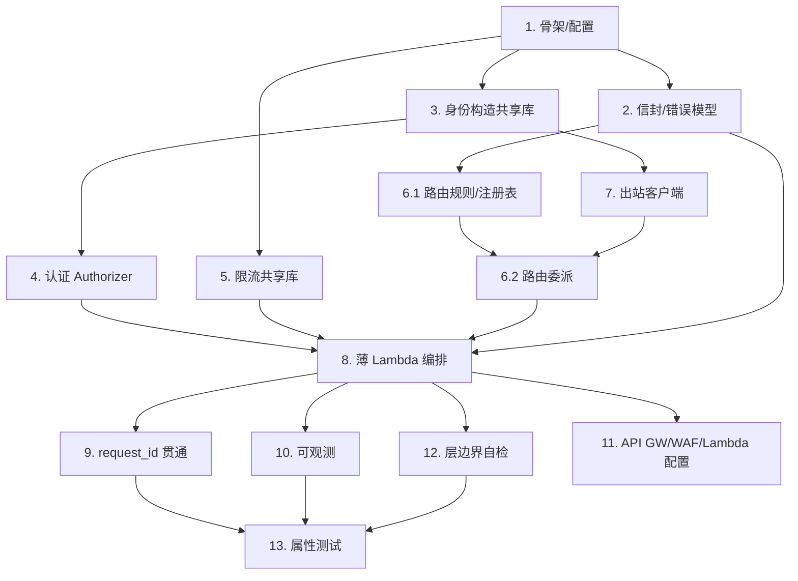

# Implementation Plan: Layer 2 —— api-gateway（统一入口 · 网关守门人）

## Overview

本计划依据 `design.md` 与 `requirements.md` 为 Layer 2 生成实现任务。L2 = API Gateway（边缘入口）+ 薄 Lambda（编排胶水），天职是**判断 + 转发 + 计数**：对外暴露 `POST /v1/query`、终结认证、单用户业务限流、Legacy/Query 路由决策、透传身份、整形统一信封。

**语言/技术**：Python 3.11（薄 Lambda + Authorizer）、pytest、hypothesis；DynamoDB（限流计数，测试用 moto/DynamoDB Local）；API Gateway + WAF + Lambda 配置（IaC 草图）。

**本期范围基线（务必遵守）**：
- **只做变体 A（一次性 JSON）**，不实现 SSE 流式；`stream=true` → 400 `BAD_REQUEST`（design §12 已决策）。
- **扩展性准备**：认证/身份构造、限流抽为**传输无关的共享库**；响应整形层消费点建模为**可分块抽象（本期单块）**；`QueryResponse` 信封可作未来流式"最终事件"复用（design §12.3）。
- **认证选项 A（网关终结）**：Lambda Authorizer 校验阳光云 OAuth JWT。
- **下游**：调用 EKS 上的 L3 query-engine；命中 Legacy 委托 legacy-router。
- **薄层零智能**：不生成 SQL、不查库、不调 LLM、不解析数据范围。

## Tasks

- [ ] 1. 工程骨架与配置
  - 建立包结构（`api_gateway/`：`handler.py` / `identity.py` / `ratelimit.py` / `router.py` / `clients/`（engine/legacy）/ `envelope.py` / `errors.py` / `config.py` / `auth/`（authorizer））
  - 配置项：边缘限流值、DynamoDB 表名、窗口策略、下游 URL、`question` 长度上限（2000）
  - pytest 骨架 + conftest（DynamoDB moto、mock 下游 fixture）
  - _Requirements: 10.1, 10.2_

- [ ] 2. 统一信封与错误模型
  - 实现 `QueryRequest`（question/session_id/stream/client_meta，校验 question 非空且 ≤2000）、`QueryResponse`（request_id/status/data/source）、`ErrorEnvelope`（code/message/request_id/retry_after）
  - HTTP 状态码映射：UNAUTHORIZED→401、BAD_REQUEST→400、RATE_LIMITED→429、DOWNSTREAM_ERROR→502/503/504
  - message 排除内部细节（堆栈/SQL/身份内部）
  - **`QueryResponse` 设计为未来流式可复用为"最终结果事件"**（§12.3 扩展性）
  - 单测：信封字段、状态码映射、参数校验（空/超长→BAD_REQUEST）、脱敏
  - _Requirements: 7.1, 7.2, 7.3, 7.4, 7.5, 7.6, 9.7_

- [ ] 3. 身份构造共享库（传输无关）
  - 实现 `build_identity(claims, request_id) -> IdentityContext`（user_id/tenant_id/scopes/raw_claims/request_id），**不绑定 API Gateway event 结构**
  - 提供"等价 token 校验"纯函数（供未来流式入口复用），当前供 Authorizer/Lambda 共用
  - **不从 raw_claims 解析 org_ids/ps_ids**（数据范围属 L5）
  - 单测：identity 构造；user_id 非空校验；不产出范围字段
  - _Requirements: 6.1, 6.2, 6.4, 6.5, 9.4, 9.6_

- [ ] 4. 认证（选项 A · Lambda Authorizer）
  - 实现 `REQUEST` 型 Lambda Authorizer：按阳光云 OAuth 2.0 校验 JWT；成功 → 注入 claims 到 `requestContext.authorizer`；失败/缺失/过期/签名无效 → 拒绝（401 `UNAUTHORIZED`）
  - 复用 T3 的等价校验纯函数，保证与未来流式路径同源
  - 保证"到达下游前有且仅有一次成功认证"；仅认证不做数据授权
  - 单测（mock JWT/JWKS）：有效放行、各类无效→401、claims 注入
  - _Requirements: 2.1, 2.2, 2.4, 2.5, 2.6_

- [ ] 5. 单用户业务限流共享库（DynamoDB 原子计数）
  - 实现 `RateLimiter.check_and_increment(user_id, request_id) -> RateLimitDecision`，**独立于入口形态**（共享库）
  - DynamoDB `pk="USER#<user_id>#<window>"`，`UpdateItem` + `ADD count :one` + 条件 `count < :limit` 原子自增；超限→allowed=False + retry_after；配 TTL 自动回收；`RateLimitRecord` 模型
  - 单测（moto）：正常自增、超限拒绝、并发原子性不丢增、TTL 字段、429 + Retry-After
  - _Requirements: 4.1, 4.2, 4.3, 4.4, 4.6, 4.7_

- [ ] 6. Legacy/Query 路由决策
- [ ] 6.1 可序列化路由规则与注册表
  - 实现 `RoutingRule`（rule_id/matcher/target/priority/description）与 `RuleRegistry`（按 priority 遍历、首个命中即返回、全不命中→QUERY）
  - **定义可序列化 matcher 规格**（type: keyword/regex/prefix + 参数），加载器由配置（文件/DynamoDB）构造谓词，支持热更新不改代码（补齐 design §4.5 与"配置驱动"之间的缺口）
  - 单测：优先级顺序、首个命中、fail-to-query 默认、配置加载
  - _Requirements: 5.1, 5.2, 5.3, 5.4, 5.8_
- [ ] 6.2 路由执行委派
  - QUERY → `EngineClient` 调 L3；LEGACY → `LegacyClient` 委托 legacy-router；本层只决策不执行
  - 单测：命中 LEGACY 带 rule_id 委托、未命中走 QUERY
  - _Requirements: 5.5, 5.6, 5.7_

- [ ] 7. 出站客户端（身份透传）
  - `EngineClient.invoke`：HTTPS 调 L3；透传 `X-Identity-User-Id`/`X-Request-Id` 头 + body `identity.raw_claims`；5xx/超时/连接失败 → DownstreamError
  - `LegacyClient.invoke`：命中 Legacy 委托 legacy-router，透传身份
  - 单测（mock http）：身份透传字段、下游错误→DOWNSTREAM_ERROR
  - _Requirements: 6.3, 6.5, 7.7_

- [ ] 8. 薄 Lambda 编排 Handler（固定顺序 + 零智能 + 响应可分块抽象）
  - 固定顺序：解析请求+构造身份 → **单用户限流（早于路由与下游）** → Legacy/Query 路由决策 → 请求整形+身份透传 → 调下游 → 整形回包
  - **薄层零智能**：不生成 SQL、不查库、不调 LLM、不解析范围
  - **stream=true → 400 BAD_REQUEST（本期不支持流式）**
  - **响应整形层**：下游响应消费点建模为**可分块（chunkable）抽象，本期只产出单块**（§12.3），编排逻辑不假设"一次性返回"
  - 异常 → 统一错误信封；fail-closed 兜底（未预期异常→500 信封，不泄露内部）
  - 单测：编排顺序、限流早于路由、零智能断言、stream=true→400、错误信封
  - _Requirements: 3.1, 3.2, 3.3, 3.4, 3.5, 3.6, 4.5, 9.1, 9.2, 9.3, 9.6, 11.1, 11.2, 11.3, 11.4, 11.5_

- [ ] 9. request_id 全链路贯通
  - 入口生成或采用客户端 `X-Request-Id`；透传每次下游调用；写入每条结构化日志；响应 request_id 恒等于入口 request_id
  - 单测：生成/透传/响应一致性
  - _Requirements: 8.1, 8.2, 8.3, 8.4_

- [ ] 10. 可观测性
  - 每编排步骤（认证结果/限流决策/路由决策/下游耗时/状态码）打结构化日志，含 request_id + 脱敏 user_id；发出 429 率、下游延迟、路由分布（query vs legacy）指标
  - 单测：日志字段/脱敏、指标发出
  - _Requirements: 12.1, 12.2, 12.3_

- [ ] 11. API Gateway / WAF / Lambda 配置（IaC 草图）
  - `POST /v1/query`：`AWS_PROXY` 集成、REQUEST 型 Authorizer（选项 A）、方法级边缘限流（稳态+突发）、WAF WebACL（IP 速率 + SQLi/XSS 托管规则）、集成超时 29s
  - 呈现给 iOS/Android/Web/外部应用完全相同的契约；运行于 API Gateway + Lambda（**不使用 ECS Fargate**）
  - 校验：cfn-lint（若用 CFN）；文档标注"流式 Function URL 变体本期不部署"
  - _Requirements: 1.1, 1.2, 1.3, 1.4, 1.5, 1.6, 2.3, 10.3, 10.4, 9.1_

- [ ] 12. 层边界自检
  - 断言 L2 不做术语归一化/语义缓存（L3）、不生成 SQL（L4）、不隔离/不解析范围（L5）、不执行查询（L6/7）；输出恒为下游结果信封或错误信封
  - 单测：越界检测；输出二态
  - _Requirements: 11.1, 11.2, 11.3, 11.4, 11.5_

- [ ] 13. 属性测试（覆盖 9 条正确性属性）
  - hypothesis 覆盖 Property 1~9：认证前置、薄层零智能、身份必达、不解析范围、单用户限流生效、路由确定性、限流早于路由与下游、错误信封统一、request_id 贯通
  - 例：任意 question → route ∈ {QUERY,LEGACY} 且未命中必 QUERY；任意窗口内第 >limit 次必 429 且无下游调用；任意成功请求响应 request_id == 入口 request_id
  - _Requirements: 2.1, 2.5, 3.2, 3.3, 3.4, 3.5, 4.1, 4.5, 4.7, 5.1, 5.2, 5.3, 5.4, 6.1, 6.2, 7.3, 8.1, 8.4_

## Task Dependency Graph

```json
{
  "waves": [
    { "wave": 1, "tasks": ["1"] },
    { "wave": 2, "tasks": ["2", "3"] },
    { "wave": 3, "tasks": ["4", "5", "6.1", "7"] },
    { "wave": 4, "tasks": ["6.2"] },
    { "wave": 5, "tasks": ["8"] },
    { "wave": 6, "tasks": ["9", "10", "12"] },
    { "wave": 7, "tasks": ["11"] },
    { "wave": 8, "tasks": ["13"] }
  ]
}
```



## Notes

- **本期只做变体 A**：所有认证/限流/身份构造按"传输无关共享库"实现（T3/T4/T5），响应整形消费点建模为可分块抽象（T8）。未来加流式 = 新增 Function URL 入口 + 复用这些库，编排零改动（design §12.3）。
- **认证选项 A 已定**：网关终结（Lambda Authorizer）；无效 token 边缘早拒。
- **补齐的设计缺口**：T6.1 定义可序列化的 RoutingRule matcher 规格 + 加载器（原 design §4.5 的 Callable 无法直接存配置/DynamoDB）。真实 Legacy 场景清单需产品/业务补充。
- **薄层零智能**是硬约束：不生成 SQL、不查库、不调 LLM、不解析数据范围（T8/T12 + T13 属性测试保证）。
- **限流须早于路由与下游**（Property 7），编排顺序不可换。
- 属性测试与 DynamoDB 原子性测试建议 CI 单独分组。
