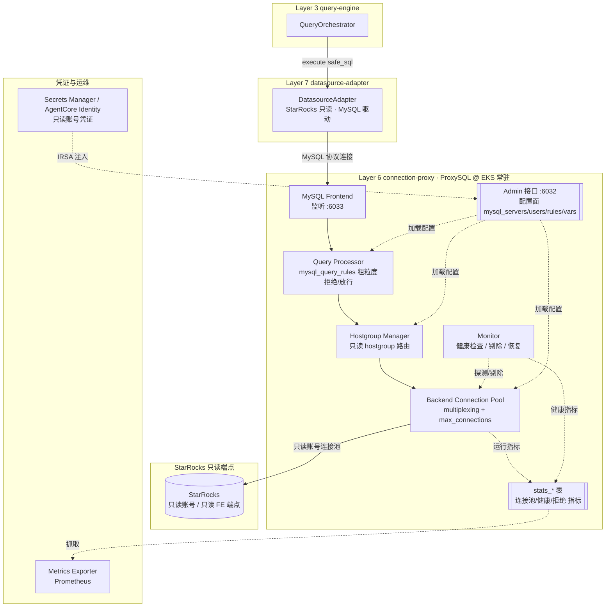
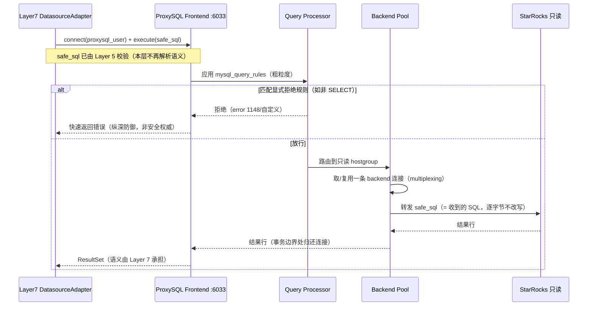
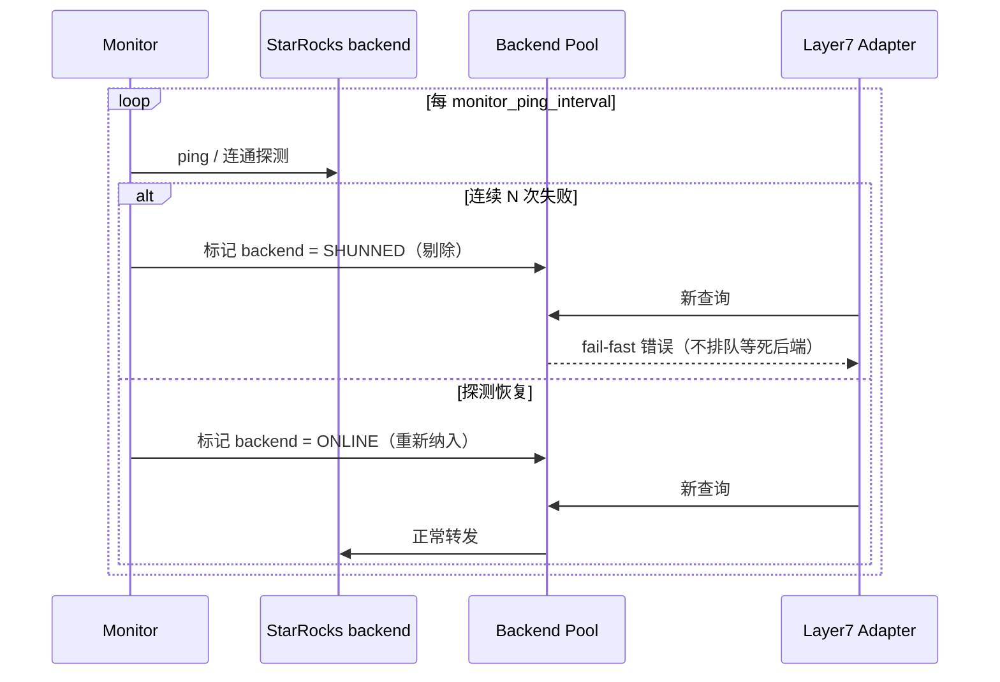
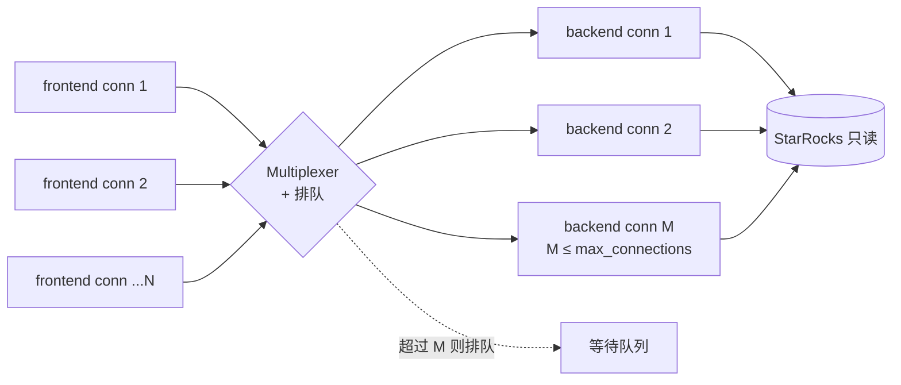
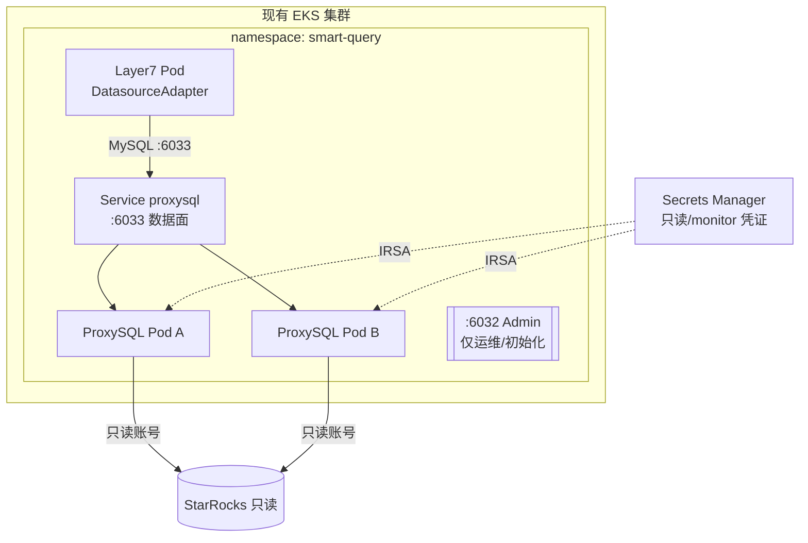

# 设计文档：Layer 6 —— connection-proxy（连接代理层 · ProxySQL）

> **所属系统**：智能问数（智能数据问答）系统 v2，见 `docs/smart-query-architecture-v2.md`
> **本文档范围**：仅覆盖 **Layer 6（connection-proxy）** 的设计
> **设计形态**：高层设计（架构 / 组件 / 接口 / 数据模型 / 数据流图）+ 低层设计（Python 接口签名 / 伪代码 / 依赖注入契约 + ProxySQL 配置片段）
> **语言约定**：团队以中文协作，本文档正文中文；代码示例用 Python（Layer 7 侧连接代码运行于 EKS 的 Python 服务），基础设施配置用 ProxySQL 配置语法
> **上下游契约对齐**：
> - 与 `.kiro/specs/isolation-guard/design.md`（Layer 5）对齐 —— 本层收到的 SQL **已是** Layer 5 校验通过的安全 SQL（经 Layer 7 下发），本层**不感知隔离语义**。
> - 与 `.kiro/specs/query-engine/design.md`（Layer 3）§3.5 的 `DatasourceAdapter` 契约对齐 —— Layer 3 经该适配器执行安全 SQL，适配器（Layer 7）通过 MySQL 驱动连到本层 frontend 端口。
> - 与 Layer 7（datasource-adapter）对齐 —— `DatasourceAdapter.execute(safe_sql) -> ResultSet` / `dry_run(sql) -> None` 的物理连接由本层提供的连接池承载。

---

## Overview

Layer 6（connection-proxy）是智能问数系统的**连接代理层**，核心是一个**基础设施组件 ProxySQL**，常驻部署在**现有 EKS**。因为 StarRocks 对外暴露 **MySQL 协议**，ProxySQL（一个成熟的 MySQL 协议代理）可以直接用作 StarRocks 只读查询的连接池与代理。

本层的唯一使命是：把上游 Layer 7（`DatasourceAdapter`，经 MySQL 驱动）发来的**已经过 Layer 5 校验的安全 SQL**，通过一个受控的**后端连接池**，安全、高效、可观测地送达 StarRocks backend 并回传结果。它做四件事：**连接池 / 连接复用**、**限流 / 并发控制**、**故障隔离**、**只读路由**——外加作为 MySQL 协议代理承接 frontend 连接。

必须澄清的一条设计红线：**Layer 6 不是业务 Python 代码，而是"基础设施组件（ProxySQL）+ 一套配置与运维契约"**。它**不做隔离、不解析权限、不生成/改写 SQL、不做只读 AST 校验**——那些确定性安全职责全部属于 Layer 5。ProxySQL 的 `mysql_query_rules` 至多做**粗粒度纵深防御**（例如拒绝明显的非 SELECT 语句），作为"第二/第三道防线"之一，但**绝不替代 Layer 5 的确定性只读校验**：安全正确性的唯一权威仍是 Layer 5。本层在**连接与路由**层面工作，转发的 SQL 恒等于收到的 SQL（除非匹配到显式配置的粗粒度拒绝规则而被整条拒绝）。

---

## 1. 目的与范围（Purpose & Scope）

### 1.1 目的

Layer 6 把"物理连接管理"这件重活从业务层剥离：上游无需为每个查询新建 StarRocks 连接，也无需自己实现健康检查、排队、熔断。ProxySQL 以 frontend 多连接**多路复用（multiplexing）**少量 backend 连接，既复用连接、又对后端并发设上限，并在后端不健康时快速剔除、恢复后重新纳入——从而在高并发问数场景下保护 StarRocks 不被打垮。

### 1.2 核心设计洞察（必须落地）

- **本层是"配置面 + 运维契约"，不是业务代码**：设计的产出主要是 ProxySQL 的四张核心配置（`mysql_servers` / `mysql_users` / `mysql_query_rules` / `global_variables`）以及 EKS 部署与密钥托管契约；Python 侧只是"如何连它"的一段瘦客户端约定（归属 Layer 7）。
- **只读路由不可绕过**：所有 backend 连接**只**指向 StarRocks **只读端点 / 只读账号**。这是纵深防御的一道（配合 Layer 7 只读账号与 Layer 5 只读校验），三道彼此独立。
- **连接复用而非 1:1 占用**：frontend 侧可有大量短连接，backend 侧维持一个受上限约束的小连接池，靠 multiplexing 复用。frontend 连接数 ≠ backend 连接数。
- **后端并发有硬上限**：`mysql_servers.max_connections` + `mysql-max_connections` 约束后端连接总数，超限则排队而非无限扩张。
- **故障 fail-fast 且可观测**：后端不可用时快速返回错误、剔除坏后端，避免请求堆积造成雪崩；连接池使用率、后端健康、拒绝计数等指标可被采集。
- **粗粒度规则只"拒绝或放行"**：`mysql_query_rules` 只能整条拒绝或原样放行，**绝不注入隔离、绝不改写权限、绝不重写 SQL 语义**。
- **此层无法用 AgentCore 替代**（决策记录，见 §1.5）。

### 1.3 边界：Layer 6 拥有什么 / 不拥有什么

明确边界是本设计的第一原则。

| 维度 | 归属 | 说明 |
|------|------|------|
| **MySQL 协议 frontend（承接来自 Layer 7 的连接）** | ✅ **Layer 6** | ProxySQL frontend 监听端口 |
| **后端连接池 / 连接复用（multiplexing）** | ✅ **Layer 6** | 复用少量 backend 连接服务多 frontend 连接 |
| **限流 / 并发控制（后端连接上限 + 排队）** | ✅ **Layer 6** | `max_connections` / `mysql-max_connections` |
| **故障隔离（健康检查 / 剔除 / 恢复 / fail-fast）** | ✅ **Layer 6** | monitor 模块 + shunning |
| **只读路由（全部指向只读端点 / 只读账号）** | ✅ **Layer 6** | `mysql_servers` 只配只读目标 |
| **粗粒度防护规则（拒绝明显非 SELECT，纵深防御）** | ✅ **Layer 6（可选加固）** | `mysql_query_rules`，只拒绝/放行 |
| **连接池使用率 / 后端健康 / 拒绝计数 指标** | ✅ **Layer 6** | ProxySQL `stats_*` 表 + exporter |
| 权限解析（身份 → org_ids/ps_ids） | ❌ **Layer 5（isolation-guard）** | 本层不感知身份与范围 |
| 数据隔离注入 / **确定性只读 AST 校验** | ❌ **Layer 5** | 安全正确性唯一权威，本层不替代 |
| SQL 生成 / Schema Linking / 选择 / 修复 | ❌ **Layer 4（text2sql-pipeline）** | 本层不生成 SQL |
| 多轮改写 / 术语归一化 / 语义缓存 / 编排 | ❌ **Layer 3（query-engine）** | 本层无编排语义 |
| **ResultSet 语义 / 方言差异 / 结果整形 / 只读账号凭证使用** | ❌ **Layer 7（datasource-adapter）** | 本层只提供连接与转发，结果细节归 Layer 7 |
| 认证 / 边缘限流 | ❌ **Layer 2（api-gateway）** | 与本层无关 |

> **铁律 1**：本层**转发的 SQL = 收到的 SQL**，唯一例外是"匹配到显式配置的粗粒度拒绝规则 → 整条拒绝"。本层**永不**改写、注入、重写 SQL 语义。
> **铁律 2**：本层收到的 SQL **默认已由 Layer 5 校验为安全只读 SQL**。粗粒度 query_rules 是**冗余的纵深防御**，**不是**安全校验的权威——即便关闭它，安全性也由 Layer 5 + 只读账号保证。
> **铁律 3**：所有 backend 目标**只**指向 StarRocks **只读账号 / 只读端点**，配置面不存在可写目标。

### 1.4 复用与许可约束

- **直接采用开源 ProxySQL**（GPLv3 二进制，作为独立基础设施进程运行，不链接进业务代码，不构成对业务代码的传染）。以**官方镜像**部署于 EKS。
- **不自研连接池**：连接池、multiplexing、健康检查、query rules 均由 ProxySQL 提供，本层只负责**配置与运维契约**。
- **凭证托管**：ProxySQL → StarRocks 的**只读账号**凭证经 **Secrets Manager 或 AgentCore Identity** 托管（与架构文档 D4 / §4 Layer 7 一致）；EKS Pod 经 **IRSA** 取密钥，凭证**不落明文日志、不写入镜像**。

### 1.5 决策记录：为何此层无法用 AgentCore 替代

> 对齐架构文档 D1 / §4 Layer 6 / §8。

- **AgentCore 无连接池能力**：AgentCore Runtime 采用"每会话 microVM"模型，天然不具备跨会话共享的后端连接池；而本层的核心价值恰是**跨请求共享、复用少量 backend 连接**。
- **microVM / 会话模型与共享连接池冲突**：会话级隔离意味着连接无法跨会话复用，高并发下会退化为"每查询新建连接"，正是本层要消除的反模式，且成本更高。
- **结论**：Layer 6 明确选择 **ProxySQL 常驻 EKS**，不纳入 AgentCore 托管。这是一条**不可动摇的架构决策**，而非实现细节。

---

## Architecture

## 2. 高层架构（High-Level Architecture）

### 2.1 总体思想

Layer 6 = **一个常驻 ProxySQL 进程**，对上以 **MySQL 协议 frontend** 承接 Layer 7 适配器的连接，对下以**受控 backend 连接池**连接 StarRocks 只读端点。它由四个内建模块协作：**Query Processor（应用 query_rules）→ Hostgroup Manager（只读路由）→ Connection Pool（复用 + 限流）→ Monitor（健康检查 + 剔除/恢复）**。ProxySQL 自身的 Admin 接口（配置面）与业务数据面（frontend）分离。



### 2.2 三个关键机制

1. **多路复用（Multiplexing）**：frontend 的多条连接在空闲事务边界处**归还** backend 连接，使少量 backend 连接被大量 frontend 连接轮流复用。前提是会话状态可复用（无跨查询残留事务/临时表），只读查询天然满足。
2. **只读 hostgroup（Read-Only Routing）**：所有 `mysql_servers` 归入同一个**只读 hostgroup**，默认路由规则把全部流量送往它；配置面**不存在**任何可写目标，路由无法"绕过"到可写端点。
3. **健康监控与熔断（Monitor & Shunning）**：Monitor 周期性 ping / 探测 backend；连续失败则**剔除（SHUNNED）**该 backend、请求 fail-fast；恢复后经探测重新**纳入（ONLINE）**。避免请求堆积成雪崩。

### 2.3 配置面 vs 数据面（务必区分）

Layer 6 的设计天然分成两个平面，二者不可混淆：

| 平面 | 入口 | 内容 | 谁来操作 |
|------|------|------|---------|
| **配置面（Control Plane）** | ProxySQL Admin `:6032`（MySQL 协议） | `mysql_servers` / `mysql_users` / `mysql_query_rules` / `global_variables` 四张核心表 + `LOAD/SAVE ... TO RUNTIME/DISK` | **运维 / 初始化脚本**（经 IRSA 拿到只读账号密钥后灌入），**非业务代码** |
| **数据面（Data Plane）** | ProxySQL Frontend `:6033`（MySQL 协议） | 承接 Layer 7 的 `execute(safe_sql)` 连接，转发到 backend，回传结果 | **Layer 7 `DatasourceAdapter`**（经 MySQL 驱动） |

> **要点**：Layer 7 的 Python 代码**只**接触数据面（`:6033`），永远**不**接触配置面（`:6032`）。配置面由部署/运维契约管理。

### 2.4 标准查询数据流（frontend → backend，含复用）



### 2.5 后端健康检查与故障隔离时序



### 2.6 连接复用 / 限流示意（frontend N : backend M，M ≤ 上限）



---

## Components and Interfaces

## 3. 组件与接口（高层）

Layer 6 的"组件"分两类：**ProxySQL 内建模块（不写代码，靠配置驱动）** 与 **本层对外暴露的契约（配置面契约 + 数据面连接契约）**。

### 3.1 ProxySQL 内建模块（配置驱动，无业务代码）

| 组件 | 职责 | 由哪张配置驱动 |
|------|------|---------------|
| **MySQL Frontend** | 承接 Layer 7 连接（MySQL 协议），做 frontend 认证 | `mysql_users`、`mysql-interfaces` |
| **Query Processor** | 对每条 SQL 应用 `mysql_query_rules`（粗粒度拒绝/放行），**不改写语义** | `mysql_query_rules` |
| **Hostgroup Manager** | 把流量路由到**只读 hostgroup** | `mysql_servers`（hostgroup 定义）+ 默认路由 |
| **Connection Pool** | backend 连接复用（multiplexing）+ 并发上限 + 排队 | `mysql_servers.max_connections`、`mysql-*` 全局变量 |
| **Monitor** | 后端健康检查、剔除（SHUNNED）、恢复（ONLINE） | `mysql-monitor_*` 全局变量 + monitor 账号 |
| **Stats** | 暴露连接池使用率、后端健康、命中/拒绝计数 | `stats_mysql_*` 表（只读查询） |

### 3.2 对外契约一：配置面契约（Control Plane Contract）

配置面是 Layer 6 交付的**主要产物**。它是四张核心表的一份**声明式期望配置**，由初始化/运维脚本经 Admin 接口灌入并 `LOAD ... TO RUNTIME` / `SAVE ... TO DISK`。四张表职责：

- `mysql_servers`：**只读** backend 目标集合（当前仅 StarRocks 一个），归入只读 hostgroup，带 `max_connections`。
- `mysql_users`：frontend 账号（Layer 7 用它连 `:6033`）与其默认 hostgroup 映射；backend 侧只读账号凭证。
- `mysql_query_rules`：粗粒度防护规则（可选加固），**只拒绝或放行**。
- `global_variables`：连接池 / 复用 / 监控 / 超时等 `mysql-*` 全局参数。

### 3.3 对外契约二：数据面连接契约（Data Plane Contract，供 Layer 7）

Layer 7 的 `DatasourceAdapter` 通过标准 MySQL 驱动连接本层 frontend。本层对 Layer 7 承诺的接口面**不是自定义 API**，而是**"一个行为等价于 StarRocks 只读端点的 MySQL 端点"**：

```python
from typing import Protocol, Any, Optional
from dataclasses import dataclass

@dataclass(frozen=True)
class ProxyEndpoint:
    """Layer 6 暴露给 Layer 7 的数据面连接端点契约（非自定义协议，就是一个 MySQL 端点）。"""
    host: str                 # ProxySQL Service 的集群内 DNS，如 "proxysql.smart-query.svc"
    port: int = 6033          # frontend 数据端口（绝不是 6032 Admin 端口）
    username: str = "sq_ro"   # frontend 账号（映射到只读 hostgroup）
    # password 不出现在此结构：由 Layer 7 经 Secrets/IRSA 注入，绝不硬编码/落日志
    default_schema: Optional[str] = None
    connect_timeout_ms: int = 3000

class Layer6ProxyContract(Protocol):
    """
    契约（非本层实现，仅供理解 Layer 7 如何用它）：
    - Layer 7 用 MySQL 驱动连接 ProxyEndpoint，执行已由 Layer 5 校验的 safe_sql。
    - 本层保证：转发的 SQL 逐字节等于收到的 SQL（除非命中显式拒绝规则）。
    - 本层保证：连接来自受限只读连接池；后端不可用时 fail-fast。
    - 本层不解释 ResultSet 语义 —— 那是 Layer 7 的职责。
    """
    def endpoint(self) -> ProxyEndpoint: ...
```

> **说明**：`ResultSet`、方言差异、`execute(safe_sql) -> ResultSet` / `dry_run(sql) -> None` 的语义封装都归 **Layer 7**（见 query-engine §3.5 与 datasource-adapter 设计）。Layer 6 只在其下方提供"连接 + 转发"。

### 3.4 对外契约三：可观测契约（Observability Contract）

本层承诺可采集以下指标（经 `stats_mysql_*` 表 + Prometheus exporter）：连接池使用率（活跃/空闲 backend 连接、frontend 连接数）、后端健康状态（ONLINE/SHUNNED/OFFLINE）、被 query_rules 拒绝的计数、查询错误/超时计数、连接排队等待。详见 §9。

---

## Data Models

## 4. 数据模型（Data Models）

Layer 6 的"数据模型"= **ProxySQL 配置表的声明式模型** + **Python 侧连接参数模型**。下面用 Python dataclass 表达配置的**逻辑模型**（便于初始化脚本生成 Admin SQL），实际写入见 §8 的 ProxySQL 配置片段。

### 4.1 后端服务器模型：`MysqlServerSpec`（对应 `mysql_servers`）

```python
from dataclasses import dataclass, field
from enum import Enum
from typing import Optional

READONLY_HOSTGROUP = 10   # 只读 hostgroup id（配置面唯一 hostgroup；不存在可写 hostgroup）

@dataclass(frozen=True)
class MysqlServerSpec:
    """一个 backend 目标 —— 当前仅 StarRocks 只读端点一个（可扩展但当前只此一个）。"""
    hostgroup_id: int = READONLY_HOSTGROUP  # 恒为只读 hostgroup
    hostname: str = "starrocks-ro.internal" # StarRocks 只读 FE 端点
    port: int = 9030                        # StarRocks MySQL 协议端口
    max_connections: int = 200              # ★后端连接上限（并发控制硬约束）
    max_replication_lag: int = 0            # StarRocks 不用主从 lag 语义，置 0
    weight: int = 1
    comment: str = "starrocks-readonly-only"
```

### 4.2 用户/账号模型：`MysqlUserSpec`（对应 `mysql_users`）

```python
class UserPlane(str, Enum):
    FRONTEND = "frontend"   # Layer 7 用来连 :6033 的账号
    BACKEND_RO = "backend_readonly"  # ProxySQL 连 StarRocks 用的只读账号

@dataclass(frozen=True)
class MysqlUserSpec:
    """frontend 账号（映射到只读 hostgroup）与 backend 只读账号。
    ★密码不在模型里存明文：运行期经 Secrets Manager / IRSA 注入，绝不落库/落日志。"""
    username: str
    default_hostgroup: int = READONLY_HOSTGROUP   # 默认路由到只读 hostgroup
    plane: UserPlane = UserPlane.FRONTEND
    transaction_persistent: bool = False          # 只读查询无需事务持久，利于 multiplexing
    max_connections: int = 1000                   # frontend 侧单账号可建连接上限
    active: bool = True
    # password_secret_ref: 仅存"密钥引用"（如 Secrets ARN / key 名），不存明文
    password_secret_ref: Optional[str] = None
```

### 4.3 粗粒度规则模型：`QueryRuleSpec`（对应 `mysql_query_rules`）

```python
class RuleAction(str, Enum):
    """★本层规则只有两种终态：拒绝 或 放行。绝无"改写/注入"动作。"""
    DENY = "deny"        # 命中即整条拒绝（error_msg 返回）
    ALLOW = "allow"      # 命中即放行（可用于白名单短路）

@dataclass(frozen=True)
class QueryRuleSpec:
    """粗粒度纵深防御规则。示例：拒绝明显的非 SELECT。
    铁律：不设置 replace_pattern / 不做 SQL 重写；action ∈ {DENY, ALLOW}。"""
    rule_id: int
    match_pattern: str            # 作用于 SQL 文本的正则（粗粒度）
    action: RuleAction
    error_msg: Optional[str] = None   # DENY 时返回的信息
    active: bool = True
    apply: bool = True            # 命中后停止继续匹配后续规则
    comment: str = ""
    # 注意：本 dataclass 刻意不含 replace_pattern 字段 —— 结构上禁止 SQL 改写。
```

### 4.4 全局变量模型：`GlobalVarsSpec`（对应 `global_variables` 中的 `mysql-*`）

```python
@dataclass(frozen=True)
class GlobalVarsSpec:
    """连接池 / 复用 / 监控 / 超时的关键全局参数。"""
    max_connections: int = 2048               # mysql-max_connections（frontend 总上限）
    multiplexing: bool = True                 # ★开启多路复用（连接复用核心）
    default_query_timeout_ms: int = 60_000    # 单查询超时（fail-fast 上界）
    connect_timeout_server_ms: int = 3000     # 连 backend 超时
    # —— Monitor（健康检查 / 剔除 / 恢复）——
    monitor_enabled: bool = True
    monitor_ping_interval_ms: int = 2000      # ping 间隔
    monitor_connect_interval_ms: int = 2000
    shun_on_failures: int = 3                 # 连续失败 N 次剔除
    shun_recovery_time_s: int = 10            # 剔除后多久尝试恢复
    # monitor 账号凭证同样经 Secrets/IRSA 注入（此处仅引用）
    monitor_user_secret_ref: Optional[str] = None
```

### 4.5 期望配置聚合：`ProxySqlDesiredConfig`

```python
@dataclass(frozen=True)
class ProxySqlDesiredConfig:
    """一份声明式的完整期望配置 —— 初始化脚本据此生成 Admin SQL 并 LOAD/SAVE。"""
    servers: tuple[MysqlServerSpec, ...]
    users: tuple[MysqlUserSpec, ...]
    query_rules: tuple[QueryRuleSpec, ...]
    globals: GlobalVarsSpec

    def assert_readonly_only(self) -> None:
        """自检：所有 server 归入只读 hostgroup；无任何可写目标。（对应 Property 1/9）"""
        assert all(s.hostgroup_id == READONLY_HOSTGROUP for s in self.servers)

    def assert_no_rewrite_rules(self) -> None:
        """自检：所有规则动作仅 DENY/ALLOW，无改写。（对应 Property 5/6）"""
        assert all(r.action in (RuleAction.DENY, RuleAction.ALLOW) for r in self.query_rules)
```

---

## Correctness Properties

以下为 Layer 6 必须成立的正确性属性，用全称量化陈述表达，作为实现（配置）与验证的约束。这些属性将在派生需求阶段映射为具体验收标准。

### Property 1: 只读路由不可绕过（Read-Only Routing Cannot Be Bypassed）
所有 backend 连接都指向 StarRocks 只读账号 / 只读端点；配置面不存在任何可写目标或可写 hostgroup。
`∀ conn ∈ backend_connections: conn.target ∈ readonly_endpoints ∧ conn.account = readonly_account`

**Validates: Requirements 1.1, 1.2, 1.3, 1.4, 1.5, 1.6, 1.7**

### Property 2: 连接复用（Connections Are Multiplexed, Not 1:1）
不存在"每条 frontend 连接独占一条 backend 连接"的关系；backend 连接在事务边界被复用。
`∀ 时刻 t: active_backend_conns(t) ≤ max(configured_backend_pool) ∧ ¬(∀ f∈frontend: f↦独占 backend)`

**Validates: Requirements 2.1, 2.2, 2.3, 2.4, 2.5**

### Property 3: 后端并发不超上限（Backend Concurrency Is Bounded）
任意时刻，指向某 backend 的活跃连接数不超过其 `max_connections`，超出的请求排队而非新建。
`∀ server s, ∀ 时刻 t: active_conns(s, t) ≤ s.max_connections`

**Validates: Requirements 3.1, 3.2, 3.3, 3.6**

### Property 4: 不健康后端被剔除且恢复后重新纳入（Unhealthy Backend Shunned, Recovered Backend Rejoined）
连续探测失败达阈值的 backend 被标记为 SHUNNED 并停止接新连接；探测恢复后重新变为 ONLINE 并重新接流量。
`∀ server s: failures(s) ≥ shun_on_failures ⟹ status(s)=SHUNNED；且 recovered(s) ⟹ eventually status(s)=ONLINE`

**Validates: Requirements 4.1, 4.2, 4.3, 4.4, 4.5**

### Property 5: 不改写 SQL 语义（SQL Semantics Are Not Rewritten）
被转发到 backend 的 SQL 与从 frontend 收到的 SQL 逐字节相同，唯一例外是命中显式拒绝规则而被整条拒绝（此时不转发任何 SQL）。
`∀ 查询 q: forwarded_sql(q) = received_sql(q) ∨ q ∈ denied_by_explicit_rule`

**Validates: Requirements 6.1, 6.2, 6.3, 6.4**

### Property 6: 粗粒度规则只拒绝或放行（Query Rules Only Deny or Allow）
每条 `mysql_query_rules` 的动作只能是拒绝或放行，绝不注入隔离条件、绝不改写权限、绝不重写 SQL。
`∀ rule r: r.action ∈ {DENY, ALLOW} ∧ r 不含 replace/rewrite 语义`

**Validates: Requirements 5.1, 5.2, 5.3, 5.4, 5.5**

### Property 7: 故障 fail-fast 且可观测（Failures Fail Fast and Are Observable）
当所有 backend 不可用时，请求在超时上界内快速返回错误而非无限等待，且该失败在指标中可见。
`∀ 请求 q: all_backends_down ⟹ (latency(q) ≤ timeout_bound ∧ q 计入 error/rejected 指标)`

**Validates: Requirements 4.6, 13.2, 13.3, 13.4, 13.7**

### Property 8: 密钥不落明文日志（Secrets Never Appear in Plaintext Logs）
只读账号 / monitor 账号的密码在任何日志、指标、配置导出中都不以明文出现；配置模型只保存密钥引用。
`∀ 日志/导出记录 e: password_plaintext ∉ e`

**Validates: Requirements 7.1, 7.2, 7.3, 7.4, 7.5, 7.6, 13.6**

### Property 9: 单一后端 = StarRocks（Single Backend Is StarRocks, Extensible but Currently Sole）
当前配置面的 backend 集合恰为 StarRocks 只读端点（可扩展但当前只此一个），且新增 backend 只能加入只读 hostgroup。
`∀ server s ∈ mysql_servers: s = StarRocks_RO ∧ (|mysql_servers| 可增长 ⟹ 新增 s.hostgroup = READONLY_HOSTGROUP)`

**Validates: Requirements 8.1, 8.2, 8.3, 8.4**

### Property 10: 关键运维指标可观测（Operational Metrics Are Observable）
连接池使用率、后端健康状态、规则拒绝计数在任意时刻都可从本层采集到。
`∀ 时刻 t: {pool_usage(t), backend_health(t), denied_count(t)} 均可被 exporter 读取`

**Validates: Requirements 9.1, 9.2, 9.3, 9.4, 9.5, 9.6**

### Property 11: 安全权威归属 Layer 5（Security Authority Remains at Layer 5）
本层的粗粒度规则是冗余纵深防御；关闭它不改变系统安全正确性——安全性仍由 Layer 5 确定性只读校验 + 只读账号保证。
`∀ 系统配置: security_correctness = f(Layer5_validation, readonly_account) ∧ ∂(security)/∂(L6_rules) = 0`

**Validates: Requirements 10.1, 10.2, 10.3, 10.4**

---

## 5. 只读路由与纵深防御（Read-Only Routing & Defense-in-Depth）

### 5.1 三道彼此独立的只读防线

| 防线 | 归属层 | 机制 | 失效影响 |
|------|--------|------|---------|
| 第一道 | **Layer 5** | 确定性 sqlglot AST 只读校验（权威） | 无——权威门 |
| 第二道 | **Layer 6（本层）** | 只读路由 + 可选粗粒度 query_rules 拒绝非 SELECT | 冗余，缺失不影响安全正确性 |
| 第三道 | **Layer 7 / DB** | StarRocks **只读账号**（即使前两道有漏，DB 也拒写） | 最终兜底 |

> 本层的价值在于**只读路由不可绕过**（Property 1）与**冗余拒绝**（Property 6/11），而非替代 Layer 5。

### 5.2 只读 hostgroup 的不可绕过性

- 配置面**只**定义一个只读 hostgroup（`READONLY_HOSTGROUP=10`），`mysql_servers` 全部落在其中；
- `mysql_users.default_hostgroup` 全部指向它；
- **不存在**任何指向可写目标的 server / hostgroup / 路由规则。
- 因此即便 query_rules 全空，流量也**只能**流向只读端点（Property 1 由拓扑保证，而非规则保证）。

---

## 6. 连接池、复用与限流（Pooling, Multiplexing & Throttling）

- **Multiplexing 开启**（`mysql-multiplexing=true`）：只读查询在事务边界归还 backend 连接，使 frontend N 连接复用 backend M 连接（M ≤ 上限）。
- **后端上限**：`mysql_servers.max_connections=200`（每 backend）+ `mysql-max_connections=2048`（frontend 全局）共同约束（Property 3）。
- **排队而非拒绝优先**：超过 backend 池上限的请求进入等待队列，直至有空闲连接或超时（`default_query_timeout`）。
- **打破 multiplexing 的情形**：显式事务、`SET` 会话变量、临时表、`LOCK` 等会使连接"粘住"；只读问数场景应避免这些，从而保持高复用率。

---

## 7. 故障隔离与超时（Fault Isolation & Timeouts）

- **健康检查**：Monitor 用独立 monitor 账号周期性 ping / connect 探测（`mysql-monitor_ping_interval`、`mysql-monitor_connect_interval`）。
- **剔除（Shunning）**：连续失败达 `shun_on_failures` → backend 置 SHUNNED，停止接新连接，进行中的失败请求 fail-fast（Property 4/7）。
- **恢复**：经 `shun_recovery_time` 后探测成功 → 置回 ONLINE，重新接流量（Property 4）。
- **超时上界**：`mysql-default_query_timeout` 与 `mysql-connect_timeout_server` 保证请求不会无限等待（Property 7）。
- **雪崩防护**：fail-fast + 后端上限 + 排队上界，三者共同防止请求在坏后端上堆积。

---

## 8. 低层设计：ProxySQL 配置片段 + Python 连接契约

> 配置面（Admin `:6032`）由**初始化/运维脚本**执行；密码用 `${...}` 占位，运行期经 Secrets Manager / IRSA 注入，**绝不硬编码**。

### 8.1 `mysql_servers`（只读 backend，当前仅 StarRocks）

```sql
-- 仅一个只读 hostgroup(10)，仅一个 backend；不存在任何可写目标（Property 1/9）
INSERT INTO mysql_servers (hostgroup_id, hostname, port, max_connections, comment)
VALUES (10, 'starrocks-ro.internal', 9030, 200, 'starrocks-readonly-only');

LOAD MYSQL SERVERS TO RUNTIME;
SAVE MYSQL SERVERS TO DISK;
```

### 8.2 `mysql_users`（frontend 账号 → 只读 hostgroup；backend 只读账号）

```sql
-- frontend 账号：Layer 7 用它连 :6033，默认路由到只读 hostgroup 10
-- 密码经 Secrets/IRSA 注入占位符，绝不明文入库/入日志（Property 8）
INSERT INTO mysql_users (username, password, default_hostgroup,
                         transaction_persistent, active, max_connections)
VALUES ('sq_ro', '${SQ_RO_FRONTEND_PASSWORD}', 10, 0, 1, 1000);

LOAD MYSQL USERS TO RUNTIME;
SAVE MYSQL USERS TO DISK;
```

```sql
-- backend 只读账号 + monitor 账号（连 StarRocks 用），凭证同样占位注入
UPDATE global_variables SET variable_value='${STARROCKS_RO_USER}'
  WHERE variable_name='mysql-monitor_username';
UPDATE global_variables SET variable_value='${STARROCKS_RO_PASSWORD}'
  WHERE variable_name='mysql-monitor_password';
```

### 8.3 `mysql_query_rules`（粗粒度纵深防御 · 只拒绝/放行，绝不改写）

```sql
-- 冗余防线：拒绝明显的非 SELECT（DML/DDL）。注意：无 replace_pattern，绝不改写 SQL（Property 5/6）
-- 安全权威仍是 Layer 5；即使删除此规则也不影响安全正确性（Property 11）
INSERT INTO mysql_query_rules (rule_id, active, match_pattern, error_msg, apply)
VALUES (100, 1,
        '(?i)^\s*(INSERT|UPDATE|DELETE|REPLACE|DROP|ALTER|CREATE|TRUNCATE|GRANT|SET)\b',
        'connection-proxy: non-readonly statement rejected (defense-in-depth)', 1);

LOAD MYSQL QUERY RULES TO RUNTIME;
SAVE MYSQL QUERY RULES TO DISK;
```

### 8.4 `global_variables`（连接池 / 复用 / 监控 / 超时）

```sql
UPDATE global_variables SET variable_value='true'  WHERE variable_name='mysql-multiplexing';
UPDATE global_variables SET variable_value='2048'  WHERE variable_name='mysql-max_connections';
UPDATE global_variables SET variable_value='60000' WHERE variable_name='mysql-default_query_timeout';
UPDATE global_variables SET variable_value='3000'  WHERE variable_name='mysql-connect_timeout_server';
-- Monitor（健康检查 / 剔除 / 恢复）
UPDATE global_variables SET variable_value='true'  WHERE variable_name='mysql-monitor_enabled';
UPDATE global_variables SET variable_value='2000'  WHERE variable_name='mysql-monitor_ping_interval';
UPDATE global_variables SET variable_value='2000'  WHERE variable_name='mysql-monitor_connect_interval';

LOAD MYSQL VARIABLES TO RUNTIME;
SAVE MYSQL VARIABLES TO DISK;
```

### 8.5 依赖注入契约：初始化器与凭证解析（Python，运维侧）

> 这段 Python **不是数据面业务代码**，而是"配置面初始化器"，仅在部署/引导时运行。它把 §4 的期望配置渲染为 Admin SQL 并注入密钥引用。

```python
from typing import Protocol

class SecretResolver(Protocol):
    """经 Secrets Manager / AgentCore Identity + IRSA 解析密钥引用 → 运行期值。
    绝不将解析后的明文写入日志（Property 8）。"""
    def resolve(self, secret_ref: str) -> str: ...

class AdminSession(Protocol):
    """ProxySQL Admin(:6032) 会话（仅初始化/运维脚本使用，业务代码永不接触）。"""
    def execute(self, admin_sql: str) -> None: ...
    def load_to_runtime(self) -> None: ...
    def save_to_disk(self) -> None: ...

class ProxySqlConfigurator:
    """把 ProxySqlDesiredConfig 渲染为 Admin SQL 并应用。依赖注入 SecretResolver/AdminSession，
    便于对配置渲染逻辑做单元测试（不连真实 ProxySQL）。"""
    def __init__(self, admin: AdminSession, secrets: SecretResolver) -> None:
        self._admin = admin
        self._secrets = secrets

    def apply(self, desired: "ProxySqlDesiredConfig") -> None:
        # 前置自检：只读拓扑 + 无改写规则（对应 Property 1/5/6/9）
        desired.assert_readonly_only()
        desired.assert_no_rewrite_rules()

        for s in desired.servers:
            self._admin.execute(self._render_server(s))
        for u in desired.users:
            pwd = self._secrets.resolve(u.password_secret_ref) if u.password_secret_ref else None
            self._admin.execute(self._render_user(u, pwd))   # pwd 仅进 Admin SQL，不进日志
        for r in desired.query_rules:
            assert r.action in (RuleAction.DENY, RuleAction.ALLOW)  # 结构性防改写
            self._admin.execute(self._render_rule(r))
        self._admin.execute(self._render_globals(desired.globals))

        self._admin.load_to_runtime()   # LOAD ... TO RUNTIME
        self._admin.save_to_disk()      # SAVE ... TO DISK

    # _render_* 省略：纯字符串渲染，密码只出现在返回的 SQL 中，调用方不得日志化
```

### 8.6 数据面用法（Layer 7 侧，仅示意——归属 Layer 7 实现）

```python
import pymysql   # 或任意 MySQL 驱动

def open_proxy_connection(ep: "ProxyEndpoint", password: str):
    """Layer 7 DatasourceAdapter 如何连本层 frontend(:6033)。
    password 经 Secrets/IRSA 注入，绝不硬编码/日志化。"""
    return pymysql.connect(
        host=ep.host, port=ep.port,          # 6033 数据面，绝不用 6032 Admin
        user=ep.username, password=password,
        connect_timeout=ep.connect_timeout_ms / 1000,
        read_default_group=None,
        autocommit=True,                     # 只读查询，autocommit 利于 multiplexing
    )
# 之后 Layer 7 在此连接上执行"已由 Layer 5 校验的 safe_sql"，本层原样转发到 StarRocks。
```

---

## 9. 可观测性（Observability）

指标来源为 ProxySQL 内建 `stats_mysql_*` 表，经 exporter 暴露给 Prometheus：

| 指标类别 | 来源 | 对应 Property |
|---------|------|--------------|
| 连接池使用率（backend 活跃/空闲、frontend 连接数） | `stats_mysql_connection_pool` | Property 2/3/10 |
| 后端健康状态（ONLINE / SHUNNED / OFFLINE） | `stats_mysql_connection_pool.status` + `mysql_servers` | Property 4/10 |
| query_rules 命中/拒绝计数 | `stats_mysql_query_rules` | Property 6/10/11 |
| 查询错误 / 超时 / 慢查询 | `stats_mysql_global`、`stats_mysql_query_digest` | Property 7/10 |
| 连接排队等待 | `stats_mysql_global`（连接相关计数器） | Property 3/7 |

> **脱敏**：`stats_mysql_query_digest` 存的是 digest（参数化模板），非完整含值 SQL；日志与指标均**不含密钥**（Property 8）。

---

## Error Handling

## 10. 错误处理（Error Handling）

| 场景 | 本层行为 | 返回给 Layer 7 | 恢复 |
|------|---------|---------------|------|
| 命中粗粒度拒绝规则（非 SELECT） | Query Processor 拒绝，不转发 | MySQL 错误 + `error_msg` | 无需恢复（预期拒绝） |
| 所有 backend SHUNNED / 不可用 | fail-fast，不无限排队 | 连接/查询错误（超时上界内） | Monitor 探测恢复后自动纳入 |
| backend 连接池打满 | 排队至超时 | 超时错误 | 空闲连接释放后自愈 |
| 单查询超过 `default_query_timeout` | 中断该查询 | 超时错误 | 无 |
| 密钥解析失败（启动期） | 配置器 fail-closed，拒绝启动 | 部署失败告警 | 修复 Secrets/IRSA 后重启 |

> **原则**：本层错误一律**快速、显式、可观测**；绝不静默吞掉，绝不在错误信息里回显密钥。

---

## 11. 部署（Deployment · EKS 常驻）

- **形态**：ProxySQL 以 **Deployment（或 StatefulSet）+ Service** 常驻现有 EKS；Service 暴露 `:6033`（数据面）供集群内 Layer 7 访问；`:6032`（Admin）仅限运维/初始化访问，**不对业务暴露**。
- **副本与可用性**：多副本 + 反亲和；ProxySQL 各副本从磁盘/初始化脚本加载同一份期望配置（§8）。
- **密钥**：Pod 经 **IRSA** 获取 Secrets Manager 中的只读账号 / monitor 账号凭证（对应 Layer 7 §4 / D4）；凭证注入为运行期占位符解析，**不写入镜像、不落明文日志**（Property 8）。
- **不使用**：ECS Fargate、AgentCore Runtime（见 §1.5 决策记录）。



---

## Testing Strategy

以下测试策略用于验证 Layer 6 各项职责，均对齐前述 Correctness Properties：

- **配置渲染单元测试**：对 `ProxySqlConfigurator` 注入 mock `AdminSession` / `SecretResolver`，断言 `assert_readonly_only` / `assert_no_rewrite_rules` 生效，且解析后的密码不出现在日志中（对应 Property 1/5/6/8/9）。
- **只读路由集成测试**：尝试提交非 SELECT 语句，验证其被粗粒度规则拒绝或被只读账号拒写，验证三道彼此独立的只读防线均生效（对应 Property 1/6/11）。
- **连接复用 / 并发上限测试**：并发压测断言 backend 活跃连接数 ≤ `max_connections`，且 frontend N 条连接复用 backend M 条连接（M ≤ 上限），超限请求排队而非新建（对应 Property 2/3）。
- **故障隔离测试**：下线 backend 验证其被标记 SHUNNED 且请求 fail-fast，恢复后经探测重新变为 ONLINE 并重新接流量（对应 Property 4/7）。
- **SQL 不改写测试**：断言转发到 backend 的 SQL 与从 frontend 收到的 SQL 逐字节相等（未命中拒绝规则时）（对应 Property 5）。
- **可观测测试**：验证 `stats_mysql_*` 指标（连接池使用率、后端健康、拒绝计数）可被 Prometheus exporter 读取（对应 Property 10）。

---

## 12. 依赖（Dependencies）

| 依赖 | 用途 | 备注 |
|------|------|------|
| **ProxySQL**（官方镜像） | 连接池 / 复用 / 限流 / 故障隔离 / 只读路由 / query_rules | GPLv3，作为独立进程，不链接业务代码 |
| **StarRocks 只读端点 + 只读账号** | 唯一 backend（当前） | MySQL 协议；只读账号是第三道防线 |
| **Secrets Manager / AgentCore Identity** | 只读 / monitor 账号凭证托管 | 经 IRSA 注入（D4 / §4 Layer 7 一致） |
| **EKS + IRSA** | 常驻运行载体 + Pod 取密钥 | 与 query-engine 同集群 |
| **Prometheus exporter** | 采集 `stats_mysql_*` 指标 | 可观测契约（§9） |
| **MySQL 驱动**（Layer 7 侧，如 PyMySQL） | Layer 7 连数据面 `:6033` | 归 Layer 7 依赖，此处仅登记契约 |

---

## 13. 上下游契约对齐小结（Contract Alignment Summary）

- **上游 Layer 7（datasource-adapter）**：`DatasourceAdapter`（当前 StarRocks 只读）经 MySQL 驱动连本层 frontend `:6033`，在其上执行 `execute(safe_sql) -> ResultSet` / `dry_run(sql) -> None`。**ResultSet / 连接语义归 Layer 7**；本层只提供连接与逐字节转发。
- **间接上游 Layer 5（isolation-guard）**：本层收到的 SQL **已是** Layer 5 校验通过的安全只读 SQL；本层**不感知隔离语义**，粗粒度规则仅为冗余纵深防御（Property 11）。
- **凭证**：ProxySQL → StarRocks 使用**只读账号**，凭证经 Secrets Manager / AgentCore Identity 托管，Pod 经 IRSA 获取（对齐 D4 / §4 Layer 7）。
- **部署**：EKS 常驻（Deployment/StatefulSet + Service），数据面 `:6033` 对内、Admin `:6032` 仅运维。
