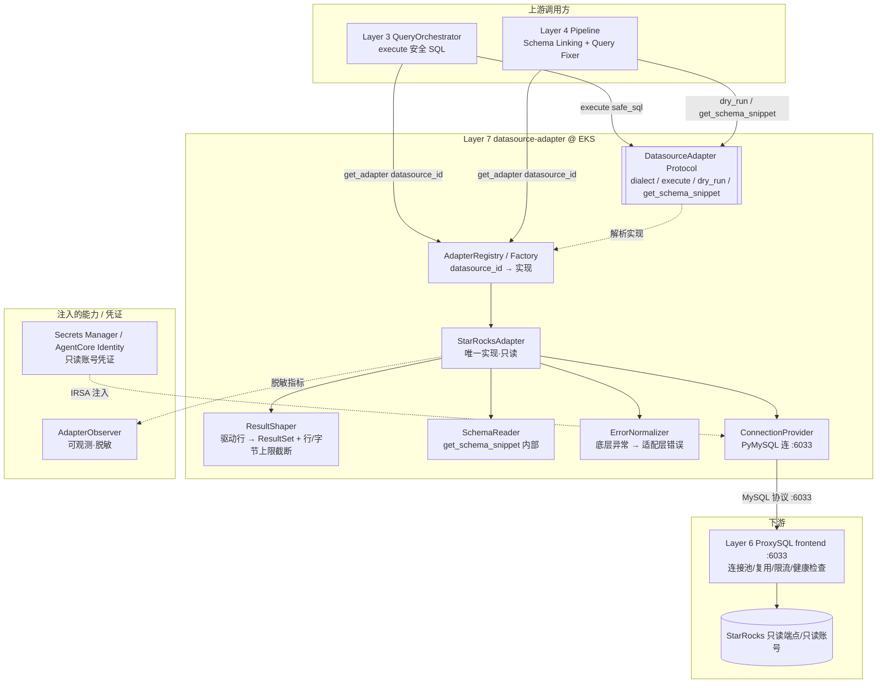
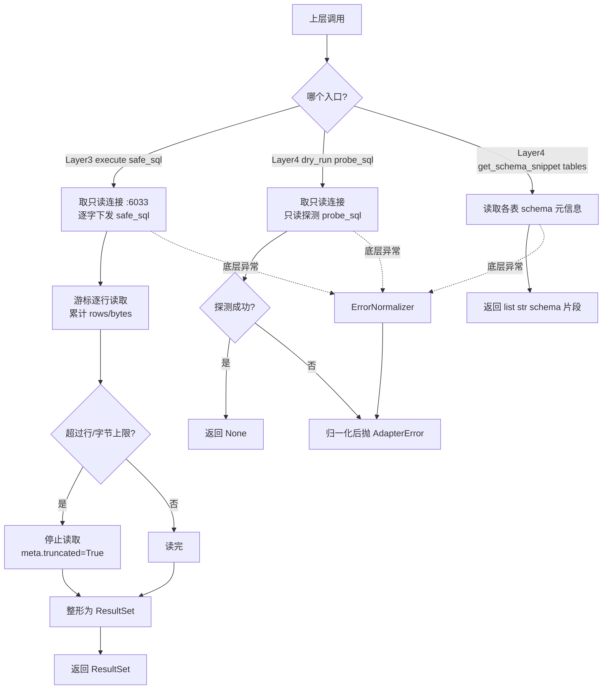
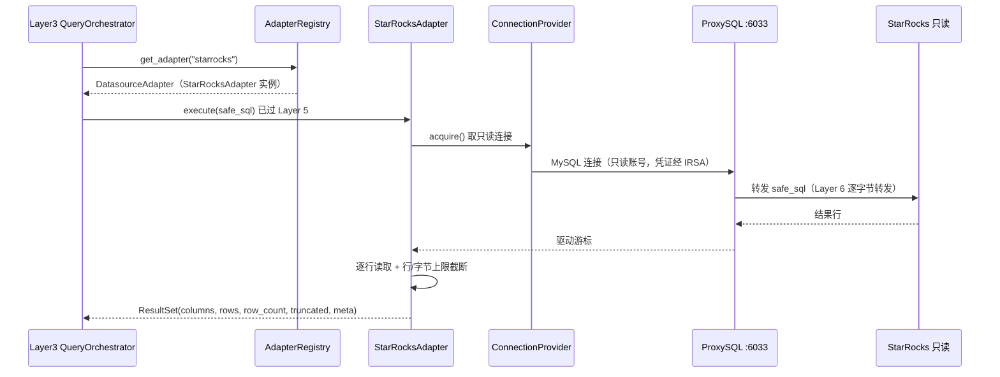
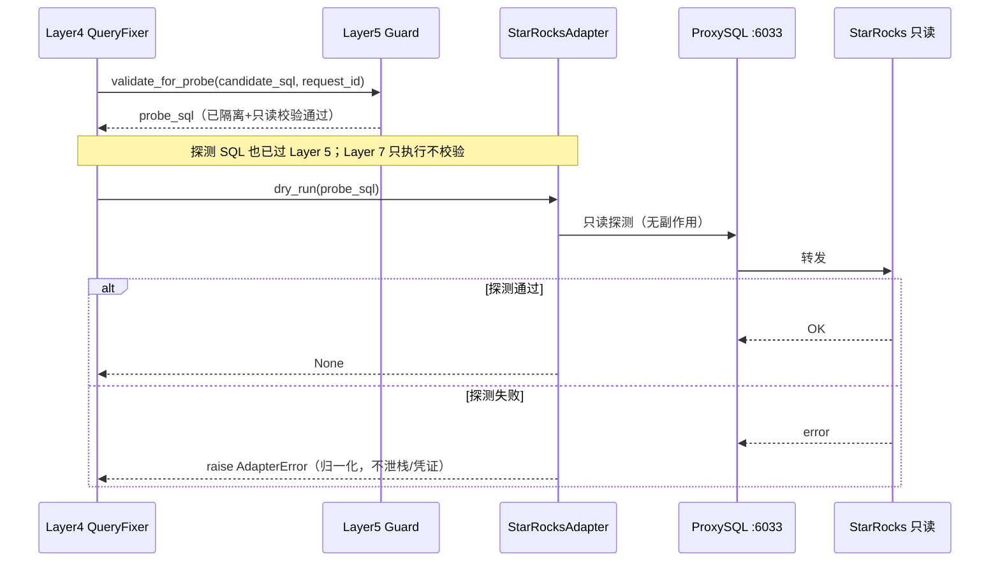

# 设计文档：Layer 7 —— datasource-adapter（可插拔数据源适配层 · StarRocks 只读）

> **所属系统**：智能问数（智能数据问答）系统 v2，见 `docs/smart-query-architecture-v2.md`
> **本文档范围**：仅覆盖 **Layer 7（datasource-adapter）** 的设计
> **设计形态**：高层设计（架构 / 组件 / 接口 / 数据模型 / 数据流图）+ 低层设计（Python 接口签名 / 伪代码 / 依赖注入契约）
> **语言约定**：团队以中文协作，本文档正文中文；代码示例用 Python（Layer 7 运行于 EKS 的 Python 服务，用标准 MySQL 驱动 PyMySQL 连 Layer 6）
> **上下游契约对齐**：
> - 与 `.kiro/specs/query-engine/design.md`（Layer 3）§3.5 对齐 —— Layer 3 经本层 `DatasourceAdapter.execute(safe_sql) -> ResultSet` 执行已由 Layer 5 校验的安全 SQL，结果 `ResultSet` 承载于 `Answer.rows`。
> - 与 `.kiro/specs/text2sql-pipeline/design.md`（Layer 4）对齐 —— Layer 4 用本层 `dialect` / `dry_run(sql) -> None`（Query Fixer 只读探测）/ `get_schema_snippet(table_names) -> list[str]`（Schema Linking 取 schema 片段）。
> - 与 `.kiro/specs/isolation-guard/design.md`（Layer 5）对齐 —— 本层只读取 `dialect`；探测 SQL 与执行 SQL **都已过 Layer 5** 校验，**本层只执行不校验**。
> - 与 `.kiro/specs/connection-proxy/design.md`（Layer 6）对齐 —— 本层经 MySQL 驱动连 ProxySQL frontend `:6033`，**绝不接触 Admin `:6032`**；连接池 / 复用 / 限流 / 健康检查全归 Layer 6。
> - **本文档是 `ResultSet` 数据模型的 owner**：此前 Layer 3/4/5 各层均以 `"ResultSet"` 前向引用，其权威定义在此（§4.1）。

---

## Overview

Layer 7（datasource-adapter）是智能问数系统**最下游的物理执行层**，是一个运行在 EKS 上的 Python 适配层。它的唯一使命是：把上游（Layer 3 执行、Layer 4 探测 / Schema Linking）交下来的**已由 Layer 5 校验的安全 SQL**，通过标准 MySQL 驱动（PyMySQL）经 Layer 6（ProxySQL frontend `:6033`）送达 StarRocks **只读端点**，并把方言差异、结果整形、schema 读取、错误归一化**封装在实现类内部**，向上层只暴露一个稳定的**抽象契约**。

本层定义一个 `DatasourceAdapter` **Protocol** 与一个**按 `datasource_id` 取实现的注册表 / 工厂**；当前唯一实现是 **StarRocks（只读）**，但抽象为"新增源只加实现类、不改上层"预留了扩展点（预留 MySQL / Spark，当前不实现）。本层也是 `ResultSet` 数据模型的**归属者**——此前上游各层只前向引用它，其字段语义（列名、行、行数、截断标志与元数据）由本文档定义。

必须澄清的两条设计红线：其一，**只读账号是第二 / 第三道防线**——它与 Layer 5 的确定性只读 AST 校验、Layer 6 的只读路由**三道彼此独立**，即便前两道有漏，DB 只读账号也最终拒写；本层**不做**只读 AST 校验（那是 Layer 5），**不生成 / 不改写 SQL**，**假定传入的 SQL 已经安全**。其二，**本层不持有连接池、不做健康检查、不限流**（那是 Layer 6）；本层只在 Layer 6 提供的连接之上做**方言连接 + 执行 + 结果整形 + 错误归一化**，并对结果施加**最大行数 / 字节上限**、超限则截断并在 `ResultSet` 元数据标记（这是"结果规模保护"，区别于 Layer 6 的"连接并发保护"）。

---

## 1. 目的与范围（Purpose & Scope）

### 1.1 目的

Layer 7 把"如何真正跑一条 SQL、拿回一批行"这件与**具体数据源方言 / 驱动 / 连接细节**强相关的重活，收拢到一个可插拔的抽象背后，使上层（Layer 3/4）只依赖 `DatasourceAdapter` 接口而非某个具体数据库。它让 Layer 5 的安全成果**真正落地执行**，同时用只读账号兜住"万一"，用结果上限兜住"超大结果集撑爆内存 / 回包"。

### 1.2 核心设计洞察（必须落地）

- **抽象在上、方言在下**：`DatasourceAdapter` 是稳定 Protocol；方言差异 / 结果整形 / schema 读取 / 错误归一化**全封在实现类**（当前 `StarRocksAdapter`）内部，上层永不 `import pymysql`、永不感知 StarRocks 细节。
- **按 `datasource_id` 取实现**：一个**注册表 / 工厂**把 `datasource_id`（如 `"starrocks"`）解析到唯一实现实例；同一 id 恒解析到同一实现（Property 10）。当前只注册 StarRocks。
- **只执行、不校验、不改写**：`execute` / `dry_run` 收到的 SQL **已过 Layer 5**；本层**逐字下发**，绝不放宽、绝不改写、绝不注入、绝不自建只读校验（Property 2）。
- **只读账号是纵深防御的一道**：本层用 StarRocks **只读账号** 连接，是三道独立只读防线的**最终兜底**（Property 1）。
- **物理连接经 Layer 6，不直连、不自建池**：本层用 MySQL 驱动连 ProxySQL frontend `:6033`，连接的复用 / 上限 / 健康检查归 Layer 6；本层**不接触 Admin `:6032`**（Property 8）。
- **结果规模保护在本层**：`execute` 施加**最大行数 / 字节上限**，超限截断并在 `ResultSet` 元数据标记 `truncated=True`（Property 3）——与 Layer 6 的连接并发保护是不同维度。
- **错误归一化**：驱动 / 网络 / 语法 / 超时等底层异常在本层归一化为**统一适配层错误类型**，不外泄驱动栈、不外泄凭证（Property 7）。
- **凭证不落明文日志**：StarRocks 只读账号凭证经 **Secrets Manager / AgentCore Identity + IRSA** 注入，任何日志 / 错误信息 / 指标都不含明文口令（Property 9）。

### 1.3 边界：Layer 7 拥有什么 / 不拥有什么

明确边界是本设计的第一原则。

| 维度 | 归属 | 说明 |
|------|------|------|
| **`DatasourceAdapter` Protocol（稳定抽象）** | ✅ **Layer 7** | 上层唯一依赖面 |
| **按 `datasource_id` 取实现的注册表 / 工厂** | ✅ **Layer 7** | `AdapterRegistry` / `get_adapter(datasource_id)` |
| **StarRocks 只读实现（当前唯一实现）** | ✅ **Layer 7** | `StarRocksAdapter` |
| **`execute(safe_sql) -> ResultSet`（Layer 3 执行安全 SQL）** | ✅ **Layer 7** | 只执行不校验 |
| **`dry_run(sql) -> None`（Layer 4 Query Fixer 只读探测）** | ✅ **Layer 7** | 成功 None，失败抛异常 |
| **`get_schema_snippet(table_names) -> list[str]`（Layer 4 Schema Linking）** | ✅ **Layer 7** | 取 schema 片段 |
| **`ResultSet` 数据模型（列名 / 行 / 行数 / 截断标志 / 元数据）** | ✅ **Layer 7（owner）** | 上游各层此前只前向引用 |
| **方言差异 / 结果整形 / schema 读取 / 错误归一化** | ✅ **Layer 7（封在实现类内）** | 上层只依赖抽象 |
| **结果最大行数 / 字节上限 + 超限截断标记** | ✅ **Layer 7** | 结果规模保护（区别于 L6 连接并发保护） |
| **只读账号凭证使用（经 Secrets / Identity + IRSA）** | ✅ **Layer 7** | 不落明文日志 |
| 权限解析（身份 → org_ids/ps_ids） | ❌ **Layer 5（isolation-guard）** | 本层不解析权限 |
| 数据隔离注入 / **确定性只读 AST 校验** | ❌ **Layer 5** | 本层不做只读校验，假定 SQL 已安全 |
| SQL 生成 / Schema Linking 编排 / 选择 / 修复 | ❌ **Layer 4（text2sql-pipeline）** | 本层不生成 / 不改写 SQL |
| 多轮改写 / 术语归一化 / 语义缓存 / 编排 | ❌ **Layer 3（query-engine）** | 本层无编排语义 |
| **连接池 / 连接复用 / 限流 / 故障隔离 / 健康检查** | ❌ **Layer 6（ProxySQL）** | 本层不自建池、不健康检查、不限流 |
| MySQL 协议路由 / 后端并发上限 | ❌ **Layer 6** | 本层经 `:6033` 使用，不碰 Admin `:6032` |
| 认证 / 边缘限流 | ❌ **Layer 2（api-gateway）** | 与本层无关 |

> **铁律 1**：`execute` / `dry_run` 收到的 SQL **默认已由 Layer 5 校验为安全只读 SQL**；本层**只执行不放宽、不改写**，不存在"本层再放行一点"或"本层自己校验一遍只读"的代码路径。
> **铁律 2**：本层所有 backend 连接**只**使用 StarRocks **只读账号**，经 Layer 6 `:6033`；本层**不直连 StarRocks、不自建连接池、不接触 Admin `:6032`**。
> **铁律 3**：`ResultSet` 一旦超出行 / 字节上限即**截断并标记**，绝不无上限地把海量行加载进内存或回传上层。

### 1.4 复用与许可约束

- **标准 MySQL 驱动 PyMySQL**（MIT）连接 Layer 6 frontend `:6033`（StarRocks 对外为 MySQL 协议，经 ProxySQL 代理）。
- **不自研连接池**：连接复用 / 上限 / 健康检查由 Layer 6（ProxySQL）承担，本层只"如何连它、如何跑一条 SQL、如何整形结果"。
- **凭证托管**：StarRocks 只读账号凭证经 **Secrets Manager / AgentCore Identity** 托管，EKS Pod 经 **IRSA** 取密钥（对齐架构文档 D4 / D6 与 Layer 6 §1.4）；凭证**不落明文日志、不写入镜像**。
- **可插拔抽象**：对齐架构决策 **D6**——`DatasourceAdapter` 接口当前只接 StarRocks，预留 MySQL / Spark；**现在不实现多源，但不写死单源**。

---

## Architecture

## 2. 高层架构（High-Level Architecture）

### 2.1 总体思想

Layer 7 = **一个稳定的 `DatasourceAdapter` Protocol** + **一个按 `datasource_id` 取实现的注册表 / 工厂** + **当前唯一实现 `StarRocksAdapter`**。上层（Layer 3/4）只拿到 Protocol 视图，经工厂解析出实现，调用 `execute` / `dry_run` / `get_schema_snippet`。实现类内部经注入的 `ConnectionProvider`（连 Layer 6 `:6033`）取连接、执行、把驱动返回整形为 `ResultSet`、把底层异常归一化为适配层错误。所有外部能力（连接、凭证、可观测）通过**依赖注入**提供，实现可 mock、可独立测试。



### 2.2 三个关键机制

1. **抽象 / 实现分离（Protocol + Factory）**：`DatasourceAdapter` 是上层唯一依赖面；`AdapterRegistry` 把 `datasource_id` 解析到实现。上层不 `new` 具体实现、不知道 StarRocks 存在。所有已注册实现满足同一 Protocol（Property 4），同一 id 恒解析到同一实现（Property 10）。
2. **结果规模保护（行 / 字节上限 + 截断标记）**：`execute` 边读驱动游标边计行数 / 累计字节，达上限即停止读取、`truncated=True` 记入 `ResultSet.meta`。避免海量结果撑爆内存 / 回包（Property 3）。
3. **错误归一化 + 凭证脱敏**：底层驱动 / 网络 / 超时 / 语法异常统一转为 `AdapterError` 子类，错误消息**不含驱动栈细节、不含凭证**（Property 7/9）。

### 2.3 三个入口的数据流（execute / dry_run / get_schema_snippet）



### 2.4 一次典型执行（Layer 3 execute 的时序）



### 2.5 Query Fixer 只读探测的时序（Layer 4 → Layer 5 → Layer 7）



---

## Components and Interfaces

## 3. 组件与接口（高层）

一个对外抽象（Protocol）、一个工厂、一个实现，加若干注入的内部协作者。

### 3.1 组件一：`DatasourceAdapter`（对外稳定抽象 · 上层唯一依赖面）

**职责**：定义上层依赖的最小执行契约。**逐字段与既有层一致**（见 query-engine §3.5、isolation-guard §1.3、text2sql-pipeline 探测契约），本文档不发明新签名，只补齐既有前向引用的完整定义。

**接口**：
```python
from typing import Protocol

class DatasourceAdapter(Protocol):
    """可插拔数据源适配抽象。当前唯一实现 StarRocks（只读）。
    收到的 SQL 均已由 Layer 5 校验；本层只执行不校验、不改写。"""

    dialect: str
    """数据源方言标识，如 "starrocks"。供 Layer 5 只读校验 / 注入使用（Layer 5 只读取此字段）。"""

    def execute(self, safe_sql: str) -> "ResultSet":
        """Layer 3 执行入口：执行已由 Layer 5 校验的安全 SQL，返回结果集。
        施加最大行数/字节上限，超限截断并在 ResultSet.meta 标记 truncated。"""
        ...

    def dry_run(self, sql: str) -> None:
        """Layer 4 Query Fixer 只读探测：探测 SQL 也已过 Layer 5。
        成功返回 None；失败抛 AdapterError（不泄露驱动栈/凭证）。无副作用。"""
        ...

    def get_schema_snippet(self, table_names: list[str]) -> list[str]:
        """Layer 4 Schema Linking 取 schema 片段：返回各表的 schema 描述字符串列表。"""
        ...
```

> **说明**：`dialect` / `execute` / `dry_run` / `get_schema_snippet` 的签名分别在 Layer 3（`dialect`/`execute`）、Layer 4（`dry_run`/`get_schema_snippet`）、Layer 5（读取 `dialect`）中已前向引用；此处给出完整、权威定义，不改动任何签名。

### 3.2 组件二：`AdapterRegistry`（按 `datasource_id` 取实现的注册表 / 工厂）

**职责**：把 `datasource_id` 解析到唯一实现实例。当前只注册 `"starrocks" → StarRocksAdapter`。保证同一 id 恒解析到同一实现（Property 10），未知 id 快速失败。

**接口**：
```python
class AdapterRegistry(Protocol):
    def register(self, datasource_id: str, adapter: "DatasourceAdapter") -> None: ...
    def get_adapter(self, datasource_id: str) -> "DatasourceAdapter":
        """未注册的 datasource_id → 抛 UnknownDatasourceError。同一 id 恒返回同一实例。"""
        ...
```

### 3.3 组件三：`StarRocksAdapter`（当前唯一实现 · 只读）

**职责**：实现 `DatasourceAdapter`。内部封装：经 `ConnectionProvider` 取只读连接（连 Layer 6 `:6033`）、逐字下发 SQL、`ResultShaper` 整形结果并施加上限截断、`SchemaReader` 读取 schema 片段、`ErrorNormalizer` 归一化底层异常。`dialect = "starrocks"`。

**职责边界**：不校验只读、不注入隔离、不生成 / 改写 SQL、不自建连接池、不健康检查、不限流。

### 3.4 注入的内部协作者（实现细节，封在实现类内）

```python
from typing import Protocol, Any, Optional

class ConnectionProvider(Protocol):
    """封装"如何连 Layer 6 frontend :6033"。凭证经 Secrets/Identity + IRSA 注入。
    仅数据面 :6033，绝不接触 Admin :6032。连接池/复用/健康检查归 Layer 6。"""
    def acquire(self) -> "Connection": ...      # 取一条只读连接（借自/经由 Layer 6）
    def release(self, conn: "Connection") -> None: ...

class ResultShaper(Protocol):
    """把驱动游标整形为 ResultSet，并施加最大行数/字节上限，超限截断+标记。"""
    def shape(self, columns: list[str], cursor: Any,
              max_rows: int, max_bytes: int) -> "ResultSet": ...

class SchemaReader(Protocol):
    """读取指定表的 schema 片段（get_schema_snippet 内部委派）。"""
    def read(self, conn: "Connection", table_names: list[str]) -> list[str]: ...

class ErrorNormalizer(Protocol):
    """底层驱动/网络/超时/语法异常 → 统一 AdapterError 子类；剥除栈与凭证。"""
    def normalize(self, exc: BaseException) -> "AdapterError": ...

class SecretResolver(Protocol):
    """经 Secrets Manager / AgentCore Identity + IRSA 解析只读账号凭证引用 → 运行期值。
    解析后的明文绝不写入日志/指标/错误信息（Property 9）。"""
    def resolve(self, secret_ref: str) -> str: ...
```

---

## Data Models

## 4. 数据模型（Data Models）

### 4.1 `ResultSet`（★本层为 owner —— 上游各层此前只前向引用）

```python
from dataclasses import dataclass, field
from typing import Any, Optional

@dataclass(frozen=True)
class ResultSet:
    """数据源执行结果集 —— 本层权威定义；承载于 Layer 3 Answer.rows。

    行/字节超过上限时 truncated=True，rows 只含截断前部分（Property 3）。
    """
    columns: tuple[str, ...]                     # 列名（按查询列序）
    rows: tuple[tuple[Any, ...], ...]            # 数据行（每行与 columns 对齐）
    row_count: int                               # 实际返回的行数（= len(rows)）
    truncated: bool = False                      # ★是否因行/字节上限被截断
    meta: "ResultMeta" = field(default_factory=lambda: ResultMeta())

@dataclass(frozen=True)
class ResultMeta:
    """结果元数据（可观测；不含任何凭证/明文口令）。"""
    datasource_id: str = "starrocks"
    dialect: str = "starrocks"
    truncated: bool = False                      # 与 ResultSet.truncated 一致（便于独立传递）
    truncate_reason: Optional[str] = None        # "max_rows" | "max_bytes" | None
    applied_max_rows: Optional[int] = None       # 生效的行上限
    applied_max_bytes: Optional[int] = None      # 生效的字节上限
    approx_bytes: int = 0                        # 已累计的近似字节数
    elapsed_ms: float = 0.0                      # 执行耗时（可观测）
```

### 4.2 结果规模上限配置：`ResultLimits`

```python
@dataclass(frozen=True)
class ResultLimits:
    """结果规模保护（区别于 Layer 6 的连接并发保护）。"""
    max_rows: int = 10_000                        # 最大行数上限
    max_bytes: int = 32 * 1024 * 1024             # 最大字节上限（近似，边读边累计）
```

### 4.3 连接端点契约：`AdapterEndpoint`（连 Layer 6 `:6033`）

> 与 Layer 6 §3.3 `ProxyEndpoint` 对齐：这是**数据面**端点，绝不是 Admin `:6032`。

```python
@dataclass(frozen=True)
class AdapterEndpoint:
    """Layer 7 连 Layer 6 frontend 的数据面端点。"""
    host: str                                     # ProxySQL Service 集群内 DNS
    port: int = 6033                              # ★数据面；绝不用 6032 Admin
    username: str = "sq_ro"                       # frontend 只读账号（映射只读 hostgroup）
    default_schema: Optional[str] = None
    connect_timeout_ms: int = 3000
    # password 不出现在此结构：经 SecretResolver（Secrets/Identity + IRSA）注入，绝不硬编码/落日志
    password_secret_ref: Optional[str] = None
```

### 4.4 适配器配置：`AdapterConfig`

```python
@dataclass(frozen=True)
class AdapterConfig:
    datasource_id: str = "starrocks"
    dialect: str = "starrocks"
    endpoint: Optional[AdapterEndpoint] = None
    limits: ResultLimits = field(default_factory=ResultLimits)
    dry_run_timeout_ms: int = 10_000              # 探测超时（fail-fast）
    execute_timeout_ms: int = 60_000              # 执行超时（不超过 Layer 6 default_query_timeout）
```

### 4.5 错误模型：`AdapterError` 家族（归一化后的统一错误）

```python
class AdapterError(Exception):
    """所有适配层错误的基类。message 已脱敏：不含驱动栈细节、不含凭证。"""

class UnknownDatasourceError(AdapterError):
    """get_adapter 收到未注册的 datasource_id。"""

class ConnectionError(AdapterError):
    """无法经 Layer 6 取得连接（连接/网络失败）。"""

class QueryExecutionError(AdapterError):
    """执行/探测 SQL 时数据源返回错误（语法/权限/运行期）。"""

class QueryTimeoutError(AdapterError):
    """执行/探测超过超时上界。"""

class SchemaReadError(AdapterError):
    """读取 schema 片段失败。"""
```

> **说明**：本层**不**定义"只读违规"错误——只读校验是 Layer 5 的职责。若只读账号在 DB 侧拒写（第三道防线触发），本层归一化为 `QueryExecutionError`（数据源返回的错误），不解释其安全语义。

---

## Correctness Properties

以下为 Layer 7 必须成立的正确性属性，用全称量化陈述表达，作为实现与测试的约束。这些属性将在派生需求阶段映射为具体验收标准。

### Property 1: 只读账号执行（All Execution Uses Read-Only Account）
本层任何 `execute` / `dry_run` / schema 读取所用的连接，均使用 StarRocks **只读账号**；本层不存在使用可写账号 / 可写端点的代码路径（只读账号是三道独立防线的最终兜底）。
`∀ 操作 op ∈ {execute, dry_run, read_schema}: op.account = readonly_account ∧ op.endpoint ∈ readonly_endpoints`

**Validates: Requirements 3.1, 3.2, 3.3, 3.4, 3.5, 13.2**

### Property 2: 只执行不放宽 / 不改写（Execute As-Is, No Relaxation, No Rewrite）
`execute` / `dry_run` 下发到数据源的 SQL 与收到的入参**逐字节相同**（假定已过 Layer 5）；本层从不改写、不注入、不放宽、不自建只读校验。
`∀ sql: forwarded(sql) = received(sql) ∧ 本层不修改 sql 语义`

**Validates: Requirements 4.1, 4.2, 4.3, 4.4, 4.5**

### Property 3: 结果规模受上限约束并正确标记截断（Result Bounded and Truncation Flagged）
任意 `execute` 返回的 `ResultSet`，其行数 ≤ `max_rows` 且累计字节 ≤ `max_bytes`；当且仅当发生截断时 `truncated=True` 且 `meta.truncate_reason ∈ {max_rows, max_bytes}`。
`∀ rs = execute(_): rs.row_count ≤ max_rows ∧ rs.meta.approx_bytes ≤ max_bytes ∧ (rs.truncated ⟺ 触达任一上限)`

**Validates: Requirements 5.1, 5.2, 5.3, 5.4, 5.5, 5.6, 5.7, 5.8, 5.9**

### Property 4: 所有已注册 adapter 满足同一 Protocol（Uniform Protocol Conformance）
注册表中任意实现都实现 `DatasourceAdapter` 的全部成员（`dialect` / `execute` / `dry_run` / `get_schema_snippet`），签名一致；上层只依赖抽象即可替换实现。
`∀ a ∈ registry.values(): a 满足 DatasourceAdapter（成员齐备 ∧ 签名一致）`

**Validates: Requirements 1.1, 1.2, 1.3, 1.4, 6.1, 6.2, 6.3**

### Property 5: `dialect` 与真实源方言一致（Dialect Matches Real Source）
任意 adapter 暴露的 `dialect` 与其底层真实数据源方言一致（当前实现 `dialect == "starrocks"` 且连接的是 StarRocks）。
`∀ a: a.dialect = real_dialect_of(a.datasource)`

**Validates: Requirements 7.1, 7.2, 7.3**

### Property 6: `dry_run` 无副作用（Dry Run Has No Side Effects）
任意 `dry_run(sql)` 调用不改变数据源任何持久状态（只读探测）；成功返回 `None`，失败抛 `AdapterError`。
`∀ sql: state_after(dry_run(sql)) = state_before ∧ dry_run(sql) ∈ {None, raise AdapterError}`

**Validates: Requirements 8.1, 8.2, 8.3, 8.4**

### Property 7: 错误归一化且不泄露栈 / 凭证（Errors Normalized, No Stack/Secret Leak）
本层向上抛出的任何异常都是 `AdapterError` 子类，其消息不含底层驱动栈细节，也不含任何凭证 / 明文口令。
`∀ e 由本层抛出: e ∈ AdapterError 家族 ∧ driver_stack ∉ str(e) ∧ secret_plaintext ∉ str(e)`

**Validates: Requirements 10.1, 10.2, 10.3, 10.4, 10.5, 10.6, 10.7, 10.8, 10.9**

### Property 8: 连接经 Layer 6、不直连 / 不自建池（Connect via Layer 6, No Direct/Own Pool）
本层所有连接都经 Layer 6 frontend `:6033`；本层不直连 StarRocks、不自建连接池、不做健康检查 / 限流、不接触 Admin `:6032`。
`∀ conn: conn.target = proxysql_frontend(:6033) ∧ conn ∉ self_managed_pool ∧ :6032 ∉ 本层访问端点`

**Validates: Requirements 9.1, 9.2, 9.3, 9.4, 9.5, 9.6, 3.4**

### Property 9: 凭证不落明文日志（Secrets Never in Plaintext Logs）
只读账号凭证只经 Secrets/Identity + IRSA 在运行期解析使用；任何日志、指标、错误信息、`ResultSet` 元数据都不含明文口令。
`∀ 日志/指标/错误/元数据 r: secret_plaintext ∉ r`

**Validates: Requirements 11.1, 11.2, 11.3, 11.4, 11.5, 11.6, 11.7**

### Property 10: 同一 `datasource_id` 恒解析到同一实现（Stable Resolution by datasource_id）
对任意已注册 `datasource_id`，`get_adapter` 多次调用恒返回同一实现实例；未注册 id 则确定性地抛 `UnknownDatasourceError`。
`∀ id: (id ∈ registry ⟹ get_adapter(id) ≡ get_adapter(id)) ∧ (id ∉ registry ⟹ raise UnknownDatasourceError)`

**Validates: Requirements 2.4, 2.5, 2.6, 14.1**

---

## 5. 低层设计：接口签名与伪代码（Python）

### 5.1 依赖注入容器（`AdapterDependencies`）

所有外部能力经此注入，实现不自行 new 具体协作者 → 可 mock、可独立测试（不连真实 StarRocks / ProxySQL）。

```python
from dataclasses import dataclass

@dataclass
class AdapterDependencies:
    """注入给 StarRocksAdapter 的能力抽象。"""
    connection_provider: "ConnectionProvider"    # 连 Layer 6 :6033（凭证经 SecretResolver）
    result_shaper: "ResultShaper"                 # 驱动行 → ResultSet + 上限截断
    schema_reader: "SchemaReader"                 # get_schema_snippet 内部
    error_normalizer: "ErrorNormalizer"           # 底层异常 → AdapterError
    observer: "AdapterObserver"                   # 可观测（脱敏，不含凭证）

class AdapterObserver(Protocol):
    def on_execute(self, *, elapsed_ms: float, row_count: int,
                   truncated: bool) -> None: ...
    def on_error(self, *, kind: str) -> None: ...     # 只记错误种类，不记原文/凭证
```

### 5.2 注册表 / 工厂（`DefaultAdapterRegistry`）

```python
class DefaultAdapterRegistry:
    """按 datasource_id 取实现；当前只注册 StarRocks。"""

    def __init__(self) -> None:
        self._adapters: dict[str, "DatasourceAdapter"] = {}

    def register(self, datasource_id: str, adapter: "DatasourceAdapter") -> None:
        # 同一 id 恒指向同一实例（Property 10）；重复注册以最后一次为准（部署期一次性装配）
        self._adapters[datasource_id] = adapter

    def get_adapter(self, datasource_id: str) -> "DatasourceAdapter":
        adapter = self._adapters.get(datasource_id)
        if adapter is None:
            raise UnknownDatasourceError(f"未注册的数据源: {datasource_id}")
        return adapter          # 同一 id 恒返回同一实例（Property 10）

# —— 装配（部署期一次性）——
def build_registry(deps: "AdapterDependencies", config: "AdapterConfig") -> "AdapterRegistry":
    registry = DefaultAdapterRegistry()
    registry.register("starrocks", StarRocksAdapter(deps, config))   # 当前唯一实现
    return registry
```

### 5.3 StarRocks 实现（`StarRocksAdapter`）—— 三入口

```python
class StarRocksAdapter:
    """DatasourceAdapter 的 StarRocks 只读实现。方言/整形/schema/错误封在此类内。"""

    def __init__(self, deps: "AdapterDependencies", config: "AdapterConfig") -> None:
        self._deps = deps
        self._config = config
        self.dialect = config.dialect               # "starrocks"（Property 5）

    # —— 入口 A：Layer 3 执行安全 SQL ——
    def execute(self, safe_sql: str) -> "ResultSet":
        """safe_sql 已过 Layer 5；本层逐字下发，只执行不校验/不改写（Property 2）。"""
        conn = self._deps.connection_provider.acquire()       # 连 Layer 6 :6033（Property 1/8）
        try:
            cursor = self._run(conn, safe_sql, self._config.execute_timeout_ms)
            columns = self._columns_of(cursor)
            # 边读边计行/字节，超限截断并标记（Property 3）
            rs = self._deps.result_shaper.shape(
                columns, cursor,
                max_rows=self._config.limits.max_rows,
                max_bytes=self._config.limits.max_bytes)
            self._deps.observer.on_execute(
                elapsed_ms=rs.meta.elapsed_ms,
                row_count=rs.row_count, truncated=rs.truncated)
            return rs
        except BaseException as exc:
            raise self._deps.error_normalizer.normalize(exc)  # 归一化，脱敏（Property 7/9）
        finally:
            self._deps.connection_provider.release(conn)

    # —— 入口 B：Layer 4 Query Fixer 只读探测 ——
    def dry_run(self, sql: str) -> None:
        """sql 也已过 Layer 5；只读探测，无副作用（Property 6）。成功 None，失败抛。"""
        conn = self._deps.connection_provider.acquire()
        try:
            self._probe(conn, sql, self._config.dry_run_timeout_ms)   # 只探测不取全量结果
            return None
        except BaseException as exc:
            raise self._deps.error_normalizer.normalize(exc)
        finally:
            self._deps.connection_provider.release(conn)

    # —— 入口 C：Layer 4 Schema Linking 取 schema 片段 ——
    def get_schema_snippet(self, table_names: list[str]) -> list[str]:
        conn = self._deps.connection_provider.acquire()
        try:
            return self._deps.schema_reader.read(conn, table_names)
        except BaseException as exc:
            raise self._deps.error_normalizer.normalize(exc)
        finally:
            self._deps.connection_provider.release(conn)

    # —— 内部：执行/探测（省略驱动细节；只读账号连接由 provider 保证）——
    def _run(self, conn, sql: str, timeout_ms: int): ...      # 逐字下发 sql，返回游标
    def _probe(self, conn, sql: str, timeout_ms: int) -> None: ...
    def _columns_of(self, cursor) -> list[str]: ...
```

### 5.4 结果整形 + 上限截断（`ResultShaper` 伪代码）

```pascal
ALGORITHM shape(columns, cursor, max_rows, max_bytes)
INPUT: columns（列名）, cursor（驱动游标）, max_rows, max_bytes
OUTPUT: rs of type ResultSet

BEGIN
  rows ← []
  approx_bytes ← 0
  truncated ← false
  reason ← NULL

  WHILE cursor.has_next() DO
    // 行数上限（Property 3）
    IF length(rows) ≥ max_rows THEN
      truncated ← true
      reason ← "max_rows"
      BREAK
    END IF

    row ← cursor.next()
    row_bytes ← approx_size(row)

    // 字节上限（Property 3）：加入后会超则不加入、标记截断
    IF approx_bytes + row_bytes > max_bytes THEN
      truncated ← true
      reason ← "max_bytes"
      BREAK
    END IF

    rows.append(row)
    approx_bytes ← approx_bytes + row_bytes
  END WHILE

  ASSERT length(rows) ≤ max_rows
  ASSERT approx_bytes ≤ max_bytes

  meta ← ResultMeta(truncated=truncated, truncate_reason=reason,
                    applied_max_rows=max_rows, applied_max_bytes=max_bytes,
                    approx_bytes=approx_bytes)
  RETURN ResultSet(columns=tuple(columns), rows=tuple(rows),
                   row_count=length(rows), truncated=truncated, meta=meta)
END
```

**前置条件**：`columns` 非空且与游标列序对齐；`max_rows ≥ 0`、`max_bytes ≥ 0`；`cursor` 来自只读账号连接。
**后置条件**：`rs.row_count ≤ max_rows` 且 `rs.meta.approx_bytes ≤ max_bytes`；`rs.truncated ⟺ 触达任一上限`（Property 3）。
**循环不变式**：每次迭代结束时 `length(rows) ≤ max_rows ∧ approx_bytes ≤ max_bytes`。

### 5.5 连接提供者（`ConnectionProvider` 实现要点 · 连 Layer 6 `:6033`）

```python
import pymysql   # 标准 MySQL 驱动（StarRocks 走 MySQL 协议，经 ProxySQL）

class ProxyConnectionProvider:
    """连 Layer 6 frontend :6033。凭证经 SecretResolver（Secrets/Identity + IRSA）注入。
    ★不自建连接池、不健康检查、不限流（Property 8）——那些归 Layer 6。
    ★绝不接触 Admin :6032；凭证绝不落明文日志（Property 9）。"""

    def __init__(self, endpoint: "AdapterEndpoint", secrets: "SecretResolver") -> None:
        self._ep = endpoint
        self._secrets = secrets

    def acquire(self) -> "Connection":
        password = self._secrets.resolve(self._ep.password_secret_ref)  # 运行期解析，不日志化
        return pymysql.connect(
            host=self._ep.host, port=self._ep.port,     # 6033 数据面（绝不 6032）
            user=self._ep.username, password=password,  # 只读账号（Property 1）
            database=self._ep.default_schema,
            connect_timeout=self._ep.connect_timeout_ms / 1000,
            autocommit=True,                            # 只读查询，利于 Layer 6 multiplexing
        )

    def release(self, conn: "Connection") -> None:
        conn.close()        # 归还给 Layer 6（复用/上限由 Layer 6 承担）
```

### 5.6 错误归一化（`ErrorNormalizer` 要点）

```python
class DefaultErrorNormalizer:
    """底层异常 → AdapterError 家族；剥离驱动栈与凭证（Property 7/9）。"""

    def normalize(self, exc: BaseException) -> "AdapterError":
        # 只依据异常类型/错误码归类，不把驱动原始 message（可能含连接串/凭证）直接透出
        if _is_timeout(exc):
            return QueryTimeoutError("数据源执行超时")
        if _is_connection(exc):
            return ConnectionError("无法连接数据源（经连接代理层）")
        if _is_query_error(exc):
            return QueryExecutionError(f"数据源执行错误: {_safe_code(exc)}")  # 只带脱敏错误码
        return AdapterError("数据源适配层未预期错误")
```

---

## Error Handling

## 6. 错误处理（Error Handling）

| 场景 | 本层行为 | 向上返回 | 恢复 |
|------|---------|---------|------|
| `get_adapter` 收到未注册 `datasource_id` | 快速失败 | `UnknownDatasourceError` | 修正 id / 注册实现 |
| 无法经 Layer 6 取连接（网络 / backend 全 SHUNNED） | 归一化，不重试自建连接 | `ConnectionError` | Layer 6 Monitor 恢复后自愈 |
| `execute` / `dry_run` 数据源返回错误（语法 / 运行期 / 只读账号拒写） | 归一化，脱敏 | `QueryExecutionError` | 由上层依据语义处理 |
| 执行 / 探测超过超时上界 | 中断，归一化 | `QueryTimeoutError` | 无（fail-fast） |
| 结果超过行 / 字节上限 | **不报错**：截断并 `truncated=True` 标记 | 正常 `ResultSet`（截断） | 上层可据 `meta` 决定是否收窄查询 |
| `get_schema_snippet` 读取失败 | 归一化 | `SchemaReadError` | 重试 / 检查表名 |
| 凭证解析失败（启动 / 运行期） | fail-closed，不降级为无凭证连接 | `ConnectionError`（脱敏） | 修复 Secrets/IRSA |

> **原则**：本层错误一律**归一化为 `AdapterError` 家族、脱敏、显式**；绝不静默吞掉，绝不在错误信息 / 日志 / 指标中回显驱动栈或凭证（Property 7/9）。**结果超限是正常路径（截断标记），不是错误**（Property 3）。

---

## Testing Strategy

以下测试策略用于验证 Layer 7 各项职责，均对齐前述 Correctness Properties：

- **只读账号 / 连接端点单元测试**：对 `ProxyConnectionProvider` 注入 mock `SecretResolver`，断言连接总是使用只读账号、端点端口恒为 `:6033`（绝不 `:6032`）、且解析后的口令不出现在任何日志 / 指标（对应 Property 1/8/9）。
- **只执行不改写测试**：断言 `execute` / `dry_run` 下发到（mock）连接的 SQL 与入参逐字节相等，本层不做任何改写 / 注入 / 只读校验（对应 Property 2）。
- **结果上限 / 截断属性测试（property-based）**：对随机行数 / 行大小的驱动游标，断言 `ResultSet.row_count ≤ max_rows`、`meta.approx_bytes ≤ max_bytes`，且 `truncated` 当且仅当触达上限时为真、`truncate_reason` 正确（对应 Property 3）。建议库：Hypothesis。
- **Protocol 一致性测试**：对注册表中每个实现断言其满足 `DatasourceAdapter` 全部成员与签名（对应 Property 4）。
- **方言一致性测试**：断言 `StarRocksAdapter.dialect == "starrocks"` 且连接的底层为 StarRocks（对应 Property 5）。
- **`dry_run` 无副作用测试**：探测前后数据源状态不变；成功返回 `None`、失败抛 `AdapterError`（对应 Property 6）。
- **错误归一化 / 脱敏测试**：注入抛出携带"栈 + 连接串 + 口令"的底层异常，断言向上抛出的恒为 `AdapterError` 子类且消息不含栈 / 凭证（对应 Property 7/9）。
- **注册表解析稳定性测试**：同一 `datasource_id` 多次 `get_adapter` 返回同一实例，未注册 id 抛 `UnknownDatasourceError`（对应 Property 10）。
- **集成测试（三道只读防线联合）**：对只读账号提交写语句，验证即便绕过前两道，DB 只读账号最终拒写并被归一化为 `QueryExecutionError`（对应 Property 1）。

---

## 7. 依赖（Dependencies）

| 依赖 | 用途 | 备注 |
|------|------|------|
| **PyMySQL**（标准 MySQL 驱动） | 连 Layer 6 frontend `:6033` 执行 SQL | MIT；StarRocks 走 MySQL 协议 |
| **Layer 6（ProxySQL）frontend `:6033`** | 提供连接 / 复用 / 限流 / 健康检查 | 本层不自建池、不碰 Admin `:6032` |
| **StarRocks 只读端点 + 只读账号** | 唯一目标数据源（当前） | 只读账号是三道防线的最终兜底 |
| **Secrets Manager / AgentCore Identity** | 只读账号凭证托管 | 经 IRSA 注入（对齐 D4 / D6 与 Layer 6 §1.4） |
| **EKS + IRSA** | 常驻运行载体 + Pod 取密钥 | 与 query-engine / connection-proxy 同集群 |

---

## 8. 上下游契约对齐小结（Contract Alignment Summary）

- **上游 Layer 3（query-engine）**：经 `DatasourceAdapter.execute(safe_sql) -> ResultSet` 执行已由 Layer 5 校验的安全 SQL，`ResultSet` 承载于 `Answer.rows`。本层为 `ResultSet` 的 owner。
- **上游 Layer 4（text2sql-pipeline）**：用 `dialect`、`dry_run(sql) -> None`（Query Fixer 只读探测，探测 SQL 必经 Layer 5 `validate_for_probe`）、`get_schema_snippet(table_names) -> list[str]`（Schema Linking）。**本层只执行不校验**。
- **间接上游 Layer 5（isolation-guard）**：Layer 5 只读取本层 `dialect`；`execute` / `dry_run` 的入参**都已过 Layer 5** 校验。
- **下游 Layer 6（connection-proxy）**：经 MySQL 驱动连 ProxySQL frontend `:6033`，**不接触 Admin `:6032`**；连接池 / 复用 / 限流 / 健康检查全归 Layer 6，本层只在其连接之上执行与整形。
- **凭证**：StarRocks 只读账号凭证经 Secrets Manager / AgentCore Identity 托管，Pod 经 IRSA 获取；凭证不落明文日志（对齐 D4 / D6）。
