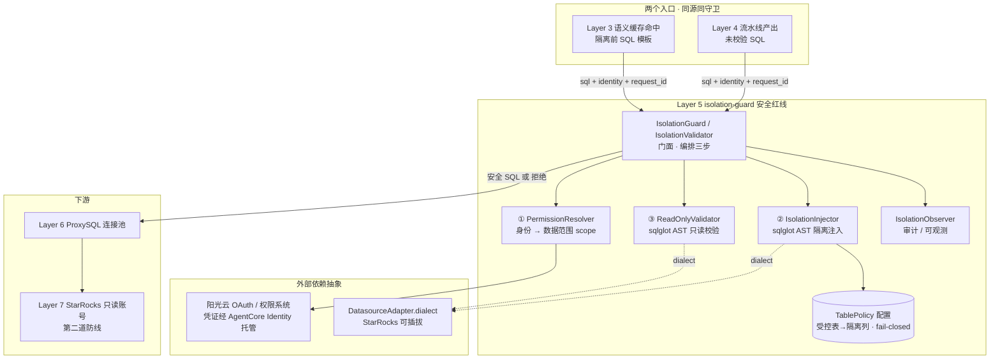
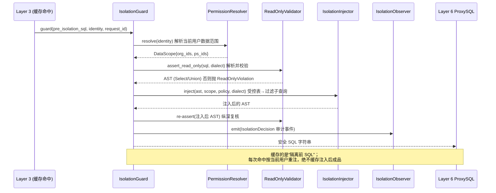
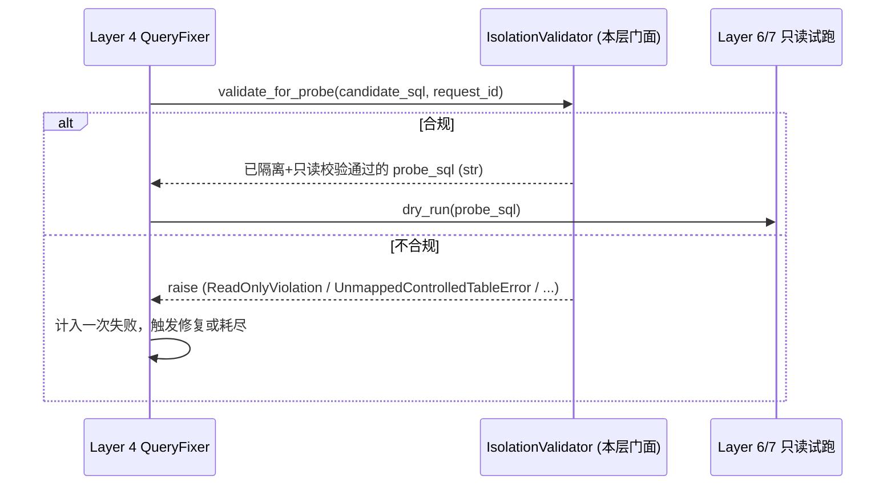
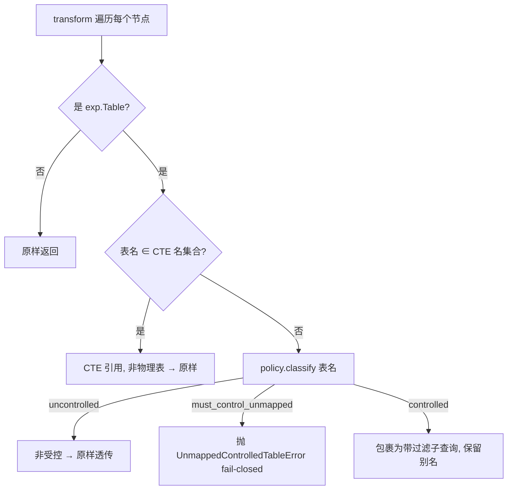

# 设计文档：Layer 5 —— isolation-guard（隔离守卫 · 安全红线）

> **所属系统**：智能问数（智能数据问答）系统 v2，见 `docs/smart-query-architecture-v2.md`
> **本文档范围**：仅覆盖 **Layer 5（isolation-guard）** 的设计
> **设计形态**：高层设计（架构 / 组件 / 接口 / 数据模型 / 数据流图）+ 低层设计（Python 接口签名 / 伪代码 / 形式化规约：前置条件 / 后置条件 / 循环不变式）
> **语言约定**：团队以中文协作，本文档正文中文；代码示例用 Python（服务运行于 EKS 的 Python 服务）
> **上游契约**：与 `.kiro/specs/text2sql-pipeline/design.md`（Layer 4）保持一致 —— 本层向 Layer 4 Query Fixer 暴露 `IsolationValidator.validate_for_probe(sql, request_id) -> str`

---

## Overview

## 1. 目的与范围（Purpose & Scope）

### 1.1 目的

Layer 5 是整个智能问数系统的**安全红线（Security Red Line）**。它接收一条**未经安全校验的 SQL**（来自 Layer 4 流水线产出，或来自 Layer 3 语义缓存命中），连同**调用方身份**，以**确定性（deterministic）、硬编码（hardcoded）、不可绕过（non-bypassable）**的方式完成三件事，最终输出一条**已注入数据隔离且通过只读校验的安全 SQL**，否则**拒绝并抛出异常**：

1. **权限解析（Permission Resolution）**：调用方身份 → 数据范围 `scope`。scope 由 `ScopeResolver` **查询阳光云权限表**（`sys_user_ps_share` / `sys_user_org` / `sys_org_all_sub_org` / `power_station_org` 等，与业务数据同库可 join，见 §5A）解析得出，本质是"当前用户可见的 `ps_id` 集合 + 可见的 `org_id` 集合"。scope 既可物化为 id 集合，也可表达为**权限子查询源**（见 §5A.3）。身份 / 权限凭证可经 **AgentCore Identity** 托管。
2. **隔离条件注入（Isolation Injection）**：使用 **sqlglot** 做**确定性 AST 改写**，把每一个受控物理表包裹成"带过滤的子查询"，贴着表注入隔离谓词。**默认采用半连接子查询注入**（`col IN (<权限子查询>)`，见 §5A.3），集合较小或权限表不同库时退回物化 `IN (<字面量>)`。隔离列按表分三类绑定（见 §5A.2）：直接 `ps_id` 列、**`ps_key` 列按前缀取 `ps_id`**（`split_part(ps_key,'_',1)`）、`org_id` 列。非受控表原样透传。改写对 **JOIN / 子查询 / CTE / UNION / 别名** 全部健壮。
3. **只读强制校验（Read-Only Enforcement）**：解析 AST，拒绝任何非 SELECT 语句（INSERT/UPDATE/DELETE/DROP/ALTER/…），拒绝多语句。第二道防线 = 数据库只读账号。

### 1.2 核心设计洞察（必须落地）

- **确定性 · 硬编码 · 不可绕过**：隔离与只读逻辑**全部在代码层完成，绝不依赖 LLM**。这与 SQLBot「行/列隔离靠 LLM 改写 + 闭源 `sqlbot_xpack`」的做法形成鲜明对比 —— 我们**不信任 LLM 的隔离结果**，任何绕过都视为安全事故。
- **单一守卫、双入口同源**：Layer 4 流水线产出的 SQL 与 Layer 3 缓存命中的 SQL，**走完全相同的守卫**，并**按当前用户重新注入隔离**。**严禁缓存注入后的成品 SQL**（否则跨用户越权泄露）。
- **fail-closed（失败即拒绝）**：对"必须受控却未在配置中映射"的表，**拒绝**而非放行；空 scope 语义为 **deny-all（不返回任何行）**。
- **对 architecture 文档参考实现的强化**：本设计在 `docs/smart-query-architecture-v2.md` 的 `assert_read_only(sql, dialect)` 与 `inject_isolation(sql, scope, dialect)` 基础上**加固**（表→带过滤子查询包裹、CTE 名规避、别名保留、类型化字面量转义、fail-closed 策略、可观测审计）。

### 1.3 边界：Layer 5 拥有什么 / 不拥有什么

明确边界是本设计的第一原则。

| 维度 | 归属 | 说明 |
|------|------|------|
| **接收未校验 SQL + 调用方身份** | ✅ **Layer 5 入口** | 两个入口：Layer 4 流水线产出 / Layer 3 缓存命中 |
| **权限解析（身份 → org_ids/ps_ids）** | ✅ **Layer 5** | 经 `PermissionResolver` 抽象外部权限服务（可 mock） |
| **隔离注入（sqlglot AST 改写）** | ✅ **Layer 5** | 受控表 → 带过滤子查询 |
| **只读强制校验（禁非 SELECT / 禁多语句）** | ✅ **Layer 5** | sqlglot AST 校验 |
| **输出安全 SQL / 拒绝** | ✅ **Layer 5 出口** | 交 Layer 6 连接池执行 |
| SQL 生成 / Schema Linking / 选择 / 修复 | ❌ **Layer 4** | Layer 5 只接收其"未校验 SQL"产出 |
| 多轮改写 / 术语归一化 / 语义缓存 | ❌ **Layer 3** | 缓存命中路径直接进 Layer 5 重注隔离 |
| 连接池 / 限流 / 故障隔离 | ❌ **Layer 6（ProxySQL）** | Layer 5 不持有连接，经适配层间接使用 |
| 物理执行 / 方言连接 / 只读账号 | ❌ **Layer 7（DatasourceAdapter）** | Layer 5 只读取 `dialect`；只读账号是第二道防线 |

> **铁律**：Layer 5 的输出**要么是"已隔离 + 只读校验通过的安全 SQL"，要么是"明确的拒绝"**。不存在"部分校验"或"绕过"的中间态。

### 1.4 复用与许可约束

- **只读校验借鉴 pandas-ai 的 `is_sql_query_safe` 思路**（关键字黑名单 + AST 校验），**重新实现，不复制其源码**。
- **WrenAI 的 RLAC/CLAC（Apache-2.0）** 是概念上的"兄弟方案"（计划层确定性行列隔离），但本期**选择自研 sqlglot**（透明、纯 Python、与栈一致、无需引入 MDL 建模范式）。见 §12 权衡。
- **不借鉴 SQLBot 的隔离实现**（其依赖闭源 xpack 且靠 LLM 改写，与本层"确定性、不可绕过"的红线相悖）。

---

## Architecture

## 2. 高层架构（High-Level Architecture）

### 2.1 总体思想

Layer 5 = **一个门面（`IsolationGuard` / `IsolationValidator`）** 顺序驱动**三个确定性子步骤**，每个子步骤是一个可独立测试、可 mock 的组件：



### 2.2 三个子步骤的执行顺序与理由

**固定顺序：① 权限解析 → ③ 只读校验 → ② 隔离注入 → 复核。**

1. **① 权限解析**先行：拿到 `scope`，若身份不可解析则**立即 fail-closed** 拒绝（无需解析 SQL）。
2. **③ 只读校验**在注入前：先确保输入是"单条 SELECT/UNION"，拒绝一切写操作与多语句。**只有合法查询才值得被注入**，且注入器只需处理查询形态的 AST，降低复杂度。
3. **② 隔离注入**：在已知安全的查询 AST 上做确定性改写。
4. **复核（re-assert）**：对注入产物再跑一次只读校验，确保改写未意外引入非查询节点（纵深防御）。

> 注意：**解析只做一次**。门面内部把 sqlglot AST 在只读校验、注入、复核之间传递，避免重复 parse 带来的不一致与开销。

### 2.3 一次典型执行（缓存命中路径 —— 重注隔离）



### 2.4 与 Layer 4 Query Fixer 的交互（探测执行入口）

Layer 4 的 `BoundedRetryFixer` 在探测执行前，必须先经本层：



> `validate_for_probe` 与主守卫路径**共享同一实现内核**（`_apply`），保证"探测所见即执行所得"。门面实例在**每请求**构造，已绑定调用方身份，故 `validate_for_probe` 无需再传 identity（与 Layer 4 契约一致）。

---

## Components and Interfaces

## 3. 组件与接口（高层）

四个组件 + 一个可观测抽象。门面负责编排，三个子组件各司一步，均可独立 mock 测试。

### 3.1 组件一：`PermissionResolver`（权限解析 · 抽象外部权限服务）

**职责**：把可信的调用方身份解析为数据范围 `DataScope{org_ids, ps_ids}`。抽象阳光云 OAuth / 权限系统，凭证可经 AgentCore Identity 托管。**必须可 mock**（本层测试与本地开发不依赖真实权限服务）。

**接口**：
```python
class PermissionResolver(Protocol):
    def resolve(self, identity: "CallerIdentity") -> "DataScope": ...
```

**职责边界**：
- 只做"身份 → 范围"，不接触 SQL。
- 身份无法解析（token 失效 / 权限系统不可达 / 用户无任何授权范围）→ 抛 `PermissionResolutionError`（fail-closed）。
- 允许返回**空 scope**（用户已认证但无任何数据授权）—— 这是合法结果，语义为 deny-all（见 §5.5），**不是错误**。

### 3.2 组件二：`IsolationInjector`（隔离注入 · sqlglot 确定性 AST 改写）

**职责**：在已通过只读校验的查询 AST 上，把每个**受控物理表**替换为"带隔离过滤的子查询"，非受控表原样透传，未映射的必控表 fail-closed。

**接口**：
```python
class IsolationInjector(Protocol):
    def inject(self, ast: "exp.Expression", scope: "DataScope",
               policy: "TablePolicy", dialect: str) -> "exp.Expression": ...
```

**职责边界**：
- 只做确定性 AST 改写，不调用 LLM、不访问数据库。
- 输入 AST 已由 `ReadOnlyValidator` 保证是单条 Select/Union。
- 对 JOIN / 子查询 / CTE / UNION / 别名健壮（见 §5 深入算法）。

### 3.3 组件三：`ReadOnlyValidator`（只读强制校验 · sqlglot AST）

**职责**：解析 SQL 为 AST，强制单条语句且顶层为查询，树内不得含任何写 / DDL / 命令节点。

**接口**：
```python
class ReadOnlyValidator(Protocol):
    def parse_single(self, sql: str, dialect: str) -> "exp.Expression":
        """解析并强制单语句；多语句/空/解析失败 → ReadOnlyViolation。"""
        ...
    def assert_read_only(self, ast: "exp.Expression") -> None:
        """顶层必须是 Select/Union；树内禁止任何 FORBIDDEN 节点，否则 ReadOnlyViolation。"""
        ...
```

### 3.4 组件四（门面）：`IsolationGuard` / `IsolationValidator`

**职责**：编排三步，对外提供两个入口：
- `guard(sql, request_id) -> GuardResult`：主守卫路径（Layer 3 缓存命中 / Layer 4 产出 → 执行前），返回结构化结果（含审计信息）。
- `validate_for_probe(sql, request_id) -> str`：Layer 4 Query Fixer 探测专用，返回安全 SQL 字符串或抛异常（与 Layer 4 契约一致）。

**接口**：
```python
class IsolationValidator(Protocol):
    """暴露给 Layer 4 Query Fixer 的最小契约（与 text2sql-pipeline 设计对齐）。"""
    def validate_for_probe(self, sql: str, request_id: str) -> str: ...
```

`IsolationGuard` 是其唯一生产实现，同时提供更丰富的 `guard(...)`。门面在**每请求**构造并绑定 `CallerIdentity`；`DataScope` 在首次使用时解析并缓存于实例（同一请求内一致）。

---

## Data Models

## 4. 数据模型（Data Models）

### 4.1 身份与数据范围

> **注**：下面的 `DataScope`（两个 id 集合）是基础形态。本项目按 §5A 细化为"可见 ps_id 源 + 可见 org_id 源"，每个源可为物化集合或权限子查询源（`ScopeSource`）；以 §5A 为准。

```python
from dataclasses import dataclass, field
from enum import Enum
from typing import Protocol, Optional, Union, Iterable

# 隔离列取值可能是数值 id（如 ps_id）或字符串 id（如 org 编码），统一支持
ScopeId = Union[int, str]


@dataclass(frozen=True)
class CallerIdentity:
    """可信调用方身份 —— 由 Layer 2 认证（阳光云 OAuth）透传而来。"""
    user_id: str                          # 稳定用户标识（审计用）
    oauth_subject: Optional[str] = None   # OAuth sub
    tenant: Optional[str] = None          # 可选：多租户标识
    # 原始声明只读留存（不含敏感明文凭证；凭证经 AgentCore Identity 托管，不落本模型）
    claims: dict = field(default_factory=dict)


@dataclass(frozen=True)
class DataScope:
    """调用方的数据范围。ids 视为可信（来自认证/权限系统），但仍类型化转义。"""
    org_ids: frozenset[ScopeId] = frozenset()
    ps_ids: frozenset[ScopeId] = frozenset()
    resolved_at: float = 0.0              # 解析时间戳（可观测）

    def ids_for(self, column: str, policy: "TablePolicy") -> frozenset[ScopeId]:
        """按隔离列名取出对应的 id 集合。"""
        if column == policy.org_column:
            return self.org_ids
        if column == policy.ps_column:
            return self.ps_ids
        raise ConfigurationError(f"未知隔离列: {column}")

    def is_empty_for(self, column: str, policy: "TablePolicy") -> bool:
        return len(self.ids_for(column, policy)) == 0
```

### 4.2 表隔离规则配置（可维护 · fail-closed）

> **注**：下面 `controlled` 的值（列名字符串）是基础形态。本项目按 §5A.2 升级为 `ColumnBinding`（dimension + column + transform），以支持 `ps_key` 前缀取 ps_id 与 org 维度；以 §5A 为准。

```python
class UnknownTablePolicy(str, Enum):
    """对既不在受控表、也不在非受控白名单中的"未知表"如何处理。"""
    FAIL_CLOSED = "fail_closed"    # 默认（推荐）：拒绝，视为"必控却未映射"
    PASS_THROUGH = "pass_through"  # 仅在明确评估安全后开启（不推荐）


@dataclass(frozen=True)
class TablePolicy:
    """表→隔离列映射，可维护配置（可从 DynamoDB / 配置中心加载）。

    示例：
        controlled = {"gen": "ps_id", "power_station": "ps_id", "orders": "org_id"}
        uncontrolled = {"dim_date", "dim_region"}   # 维表/字典表，无租户数据
        unknown_table_policy = UnknownTablePolicy.FAIL_CLOSED
    """
    controlled: dict[str, str]                       # 受控物理表 → 隔离列名
    uncontrolled: frozenset[str] = frozenset()       # 显式放行的非受控表白名单
    unknown_table_policy: UnknownTablePolicy = UnknownTablePolicy.FAIL_CLOSED
    org_column: str = "org_id"
    ps_column: str = "ps_id"
    case_insensitive: bool = True                    # 表名匹配是否忽略大小写

    def classify(self, table_name: str) -> "TableClass":
        name = table_name.lower() if self.case_insensitive else table_name
        controlled = {(k.lower() if self.case_insensitive else k): v
                      for k, v in self.controlled.items()}
        uncontrolled = {(t.lower() if self.case_insensitive else t)
                        for t in self.uncontrolled}
        if name in controlled:
            return TableClass(kind="controlled", column=controlled[name])
        if name in uncontrolled:
            return TableClass(kind="uncontrolled", column=None)
        # 未知表：按策略
        if self.unknown_table_policy is UnknownTablePolicy.PASS_THROUGH:
            return TableClass(kind="uncontrolled", column=None)
        return TableClass(kind="must_control_unmapped", column=None)


@dataclass(frozen=True)
class TableClass:
    kind: str                     # "controlled" | "uncontrolled" | "must_control_unmapped"
    column: Optional[str]         # 受控表的隔离列名
```

### 4.3 守卫结果与审计事件

```python
class GuardStatus(str, Enum):
    ALLOWED = "allowed"           # 校验通过，safe_sql 可执行
    REJECTED = "rejected"         # 拒绝，rejection_reason 说明原因


@dataclass(frozen=True)
class GuardResult:
    """主守卫路径的结构化结果（供执行层 + 审计使用）。"""
    request_id: str
    status: GuardStatus
    safe_sql: Optional[str]                 # ALLOWED 时为已隔离+只读校验通过的 SQL
    original_sql: str
    dialect: str
    injected_tables: tuple[str, ...] = ()   # 实际被注入隔离的受控表（可观测）
    passthrough_tables: tuple[str, ...] = ()
    scope_org_count: int = 0                # 仅计数，不落具体 id（审计脱敏）
    scope_ps_count: int = 0
    deny_all: bool = False                  # 是否因空 scope 触发 deny-all
    rejection_reason: Optional[str] = None  # REJECTED 时填充
    rejection_kind: Optional[str] = None    # 异常类名（read_only / unmapped / permission ...）
    elapsed_ms: float = 0.0


@dataclass(frozen=True)
class IsolationDecision:
    """审计事件：每次守卫决策留痕（安全红线可审计要求）。"""
    request_id: str
    user_id: str
    status: GuardStatus
    tables_seen: tuple[str, ...]
    tables_injected: tuple[str, ...]
    scope_org_count: int
    scope_ps_count: int
    deny_all: bool
    dialect: str
    rejection_kind: Optional[str]
    timestamp: float
```

### 4.4 自定义异常层次

```python
class IsolationGuardError(Exception):
    """本层所有异常的基类。捕获它即可统一 fail-closed。"""


class ReadOnlyViolation(IsolationGuardError):
    """非 SELECT / 多语句 / 解析失败 / 注入后复核失败。"""


class UnmappedControlledTableError(IsolationGuardError):
    """必控却未映射的表（fail-closed 核心异常）。"""
    def __init__(self, table_name: str):
        self.table_name = table_name
        super().__init__(f"表 '{table_name}' 必须受控但未在 TablePolicy 中映射（fail-closed 拒绝）")


class PermissionResolutionError(IsolationGuardError):
    """身份不可解析：token 失效 / 权限系统不可达 / 无授权范围解析失败。"""


class ConfigurationError(IsolationGuardError):
    """配置自身非法（如隔离列名与 scope 字段不一致）。"""
```

> **设计要点**：所有异常继承 `IsolationGuardError`。门面 `guard(...)` 捕获该基类并转为 `GuardStatus.REJECTED` 的结构化结果；`validate_for_probe(...)` 则**直接向上抛**（Layer 4 fixer 依赖异常语义）。**任何未预期异常也按拒绝处理**（fail-closed 兜底）。

---

## 5. 隔离注入算法深入（sqlglot AST 改写）

这是本层的正确性核心。相较 architecture 文档的参考实现，本设计**加固**了 CTE 名规避、别名保留、类型化字面量转义、空 scope 语义与 fail-closed。

### 5.1 核心思想：贴着表包裹"带过滤子查询"，而非顶层 WHERE

对每个受控物理表 `T`（隔离列 `c`），把 AST 里的 `T`（含别名 `a`）替换为：

```
(SELECT * FROM T WHERE c IN (<scope ids>)) AS a
```

**为什么用子查询包裹，而不是在顶层加 `WHERE c IN (...)`**（关键权衡，见 §12-T3）：
- **多表 JOIN 时列名歧义**：`gen` 和 `orders` 都可能出现同类列，顶层 WHERE 难以无歧义地限定"哪张表的 org_id"。贴表包裹时，`WHERE c IN (...)` 作用在 `SELECT * FROM T` 这个只含单表的作用域内，**列引用绝对无歧义**。
- **组合正确性**：包裹后的子查询在语义上就是"T 的受限视图"，无论它出现在 JOIN、子查询、UNION 分支还是 CTE 定义体内，替换都是**局部且可组合**的。
- **别名兼容**：保留原别名 `a`，使外层所有 `a.col` 引用继续有效，无需改写其它节点。

### 5.2 遍历与替换策略

使用 `ast.transform(fn)`（sqlglot 自底向上遍历，返回新树）。`fn` 只处理 `exp.Table` 节点：



### 5.3 CTE 名规避（关键健壮性）

`WITH c AS (SELECT ... FROM gen) SELECT * FROM c` 中：
- `gen` 是物理表 → 需要注入；
- `c` 是 CTE 名，在 AST 里也表现为 `exp.Table(name="c")`，但它**不是物理表**，**绝不能包裹**。

**做法**：改写前先收集所有 CTE 名（遍历 `ast.find_all(exp.CTE)` 取其 `alias`），传入 `fn` 作为跳过集合。注意**嵌套 CTE** 与**同名遮蔽**：保守起见把全树所有 CTE 名纳入跳过集（宁可漏包裹 CTE 引用，也不会把 CTE 名误判为受控表——而 CTE 定义体内部的物理表仍会被独立包裹，隔离不丢失）。

### 5.4 各类结构的处理示例

| 结构 | 输入片段 | 处理后（受控 `gen→ps_id`） |
|------|---------|--------------------------|
| 简单表 | `FROM gen` | `FROM (SELECT * FROM gen WHERE ps_id IN (..)) AS gen` |
| 带别名 | `FROM gen g` | `FROM (SELECT * FROM gen WHERE ps_id IN (..)) AS g` |
| JOIN | `FROM gen g JOIN orders o ON ..` | 各自独立包裹（`gen→ps_id`，`orders→org_id`） |
| 自 JOIN | `FROM gen a JOIN gen b ON ..` | 两个 Table 节点各自包裹，别名 `a`/`b` 分别保留 |
| 子查询 | `FROM (SELECT * FROM gen) t` | 内层 `gen` 包裹；派生表别名 `t` 不受影响 |
| CTE | `WITH c AS (SELECT * FROM gen) SELECT * FROM c` | CTE 体内 `gen` 包裹；`c` 引用原样 |
| UNION | `SELECT * FROM gen UNION SELECT * FROM orders` | 两分支各自表被包裹 |
| 非受控 | `FROM dim_date` | 原样透传 |
| 必控未映射 | `FROM unknown_fact` | fail-closed 抛异常 |

### 5.5 空 scope 语义：deny-all

- 若受控表对应列的 id 集合**为空**（用户无该维度授权），注入 **deny-all 谓词**，保证不返回任何行：
  - 采用显式恒假谓词：`(SELECT * FROM T WHERE FALSE) AS a`（StarRocks 支持；语义确定、可读）。
  - **不使用** `c IN (NULL)`（其为三值逻辑的 UNKNOWN，虽同样不返回行，但语义晦涩、易误读）。
- 空 scope 是**合法结果**（返回 0 行），**不是异常**。`GuardResult.deny_all = True` 标记，供可观测。

### 5.6 id 转义 / 参数化（防注入）

scope ids 视为可信（来自认证），但仍**纵深防御**、**绝不字符串拼接**：
- 用 sqlglot 表达式构造 IN 列表：数值 id → `exp.Literal.number`；字符串 id → `exp.Literal.string`（由 sqlglot 负责按方言正确转义引号）。
- 谓词整体由 `exp.In(this=exp.column(c), expressions=[...literals...])` 构造，而非 `where(f"{c} IN ({vals})")` 的字符串插值。
- 数值列可选做 `int(x)` 归一，进一步收敛取值域。

### 5.7 注入算法伪代码 + 形式化规约

```python
def inject(self, ast: exp.Expression, scope: DataScope,
           policy: TablePolicy, dialect: str) -> exp.Expression:
    """在查询 AST 上注入行级隔离。"""
```

**前置条件（Preconditions）**：
- `ast` 是单条查询（顶层为 `exp.Select` 或 `exp.Union`），且已通过 `ReadOnlyValidator.assert_read_only`。
- `scope` 已由 `PermissionResolver` 成功解析（可为空 scope）。
- `policy.controlled` 中每个隔离列 ∈ `{policy.org_column, policy.ps_column}`。

**后置条件（Postconditions）**：
- 返回的新 AST 中，**每一个受控物理表引用**都被包裹为 `(SELECT * FROM T WHERE <predicate>) AS <原别名>`。
- 非受控表节点结构不变。
- 存在"必控未映射"表时**不返回**，而是抛 `UnmappedControlledTableError`（原子性：要么整体成功，要么拒绝）。
- 输出仍是单条查询（不引入任何写/DDL 节点）。
- 相同 `(ast, scope, policy, dialect)` 输入 → 逐字符相同输出（确定性）。

**伪代码**：
```pascal
ALGORITHM inject(ast, scope, policy, dialect)
BEGIN
  cte_names ← { cte.alias FOR cte IN ast.find_all(CTE) }   // §5.3 规避
  injected  ← []

  FUNCTION rewrite(node)
  BEGIN
    IF NOT isinstance(node, exp.Table) THEN RETURN node

    IF node.name IN cte_names THEN RETURN node              // CTE 引用，非物理表

    cls ← policy.classify(node.name)
    IF cls.kind = "uncontrolled" THEN RETURN node           // 透传
    IF cls.kind = "must_control_unmapped" THEN
      RAISE UnmappedControlledTableError(node.name)         // fail-closed

    // cls.kind = "controlled"
    col   ← cls.column
    ids   ← scope.ids_for(col, policy)
    alias ← node.alias_or_name                              // 保留别名（无别名则用表名）
    IF ids 为空 THEN
      predicate ← FALSE                                     // §5.5 deny-all
    ELSE
      predicate ← exp.In(col, [typed_literal(x) FOR x IN ids])   // §5.6 类型化转义
    inner ← exp.Select("*").from_(node.name).where(predicate)
    injected.append(node.name)
    RETURN inner.subquery(alias=alias)
  END

  ASSERT invariant: 每处理完一个 Table 节点，其结果或为原节点、或为"仅在其内部含单一物理表的受限子查询"
  new_ast ← ast.transform(rewrite)
  RETURN new_ast
END
```

**循环不变式（transform 遍历过程中）**：
- 已处理的每个 `exp.Table` 节点，要么保持原样（非受控 / CTE 引用），要么被替换为一个"内部恰好引用该物理表一次、且带隔离谓词"的子查询；**从不遗漏受控表，从不放行必控未映射表**。
- 遍历不改变非 Table 节点的语义结构（JOIN 条件、投影列、GROUP/ORDER 等原样保留）。

---

## 5A. 阳光云权限模型落地与 scope 解析策略

> 本节把 §4.1（DataScope）、§4.2（TablePolicy）、§5（注入）落到**阳光云真实数据模型**上，是上述小节在本项目的**权威细化**；与其冲突处以本节为准。依据 `sungrow sql ddl.docx` 的真实表结构与业务确认。

### 5A.1 权限来源表（与业务数据同库，可 join）

scope 解析所依据的授权关系表（均在同一 StarRocks 实例，可与数据表直接 join）：

| 表 | 关键列 | 含义 |
|----|--------|------|
| `sys_user_ps_share` | `user_id`, `ps_id`, `is_active`, `share_type`, `is_public_share`, `is_under_share`, `is_channel_partner` | 用户被**直接分享**的电站 |
| `sys_user_org` | `user_id`, `org_id`, `is_master_org` | 用户所属**组织** |
| `sys_org_all_sub_org` | `org_id`, `sub_org_id` | 组织树**闭包表**（一个组织的全部下级，通常含自身） |
| `power_station_org` | `ps_id`, `org_id`, `root_org_id` | 电站→组织归属 |
| `power_station_public_share` | `ps_id` | 公开分享电站 |

> **实体关系（业务确认）**：`ps_id` 是电站在云上的唯一编号，`ps_key` 是设备在云上的唯一编号；设备:电站 = 多:1；**`ps_key` 的值以 `ps_id` 为前缀**，形如 `"{ps_id}_x_x_x"`（例：ps_id `123456` → ps_key `123456_1_1_1`）。故只有 `ps_key` 列的表可用前缀段 `split_part(ps_key,'_',1)` 反解出 ps_id 做隔离。

### 5A.2 隔离列绑定的三种类型（对 §4.2 TablePolicy 的细化）

受控表不再是"表→单一列名"，而是"表→**列绑定 `ColumnBinding`**"，含三要素：`dimension`（PS / ORG）、`column`（物理列名）、`transform`（列取值如何映射到 scope 维度）：

```python
class ScopeDim(str, Enum):
    PS = "ps"      # 电站维度，对应可见 ps_id 集合
    ORG = "org"    # 组织维度，对应可见 org_id 集合

class ColTransform(str, Enum):
    IDENTITY = "identity"              # 列值即维度 id（如 ps_id 列、org_id 列）
    PS_ID_FROM_PS_KEY = "ps_from_key"  # 列是 ps_key，取 split_part(col,'_',1) 得 ps_id

@dataclass(frozen=True)
class ColumnBinding:
    dimension: ScopeDim
    column: str
    transform: ColTransform = ColTransform.IDENTITY
```

据 DDL 的绑定示例（**表清单待随接入逐表登记**，未登记表按 §4.2 fail-closed）：

| 表（示例） | dimension | column | transform |
|-----------|-----------|--------|-----------|
| `fact_power_station_kpi_month/year`、`fact_power_cusp_*`、`power_statistical_data`、`data_point_val` | PS | `ps_id` | IDENTITY |
| `bus_points_day/month/year`（**无 ps_id，仅 ps_key**） | PS | `ps_key` | PS_ID_FROM_PS_KEY |
| `fact_organization_kpi_month/year` | ORG | `org_id` | IDENTITY |

> `ps_type` 本期**不作为隔离维度**（业务确认），仅作普通查询过滤。

### 5A.3 scope 解析与两种注入源（`ScopeSource`）

`ScopeResolver`（即 §3.1 `PermissionResolver` 在本项目的实现，职责不变：只解析、不碰业务 SQL）产出 `ScopeSource`，注入器据此生成 IN 右侧：

- **`SubqueryScopeSource`（默认）**：把权限查询作为**子查询**嵌入隔离谓词，不物化 id 列表。适合可见电站/组织集合很大（数千上万）的场景，SQL 紧凑、权限永远新鲜、DB 侧走索引。
- **`MaterializedScopeSource`（退回）**：`ScopeResolver` 先算出 id 集合，注入 `IN (<类型化字面量>)`（沿用 §5.6）。用于集合很小、或权限表与数据表不同库无法 join 的兜底。

**默认走子查询**。可见集合子查询模板（`:uid` 为当前用户，唯一随用户变的参数）：

```sql
-- 可见 ps_id 集合（PS 维度）
SELECT ps_id FROM sys_user_ps_share
 WHERE user_id = :uid AND /* [[PERM_SHARE_FILTER 占位符：is_active/share_type/... 规则待定]] */
UNION
SELECT pso.ps_id
  FROM sys_user_org uo
  JOIN sys_org_all_sub_org sub ON sub.org_id = uo.org_id
  JOIN power_station_org  pso ON pso.org_id = sub.sub_org_id
 WHERE uo.user_id = :uid AND /* [[PERM_ORG_FILTER 占位符：规则待定]] */
UNION
SELECT ps_id FROM power_station_public_share
 WHERE /* [[PERM_PUBLIC_FILTER 占位符：是否并入公开分享、规则待定]] */

-- 可见 org_id 集合（ORG 维度）
SELECT sub.sub_org_id AS org_id
  FROM sys_user_org uo
  JOIN sys_org_all_sub_org sub ON sub.org_id = uo.org_id
 WHERE uo.user_id = :uid AND /* [[PERM_ORG_FILTER 占位符：规则待定]] */
```

> **占位符（重要）**：上面 `[[PERM_*_FILTER]]` 处的**标志位过滤规则（`is_active` / `share_type` / `is_public_share` / `is_under_share` / `is_channel_partner` 等取值含义与取舍）业务尚未确定**。设计上把它做成**可配置的授权行过滤谓词**（`PermissionFilterSpec`），当前留占位（TODO），待业务给出规则后填入，不臆造默认。占位期实现应**显式拒绝或使用最小可见集**，由配置决定，避免默认放行造成越权。

### 5A.4 三种绑定的注入谓词形态

设 `S_ps` = 可见 ps_id 源、`S_org` = 可见 org_id 源（子查询或字面量列表）：

| 绑定 | 受控表包裹后的谓词 |
|------|-------------------|
| PS / `ps_id` / IDENTITY | `(SELECT * FROM T WHERE ps_id IN (S_ps)) AS a` |
| PS / `ps_key` / PS_ID_FROM_PS_KEY | `(SELECT * FROM T WHERE CAST(split_part(ps_key,'_',1) AS BIGINT) IN (S_ps)) AS a` |
| ORG / `org_id` / IDENTITY | `(SELECT * FROM T WHERE org_id IN (S_org)) AS a` |

要点：
- **ps_key 前缀取值**用 `split_part(ps_key,'_',1)` 再 `CAST` 对齐 ps_id 类型；本项目该类表**延迟不敏感**（业务确认），故函数计算列导致 bitmap 索引失效可接受。
- **deny-all 简化**：子查询模式下，若权限子查询结果为空，`col IN (<空结果集>)` 天然不返回行，deny-all **自动成立**，无需显式 `WHERE FALSE`；物化模式下仍按 §5.5 用恒假谓词。两种模式 `GuardResult.deny_all` 标记规则不变。
- **确定性**：子查询模板为固定文本 + `:uid` 字面量，逐字符可复现（满足 Property 1）。
- **注入安全**：`:uid` 以类型化字面量渲染，权限表名/列名为固定常量，无字符串插值、无 LLM（满足 Property 9 的等价保证）。

### 5A.5 对既有小节的影响小结

- §4.1 `DataScope`：从"两个 id 集合"扩展为"可见 ps_id 源 + 可见 org_id 源"，源可为物化集合或子查询（`ScopeSource`）。
- §4.2 `TablePolicy`：`controlled` 的值从"列名字符串"升级为 `ColumnBinding`（dimension + column + transform）。
- §5.1 谓词形态：新增"子查询半连接"与"ps_key 前缀"两种，仍贴表包裹、别名保留、CTE 规避、只读复核不变。

---

## 6. 只读强制校验规则（Read-Only Enforcement）

### 6.1 允许 / 禁止

**允许（顶层节点）**：`exp.Select`、`exp.Union`（含带 `WITH` CTE 的查询）。子查询 `exp.Subquery` 若其内核为 Select 亦可。

**禁止（树内任意位置出现即拒绝）**：
```python
FORBIDDEN = (
    exp.Insert, exp.Update, exp.Delete,          # DML 写
    exp.Drop, exp.Create, exp.Alter,             # DDL
    exp.TruncateTable,                           # 截断
    exp.Command,                                 # SET / USE / CALL / EXPLAIN 等裸命令
    exp.Into,                                    # SELECT ... INTO（物化写）
)
```

### 6.2 单语句强制

- `sqlglot.parse(sql, dialect)` 返回语句列表；**长度必须恰为 1** 且首元素非 `None`，否则 `ReadOnlyViolation`（拒绝多语句 / 空 / 尾随分号造成的空语句）。
- 解析抛错（语法非法）→ 归为 `ReadOnlyViolation`（fail-closed：无法解析即无法证明安全）。

### 6.3 校验伪代码 + 形式化规约

```python
def parse_single(self, sql: str, dialect: str) -> exp.Expression: ...
def assert_read_only(self, ast: exp.Expression) -> None: ...
```

**前置条件**：`sql` 为非空字符串；`dialect` 为受支持方言（当前 `"starrocks"`）。

**后置条件**：
- `parse_single` 返回**恰好一条**语句的 AST，否则抛 `ReadOnlyViolation`。
- `assert_read_only` 正常返回 ⟺ 顶层是 Select/Union **且** `ast.find_all(*FORBIDDEN)` 为空；否则抛 `ReadOnlyViolation`。
- 无副作用（不执行 SQL、不连库）。

```pascal
ALGORITHM assert_read_only(ast)
BEGIN
  IF NOT isinstance(ast, (Select, Union, Subquery-of-Select)) THEN
    RAISE ReadOnlyViolation("只允许 SELECT/UNION，拒绝 " + typename(ast))
  IF ast.find_all(FORBIDDEN) 非空 THEN
    RAISE ReadOnlyViolation("检测到非 SELECT 操作")
  RETURN            // 通过
END
```

> **第二道防线**：即便本层代码有漏，Layer 7 使用**数据库只读账号**连接 StarRocks，DB 侧亦拒绝任何写操作。

---

## Correctness Properties

以下为 Layer 5 必须成立的正确性属性，用全称量化陈述表达，作为实现与测试（尤其边界测试）的约束。这些属性将在派生需求阶段映射为具体验收标准。

### Property 1: 确定性（Determinism）
对任意固定的 `(sql, scope, policy, dialect)`，守卫输出（安全 SQL 或拒绝类型）**逐字符 / 逐类型可复现**，全程不调用 LLM、不依赖随机性或外部可变状态。
`∀ 输入: guard(输入) == guard(输入)`

**Validates: Requirements 10.1, 10.2, 10.3, 7.3**

### Property 2: 受控表必被注入（Controlled Tables Always Injected）
对任意通过校验的输出 SQL，其中**每一个受控物理表引用**都处于一个注入了隔离谓词的子查询内。
`∀ 输出 SQL, ∀ 受控表 T ∈ 输出: T 被 (SELECT * FROM T WHERE 隔离谓词) 包裹`

**Validates: Requirements 3.1, 3.2, 3.7**

### Property 3: 不可绕过（Non-Bypassable）
两个入口（Layer 4 流水线产出、Layer 3 缓存命中）与探测入口，**全部**经同一内核 `_apply`；不存在任何返回未经只读校验或未经隔离注入 SQL 的代码路径。
`∀ 出口: 返回的 SQL ∈ _apply 的合规产物`

**Validates: Requirements 7.1, 7.2, 7.4, 2.9**

### Property 4: 只读强制（Read-Only Enforced）
对任意输入，若其非"单条 SELECT/UNION"或树内含任何写/DDL/命令节点，则守卫拒绝；被放行的输出必然是单条查询。
`∀ 输入: 放行 ⟹ (单语句 ∧ 顶层∈{Select,Union} ∧ 无 FORBIDDEN 节点)`

**Validates: Requirements 2.5, 2.6, 2.7, 2.9**

### Property 5: 空 scope → 零行（Empty Scope Denies All）
若某受控表对应列的 scope id 集合为空，则该表被包裹为恒假谓词，查询对该表不返回任何行。
`∀ 受控表 T, ids(T)=∅ ⟹ 包裹谓词 ≡ FALSE`

**Validates: Requirements 5.1, 5.2, 5.3, 5.4**

### Property 6: 缓存命中按当前用户重注（Re-inject Per Current User）
缓存路径进入的是"隔离前 SQL"，隔离谓词恒使用**当前调用方**解析出的 scope；系统任何位置都不缓存注入后的成品 SQL。
`∀ 缓存命中: 注入所用 scope = resolve(当前 identity)`

**Validates: Requirements 8.1, 8.2, 8.3**

### Property 7: 语义受限等价（Semantically Restricted Output）
输出查询在语义上等于"原查询把每个受控表替换为其 scope 受限行集"的结果；非受控数据与查询逻辑（投影、聚合、连接条件、排序）保持不变。
`∀ 查询 Q: 输出 ≡ Q[受控表 T ↦ σ_{隔离谓词}(T)]`

**Validates: Requirements 3.1, 3.5, 3.8**

### Property 8: fail-closed（Fail Closed on Unmapped）
对"必须受控却未映射"的表，守卫拒绝而非放行；未知表在默认策略下即属此类。
`∀ 表 T: classify(T)=must_control_unmapped ⟹ 拒绝`

**Validates: Requirements 4.3, 4.4, 12.3**

### Property 9: 注入安全（Injection-Safe Rendering）
所有 scope id 通过类型化 sqlglot 字面量渲染，绝无字符串插值，故任意 id 取值都不能改变 SQL 结构。
`∀ id ∈ scope: 渲染(id) 为字面量节点, 不参与语法结构`

**Validates: Requirements 6.1, 6.2, 6.3, 6.4**

### Property 10: 身份不可解析即拒绝（Deny on Unresolvable Identity）
若身份无法解析为 scope（token 失效 / 权限系统不可达），守卫在触碰 SQL 之前即拒绝。
`∀ identity: resolve 失败 ⟹ 拒绝 ∧ 未产出任何 SQL`

**Validates: Requirements 1.2, 1.3, 1.4, 1.6**

---

## 7. 低层设计：门面与组件实现（Python）

### 7.1 门面 `IsolationGuard`（编排三步 + 双入口）

```python
import time
import sqlglot
from sqlglot import exp


class IsolationGuard:
    """Layer 5 门面。每请求构造，绑定 CallerIdentity；DataScope 惰性解析并缓存。"""

    def __init__(self, *, identity: CallerIdentity,
                 resolver: PermissionResolver,
                 injector: IsolationInjector,
                 validator: ReadOnlyValidator,
                 policy: TablePolicy,
                 dialect: str,                       # 来自 DatasourceAdapter.dialect，可插拔
                 observer: "IsolationObserver") -> None:
        self._identity = identity
        self._resolver = resolver
        self._injector = injector
        self._validator = validator
        self._policy = policy
        self._dialect = dialect
        self._obs = observer
        self._scope_cache: Optional[DataScope] = None

    # —— 内核：三步全部在此，双入口共享，保证不可绕过 ——
    def _apply(self, sql: str, request_id: str) -> tuple[str, dict]:
        """返回 (safe_sql, meta)。任何不合规抛 IsolationGuardError 子类。"""
        # ① 权限解析（惰性 + 缓存，同请求内一致）
        scope = self._resolve_scope()

        # ③ 只读校验（注入前）：解析一次，全程复用 AST
        ast = self._validator.parse_single(sql, self._dialect)
        self._validator.assert_read_only(ast)

        # ② 隔离注入
        injected_ast = self._injector.inject(ast, scope, self._policy, self._dialect)

        # 复核（纵深防御）：注入后再确认仍是只读查询
        self._validator.assert_read_only(injected_ast)

        safe_sql = injected_ast.sql(dialect=self._dialect)
        meta = {
            "scope_org_count": len(scope.org_ids),
            "scope_ps_count": len(scope.ps_ids),
            "deny_all": self._is_deny_all(scope),
        }
        return safe_sql, meta

    def _resolve_scope(self) -> DataScope:
        if self._scope_cache is None:
            try:
                self._scope_cache = self._resolver.resolve(self._identity)
            except IsolationGuardError:
                raise
            except Exception as e:                    # 外部服务异常 → fail-closed
                raise PermissionResolutionError(
                    f"身份解析失败: {e!r}") from e
        return self._scope_cache

    def _is_deny_all(self, scope: DataScope) -> bool:
        # 只要存在任一受控列的 scope 为空即可能 deny-all（保守标记）
        cols = set(self._policy.controlled.values())
        return any(scope.is_empty_for(c, self._policy) for c in cols)

    # —— 入口 A：主守卫路径（Layer 3 缓存命中 / Layer 4 产出 → 执行前）——
    def guard(self, sql: str, request_id: str) -> GuardResult:
        started = time.monotonic()
        try:
            safe_sql, meta = self._apply(sql, request_id)
            result = GuardResult(
                request_id=request_id, status=GuardStatus.ALLOWED,
                safe_sql=safe_sql, original_sql=sql, dialect=self._dialect,
                scope_org_count=meta["scope_org_count"],
                scope_ps_count=meta["scope_ps_count"],
                deny_all=meta["deny_all"],
                elapsed_ms=(time.monotonic() - started) * 1000)
        except IsolationGuardError as e:
            result = GuardResult(
                request_id=request_id, status=GuardStatus.REJECTED,
                safe_sql=None, original_sql=sql, dialect=self._dialect,
                rejection_reason=str(e), rejection_kind=type(e).__name__,
                elapsed_ms=(time.monotonic() - started) * 1000)
        except Exception as e:                         # 未预期异常 → fail-closed 拒绝
            result = GuardResult(
                request_id=request_id, status=GuardStatus.REJECTED,
                safe_sql=None, original_sql=sql, dialect=self._dialect,
                rejection_reason=f"未预期错误: {e!r}",
                rejection_kind="UnexpectedError",
                elapsed_ms=(time.monotonic() - started) * 1000)
        self._obs.on_decision(self._to_decision(result))
        return result

    # —— 入口 B：Layer 4 Query Fixer 探测（与 text2sql-pipeline 契约一致）——
    def validate_for_probe(self, sql: str, request_id: str) -> str:
        """返回可安全试跑的、已注入隔离且只读校验通过的 SQL；不合规抛异常。"""
        safe_sql, meta = self._apply(sql, request_id)   # 复用同一内核
        self._obs.on_decision(IsolationDecision(
            request_id=request_id, user_id=self._identity.user_id,
            status=GuardStatus.ALLOWED, tables_seen=(), tables_injected=(),
            scope_org_count=meta["scope_org_count"],
            scope_ps_count=meta["scope_ps_count"],
            deny_all=meta["deny_all"], dialect=self._dialect,
            rejection_kind=None, timestamp=time.time()))
        return safe_sql

    def _to_decision(self, r: GuardResult) -> IsolationDecision:
        return IsolationDecision(
            request_id=r.request_id, user_id=self._identity.user_id,
            status=r.status, tables_seen=r.passthrough_tables + r.injected_tables,
            tables_injected=r.injected_tables,
            scope_org_count=r.scope_org_count, scope_ps_count=r.scope_ps_count,
            deny_all=r.deny_all, dialect=r.dialect,
            rejection_kind=r.rejection_kind, timestamp=time.time())
```

> 说明：为聚焦编排逻辑，上面 `injected_tables` 的回传做了简化。生产实现中 `IsolationInjector.inject` 应返回 `(ast, InjectionReport)`，把被注入 / 透传的表名带回门面填入 `GuardResult`（保持组件边界清晰）。

### 7.2 只读校验器实现 `SqlglotReadOnlyValidator`

```python
class SqlglotReadOnlyValidator:
    FORBIDDEN = (exp.Insert, exp.Update, exp.Delete, exp.Drop, exp.Create,
                 exp.Alter, exp.TruncateTable, exp.Command, exp.Into)

    def parse_single(self, sql: str, dialect: str) -> exp.Expression:
        if not sql or not sql.strip():
            raise ReadOnlyViolation("空 SQL")
        try:
            stmts = sqlglot.parse(sql, dialect=dialect)
        except Exception as e:
            raise ReadOnlyViolation(f"SQL 解析失败: {e!r}") from e
        # 过滤掉 None（尾随分号等）后必须恰好一条
        real = [s for s in stmts if s is not None]
        if len(real) != 1:
            raise ReadOnlyViolation(f"只允许单条语句，检测到 {len(real)} 条")
        return real[0]

    def assert_read_only(self, ast: exp.Expression) -> None:
        root = ast.this if isinstance(ast, exp.Subquery) else ast
        if not isinstance(root, (exp.Select, exp.Union)):
            raise ReadOnlyViolation(f"只允许 SELECT/UNION，拒绝 {type(root).__name__}")
        if list(ast.find_all(*self.FORBIDDEN)):
            raise ReadOnlyViolation("检测到非 SELECT 操作")
```

### 7.3 隔离注入器实现 `SqlglotIsolationInjector`

```python
class SqlglotIsolationInjector:
    def inject(self, ast: exp.Expression, scope: DataScope,
               policy: TablePolicy, dialect: str) -> exp.Expression:
        cte_names = {c.alias for c in ast.find_all(exp.CTE)}

        def _typed_literal(x: ScopeId) -> exp.Expression:
            if isinstance(x, bool):                    # 防 bool 被当作 int
                raise ConfigurationError("scope id 不应为 bool")
            if isinstance(x, int):
                return exp.Literal.number(x)
            return exp.Literal.string(str(x))          # sqlglot 负责按方言转义

        def _predicate(col: str, ids: frozenset[ScopeId]) -> exp.Expression:
            if not ids:
                return exp.false()                     # §5.5 deny-all 恒假
            # 稳定排序 → 确定性输出（Property 1）
            lits = [_typed_literal(x) for x in sorted(ids, key=lambda v: (str(type(v)), str(v)))]
            return exp.In(this=exp.column(col), expressions=lits)

        def rewrite(node: exp.Expression) -> exp.Expression:
            if not isinstance(node, exp.Table):
                return node
            if node.name in cte_names:
                return node                            # CTE 引用，非物理表
            cls = policy.classify(node.name)
            if cls.kind == "uncontrolled":
                return node
            if cls.kind == "must_control_unmapped":
                raise UnmappedControlledTableError(node.name)
            # controlled
            col = cls.column
            ids = scope.ids_for(col, policy)
            alias = node.alias_or_name
            inner = (exp.select("*").from_(node.name)
                        .where(_predicate(col, ids)))
            return inner.subquery(alias=alias)

        return ast.transform(rewrite)
```

### 7.4 权限解析器（mockable）

```python
class SunshinePermissionResolver:
    """对接阳光云 OAuth / 权限系统的生产实现（凭证经 AgentCore Identity 托管）。"""
    def __init__(self, perm_client, identity_provider) -> None:
        self._perm = perm_client
        self._idp = identity_provider          # AgentCore Identity SDK 封装

    def resolve(self, identity: CallerIdentity) -> DataScope:
        token = self._idp.workload_token_for(identity)      # 代表用户换取下游 token
        grants = self._perm.get_data_scope(token)           # → {org_ids, ps_ids}
        return DataScope(
            org_ids=frozenset(grants.get("org_ids", [])),
            ps_ids=frozenset(grants.get("ps_ids", [])),
            resolved_at=time.time())


class StaticPermissionResolver:
    """测试 / 本地开发用：固定 scope，无外部依赖。"""
    def __init__(self, scope: DataScope) -> None:
        self._scope = scope
    def resolve(self, identity: CallerIdentity) -> DataScope:
        return self._scope
```

### 7.5 组装入口（依赖注入 · 每请求构造）

```python
def build_guard(*, identity: CallerIdentity, resolver: PermissionResolver,
                policy: TablePolicy, dialect: str,
                observer: "IsolationObserver") -> IsolationGuard:
    return IsolationGuard(
        identity=identity, resolver=resolver,
        injector=SqlglotIsolationInjector(),
        validator=SqlglotReadOnlyValidator(),
        policy=policy, dialect=dialect, observer=observer)
```

> **方言可插拔**：`dialect` 由 `DatasourceAdapter.dialect` 注入（当前 `"starrocks"`）。切换数据源只需传入新方言字符串，注入 / 校验逻辑不变（sqlglot 负责方言差异）。

---

## Error Handling

## 8. 错误处理

### 8.1 拒绝分类与响应

| 场景 | 异常 | 触发时机 | `guard()` 行为 | `validate_for_probe()` 行为 |
|------|------|---------|----------------|----------------------------|
| 非 SELECT / 多语句 / 解析失败 / 注入后复核失败 | `ReadOnlyViolation` | 只读校验 | `REJECTED`（`read_only`） | 抛出 |
| 必控表未映射 / 未知表（默认策略） | `UnmappedControlledTableError` | 注入分类 | `REJECTED`（`unmapped`） | 抛出 |
| 身份不可解析 / 权限系统不可达 | `PermissionResolutionError` | 权限解析 | `REJECTED`（`permission`） | 抛出 |
| 配置非法（列名不一致等） | `ConfigurationError` | 注入 / 解析 | `REJECTED`（`config`） | 抛出 |
| 任意未预期异常 | （兜底） | 任意步骤 | `REJECTED`（`UnexpectedError`，fail-closed） | 抛出 |
| 空 scope（合法） | 无异常 | 注入 | `ALLOWED` + `deny_all=True` | 返回 deny-all SQL |

### 8.2 fail-closed 原则

- **默认拒绝**：任何无法证明安全的情况都拒绝。未知表在默认 `FAIL_CLOSED` 策略下即被拒。
- **异常不吞**：`_apply` 内所有异常向上传播；`guard()` 统一转结构化拒绝并审计，`validate_for_probe()` 保持异常语义供 Layer 4 感知。
- **空 scope 不是错误**：这是"用户无授权"的正常业务态，返回 0 行，不能误判为异常放行。

### 8.3 拒绝信息脱敏

拒绝原因用于日志 / 审计，**不得回显具体 scope ids 或完整敏感 SQL 明文**给终端用户；对外仅返回稳定的错误类别与 `request_id`，便于排查而不泄露隔离细节。

## 9. 可观测与审计（Observability & Audit）

安全红线必须**可审计**（对应架构文档安全 Checklist："隔离层操作可审计（日志留痕）"）。

### 9.1 观察者接口

```python
class IsolationObserver(Protocol):
    def on_decision(self, decision: IsolationDecision) -> None: ...
```

### 9.2 每次决策留痕字段

- `request_id`（全链路追踪，贯穿 Layer 2~7）、`user_id`；
- `status`（allowed / rejected）、`rejection_kind`；
- `tables_seen` / `tables_injected`（受控表是否确实被注入，供事后审计验证隔离生效）；
- `scope_org_count` / `scope_ps_count`（**仅计数，脱敏**，不落具体 id）；
- `deny_all`、`dialect`、`timestamp`、`elapsed_ms`。

### 9.3 关键可观测指标（建议）

- 拒绝率按 `rejection_kind` 分桶（`unmapped` 突增 → 可能有新表未纳入配置）。
- `deny_all` 比例（异常升高可能是权限解析故障）。
- p50/p99 守卫延迟（注入 + 校验为纯 CPU，应 < 数毫秒）。

## Testing Strategy

## 10. 可测试性（Testability）

### 10.1 单元测试（组件隔离）

- `SqlglotReadOnlyValidator`：SELECT/UNION/CTE 放行；INSERT/UPDATE/DELETE/DROP/ALTER/TRUNCATE/CALL/SET/USE/`SELECT INTO`/多语句/空/语法错 全部拒绝。
- `SqlglotIsolationInjector`：见 §10.3 边界矩阵。
- `PermissionResolver`：用 `StaticPermissionResolver`；生产实现用 mock client 覆盖成功 / 失效 token / 服务不可达。

### 10.2 属性 / 契约测试

- 用 §Correctness Properties 逐条建测：确定性（同输入多次 == 结果一致）、受控表必注入（对生成的随机查询，输出中受控表恒被包裹）、fail-closed（未知表恒拒绝）、注入安全（含引号 / 分号的字符串 id 不改变结构）。
- 建议属性测试库：**Hypothesis**（生成随机 SQL 结构 / scope）。

### 10.3 隔离注入边界测试矩阵（必测）

| 用例 | 校验点 |
|------|--------|
| 简单 SELECT / 带别名 | 别名保留、谓词贴表 |
| 多表 JOIN（不同隔离列） | 各表按其列独立注入 |
| 自 JOIN（同表两别名） | 两处独立包裹、别名不串 |
| 派生表 / 多层子查询 | 内层受控表注入、派生别名不受影响 |
| CTE（含嵌套 / 引用 CTE） | CTE 体内物理表注入、CTE 名不被误包裹 |
| UNION / UNION ALL | 每个分支各自注入 |
| 受控 + 非受控混用 | 非受控透传、受控注入 |
| 必控未映射表 | fail-closed 抛异常 |
| 空 scope（org / ps 分别为空） | deny-all 恒假谓词 |
| 字符串 id 含特殊字符 | 正确转义、结构不变 |
| StarRocks 方言特有语法 | parse/serialize 往返正确 |

### 10.4 双入口一致性测试

- 同一 `(sql, identity)` 分别经 `guard()` 与 `validate_for_probe()`，产出的安全 SQL 必须一致（共享 `_apply` 的回归保证）。
- 缓存命中回归：同一"隔离前 SQL"对两个不同用户，注入出**不同** scope 谓词（验证 Property 6，防跨用户泄露）。

---

## Dependencies

## 11. 依赖

| 依赖 | 用途 | 说明 |
|------|------|------|
| **sqlglot** | SQL 解析 / AST 改写 / 方言序列化 | 本层核心；确定性、纯 Python |
| `DatasourceAdapter.dialect` | 提供方言字符串（当前 StarRocks） | 方言可插拔，注入 / 校验逻辑不变 |
| `PermissionResolver`（阳光云 OAuth / 权限系统） | 身份 → scope | 经 AgentCore Identity 托管凭证；可 mock |
| `TablePolicy` 配置源（DynamoDB / 配置中心） | 受控表→隔离列映射 | 可维护、可热更新（加载后不可变） |
| Layer 6 ProxySQL / Layer 7 只读账号 | 下游执行 + 第二道防线 | 本层不持连接，只产出安全 SQL |

> 本层**不依赖 LLM、不依赖向量库**（与 Layer 3/4 不同），确保确定性与不可绕过。

---

## 12. 权衡与取舍（Tradeoffs）

### T1. sqlglot AST 改写 vs 数据库原生 RLS vs WrenAI MDL

| 方案 | 优点 | 缺点 | 结论 |
|------|------|------|------|
| **自研 sqlglot AST 注入**（本设计） | 透明、纯 Python、与栈一致、无需建模范式、可精细控制包裹形态、易审计 | 正确性依赖充分的边界测试（主要工程风险） | ✅ **本期采用** |
| **数据库原生 RLS**（行级安全策略） | 由 DB 引擎强制、天然不可绕过 | StarRocks 对 RLS 支持有限；策略随身份传递复杂；跨源不可移植；对多变的 org/ps 组合表达力受限 | ❌ 不采用（受源能力约束） |
| **WrenAI MDL / RLAC**（Apache-2.0） | 计划层确定性行列隔离、语义层统一 | 需全盘引入 MDL 建模范式、LLM 需生成"语义 SQL"、迁移成本高 | ⚪ 概念兄弟，隔离规则复杂到列级密级时**重估引入** |

### T2. fail-closed vs fail-open（未知表策略）

- **fail-closed（默认）**：未映射即拒绝。**牺牲少量可用性换取零越权风险**。新增表需先登记到 `TablePolicy`。这是安全红线的正确默认。
- **fail-open（`PASS_THROUGH`）**：未映射放行。仅在**明确评估某数据域完全无租户隔离需求**时按需开启，且应有显式审批与审计。默认不启用。

### T3. 子查询包裹 vs 顶层 WHERE 注入

- **子查询包裹（本设计）**：局部、可组合、列引用无歧义、对 JOIN/CTE/UNION/别名健壮。代价是 SQL 变复杂、可能影响优化器（StarRocks 通常能把过滤下推，实际影响小）。
- **顶层 WHERE 注入**：SQL 更简洁，但**多表时列名歧义严重**、CTE/UNION/子查询场景难以正确覆盖、易漏注入 → 安全不可接受。**否决**。

### T4. 解析一次 vs 分步各自解析

- 门面内**解析一次**，AST 在只读校验 / 注入 / 复核间共享：避免重复 parse 的开销与"解析结果不一致"的隐患。注入后**再复核一次只读**属于刻意的纵深防御（成本低、收益高）。

### T5. 空 scope 用 `WHERE FALSE` vs `IN (NULL)`

- 采用 `WHERE FALSE`：语义确定、可读、与"deny-all"意图一一对应；`IN (NULL)` 依赖三值逻辑、可读性差，虽结果相同但**否决**。

---

## 13. 与上下游契约对齐小结

- **对 Layer 4**：暴露 `IsolationValidator.validate_for_probe(sql, request_id) -> str`，与 `.kiro/specs/text2sql-pipeline/design.md` 中 `BoundedRetryFixer` 的调用完全一致（探测前必经本层）。
- **对 Layer 3**：缓存命中路径调用 `guard(pre_isolation_sql, request_id)`，按当前用户重注隔离。
- **对 Layer 6/7**：输出安全 SQL 字符串，交 ProxySQL 连接池 + StarRocks 只读账号执行（第二道防线）。
- **配置**：`TablePolicy` 与架构文档示例 `{"gen":"ps_id","power_station":"ps_id","orders":"org_id"}` 一致，并扩展了非受控白名单与 fail-closed 策略。
