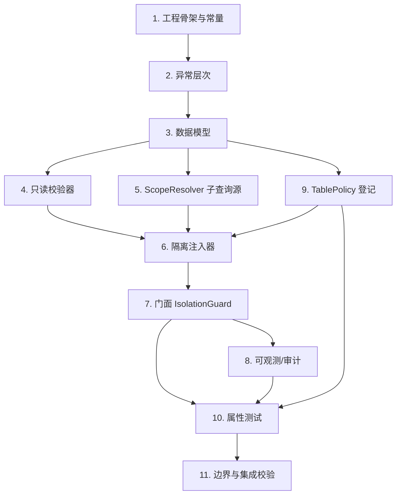

# Implementation Plan: Layer 5 —— isolation-guard（隔离守卫）

## Overview

本计划依据 `design.md`（含 §5A 阳光云权限模型落地）与 `requirements.md`（含 Req 15~18）为 Layer 5 隔离守卫生成可执行的实现任务。

**语言/技术**：Python 3.10+（本机 3.10.11）、sqlglot、pytest、hypothesis（属性测试）。

**本期范围基线（务必遵守）**：
- **不执行 SQL**：L5 只产出 safe_sql 字符串，不 dry_run、不连业务库。
- **零 DB 连接**：scope 用 `SubqueryScopeSource`（把权限子查询作为文本嵌入输出 SQL），本期不查权限表。
- **dialect 硬编码** `starrocks`（常量/配置注入）。
- `MaterializedScopeSource`（做法一）只保留抽象，本期不实现（未来配置切换）。
- **PermissionFilterSpec 占位**：权限标志位过滤规则未定，留 TODO，占位期不默认放行全部授权行。

**状态：全部完成，77 个测试通过（实现位于 `src/isolation_guard/`，测试位于 `tests/isolation_guard/`）。**

## Tasks

- [x] 1. 工程骨架与常量
  - 建立包结构（`isolation_guard/`：`models.py` / `readonly.py` / `injector.py` / `scope.py` / `guard.py` / `observer.py` / `policy.py` / `config.py`）
  - 定义 dialect 常量/配置项 `DIALECT = "starrocks"`（集中一处，便于未来经 L7 注入）
  - 建立 pytest 骨架与 `conftest.py`
  - _Requirements: 11.1, 11.2, 11.3_

- [x] 2. 异常层次
  - 实现 `IsolationGuardError` 基类及子类：`ReadOnlyViolation`、`UnmappedControlledTableError`、`PermissionResolutionError`、`ConfigurationError`
  - 单测：各异常可被基类统一捕获
  - _Requirements: 12.1_

- [x] 3. 数据模型
- [x] 3.1 身份与数据范围
  - 实现 `CallerIdentity`（user_id / oauth_subject / tenant / claims）
  - 实现 `ScopeDim`（PS/ORG）与 `ScopeSource` 抽象；实现 `SubqueryScopeSource`（持有 user_id + dimension），`MaterializedScopeSource` 仅定义接口/占位（本期不实现渲染）
  - 实现 `DataScope`（可见 ps_id 源 + 可见 org_id 源，各为一个 ScopeSource）
  - 单测：DataScope 按维度取到对应 ScopeSource
  - _Requirements: 1.1, 1.5_
- [x] 3.2 表策略与列绑定
  - 实现 `ScopeDim` / `ColTransform`（IDENTITY / PS_ID_FROM_PS_KEY）/ `ColumnBinding`（dimension+column+transform）
  - 实现 `TablePolicy`（controlled: dict[str, ColumnBinding]、uncontrolled 白名单、unknown_table_policy 默认 FAIL_CLOSED、case_insensitive）与 `classify()`
  - 单测：controlled/uncontrolled/must_control_unmapped 三类分类；大小写不敏感匹配
  - _Requirements: 4.1, 4.2, 4.3, 4.5, 4.6_
- [x] 3.3 结果与审计模型
  - 实现 `GuardStatus`、`GuardResult`（含 deny_all、injected/passthrough tables、脱敏计数、rejection 信息）、`IsolationDecision`
  - 单测：字段完整性；审计事件仅含计数不含具体 id
  - _Requirements: 13.2, 13.3_

- [x] 4. 只读校验器 `SqlglotReadOnlyValidator`
  - 实现 `parse_single`（强制单条非空语句；空/多语句/解析失败 → ReadOnlyViolation）
  - 实现 `assert_read_only`（顶层必须 Select/Union；`FORBIDDEN` 节点存在即拒绝；不连库不执行）
  - 单测：SELECT/WITH/UNION 通过；INSERT/UPDATE/DELETE/DROP/ALTER/TRUNCATE/Command/Into 拒绝；多语句拒绝；空/语法错拒绝
  - _Requirements: 2.1, 2.2, 2.3, 2.4, 2.5, 2.6, 2.7, 2.8_

- [x] 5. ScopeResolver（本期：构造子查询源，零 DB 连接）
- [x] 5.1 PermissionFilterSpec 占位骨架
  - 定义 `PermissionFilterSpec`（可配置授权行过滤谓词），本期留占位（TODO 注释 + 配置开关）；实现"占位期不默认放行全部"的显式策略点
  - 单测：占位配置下过滤谓词位置存在且为受控占位（非空泛 TRUE）
  - _Requirements: 18.1, 18.2, 18.3_
- [x] 5.2 可见集合子查询构造
  - 实现 `ScopeResolver.resolve(identity) -> DataScope`：产出 `SubqueryScopeSource`，渲染 §5A.3 的可见 ps_id 子查询（sys_user_ps_share 直接分享 ∪ 组织闭包 sys_user_org→sys_org_all_sub_org→power_station_org ∪ power_station_public_share）与可见 org_id 子查询
  - `user_id` 以类型化字面量注入子查询模板；权限表名/列名为固定常量；本期 `resolve` 不连库、不执行，仅构造 AST/文本
  - 单测：给定 user_id 渲染出稳定、确定的权限子查询；同一请求内复用（缓存）
  - _Requirements: 1.4, 1.6, 1.7, 15.1, 15.2, 15.3, 15.4, 15.5, 15.6_

- [x] 6. 隔离注入器 `SqlglotIsolationInjector`
- [x] 6.1 遍历与分类改写骨架
  - 用 `ast.transform` 只处理 `exp.Table`；先收集 CTE 名集合并跳过；按 `policy.classify` 分流：uncontrolled 透传、must_control_unmapped 抛 `UnmappedControlledTableError`、controlled 进入包裹
  - 保留原别名（无别名用表名）；对 JOIN/自 JOIN/子查询/CTE/UNION 各表节点独立包裹
  - 单测（§5.4 表格逐项）：简单表/别名/JOIN/自 JOIN/子查询/CTE/UNION/非受控/必控未映射
  - _Requirements: 3.1, 3.3, 3.4, 3.5, 3.6, 3.7, 3.8, 3.9, 4.4_
- [x] 6.2 三种列绑定的谓词生成
  - IDENTITY(ps_id) → `ps_id IN (<S_ps>)`
  - PS_ID_FROM_PS_KEY → `CAST(split_part(ps_key,'_',1) AS BIGINT) IN (<S_ps>)`
  - IDENTITY(org_id) → `org_id IN (<S_org>)`
  - 单测：三类表分别生成正确谓词；ps_key 表用前缀段且做 CAST
  - _Requirements: 3.2, 16.1, 16.2, 16.3_
- [x] 6.3 子查询注入源渲染（本期默认路径）
  - 对 `SubqueryScopeSource`：把 §5A.3 权限子查询作为 IN 右侧嵌入（`col IN (<权限子查询>)`）
  - 为 `MaterializedScopeSource` 预留渲染分支（本期抛 `NotImplementedError` 或走占位），不实现
  - 单测：子查询模式输出内嵌权限 SELECT；对相同 (sql, user_id, policy, dialect) 逐字符一致
  - _Requirements: 17.1, 17.2, 17.4_
- [x] 6.4 空 scope / deny-all 语义
  - 子查询模式：依赖"权限子查询空结果集 → IN 空 → 零行"，将 `GuardResult.deny_all` 按策略标记（保守：受控列存在即可能 deny-all）
  - 保留 §5.5 恒假谓词逻辑（供 Materialized 模式/未来使用）
  - 单测：deny_all 标记正确；不使用 `IN (NULL)`
  - _Requirements: 5.1, 5.2, 5.3, 5.4, 17.3_
- [x] 6.5 注入安全（防注入）
  - 所有字面量（user_id、可能的 scope id）用类型化 sqlglot 字面量节点，禁止字符串插值；bool 值抛 `ConfigurationError`
  - IN 列表/子查询整体以 AST 节点构造
  - 单测：含引号/分号的取值不改变 SQL 结构；bool → ConfigurationError
  - _Requirements: 6.1, 6.2, 6.3, 6.4_

- [x] 7. 门面 `IsolationGuard`
- [x] 7.1 共享内核 `_apply` 与 scope 缓存
  - 编排：① 解析 scope（惰性+每请求缓存，外部异常 → PermissionResolutionError fail-closed）→ ③ parse_single + assert_read_only → ② inject → 注入后 re-assert 复核 → 序列化 safe_sql
  - _Requirements: 1.2, 1.3, 1.4, 1.7, 2.9, 7.1, 7.2_
- [x] 7.2 双入口
  - `guard(sql, request_id) -> GuardResult`：捕获 IsolationGuardError → REJECTED；未预期异常 → REJECTED(UnexpectedError) fail-closed
  - `validate_for_probe(sql, request_id) -> str`：复用 `_apply`，合规返回 safe_sql，不合规向上抛异常（供 L4 Query Fixer 静态校验；本期不 dry_run）
  - 提供 `IsolationGuardFactory.for_identity(identity)` 每请求构造 guard（供 Layer 3 契约）
  - 单测：两入口对相同 (sql, identity) 放行时逐字符一致；probe 抛异常语义
  - _Requirements: 7.3, 7.4, 9.1, 9.2, 9.3, 9.4, 12.2, 12.3, 12.4, 12.5_

- [x] 8. 可观测 / 审计
  - 实现 `IsolationObserver` 接口与默认实现（InMemoryObserver / NullObserver）；每次决策产出 `IsolationDecision`
  - 拒绝信息不回显具体 scope id / 敏感 SQL 明文；对外返回稳定错误类别 + request_id
  - 单测：ALLOWED/REJECTED 均产出事件；脱敏
  - _Requirements: 13.1, 13.2, 13.3, 13.4, 13.5_

- [x] 9. TablePolicy 登记（sungrow 表）
  - 按 §5A.2 登记本期已知受控表的 ColumnBinding：ps_id 类（fact_power_station_kpi_*、fact_power_cusp_*、power_statistical_data、data_point_val…）、ps_key 类（bus_points_day/month/year）、org 类（fact_organization_kpi_month/year）
  - 登记非受控白名单（维表/字典表，如 sys_country、sys_timezone 等，按需）
  - 未登记表 → fail-closed
  - 单测：登记表分类正确；未登记表触发 fail-closed
  - _Requirements: 4.1, 4.2, 4.3, 14.1_

- [x] 10. 属性测试（覆盖 10 条正确性属性）
  - 用 hypothesis 覆盖 Property 1~10（确定性、受控表必被注入、不可绕过、只读强制、空 scope 零行、缓存重注、语义受限等价、fail-closed、注入安全、身份不可解析即拒绝）
  - 生成器：随机合法查询结构（JOIN/CTE/UNION/子查询/别名）+ 受控/非受控/未映射表混排
  - _Requirements: 10.1, 10.2, 10.3, 7.3, 3.1, 3.2, 3.7, 2.5, 2.6, 2.7, 5.1, 5.2, 8.1, 8.2, 8.3, 4.3, 4.4, 6.1, 6.2, 1.2, 1.3_

- [x] 11. 边界与集成校验
  - 确认 L5 不持有数据库连接（本期零 DB）、只产出字符串；文档化"第二道防线为 L7 只读账号（本期未实现，未来接入）"
  - 用 §5.4 全量结构 + sungrow 真实表名做端到端拼装校验（输入隔离前 SQL → 输出带权限子查询的 safe_sql）
  - _Requirements: 14.1, 14.2, 8.1, 8.2, 8.3_

## Task Dependency Graph

```json
{
  "waves": [
    { "wave": 1, "tasks": ["1"] },
    { "wave": 2, "tasks": ["2"] },
    { "wave": 3, "tasks": ["3.1", "3.2", "3.3"] },
    { "wave": 4, "tasks": ["4", "5.1", "5.2", "9"] },
    { "wave": 5, "tasks": ["6.1", "6.2", "6.3", "6.4", "6.5"] },
    { "wave": 6, "tasks": ["7.1", "7.2"] },
    { "wave": 7, "tasks": ["8"] },
    { "wave": 8, "tasks": ["10"] },
    { "wave": 9, "tasks": ["11"] }
  ]
}
```



## Notes

- **顺序**：先建模型与异常（T1~T3），再并行做只读校验（T4）与 scope 子查询构造（T5），二者汇入注入器（T6），再到门面（T7）与审计（T8）。TablePolicy 登记（T9）为注入器提供真实受控表映射。属性测试（T10）在功能齐备后统一覆盖 10 条正确性属性。
- **本期不实现**：`MaterializedScopeSource` 渲染、dry_run/执行、L6 连接池、L7 完整适配（dialect 硬编码代替）。
- **占位项（须显式 TODO 标注）**：`PermissionFilterSpec`（权限标志位过滤规则待业务确定，占位期不默认放行全部授权行）。
- **未来切换点**：`ScopeSource` 抽象允许后续切换到 `MaterializedScopeSource`（做法一）而不改注入/校验/门面逻辑；触发条件见 design.md（权限表与执行库不同、性能/缓存、输出 SQL 自包含等）。
- 属性测试涉及大量随机生成用例，运行时长可能较高，建议在 CI 中单独分组。
