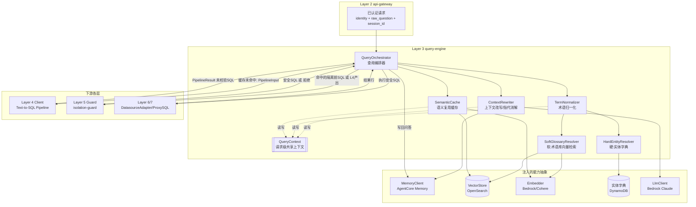
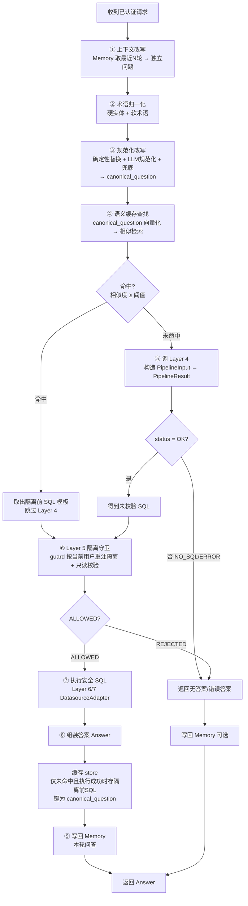
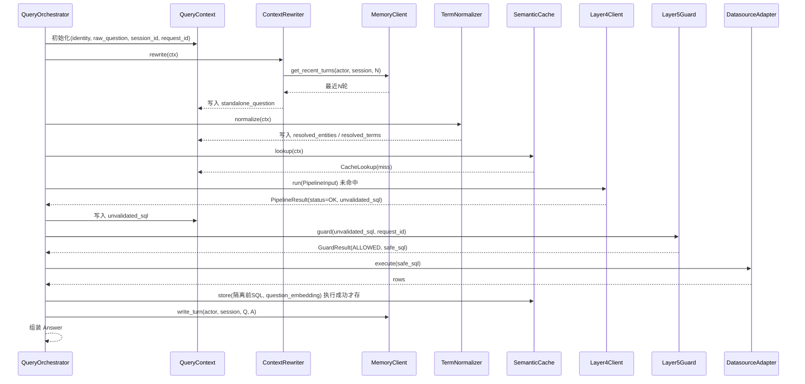
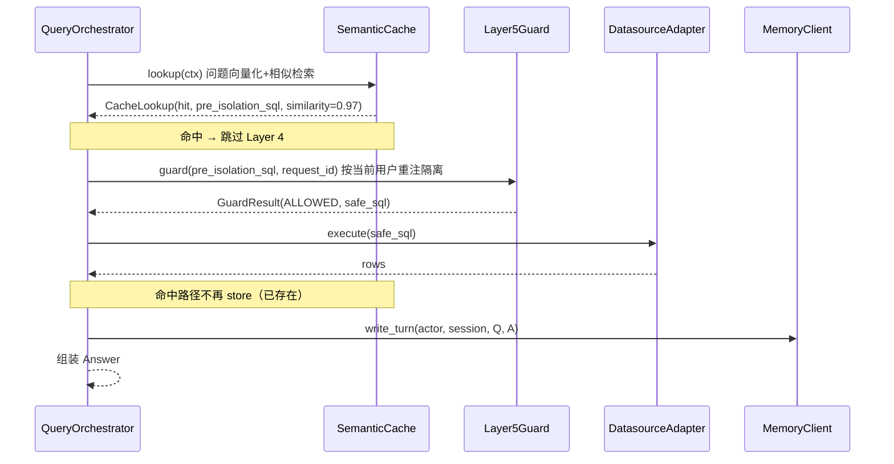
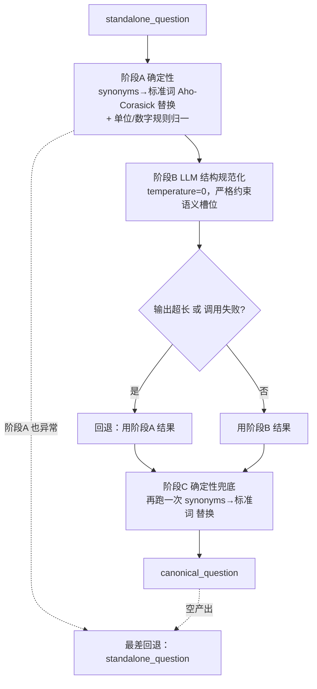
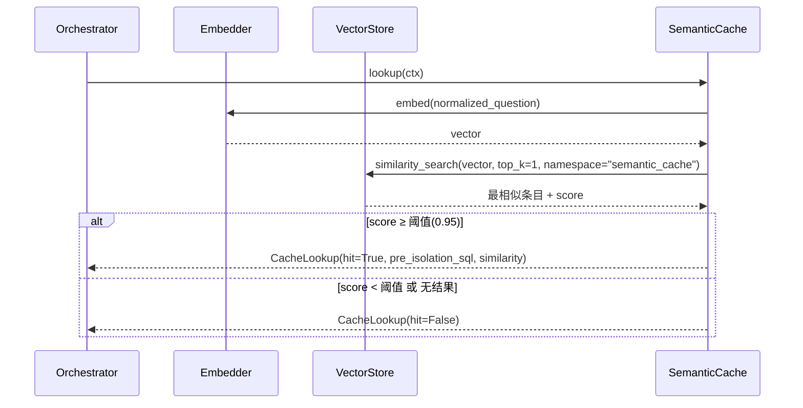
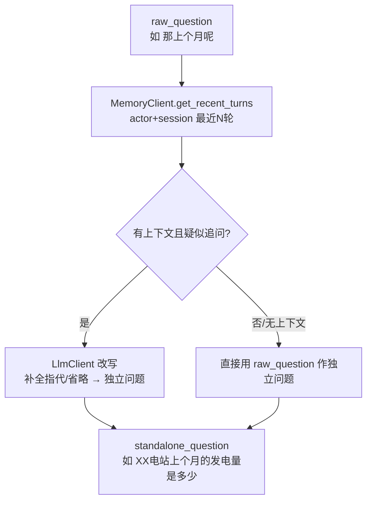

# 设计文档：Layer 3 —— query-engine（智能问数核心编排引擎）

> **所属系统**：智能问数（智能数据问答）系统 v2，见 `docs/smart-query-architecture-v2.md`
> **本文档范围**：仅覆盖 **Layer 3（query-engine）** 的设计
> **设计形态**：高层设计（架构 / 组件 / 接口 / 数据模型 / 数据流图）+ 低层设计（Python 接口签名 / 伪代码 / 依赖注入契约）
> **语言约定**：团队以中文协作，本文档正文中文；代码示例用 Python（服务运行于 EKS 的 Python 服务）
> **下游契约对齐**：
> - 与 `.kiro/specs/text2sql-pipeline/design.md`（Layer 4）对齐 —— 本层缓存未命中时构造 `PipelineInput`，调用其编排器，接收 `PipelineResult`。
> - 与 `.kiro/specs/isolation-guard/design.md`（Layer 5）对齐 —— 本层无论缓存命中还是 Layer 4 产出，都调用 `IsolationGuard.guard(sql, request_id) -> GuardResult` 取安全 SQL。

---

## Overview

Layer 3（query-engine）是智能问数系统的**核心编排器**，是一个运行在 EKS 上的 Python 服务。它的唯一使命是：把 Layer 2 透传下来的**已认证请求（身份 + 原始问题 + 会话标识）**，通过顺序驱动**本层自有节点**并**委派给下游各层**，最终转化为一个**面向当前用户的、安全的答案**。

Layer 3 拥有五类自有节点：**查询编排器（Query Orchestrator）**、**上下文改写 / 指代消解（Context Rewrite，基于 AgentCore Memory 的多轮能力）**、**术语归一化（Term Normalization，硬 + 软双通道）**、**规范化改写（Canonical Rewrite，把变体问法折叠为统一标准叙述）**、**语义复用缓存（Semantic Reuse Cache，基于可插拔 VectorStore）**。它**不做认证 / 限流**（Layer 2 的职责）、**不生成 SQL**（Layer 4 的职责）、**不注入数据隔离 / 不强制只读**（Layer 5 的职责）、**不持有连接池 / 不做物理执行**（Layer 6/7 的职责）。

本层最关键的两条设计红线：其一，**语义缓存命中也必须经过 Layer 5**——缓存里存的是"隔离前 SQL 模板"，命中后跳过 Layer 4，但仍要按**当前用户**重新注入隔离，绝不缓存注入后的成品 SQL；其二，**多轮上下文改写只在本层做**——交给 Layer 4 的必然是一个已经自包含的独立问题，身份则原样透传给 Layer 5 解析，本层从不接触用户的数据范围（org_ids/ps_ids）。

---

## 1. 目的与范围（Purpose & Scope）

### 1.1 目的

Layer 3 是整个链路的"大脑与指挥棒"：它不实现 SQL 生成、不实现隔离，而是**决定各步骤以何种顺序、在何种分支下被调用**，并在步骤之间维护一份贯穿全程的请求级状态。它把"多轮改写、术语归一、缓存复用"这三件**上游语义准备工作**做扎实，使得下游 Layer 4/5 能在一个干净、标准化、自包含的输入上工作。

### 1.2 核心设计洞察（必须落地）

- **编排顺序是固定不变式**：`原始问题 → 上下文改写(Memory) → 术语归一化(硬+软) → 规范化改写(canonical) → 语义缓存(命中/未命中) → [未命中] Layer 4 → Layer 5 → 执行(L6/7) → 组装答案 → 写回 Memory`。
- **规范化改写提升缓存命中**：在术语归一化之后、缓存查找之前，把措辞各异但意图相同的问题折叠为统一的 `canonical_question`；**缓存 store/lookup 与传给 Layer 4 的问题都统一改用它**。这样"户用/家用/residential""1MW/一百万瓦/1000000w""倒序/降序/从大到小"等变体能收拢到同一标准叙述，真正吃到缓存复用（而非仅靠 Embedding 相似度碰运气）。
- **缓存命中短路，但绝不短路 Layer 5**：命中路径跳过 Layer 4，直接把"隔离前 SQL"交给 Layer 5 按当前用户重注隔离。这是本项目**自建**的能力（SQLBot 只有 few-shot 辅助生成，没有"命中即复用"的短路）。
- **术语归一化分硬 / 软双通道**：关键实体（电站名 / 指标名）走**确定性字典**映射到标准 id；一般描述词走**软术语库**（同义词 + 定义，向量检索 + LLM 中介）。两路结果分别汇入 `resolved_entities` / `resolved_terms`，形态与 Layer 4 的 `PipelineInput` 对齐。
- **身份只传不解析**：本层把 `CallerIdentity` 原样传给 Layer 5，**从不**在本层解析 org_ids/ps_ids，**从不**构造带权限过滤的 SQL。
- **多轮只在本层解决**：Memory 读取最近若干轮 → 改写为独立问题 → 交 Layer 4；答完写回 Memory。Layer 4 永远收到独立问题。

### 1.3 边界：Layer 3 拥有什么 / 不拥有什么

明确边界是本设计的第一原则。

| 维度 | 归属 | 说明 |
|------|------|------|
| **查询编排（串联本层节点 + 委派下游）** | ✅ **Layer 3** | `QueryOrchestrator` |
| **上下文改写 / 指代消解（多轮）** | ✅ **Layer 3** | `ContextRewriter`，基于 AgentCore Memory |
| **术语归一化（硬 + 软）** | ✅ **Layer 3** | `TermNormalizer` = `HardEntityResolver` + `SoftGlossaryResolver` |
| **规范化改写（变体 → 标准叙述）** | ✅ **Layer 3** | `CanonicalRewriter`，确定性替换 + LLM 结构规范化 + 兜底 |
| **语义复用缓存（lookup / store / 短路）** | ✅ **Layer 3** | `SemanticCache`，基于可插拔 `VectorStore`；键为 `canonical_question` |
| **组装最终答案 + 写回 Memory** | ✅ **Layer 3** | 编排器收尾 |
| 认证 / 边缘限流 / 单用户业务限流 | ❌ **Layer 2（api-gateway）** | Layer 3 收到的已是"已认证请求" |
| Legacy 路由 | ❌ **Layer 2 旁路（legacy-router）** | 与本层无关 |
| Schema Linking / SQL 生成 / 选择 / 修复 | ❌ **Layer 4（text2sql-pipeline）** | 缓存未命中时委派 |
| **权限解析（身份 → org_ids/ps_ids）** | ❌ **Layer 5（isolation-guard）** | Layer 3 只透传身份，**绝不解析范围** |
| **数据隔离注入 / 只读强制校验** | ❌ **Layer 5** | 缓存命中 SQL 与 Layer 4 产出**都**经 Layer 5 |
| 连接池 / 限流 / 故障隔离 | ❌ **Layer 6（ProxySQL）** | 经 `DatasourceAdapter` 间接使用 |
| 物理执行 / 方言连接 / 只读账号 | ❌ **Layer 7（DatasourceAdapter）** | Layer 3 经适配器执行安全 SQL |

> **铁律 1**：**任何**要执行的 SQL（无论来自缓存命中还是 Layer 4）都必须先经 `IsolationGuard.guard(...)`。Layer 3 不存在"绕过 Layer 5 直连数据源"的代码路径。
> **铁律 2**：语义缓存**只存隔离前 SQL 模板**，**永不**存注入后的成品 SQL。

### 1.4 复用与许可约束

- **借鉴 SQLBot**（DataEase，modified-GPLv3）的**术语库 / 示例召回**思路用于软归一化，但**只借鉴思路、重新实现，绝不复制其 GPLv3 源码**；其行/列隔离依赖闭源 `sqlbot_xpack`，本层不涉及隔离故不采用。
- **"命中即复用"的语义缓存短路逻辑为本项目自研**（SQLBot 只做 few-shot，不做缓存短路）。
- **多轮会话 / 用户记忆用 AgentCore Memory**（经 SDK 从 EKS 调用，支持 per-user actor 隔离 + 短期上下文 + 长期偏好）。
- **凭证 / OAuth token 经 AgentCore Identity 托管**（本层仅透传身份，不落敏感明文凭证）。
- 复用系统既有抽象：`VectorStore`（当前 OpenSearch）、`Embedder`（当前 Bedrock/Cohere），**与 Layer 4 共用同一套抽象**；`DatasourceAdapter`（当前 StarRocks，只读）。

---

## Architecture

## 2. 高层架构（High-Level Architecture）

### 2.1 总体思想

Layer 3 = **一个编排器（`QueryOrchestrator`）** 顺序驱动若干**自有节点**，并在关键点**委派下游层**。节点之间通过**一份请求级上下文对象（`QueryContext`）** 传递状态（追加式写入，与 Layer 4 的 `PipelineContext` 同风格）。所有外部能力（Memory、VectorStore、Embedder、Layer4Client、Layer5Guard、DatasourceAdapter、LlmClient）通过**依赖注入**提供，节点不自行 new 具体实现，从而可 mock、可替换、可独立测试。



### 2.2 三个关键机制

1. **请求级共享上下文（`QueryContext`）**：贯穿全流程的追加式状态容器。每个节点只读取所需字段、只写入自己负责的产出（改写后的独立问题 / 已解析实体 / 已解析术语 / 缓存查找结果 / 安全 SQL / 结果行）。这是"隔离与可测"的载体。
2. **固定编排顺序（Fixed Orchestration Order）**：编排顺序是硬约束（见 §2.3 / Property 6），分支只在"缓存命中 / 未命中"处产生，且两条分支**汇聚于 Layer 5**。
3. **依赖注入（Dependency Injection）**：所有外部能力经 `EngineDependencies` 注入。测试与本地开发可注入 mock，不依赖真实 Memory / OpenSearch / 下游服务。

### 2.3 主流程（缓存未命中 vs 命中，两条分支汇聚于 Layer 5）



> **要点**：无论"命中路径（PRESQL）"还是"未命中路径（UNVSQL）"，都在节点 ⑤ **汇聚**进入 Layer 5。这从结构上保证了 Property「缓存命中仍过 Layer 5」。

### 2.4 一次典型执行（缓存未命中的时序）



### 2.5 缓存命中的时序（短路 Layer 4，仍过 Layer 5）



---

## Components and Interfaces

## 3. 组件与接口（高层）

四个自有组件 + 若干注入的客户端接口。编排器负责串联与委派，三个语义节点各司其职，均可独立 mock 测试。

### 3.1 组件一：`QueryOrchestrator`（查询编排器）

**职责**：按固定顺序驱动 `ContextRewriter → TermNormalizer → SemanticCache → [未命中]Layer4 → Layer5 → 执行 → 组装答案 → 写回 Memory`。管理 `QueryContext` 生命周期，处理分支（命中 / 未命中）与降级（见 §10）。

**接口**：
```python
class QueryOrchestrator(Protocol):
    def handle(self, request: "QueryRequest") -> "Answer": ...
```

**职责边界**：只编排、不实现具体语义逻辑；不解析权限、不生成 SQL、不注入隔离。

### 3.2 组件二：`ContextRewriter`（上下文改写 / 指代消解 · Memory 支撑）

**职责**：从 AgentCore Memory 读取当前 `(actor=user, session)` 的最近若干轮对话，把"那上个月呢"这类追问补全为**独立、自包含**的问题。若 Memory 不可用则**降级为无上下文改写**（直接用原始问题，见 §10）。答案产生后由编排器统一写回 Memory。

**接口**：
```python
class ContextRewriter(Protocol):
    def rewrite(self, ctx: "QueryContext") -> "QueryContext":
        """读取 raw_question + Memory 最近N轮，写入 ctx.standalone_question。"""
        ...
```

### 3.3 组件三：`TermNormalizer`（术语归一化 · 硬 + 软）

**职责**：对独立问题做双通道归一化，产出 `resolved_entities`（硬）与 `resolved_terms`（软），形态与 Layer 4 `PipelineInput` 对齐。内部编排两个子解析器：

- `HardEntityResolver`（硬 / 确定性）：关键业务实体（电站名 / 指标名）经**字典精确 / 规则匹配**映射到标准词 + 标准 id（字典可存 DynamoDB）。**确定性**：同一输入恒定得到同一映射。
- `SoftGlossaryResolver`（软 / LLM 中介）：一般描述词经**术语库向量检索**取同义词 + 定义，供后续注入 prompt（由 Layer 4 的 LLM 对齐）。借鉴 SQLBot 术语库思路，重新实现。

> **数据来源（由知识管理面 knowledge-admin 维护，见 `.kiro/specs/knowledge-admin/`）**：
> - **硬通道**：`EntityDictionary` 的实现为 `adapters/entity_dictionary.py`（Aho-Corasick 匹配器），从 DynamoDB `knowledge_entity` 表加载**启用**实体的别名→实体映射；wiring 已将其注入（替换原 `None`）。实体条目由 knowledge-admin 后端手动维护（CRUD + 批量导入）。
> - **软通道**：`VectorStore` 的 `glossary` 命名空间数据由 knowledge-admin 权威写入并同步（术语增改删 → 重新向量化 → upsert/删除），取代早期 `scripts/ingest_opensearch.py` 中手写的术语种子。

**接口**：
```python
class TermNormalizer(Protocol):
    def normalize(self, ctx: "QueryContext") -> "QueryContext":
        """写入 ctx.resolved_entities（硬）与 ctx.resolved_terms（软）。"""
        ...

class HardEntityResolver(Protocol):
    def resolve(self, question: str) -> tuple["ResolvedEntity", ...]: ...

class SoftGlossaryResolver(Protocol):
    def resolve(self, question: str) -> tuple["ResolvedTerm", ...]: ...
```

### 3.4 组件四：`CanonicalRewriter`（规范化改写 · 变体折叠）

**职责**：在术语归一化之后、语义缓存查找之前，把措辞各异但意图相同的问题折叠为统一的 `canonical_question`，供缓存 store/lookup 与委派 Layer 4 统一使用，从而把"户用/家用/residential""1MW/一百万瓦/1000000w""倒序/降序/从大到小"等变体收拢到同一标准叙述、真正提升命中率。

**三段算法（任一步失败逐级回退，最差回退 `standalone_question`）**：

- **阶段A（确定性，无 LLM）**：`Deterministic_Term_Replacement` + `Unit_Normalization`。读软术语库登记的 `synonyms→标准词`，用 Aho-Corasick 精确匹配替换；再用规则把等价单位/数字写法归一（如 `1MW`/`一百万瓦`/`1000000瓦` → `1000000W`）。
- **阶段B（LLM 结构规范化）**：`temperature=0` 调 LLM，把语序/口语/冗词折叠为标准叙述；提示词严格约束**不得改变**过滤条件、比较运算、阈值、单位、聚合维度、排序方向、输出字段等语义槽位；输出超过 `Rewrite_Max_Len` 或调用失败 → 回退阶段A 结果。
- **阶段C（确定性兜底）**：对阶段B 产出再跑一次确定性替换，锁定标准词（防止 LLM 又把标准词改回同义词）。

> **稳定性说明**：缓存匹配是**向量相似度 ≥ 阈值**（非字符串精确相等），故阶段B 的措辞轻微抖动可容忍——只要规范化把变体朝同一标准叙述收拢即可。阶段A/C 为确定性（Property 11）。

**接口**：
```python
class CanonicalRewriter(Protocol):
    def rewrite(self, ctx: "QueryContext") -> "QueryContext":
        """以 ctx.standalone_question 为输入，写入 ctx.canonical_question。"""
        ...
```

**职责边界**：只做叙述规范化，**不解析范围、不构造带权限过滤的 SQL**（Requirement 16.12）。

### 3.5 组件五：`SemanticCache`（语义复用缓存 · VectorStore 支撑）

**职责**：
- `lookup`：把归一化后的问题向量化，在 `VectorStore` 做相似检索；相似度 ≥ 阈值（如 0.95）判为命中，返回存储的**隔离前 SQL 模板**。
- `store`：**仅在缓存未命中、且安全 SQL 成功执行后**，把"隔离前 SQL 模板 + 问题 embedding + 元数据"写入缓存。**永不存注入后的成品 SQL**。
- 失效 / 淘汰：支持按 schema 版本 / TTL / 显式失效（见 §6.4）。

**接口**：
```python
class SemanticCache(Protocol):
    def lookup(self, ctx: "QueryContext") -> "CacheLookup": ...
    def store(self, ctx: "QueryContext", pre_isolation_sql: str) -> None: ...
    def invalidate(self, *, schema_version: Optional[str] = None,
                   entry_id: Optional[str] = None) -> int: ...
```

### 3.6 注入的下游客户端接口

```python
class MemoryClient(Protocol):
    """AgentCore Memory 的最小封装（经 SDK 从 EKS 调用，显式传入终端用户 id）。"""
    def get_recent_turns(self, actor_id: str, session_id: str,
                         limit: int) -> list["ConversationTurn"]: ...
    def write_turn(self, actor_id: str, session_id: str,
                   question: str, answer_summary: str) -> None: ...

class Layer4Client(Protocol):
    """Layer 4 Text-to-SQL Pipeline 编排器入口（见 text2sql-pipeline 设计）。"""
    def run(self, pipeline_input: "PipelineInput") -> "PipelineResult": ...

class Layer5Guard(Protocol):
    """Layer 5 隔离守卫门面（见 isolation-guard 设计）。每请求绑定 CallerIdentity。"""
    def guard(self, sql: str, request_id: str) -> "GuardResult": ...

class Layer5GuardFactory(Protocol):
    """按当前请求身份构造一个已绑定 identity 的 Guard 实例（Guard 每请求构造）。"""
    def for_identity(self, identity: "CallerIdentity") -> "Layer5Guard": ...

class DatasourceAdapter(Protocol):
    """Layer 6/7：执行安全 SQL（只读账号，经 ProxySQL 连接池）。"""
    dialect: str
    def execute(self, safe_sql: str) -> "ResultSet": ...
```

> **说明**：`Layer5Guard` 由 `Layer5GuardFactory.for_identity(identity)` 每请求构造并绑定身份——这与 isolation-guard 设计"门面每请求构造、绑定 `CallerIdentity`、`DataScope` 惰性解析并缓存"完全一致。**Layer 3 只传身份，范围解析全在 Layer 5 内部。**

---

## Data Models

## 4. 数据模型（Data Models）

### 4.1 输入：`QueryRequest` 与 `CallerIdentity`

Layer 2 认证后透传下来的请求。

```python
from dataclasses import dataclass, field
from enum import Enum
from typing import Any, Optional, Protocol

@dataclass(frozen=True)
class CallerIdentity:
    """可信调用方身份 —— 由 Layer 2 认证（阳光云 OAuth）透传。

    形态与 isolation-guard 的 CallerIdentity 对齐：Layer 3 原样透传给 Layer 5，
    绝不在本层解析 org_ids/ps_ids。
    """
    user_id: str                          # 稳定用户标识（用作 Memory actor_id + 审计）
    oauth_subject: Optional[str] = None   # OAuth sub
    tenant: Optional[str] = None          # 可选：多租户标识
    claims: dict = field(default_factory=dict)   # 只读留存，不含敏感明文凭证

@dataclass(frozen=True)
class QueryRequest:
    """Layer 3 的入口输入 —— 已认证请求。"""
    request_id: str                       # 全链路追踪 id（本层生成或沿用 L2）
    identity: CallerIdentity              # 透传给 Layer 5 的身份
    raw_question: str                     # 用户原始问题（可能是多轮追问）
    session_id: str                       # 会话标识（多轮上下文范围）
    datasource_id: str = "starrocks"      # 目标数据源（可插拔）
    model_id: Optional[str] = None        # 可选：显式指定 Bedrock 模型（透传给 L4）
    locale: str = "zh-CN"
```

### 4.2 归一化产物（与 Layer 4 `PipelineInput` 对齐）

> **契约对齐**：以下 `ResolvedEntity` / `ResolvedTerm` 的字段与 `text2sql-pipeline/design.md` §4.1 一致，确保 Layer 3 直接组装出合法的 `PipelineInput`。

```python
@dataclass(frozen=True)
class ResolvedEntity:
    """硬归一化产出：电站名/指标名 → 标准词/标准 id（确定性）。"""
    surface: str                    # 用户原文提到的表述
    canonical: str                  # 标准词
    entity_type: str                # "power_station" | "metric" | "org" ...
    entity_id: Optional[str] = None # 映射到的标准 id（若有）

@dataclass(frozen=True)
class ResolvedTerm:
    """软归一化产出：同义词 + 定义（LLM 中介）。"""
    term: str
    definition: str
    synonyms: tuple[str, ...] = ()
```

### 4.3 多轮会话记录：`ConversationTurn`

```python
@dataclass(frozen=True)
class ConversationTurn:
    """Memory 中的一轮问答（actor/session 维度隔离）。"""
    turn_id: str
    question: str                   # 该轮（已改写为独立的）问题
    answer_summary: str             # 该轮答案摘要（用于后续上下文，不必存全量行）
    created_at: float
```

### 4.4 缓存条目：`CacheEntry` 与查找结果 `CacheLookup`

```python
@dataclass(frozen=True)
class CacheEntry:
    """语义缓存条目 —— 只存隔离前 SQL 模板 + 问题 embedding + 元数据。

    铁律：pre_isolation_sql 绝不包含任何 org_id/ps_id 权限过滤（那是 Layer 5 每次重注的）。
    """
    entry_id: str
    normalized_question: str                 # 归一化后的问题文本（可读，便于审计）
    question_embedding: tuple[float, ...]     # 问题向量（相似检索用）
    pre_isolation_sql: str                   # ★隔离前 SQL 模板（唯一被缓存的 SQL）
    datasource_id: str
    schema_version: Optional[str] = None     # 用于失效（schema 变更时）
    created_at: float = 0.0
    hit_count: int = 0                       # 命中次数（可观测/淘汰参考）

@dataclass(frozen=True)
class CacheLookup:
    """lookup 的结果。"""
    hit: bool
    pre_isolation_sql: Optional[str] = None
    similarity: Optional[float] = None       # 命中时的相似度分值
    entry_id: Optional[str] = None
```

### 4.5 流转状态：`QueryContext`（节点间共享对象）

追加式写入，各节点只碰自己那块——"隔离与可测"的核心载体。

```python
class QuerySource(str, Enum):
    """安全 SQL 的来源（可观测：区分命中短路 vs Layer 4 生成）。"""
    CACHE_HIT = "cache_hit"
    PIPELINE = "pipeline"

@dataclass
class NodeTrace:
    """每节点的可观测记录（request_id 贯穿；per-node 追踪）。"""
    node: str                       # "context_rewrite" | "term_normalization" | ...
    started_at: float
    ended_at: float
    ok: bool
    error: Optional[str] = None
    attrs: dict[str, Any] = field(default_factory=dict)   # 如 {"cache_similarity": 0.97}

@dataclass
class QueryContext:
    """贯穿全流程的请求级共享状态；各节点追加写入。"""
    request: QueryRequest
    # —— 各节点产出（初始空，按序填充）——
    standalone_question: Optional[str] = None                 # by ContextRewriter
    resolved_entities: tuple[ResolvedEntity, ...] = ()        # by TermNormalizer(硬)
    resolved_terms: tuple[ResolvedTerm, ...] = ()             # by TermNormalizer(软)
    canonical_question: Optional[str] = None                  # by CanonicalRewriter（缓存键 + 传 L4）
    semantic_slots: Optional[SemanticSlots] = None            # by CanonicalRewriter（缓存精确门禁）
    cache_lookup: Optional[CacheLookup] = None                # by SemanticCache.lookup
    pipeline_result: Optional["PipelineResult"] = None        # by Layer4Client（未命中）
    pre_isolation_sql: Optional[str] = None                   # 待送 Layer 5 的隔离前 SQL
    sql_source: Optional[QuerySource] = None                  # 隔离前 SQL 的来源
    guard_result: Optional["GuardResult"] = None              # by Layer5Guard
    result_set: Optional["ResultSet"] = None                  # by DatasourceAdapter
    # —— 横切 ——
    traces: list[NodeTrace] = field(default_factory=list)
    warnings: list[str] = field(default_factory=list)
    memory_degraded: bool = False                             # Memory 不可用降级标记
```

### 4.6 输出：`Answer`（答案信封）

```python
class AnswerStatus(str, Enum):
    OK = "ok"                     # 成功，有数据
    NO_SQL = "no_sql"             # Layer 4 无法生成 SQL
    REJECTED = "rejected"         # Layer 5 拒绝（只读违规 / 未映射受控表 / 身份不可解析）
    UPSTREAM_ERROR = "error"      # Layer 4 / 执行层错误

@dataclass(frozen=True)
class Answer:
    """Layer 3 的最终产出 —— 回给 Layer 2 的答案信封。"""
    request_id: str
    status: AnswerStatus
    rows: Optional["ResultSet"] = None       # OK 时的结果行
    natural_language: Optional[str] = None   # 可选：自然语言化的答案摘要
    sql_source: Optional[QuerySource] = None # 命中短路 or 流水线（可观测）
    message: Optional[str] = None            # 失败原因（面向用户友好化）
    request_traces: tuple[NodeTrace, ...] = ()  # 可观测（脱敏后可返回或仅入日志）
```

### 4.7 与 Layer 4 的输入契约：`PipelineInput`（本层负责构造）

> 结构来自 `text2sql-pipeline/design.md` §4.1，此处列出**本层如何填充**（关键：**不含用户 scope**）。

```python
@dataclass(frozen=True)
class PipelineInput:
    request_id: str                       # = ctx.request.request_id
    standalone_question: str              # = ctx.canonical_question（规范化后的问题；其上游为改写后的独立问题）
    resolved_entities: tuple[ResolvedEntity, ...] = ()   # = ctx.resolved_entities（硬）
    resolved_terms: tuple[ResolvedTerm, ...] = ()        # = ctx.resolved_terms（软）
    datasource_id: str = "starrocks"      # = ctx.request.datasource_id
    model_id: Optional[str] = None        # = ctx.request.model_id
    locale: str = "zh-CN"
    # 注意：绝不携带 org_ids/ps_ids —— 数据范围是 Layer 5 的职责。
```

---

## 5. 术语归一化设计（Term Normalization：硬 + 软）

术语归一化是"让下游看到干净、标准化输入"的关键。它分两条独立通道，产物合并进 `QueryContext`。

### 5.1 两条通道的适用场景与差异

| 维度 | 硬归一化（`HardEntityResolver`） | 软归一化（`SoftGlossaryResolver`） |
|------|-------------------------------|---------------------------------|
| 适用对象 | **关键业务实体**：电站名、指标名、组织名 | **一般描述词**：口语化 / 同义表达（"发电量""出力""可用率"等业务口径词） |
| 机制 | **确定性字典**（精确 / 别名 / 规则匹配） | **向量检索**术语库（同义词 + 定义），LLM 中介对齐 |
| 数据源 | 实体字典（DynamoDB） | 术语库（`VectorStore` 索引 + 定义存储） |
| 产出 | `ResolvedEntity`（surface → canonical + entity_id） | `ResolvedTerm`（term + definition + synonyms） |
| 确定性 | ✅ 同输入恒同输出（Property 5） | ⚪ 检索命中集稳定，但语义对齐交由下游 LLM |
| 失败策略 | 无命中 → 不产出该实体（不阻断） | 检索为空 / 不可达 → 不产出术语（不阻断，见 §10） |

**为什么分开**：关键实体（如"XX 光伏电站"→ `ps_id=10086`）必须**确定性**映射，绝不能交给 LLM 猜（错一个电站 id 就查错数据）；而一般描述词的对齐是"提示增强"，容忍模糊、交给 LLM 在生成时消化即可。这与架构决策 D9 一致。

### 5.2 合并策略

```mermaid
graph TD
    Q[standalone_question] --> HARD[HardEntityResolver<br/>字典精确匹配]
    Q --> SOFT[SoftGlossaryResolver<br/>术语库向量检索]
    HARD -->|ResolvedEntity[]| MERGE[TermNormalizer 合并]
    SOFT -->|ResolvedTerm[]| MERGE
    MERGE --> CTX[写入 QueryContext<br/>resolved_entities + resolved_terms]
```

- 两路**互不覆盖**：硬结果进 `resolved_entities`，软结果进 `resolved_terms`，字段隔离。
- 去重：同一 `surface` 若被硬通道命中为实体，则软通道对同一片段的术语可选择去重（避免重复注入），保守起见默认**都保留**（实体 id 与术语定义作用不同）。
- 两路都**不阻断主流程**：任一路为空只是"少一些提示信息"，问题仍可继续走缓存 / Layer 4。

### 5.3 规范化改写（Canonical Rewrite）设计

规范化改写是本次为**提升缓存命中率**新增的节点，位于术语归一化之后、语义缓存查找之前。它与术语归一化的分工：**术语归一化产出结构化的 `resolved_entities/resolved_terms` 喂 Layer 4**（不改问题文本）；**规范化改写产出一段标准化的问题文本 `canonical_question`**，作为**缓存键**并**替代原问题传给 Layer 4**。

#### 5.3.1 为什么需要它

改造前缓存 lookup 嵌入的是 `standalone_question`（自然语言原句），命中率只由"嵌入模型语义相似度 + 0.95 阈值"决定；措辞改写的等价变体相似度普遍落在 0.69~0.94，几乎全部 miss。把变体先折叠为统一标准叙述，能让等价问法产生高度一致的嵌入，从而真正命中同一条缓存。

#### 5.3.2 三段算法与回退



- **阶段A（确定性替换 + 单位归一）**
  - **数据来源**：软术语库登记的 `synonyms→标准词`（与软通道向量召回**同一份术语库、两种读法**：向量召回取定义喂 L4；规范化替换只取 `synonyms→标准词` 做精确替换）。由 knowledge-admin 维护。
  - **匹配机制**：复用已实现的 Aho-Corasick 精确匹配（硬通道运行时匹配器同源思路），把命中的同义词替换为标准词；最长匹配优先、避免子串误替换。
  - **枚举值同义词**（如"产品线"取值）：标准词=`户用`，`synonyms=[家用, 家庭户用, residential, ...]`，即登记在术语库中（见 Requirement 16.3 与架构决策：枚举值同义词走软通道建模）。
  - **单位/数字归一（规则型，非同义词）**：`1MW`/`一百万瓦`/`1000000瓦`/`100万w` → `1000000W`；中文数字与量词（万/亿）换算；大小写与全半角统一。
- **阶段B（LLM 结构规范化，temperature=0）**：折叠语序、口语、冗余修饰为标准叙述。提示词硬约束：**不得增删或改变**过滤条件、比较运算（`>`/`>=`/`<`/`=`）、阈值数值、单位、聚合维度（按电站/按机型）、聚合函数（SUM/AVG）、排序方向（DESC/ASC）、排序字段、输出字段集合。输出 > `Rewrite_Max_Len` 或调用异常 → 回退阶段A 结果并记 warning。
- **阶段C（确定性兜底）**：对阶段B 产出再跑一次阶段A 的确定性替换，锁定标准词（防 LLM 把标准词又改回同义表述）。

#### 5.3.3 正确性要点

- **确定性（Property 11）**：阶段A/C 在术语库与单位规则不变时对同一输入产出一致；随机性只可能来自阶段B 的 LLM，且被"向量相似度阈值"容忍、被阶段C 收敛。
- **产物一致使用（Property 12）**：缓存 lookup/store 的键与传 Layer 4 的问题**恒为 `canonical_question`**。
- **永不抛断（Property 13）**：任一阶段失败逐级回退，最差回退 `standalone_question`，主流程不中断。
- **层边界不变**：本节点不接触 org_ids/ps_ids，不构造带权限过滤的 SQL。

### 5.4 语义槽位指纹（Semantic Slots）与缓存精确门禁

**动机（实测）**：规范化改写把相似度整体抬高（正例 ~0.90–0.98），但**嵌入相似度无法区分关键语义槽位**：仅差“升序/降序”的反例 N5 余弦达 0.94–0.997，高于多数正例；更换嵌入模型（Cohere multilingual v3）也不解决（N5 仍高于全部正例）。结论：**向量相似度只能负责“召回候选”，不能负责“判等价”**。因此在缓存命中判定上增加**结构化槽位指纹**作为精确门禁。

**分工**：向量相似度 = 召回（可放宽阈值提召回）；Semantic_Slots 全等 = 门禁（拒误命中）。

**SemanticSlots 结构**（确定性归一后）：

```python
@dataclass(frozen=True)
class SemanticSlots:
    comparison: Optional[str] = None        # GT/GE/LT/LE/EQ
    threshold_watts: Optional[int] = None   # 阈值归一为瓦的整数（仅当指标为功率类）
    metric: Optional[str] = None            # 标准指标词，如 装机容量 / 发电量
    group_by: Optional[str] = None          # 聚合维度：电站 / 机型 / 单台 / none
    agg_func: Optional[str] = None          # SUM/AVG/MAX/MIN/COUNT/NONE
    sort_direction: Optional[str] = None    # DESC/ASC
    sort_field: Optional[str] = None        # 标准排序字段
    output_entity: Optional[str] = None     # 输出主体：电站 / 机型
    product_line: tuple[str, ...] = ()      # 产品线取值集合（户用 / 工商业 …；OR 用多元素）
    top_n: Optional[int] = None             # TopN；无则 None
    extra_filters: tuple[str, ...] = ()     # 归一后的附加过滤签名（如 build_year=2025）
```

**产出方式（与规范化改写合并为一次 LLM 调用，控延迟）**：阶段B 的 LLM 以 `temperature=0` **同时**返回 `{"canonical": "...", "slots": {...}}`（结构化 JSON）。随后对 slots 做**确定性归一**：单位→瓦整数（复用 `UnitNormalizer` 思路）、方向/运算/聚合→枚举、术语→标准词（复用 `TermReplacer`/术语库）。

**规则型确定性抽取（降低对 LLM 温度/确定性的依赖）**：`comparison`、`threshold_watts`、`sort_direction`、`top_n` 这四个**最具判别性**的槽位，改由**规则**（正则/关键词）从确定性归一文本（stage_a）抽取并**覆盖** LLM 值（规则未命中时才回退 LLM 值）。这四个字段恰好区分了最危险的反例（比较符 N1/N2/N16/N17、单位量级 N10、排序方向 N5、TopN N6），规则化后它们**完全不依赖 LLM 温度与逐次抖动**，跨"入库/查询"稳定一致。

**抽取模型独立可配置**：槽位抽取所用 LLM 模型经 `SLOT_EXTRACTION_MODEL_ID`（`AwsSettings.slot_extraction_model_id` → `EngineDependencies.canonical_model_id`）独立于主生成模型配置，应选支持 `temperature=0` 的模型（如 Sonnet 4.6）。**背景**：Opus 5 / Sonnet 5 等新型模型已取消 `temperature`，以其做抽取会非确定性、破坏"入库槽位=查询槽位"的前提而拉低召回（不影响精确率）。故抽取器专用、可钉温度，与主模型演进解耦。`BedrockLlmClient` 遇模型拒绝 `temperature` 时自动去参重试。

**Fail-safe（关键）**：
- JSON 解析失败 / 字段缺失 → `semantic_slots = None`；canonical 仍按三段回退产出（不中断）。
- 缓存判命中要求 **两侧 slots 均非空且关键槽位全等**；**任一侧为空或任一关键槽位不等 → 判未命中**。宁可漏命中（走 L4，正确但不降本），绝不误命中（复用错误 SQL）。

**关键槽位集合**（全等方命中）：`comparison, threshold_watts, metric, group_by, agg_func, sort_direction, sort_field, output_entity, product_line, top_n, extra_filters`。这组槽位可区分全部 18 条困难反例（比较符/阈值单位/指标/聚合维度/聚合函数/排序方向/排序字段/输出主体/产品线/TopN/时间过滤）。

---

## 6. 语义缓存设计（Semantic Reuse Cache）

这是本项目**自研**的核心能力：把"问题 → 隔离前 SQL 模板"复用起来，命中即短路 Layer 4，显著降延迟与成本。

### 6.1 缓存什么 / 不缓存什么

- **缓存**：`归一化问题的 embedding` → `隔离前 SQL 模板`（+ 元数据：归一化问题文本、datasource_id、schema_version、created_at、hit_count）。
- **绝不缓存**：注入隔离后的成品 SQL（含具体 `org_id/ps_id`）。**原因**：成品 SQL 绑定了某个用户的数据范围，若被另一个用户命中复用，即造成**跨用户越权泄露**。这条对应架构决策 D7 与安全红线 Checklist。

### 6.2 查找（lookup）与命中判定



- **键**：`canonical_question` 的 embedding（规范化改写产物；变体折叠到统一标准叙述后命中率显著更高）。
- **命中判定 = 向量召回 + 槽位门禁（Slot_Gate）**：向量检索取 `top_k`（默认 5）候选，筛出相似度 ≥ 阈值者，**逐个比对 Semantic_Slots**，返回第一个关键槽位全等的候选为命中；无一全等 → 未命中。任一侧 slots 为空 → 未命中（fail-safe）。store 时把 slots 序列化（`slots_json`）写入缓存条目一并落库。
- **阈值取舍（已定稿）**：有了槽位门禁兜底，向量阈值放宽到 **0.85**（`CACHE_SIMILARITY_THRESHOLD`）以提升召回；门禁保证精确率与阈值无关，故低阈值不放大误命中。实测（Sonnet 4.6 + 阈值 0.85 + 门禁）正例召回 ≈14/18、误命中 0/18。
- **阈值**：默认 `0.95`（可配置）。低于阈值视为未命中，走 Layer 4。
- **命名空间**：`semantic_cache`，与软术语库（软归一化用）分开命名空间，互不干扰。

### 6.3 命中后的处理（短路 Layer 4，但过 Layer 5）

命中 → 取出 `pre_isolation_sql` → 写入 `ctx.pre_isolation_sql` 且 `ctx.sql_source = CACHE_HIT` → **跳过 Layer 4** → 直接进 Layer 5 `guard(...)` **按当前用户重注隔离** → 执行。命中路径**不再 store**（条目已存在，可选更新 hit_count）。

### 6.4 存储策略（store）与失效（invalidation）

**存储策略（严格）**：
- **仅当**：① 本次为缓存**未命中**（来自 Layer 4）；② 且 Layer 5 校验**通过**；③ 且安全 SQL **成功执行**（拿到结果行）——三者同时满足，才把 `PipelineResult.unvalidated_sql`（即隔离前 SQL）写入缓存。
- **为什么要等执行成功**：避免把"能生成但实际跑不通"的 SQL 污染缓存。
- **存的是 `unvalidated_sql`（隔离前）**，不是 `GuardResult.safe_sql`（注入后）。这是铁律。

**失效 / 淘汰**：
- **schema 版本失效**：`schema_version` 变更时，批量失效旧版本条目（schema 变了旧 SQL 可能失效）。
- **TTL / LRU**：可配置过期与容量淘汰（`hit_count` / `created_at` 作参考）。
- **显式失效**：`invalidate(entry_id=...)` 供运维在发现坏条目时手动清除。

### 6.5 缓存正确性的关键不变式

- **命中的 SQL 一定是隔离前模板**（Property 2）→ 命中后必然还要过 Layer 5 重注（Property 1）。
- **同一问题、不同用户**：命中同一条隔离前模板，但 Layer 5 用**各自的 scope** 注入，得到**各自受限**的安全 SQL（跨用户不泄露）。

---

## 7. 多轮会话设计（Multi-turn via AgentCore Memory）

### 7.1 actor / session 作用域

- **actor_id = `identity.user_id`**：按用户隔离记忆（AgentCore Memory 的 per-user actor 隔离）。
- **session_id = `request.session_id`**：按会话隔离上下文。
- 读写都在 `(actor_id, session_id)` 维度进行，**不同用户 / 不同会话互不可见**。

### 7.2 读取 → 改写 → 独立问题



- 读取最近 `N` 轮（可配，如 N=5）的 `(question, answer_summary)`。
- 用 LLM 把追问补全为**独立、自包含**的问题（消解"那""上个月""它"等指代 / 省略）。
- **产出 `standalone_question`** 后，后续所有节点（术语归一、缓存、Layer 4）都基于它工作 → 保证 **Layer 4 永远收到独立问题**（Property 3）。

### 7.3 写回（write-back）

- 主流程收尾时（无论成功产出答案，还是可选地记录失败），编排器调用 `MemoryClient.write_turn(actor, session, standalone_question, answer_summary)`。
- 写回的是**改写后的独立问题** + **答案摘要**（不必存全量结果行，控制记忆体积），供下一轮改写参考。

### 7.4 降级（Memory 不可用）

Memory 读取失败 → 记 `ctx.memory_degraded = True`，**降级为无上下文改写**（`standalone_question = raw_question`），主流程继续。写回失败 → 记 warning，不影响本轮答案返回（见 §10）。

---

## Correctness Properties

以下为 Layer 3 必须成立的正确性属性，用全称量化陈述表达，作为实现与测试的约束。这些属性将在派生需求阶段映射为具体验收标准。

### Property 1: 缓存命中仍过 Layer 5（Cache Hit Still Guarded）
对任意缓存命中的请求，其取出的隔离前 SQL **必然**经过 `Layer5Guard.guard(...)` 后才可能被执行；不存在"命中即直接执行"的路径。
`∀ 请求 r: r.cache_hit ⟹ 执行的 SQL ∈ guard(_) 的 ALLOWED 产物`

**Validates: Requirements 1.2, 1.4, 6.2, 6.3, 9.1**

### Property 2: 缓存永不存注入后 SQL（Never Cache Post-Isolation SQL）
写入缓存的 SQL **恒为** Layer 4 产出的 `unvalidated_sql`（隔离前模板），系统任何位置都不把 `GuardResult.safe_sql`（注入后）写入缓存。
`∀ 写入 e: e.pre_isolation_sql 不含 org_id/ps_id 权限过滤`

**Validates: Requirements 7.1, 7.2**

### Property 3: Layer 4 收到规范化的独立问题（Pipeline Receives Canonical Question）
对任意进入 Layer 4 的请求，`PipelineInput` 承载的问题必然是规范化产物 `canonical_question`（其上游为经上下文改写后自包含、无未消解指代 / 省略的 `standalone_question`）。
`∀ PipelineInput p: p.question == ctx.canonical_question ∧ canonical_question 派生自已改写的 standalone_question`

**Validates: Requirements 2.2, 2.3, 8.1, 16.11**

### Property 4: Layer 3 从不注入隔离 / 不解析范围（No Isolation, No Scope in L3）
Layer 3 构造的 `PipelineInput` 与传入 Layer 5 的 SQL **都不含** `org_id/ps_id` 权限过滤；Layer 3 从不调用权限解析、从不构造带范围的 SQL。身份仅**原样透传**给 Layer 5。
`∀ 输出到下游的载荷: 不含权限过滤子句 ∧ Layer 3 未解析 scope`

**Validates: Requirements 8.2, 10.1, 10.2, 10.3**

### Property 5: 硬归一化确定性（Deterministic Hard Normalization）
对任意问题，`HardEntityResolver` 对同一实体表述恒定映射到同一标准 id（不依赖 LLM、不依赖随机性）。
`∀ 表述 s: resolve(s) == resolve(s)`

**Validates: Requirements 3.2**

### Property 6: 编排顺序固定（Fixed Orchestration Order）
编排器始终按 `context_rewrite → term_normalization → canonical_rewrite → semantic_cache →（命中: L5 | 未命中: L4 → L5）→ execute → write_memory` 执行；两条分支必然汇聚于 Layer 5 之后才可能执行。
`∀ 执行: 节点序列 = 固定序列（分支仅在 cache hit/miss，且都经 L5）`

**Validates: Requirements 1.1, 1.2, 1.3, 1.4**

### Property 7: 身份透传一致（Identity Passed Through Unchanged）
传给 Layer 5 的 `CallerIdentity` 与请求入口的 `identity` **逐字段相同**；Layer 3 不修改、不增删身份声明。
`∀ 请求: guard 所用 identity == request.identity`

**Validates: Requirements 9.4, 10.1**

### Property 8: 上下文输入不可变（Immutable Request in Context）
任意节点执行后，`QueryContext.request`（原始问题 / 身份 / session）保持不变，无副作用。
`∀ node: node.run(ctx).request == ctx.request`

**Validates: Requirements 13.5, 13.6**

### Property 9: 存缓存前置条件（Store Only After Validated Execution）
仅当"缓存未命中 ∧ Layer 5 通过 ∧ 执行成功"三者同时满足时才写缓存；任一不满足则不写。
`∀ store(e): miss(e) ∧ guard_allowed(e) ∧ executed_ok(e)`

**Validates: Requirements 7.1, 7.3, 11.4**

### Property 10: 答案状态映射（Answer Status Mapping）
`Answer.status` 与实际结果一致：`OK ⟺ 有成功执行的结果行`；`NO_SQL ⟺ Layer 4 无法生成`；`REJECTED ⟺ Layer 5 拒绝`；`UPSTREAM_ERROR ⟺ Layer 4/执行层错误`。

**Validates: Requirements 8.4, 8.5, 9.2, 9.3, 11.2, 11.4**

### Property 11: 规范化确定性阶段可复现（Deterministic Canonical Stages）
规范化改写的阶段A / 阶段C 在术语库与单位规则不变时，对同一 `standalone_question` 恒定产出相同替换结果（不依赖 LLM、不引入随机性）。
`∀ 输入 s: stageA(s) == stageA(s) ∧ stageC(x) == stageC(x)`

**Validates: Requirements 16.3, 16.4, 16.13**

### Property 12: 规范化产物一致使用（Canonical Question Used Consistently）
语义缓存 lookup / store 的键与传入 Layer 4 的问题**恒为** `canonical_question`，不使用 `standalone_question`。
`∀ 请求: cache_key == ctx.canonical_question ∧ pipeline_input.question == ctx.canonical_question`

**Validates: Requirements 16.9, 16.10, 16.11**

### Property 13: 规范化改写永不抛断（Canonical Rewrite Never Breaks Flow）
规范化改写任一阶段失败都逐级回退，最差回退到 `standalone_question`；节点恒产出非空 `canonical_question` 且不使主流程中断。
`∀ 请求: ctx.canonical_question 非空 ∧ 规范化异常 ⟹ 已回退`

**Validates: Requirements 16.6, 16.7, 16.8**

### Property 14: 槽位门禁拒误命中（Slot Gate Rejects Mismatch）
即便向量相似度 ≥ 阈值，只要请求与候选的关键槽位存在不等，就判未命中。
`∀ 候选 c: (sim(c) ≥ 阈值) ∧ (slots(req) ≠ slots(c) 于任一关键槽位) ⟹ ¬hit(c)`

**Validates: Requirements 17.5, 17.6, 17.7**

### Property 15: 槽位缺失即 fail-safe（Missing Slots ⟹ Miss）
请求或候选任一侧 Semantic_Slots 为空，则判未命中。
`∀ 请求: (slots(req) = ∅ ∨ slots(c) = ∅) ⟹ ¬hit(c)`

**Validates: Requirements 17.3, 17.6**

### Property 16: 命中蕴含槽位全等（Hit ⟹ Slots Equal）
凡判命中的候选，其关键槽位与请求全等且向量相似度 ≥ 阈值。
`∀ 候选 c: hit(c) ⟹ (slots(req) = slots(c) 于全部关键槽位) ∧ sim(c) ≥ 阈值`

**Validates: Requirements 17.5, 17.7**

---

## 8. 低层设计：接口签名与伪代码（Python）

### 8.1 注入的能力抽象与依赖容器（`EngineDependencies`）

所有外部能力经此注入，节点不自行 new 具体实现 → 可 mock、可替换、可独立测试。

```python
from typing import Protocol, Optional, Any

# —— 复用系统既有抽象（与 Layer 4 共用同一套）——
class Embedder(Protocol):
    def embed(self, texts: list[str]) -> list[list[float]]: ...

class VectorStore(Protocol):
    def similarity_search(self, vector: list[float], top_k: int,
                          namespace: str) -> list[dict[str, Any]]: ...
    def upsert(self, namespace: str, doc_id: str,
               vector: list[float], payload: dict[str, Any]) -> None: ...
    def delete(self, namespace: str, *, doc_id: Optional[str] = None,
               filter: Optional[dict[str, Any]] = None) -> int: ...

class LlmClient(Protocol):
    def complete(self, *, model_id: str, system: str, prompt: str,
                 max_tokens: int = 1024, temperature: float = 0.0) -> str: ...

class EntityDictionary(Protocol):
    """硬归一化字典（DynamoDB 支撑）：按表述精确/别名查标准实体。"""
    def lookup(self, surface: str) -> Optional[ResolvedEntity]: ...
    def extract_candidates(self, question: str) -> list[str]: ...   # 从问题切出候选实体表述

class TermReplacer(Protocol):
    """规范化改写的确定性替换源：读软术语库登记的 synonyms→标准词，
    以 Aho-Corasick 精确匹配把变体词替换为标准词（确定性、无 LLM、无随机）。
    数据源为术语库权威存储（DynamoDB knowledge_glossary，由 knowledge-admin 维护）。"""
    def replace(self, text: str) -> str: ...

# —— 下游客户端（见 §3.5）——
# MemoryClient / Layer4Client / Layer5Guard / Layer5GuardFactory / DatasourceAdapter

@dataclass
class EngineDependencies:
    """注入给编排器与各节点的能力抽象。"""
    memory: "MemoryClient"
    embedder: Embedder
    vector_store: VectorStore
    llm_client: LlmClient
    entity_dict: EntityDictionary
    term_replacer: "TermReplacer"            # 规范化改写确定性替换源（synonyms→标准词）
    layer4: "Layer4Client"
    guard_factory: "Layer5GuardFactory"     # 按身份构造 Layer5Guard
    datasource: "DatasourceAdapter"
    observer: "EngineObserver"               # 可观测（per-node 追踪、缓存命中率）

@dataclass(frozen=True)
class EngineConfig:
    recent_turns: int = 5                    # 多轮读取轮数
    cache_similarity_threshold: float = 0.95 # 语义缓存命中阈值
    cache_namespace: str = "semantic_cache"
    glossary_namespace: str = "glossary"
    glossary_top_k: int = 5
    rewrite_model_id: str = "anthropic.claude-3-5-haiku-20241022-v1:0"  # 改写用轻量模型
    # —— 规范化改写（canonical_rewrite）——
    canonical_llm_enabled: bool = True       # 阶段B 是否启用 LLM 结构规范化（可开关，便于降级/测试）
    canonical_model_id: str = "anthropic.claude-3-5-haiku-20241022-v1:0"  # 规范化用轻量模型
    rewrite_max_len: int = 200               # 阶段B 输出长度上限；超长回退阶段A（Rewrite_Max_Len）
```

### 8.2 编排器（`QueryOrchestrator`）—— 完整序列（含命中/未命中分支）

```python
import time

class DefaultQueryOrchestrator:
    """按固定顺序驱动本层节点并委派下游。分支仅在缓存命中/未命中，且都汇聚于 Layer 5。"""

    def __init__(self, deps: EngineDependencies, config: EngineConfig) -> None:
        self._deps = deps
        self._config = config
        # 组装本层节点（可注入替换实现）
        self._rewriter = ContextRewriterImpl(deps, config)
        self._normalizer = TermNormalizerImpl(deps, config)
        self._canonical = CanonicalRewriterImpl(deps, config)
        self._cache = SemanticCacheImpl(deps, config)

    def handle(self, request: QueryRequest) -> Answer:
        ctx = QueryContext(request=request)

        # ① 上下文改写（Memory 支撑，失败降级）
        ctx = self._run_node("context_rewrite", ctx, self._rewriter.rewrite)

        # ② 术语归一化（硬 + 软）
        ctx = self._run_node("term_normalization", ctx, self._normalizer.normalize)

        # ③ 规范化改写（确定性替换 + LLM规范化 + 兜底 → canonical_question）
        ctx = self._run_node("canonical_rewrite", ctx, self._canonical.rewrite)

        # ④ 语义缓存查找（键 = canonical_question）
        ctx = self._run_node("semantic_cache_lookup", ctx, self._cache.lookup_into_ctx)

        # ⑤ 分支：命中 → 短路 Layer 4；未命中 → 调 Layer 4
        if ctx.cache_lookup and ctx.cache_lookup.hit:
            ctx.pre_isolation_sql = ctx.cache_lookup.pre_isolation_sql
            ctx.sql_source = QuerySource.CACHE_HIT
        else:
            ctx = self._run_node("layer4_pipeline", ctx, self._invoke_layer4)
            if ctx.pipeline_result is None or ctx.pipeline_result.status != PipelineStatus.OK:
                return self._answer_from_pipeline_failure(ctx)   # NO_SQL / ERROR
            ctx.pre_isolation_sql = ctx.pipeline_result.unvalidated_sql
            ctx.sql_source = QuerySource.PIPELINE

        # ⑥ Layer 5 隔离守卫（两条分支在此汇聚；按当前用户重注隔离 + 只读校验）
        guard = self._deps.guard_factory.for_identity(ctx.request.identity)   # 只传身份
        ctx = self._run_node(
            "isolation_guard", ctx,
            lambda c: self._invoke_guard(c, guard))
        if ctx.guard_result is None or ctx.guard_result.status != GuardStatus.ALLOWED:
            answer = self._answer_rejected(ctx)
            self._write_memory_safe(ctx, answer)                 # 可选写回失败轮
            return answer

        # ⑦ 执行安全 SQL（Layer 6/7）
        ctx = self._run_node("execute", ctx, self._execute_safe_sql)
        if ctx.result_set is None:
            answer = self._answer_upstream_error(ctx, "执行失败")
            self._write_memory_safe(ctx, answer)
            return answer

        # ⑧ 组装答案
        answer = self._assemble_answer(ctx)

        # 缓存 store：仅"未命中 ∧ 通过 ∧ 执行成功"三条件（Property 9）
        if ctx.sql_source == QuerySource.PIPELINE:
            self._cache.store_if_eligible(ctx)

        # ⑨ 写回 Memory（本轮问答）
        self._write_memory_safe(ctx, answer)
        return answer

    # —— 委派下游的私有步骤 ——
    def _invoke_layer4(self, ctx: QueryContext) -> QueryContext:
        pi = PipelineInput(
            request_id=ctx.request.request_id,
            standalone_question=ctx.canonical_question,      # 规范化产物（Property 3/12）
            resolved_entities=ctx.resolved_entities,          # 硬
            resolved_terms=ctx.resolved_terms,                # 软
            datasource_id=ctx.request.datasource_id,
            model_id=ctx.request.model_id,
            locale=ctx.request.locale,
            # 不含任何 org_ids/ps_ids（Property 4）
        )
        ctx.pipeline_result = self._deps.layer4.run(pi)
        return ctx

    def _invoke_guard(self, ctx: QueryContext, guard: "Layer5Guard") -> QueryContext:
        # 命中的隔离前 SQL 与 Layer 4 的未校验 SQL 走完全相同的 guard 入口
        ctx.guard_result = guard.guard(ctx.pre_isolation_sql, ctx.request.request_id)
        return ctx

    def _execute_safe_sql(self, ctx: QueryContext) -> QueryContext:
        safe_sql = ctx.guard_result.safe_sql
        ctx.result_set = self._deps.datasource.execute(safe_sql)
        return ctx

    # —— 节点执行包装：计时 + 追踪 + 统一异常 ——
    def _run_node(self, node: str, ctx: QueryContext,
                  fn) -> QueryContext:
        started = time.monotonic()
        self._deps.observer.on_node_start(node, ctx)
        ok, err = True, None
        try:
            ctx = fn(ctx)
        except Exception as e:                    # 节点内异常按各自降级/失败语义处理
            ok, err = False, repr(e)
            self._deps.observer.on_node_error(node, e, ctx)
            raise
        finally:
            ended = time.monotonic()
            ctx.traces.append(NodeTrace(node=node, started_at=started,
                                        ended_at=ended, ok=ok, error=err))
            self._deps.observer.on_node_end(node, ctx)
        return ctx

    def _write_memory_safe(self, ctx: QueryContext, answer: Answer) -> None:
        """写回 Memory；失败不影响答案返回（§10 降级）。"""
        try:
            self._deps.memory.write_turn(
                actor_id=ctx.request.identity.user_id,
                session_id=ctx.request.session_id,
                question=ctx.standalone_question or ctx.request.raw_question,
                answer_summary=_summarize(answer))
        except Exception as e:
            ctx.warnings.append(f"Memory 写回失败（忽略）: {e!r}")

    # —— 答案组装（状态映射见 Property 10）——
    def _assemble_answer(self, ctx: QueryContext) -> Answer:
        return Answer(request_id=ctx.request.request_id, status=AnswerStatus.OK,
                      rows=ctx.result_set, natural_language=_narrate(ctx.result_set),
                      sql_source=ctx.sql_source, request_traces=tuple(ctx.traces))

    def _answer_from_pipeline_failure(self, ctx: QueryContext) -> Answer:
        pr = ctx.pipeline_result
        status = (AnswerStatus.NO_SQL if pr and pr.status == PipelineStatus.NO_SQL
                  else AnswerStatus.UPSTREAM_ERROR)
        self._write_memory_safe(ctx, Answer(ctx.request.request_id, status))
        return Answer(request_id=ctx.request.request_id, status=status,
                      message="无法为该问题生成查询" if status == AnswerStatus.NO_SQL
                              else "生成查询时出错",
                      sql_source=None, request_traces=tuple(ctx.traces))

    def _answer_rejected(self, ctx: QueryContext) -> Answer:
        gr = ctx.guard_result
        return Answer(request_id=ctx.request.request_id, status=AnswerStatus.REJECTED,
                      message=f"查询被安全策略拒绝: {gr.rejection_kind if gr else 'unknown'}",
                      sql_source=ctx.sql_source, request_traces=tuple(ctx.traces))

    def _answer_upstream_error(self, ctx: QueryContext, msg: str) -> Answer:
        return Answer(request_id=ctx.request.request_id, status=AnswerStatus.UPSTREAM_ERROR,
                      message=msg, sql_source=ctx.sql_source,
                      request_traces=tuple(ctx.traces))
```

### 8.3 上下文改写节点（`ContextRewriterImpl`）—— Memory 支撑 + 降级

```python
class ContextRewriterImpl:
    def __init__(self, deps: EngineDependencies, config: EngineConfig) -> None:
        self._memory = deps.memory
        self._llm = deps.llm_client
        self._config = config

    def rewrite(self, ctx: QueryContext) -> QueryContext:
        raw = ctx.request.raw_question
        # 读取最近 N 轮；Memory 不可用 → 降级为无上下文改写
        try:
            turns = self._memory.get_recent_turns(
                actor_id=ctx.request.identity.user_id,
                session_id=ctx.request.session_id,
                limit=self._config.recent_turns)
        except Exception as e:
            ctx.memory_degraded = True
            ctx.warnings.append(f"Memory 读取失败，降级为无上下文改写: {e!r}")
            ctx.standalone_question = raw          # 直接用原始问题
            return ctx

        if not turns:
            ctx.standalone_question = raw          # 无历史 → 本身即独立问题
            return ctx

        # 有上下文 → LLM 改写为独立问题（消解指代/省略）
        ctx.standalone_question = self._rewrite_with_llm(raw, turns)
        return ctx

    def _rewrite_with_llm(self, raw: str, turns: list[ConversationTurn]) -> str:
        history = "\n".join(f"Q: {t.question}\nA: {t.answer_summary}" for t in turns)
        system = ("你是问题改写助手。基于对话历史，把用户的追问补全为一个独立、"
                  "自包含的问题，消解其中的指代与省略。只输出改写后的问题，不要解释。"
                  "若追问本身已自包含，则原样输出。")
        prompt = f"对话历史:\n{history}\n\n用户追问:\n{raw}\n\n独立问题:"
        rewritten = self._llm.complete(
            model_id=self._config.rewrite_model_id, system=system, prompt=prompt)
        return rewritten.strip() or raw
```

### 8.4 术语归一化节点（`TermNormalizerImpl` + 硬 / 软解析器）

```python
class HardEntityResolverImpl:
    """硬归一化：确定性字典映射（电站名/指标名 → 标准 id）。不调用 LLM（Property 5）。"""
    def __init__(self, deps: EngineDependencies) -> None:
        self._dict = deps.entity_dict

    def resolve(self, question: str) -> tuple[ResolvedEntity, ...]:
        entities: list[ResolvedEntity] = []
        for surface in self._dict.extract_candidates(question):
            hit = self._dict.lookup(surface)       # 精确/别名匹配，确定性
            if hit is not None:
                entities.append(hit)
        return tuple(entities)


class SoftGlossaryResolverImpl:
    """软归一化：术语库向量检索（同义词+定义），供下游 LLM 中介对齐。"""
    def __init__(self, deps: EngineDependencies, config: EngineConfig) -> None:
        self._embedder = deps.embedder
        self._vs = deps.vector_store
        self._ns = config.glossary_namespace
        self._top_k = config.glossary_top_k

    def resolve(self, question: str) -> tuple[ResolvedTerm, ...]:
        try:
            vec = self._embedder.embed([question])[0]
            hits = self._vs.similarity_search(vec, self._top_k, namespace=self._ns)
        except Exception:
            return ()                               # 软通道失败不阻断（§10）
        return tuple(ResolvedTerm(term=h["term"], definition=h["definition"],
                                  synonyms=tuple(h.get("synonyms", [])))
                     for h in hits)


class TermNormalizerImpl:
    def __init__(self, deps: EngineDependencies, config: EngineConfig) -> None:
        self._hard = HardEntityResolverImpl(deps)
        self._soft = SoftGlossaryResolverImpl(deps, config)

    def normalize(self, ctx: QueryContext) -> QueryContext:
        q = ctx.standalone_question
        ctx.resolved_entities = self._hard.resolve(q)   # 硬 → resolved_entities
        ctx.resolved_terms = self._soft.resolve(q)      # 软 → resolved_terms
        return ctx
```

### 8.5 规范化改写节点（`CanonicalRewriterImpl`）—— 三段算法 + 逐级回退

```python
_CANON_SYSTEM_PROMPT = (
    "你是问题规范化助手。把用户问题改写为一个标准、简洁的自然语言问句，"
    "只做叙述层面的规范化。严禁改变以下任何语义：过滤条件、比较运算(>/>=/</=)、"
    "阈值数值、单位、聚合维度(按电站/按机型)、聚合函数(总计/平均)、排序方向(升序/降序)、"
    "排序字段、输出字段集合。只输出规范化后的问句，不要解释。")


def _canon_prompt(text: str) -> str:
    return f"待规范化问题：\n{text}\n\n规范化后的问题："


class UnitNormalizer:
    """规则型单位/数字归一（纯函数，确定性，无外部依赖）。
    例：1MW / 一百万瓦 / 1000000瓦 / 100万w → 1000000W；中文数字与量词换算；大小写/全半角统一。"""
    def normalize(self, text: str) -> str: ...


class CanonicalRewriterImpl:
    """阶段A 确定性替换+单位归一 → 阶段B LLM 规范化 → 阶段C 确定性兜底。
    任一阶段失败逐级回退，最差回退 standalone_question（Property 11/12/13）。"""

    def __init__(self, deps: EngineDependencies, config: EngineConfig) -> None:
        self._llm = deps.llm_client
        self._replacer = deps.term_replacer      # synonyms→标准词，Aho-Corasick（确定性）
        self._units = UnitNormalizer()           # 规则型单位/数字归一（确定性）
        self._config = config

    def rewrite(self, ctx: QueryContext) -> QueryContext:
        base = ctx.standalone_question or ctx.request.raw_question
        # 阶段A：确定性替换 + 单位归一（Property 11）
        stage_a = self._units.normalize(self._replacer.replace(base))
        result = stage_a
        # 阶段B：LLM 结构规范化（可开关；失败/超长回退阶段A）
        if self._config.canonical_llm_enabled:
            try:
                out = self._llm.complete(
                    model_id=self._config.canonical_model_id,
                    system=_CANON_SYSTEM_PROMPT, prompt=_canon_prompt(stage_a),
                    max_tokens=self._config.rewrite_max_len, temperature=0.0).strip()
                if out and len(out) <= self._config.rewrite_max_len:
                    result = out
                else:
                    ctx.warnings.append("规范化改写：LLM 输出超长/为空，回退阶段A")
            except Exception as e:
                ctx.warnings.append(f"规范化改写：LLM 失败回退阶段A：{e!r}")
        # 阶段C：确定性兜底，锁定标准词（Property 11）
        result = self._units.normalize(self._replacer.replace(result))
        # 最差回退：确保非空（Property 13）
        ctx.canonical_question = result or base
        return ctx
```

**槽位产出（§5.4）**：阶段B 的 LLM 调用改为结构化输出 `{"canonical", "slots"}`；解析成功则对 `slots` 做确定性归一（单位→瓦、方向/运算/聚合→枚举、术语→标准词）得到 `SemanticSlots` 写入 `ctx.semantic_slots`；解析失败 → `ctx.semantic_slots = None`（fail-safe），canonical 仍走三段回退。归一的确定性部分（单位/枚举/术语）满足可复现。

### 8.6 语义缓存节点（`SemanticCacheImpl`）—— lookup（向量召回 + 槽位门禁）/ store / invalidate

**store**：`payload` 除 `pre_isolation_sql`、`question(=canonical)` 外，增加 `slots_json`（`SemanticSlots` 序列化）。

**lookup（Slot_Gate）**：
```python
def lookup(self, question: str, slots: Optional[SemanticSlots]) -> CacheLookup:
    if self._embedder is None or self._vs is None or slots is None:
        return CacheLookup(hit=False)                 # 无 slots → fail-safe 未命中（Property 15）
    vec = self._embedder.embed([question])[0]
    hits = self._vs.similarity_search(vec, self._top_k, CACHE_NAMESPACE)   # top_k≥1
    for top in hits:
        sim = float(top.get("similarity", top.get("score", 0.0)))
        if sim < self._threshold:
            continue
        cand = SemanticSlots.from_json(top.get("slots_json"))
        if cand is not None and slots_equal(slots, cand):   # 关键槽位全等（Property 14/16）
            return CacheLookup(hit=True, pre_isolation_sql=top.get("pre_isolation_sql"),
                               similarity=sim, entry_id=top.get("entry_id"))
    return CacheLookup(hit=False)
```
`slots_equal` 比较全部关键槽位（§5.4）；任一不等即视为不同问题。命中仍照旧过 Layer 5（两条红线不变）。

```python
import uuid

class SemanticCacheImpl:
    def __init__(self, deps: EngineDependencies, config: EngineConfig) -> None:
        self._embedder = deps.embedder
        self._vs = deps.vector_store
        self._ns = config.cache_namespace
        self._threshold = config.cache_similarity_threshold

    def lookup_into_ctx(self, ctx: QueryContext) -> QueryContext:
        ctx.cache_lookup = self.lookup(ctx)
        return ctx

    def lookup(self, ctx: QueryContext) -> CacheLookup:
        try:
            vec = self._embedder.embed([ctx.canonical_question])[0]   # 键 = canonical_question
            hits = self._vs.similarity_search(vec, top_k=1, namespace=self._ns)
        except Exception as e:
            ctx.warnings.append(f"缓存查找失败，按未命中处理: {e!r}")
            return CacheLookup(hit=False)
        if not hits:
            return CacheLookup(hit=False)
        best = hits[0]
        score = float(best.get("score", 0.0))
        if score < self._threshold:
            return CacheLookup(hit=False, similarity=score)
        # 命中：返回隔离前 SQL 模板（Property 1/2：命中仍过 L5；存的是隔离前）
        return CacheLookup(hit=True, similarity=score,
                           pre_isolation_sql=best["payload"]["pre_isolation_sql"],
                           entry_id=best["id"])

    def store_if_eligible(self, ctx: QueryContext) -> None:
        """仅"未命中 ∧ L5 通过 ∧ 执行成功"时写缓存（Property 9）。存隔离前 SQL。"""
        eligible = (ctx.sql_source == QuerySource.PIPELINE
                    and ctx.guard_result is not None
                    and ctx.guard_result.status == GuardStatus.ALLOWED
                    and ctx.result_set is not None
                    and ctx.pipeline_result is not None
                    and ctx.pipeline_result.unvalidated_sql is not None)
        if not eligible:
            return
        pre_isolation_sql = ctx.pipeline_result.unvalidated_sql   # ★隔离前，绝非 safe_sql
        vec = self._embedder.embed([ctx.canonical_question])[0]   # 键 = canonical_question
        self._vs.upsert(
            namespace=self._ns, doc_id=str(uuid.uuid4()), vector=vec,
            payload={
                "normalized_question": ctx.canonical_question,
                "pre_isolation_sql": pre_isolation_sql,          # 唯一被缓存的 SQL
                "datasource_id": ctx.request.datasource_id,
                "created_at": time.time(),
            })

    def store(self, ctx: QueryContext, pre_isolation_sql: str) -> None:
        # 供显式调用；生产路径统一走 store_if_eligible
        vec = self._embedder.embed([ctx.canonical_question])[0]   # 键 = canonical_question
        self._vs.upsert(namespace=self._ns, doc_id=str(uuid.uuid4()), vector=vec,
                        payload={"normalized_question": ctx.canonical_question,
                                 "pre_isolation_sql": pre_isolation_sql,
                                 "datasource_id": ctx.request.datasource_id,
                                 "created_at": time.time()})

    def invalidate(self, *, schema_version: Optional[str] = None,
                   entry_id: Optional[str] = None) -> int:
        if entry_id is not None:
            return self._vs.delete(self._ns, doc_id=entry_id)
        if schema_version is not None:
            return self._vs.delete(self._ns, filter={"schema_version": schema_version})
        return 0
```

### 8.7 组装入口（依赖注入 + 每请求构造 Guard）

```python
def build_orchestrator(deps: EngineDependencies,
                       config: EngineConfig) -> DefaultQueryOrchestrator:
    """组装编排器。所有外部能力经 deps 注入，可 mock。
    注意：Layer5Guard 不在此固定注入 —— 它按每个请求的 identity 由
    deps.guard_factory.for_identity(identity) 构造（与 isolation-guard 契约一致）。"""
    return DefaultQueryOrchestrator(deps=deps, config=config)


# —— 辅助（占位，具体实现略）——
def _summarize(answer: "Answer") -> str: ...          # 答案 → 简短摘要（写回 Memory）
def _narrate(rows: "ResultSet") -> str: ...           # 结果行 → 自然语言答案（可选）
```

---

## 9. 扩展与隔离保证（Extension & Isolation）

### 9.1 如何新增 / 替换一个节点实现

- **接口编程**：编排器只依赖节点的 `Protocol`（`ContextRewriter` / `TermNormalizer` / `SemanticCache`）与 `QueryContext` 字段，不 import 具体实现模块。
- **替换 VectorStore / Embedder / Memory / Layer4 / Layer5 / Datasource**：都在 `EngineDependencies` 里注入 → 换实现只改组装处，不改编排器与节点逻辑。
- **例**：把语义缓存的向量后端从 OpenSearch 换成别的 `VectorStore` 实现，`SemanticCacheImpl` 无需改动（它只依赖 `VectorStore` 抽象）。

### 9.2 隔离（关注点分离）如何被强制

1. **单向数据流**：`QueryContext` 追加式写入，每个节点只写自己产出的字段。
2. **身份不落地为范围**：Layer 3 数据模型里**没有** org_ids/ps_ids 字段 → 从类型上杜绝"在 L3 解析范围"。
3. **两个下游 SQL 入口同源**：命中的隔离前 SQL 与 Layer 4 未校验 SQL 都经**同一** `guard(...)` 调用点 → 结构上保证 Property 1。
4. **缓存只写隔离前**：`store_if_eligible` 只读 `pipeline_result.unvalidated_sql`，代码层杜绝写入 `safe_sql`。

---

## Error Handling

## 10. 错误处理、可观测、可测性与权衡

### 10.1 错误处理（分节点降级 / 失败语义）

| 场景 | 处理 | 结果 |
|------|------|------|
| **Memory 读取不可用** | 降级为无上下文改写（`standalone_question = raw_question`），标记 `memory_degraded` | 主流程继续，多轮能力本轮退化为单轮 |
| **Memory 写回失败** | 记 warning，忽略 | 不影响本轮答案返回 |
| **软术语检索为空 / 失败** | 不产出术语，不阻断 | 少一些 prompt 提示，正常继续 |
| **硬字典无命中** | 不产出该实体，不阻断 | 正常继续（交由 Layer 4 处理） |
| **缓存 lookup 失败** | 按未命中处理，走 Layer 4 | 正确性不受损（仍过 Layer 5） |
| **缓存为空（冷启动）** | 未命中 → Layer 4 | 首次问题正常生成 |
| **Layer 4 `NO_SQL`** | 返回 `AnswerStatus.NO_SQL`，友好提示 | 不缓存、不执行 |
| **Layer 4 `ERROR` / `FIXER_EXHAUSTED`** | 返回 `AnswerStatus.UPSTREAM_ERROR` | 不缓存、不执行 |
| **Layer 5 `REJECTED`**（只读违规 / 未映射受控表 / 身份不可解析） | 返回 `AnswerStatus.REJECTED`，不执行 | 命中的坏条目应触发失效评估 |
| **执行层错误（L6/7）** | 返回 `AnswerStatus.UPSTREAM_ERROR` | **不写缓存**（Property 9 要求执行成功） |

> **缓存与 Layer 5 拒绝的联动**：若某缓存命中的隔离前 SQL 在 Layer 5 被拒（例如 schema 变更后引用了未映射受控表），应记录并可触发该条目失效（§6.4），避免反复命中坏条目。

### 10.2 可观测（Observability）

- **`request_id` 贯穿全链路**：入口生成或沿用 Layer 2，透传给 Layer 4（`PipelineInput.request_id`）与 Layer 5（`guard(sql, request_id)`），使跨层日志可关联。
- **per-node 追踪**：`QueryContext.traces` 记录每个节点的耗时 / 成败 / 关键属性（如缓存相似度、命中与否、Layer 4 状态、Layer 5 决策类型）。
- **关键指标**：**缓存命中率**（hit / total）、各节点 P50/P99 延迟、Layer 4 调用率（= 1 − 命中率）、Layer 5 拒绝率、Memory 降级率。
- **脱敏**：日志不落用户具体数据范围（范围在 Layer 5，且其审计已脱敏为计数）；本层日志避免落敏感明文凭证。

## Testing Strategy

### 10.3 可测性（Testability）

- 所有下游能力经 `EngineDependencies` 注入 → 单测可用 mock（假的 Memory / VectorStore / Layer4 / Layer5 / Datasource）覆盖：
  - **命中路径**：mock 缓存命中 → 断言**跳过 Layer4**、**仍调用 Layer5**（Property 1）。
  - **未命中路径**：mock 未命中 → 断言构造的 `PipelineInput` **不含 scope**、`standalone_question` 已改写（Property 3/4）。
  - **store 前置条件**：分别 mock "L5 拒绝""执行失败" → 断言**不写缓存**（Property 9）。
  - **缓存只存隔离前**：断言写入 payload 的 SQL == `pipeline_result.unvalidated_sql` 且 ≠ `guard_result.safe_sql`（Property 2）。
  - **硬归一化确定性**：同输入多次调用结果一致（Property 5）。
  - **Memory 降级**：mock Memory 抛错 → 断言 `standalone_question == raw_question` 且主流程继续。
  - **身份透传**：断言 `guard_factory.for_identity` 收到的 identity 逐字段等于请求 identity（Property 7）。
  - **规范化确定性**：mock `TermReplacer` + `UnitNormalizer`，禁用/固定阶段B → 断言阶段A/C 同输入同输出（Property 11）。
  - **规范化产物一致使用**：断言缓存 lookup/store 的 embed 入参与 `PipelineInput` 的问题都等于 `ctx.canonical_question`（Property 12）。
  - **规范化回退**：mock LLM 抛错 / 返回超长 → 断言回退阶段A；全阶段失败 → 断言回退 `standalone_question` 且主流程继续（Property 13）。
  - **语义槽位保持**：对 `eval/cache_recall/` 正例断言规范化后关键槽位（比较运算/阈值/单位/聚合维度/排序方向/输出字段）不变；对反例断言槽位差异被保留（不被折叠成正例）。

### 10.4 权衡（Tradeoffs）

- **T1 缓存正确性 vs 时效性（staleness）**：语义缓存以相似度阈值复用历史 SQL 模板，可能命中"语义相近但意图微差"的问题，或 schema 变更后模板过时。缓解：阈值取高（0.95）、schema 版本失效、命中在 Layer 5 被拒即失效、必要时对命中结果做轻量校验。**安全性不受影响**（命中仍过 Layer 5，跨用户不泄露），受影响的是**答案准确性**。
- **T2 硬归一化 vs 软归一化**：硬归一化确定、准确，但依赖字典的建设与维护（谁维护、多久更新——见架构待决事项）；软归一化灵活、覆盖广，但依赖 LLM 对齐，存在模糊。二者分工：关键实体必须硬（错 id 即错数据），一般词软即可。
- **T3 跳过 Layer 4 但不跳 Layer 5**：这是本层最关键的性能—安全平衡点。命中短路省下 Layer 4 的 LLM 生成开销（延迟 / 成本大头），但**绝不省 Layer 5**——因为隔离必须按当前用户重注，省了就越权。故"命中省的是生成，不是安全"。
- **T4 多轮改写的开销**：每轮追问都要读 Memory + 一次 LLM 改写调用。缓解：改写用轻量模型（Haiku）、无历史时跳过改写、Memory 不可用时降级。
- **T5 改写质量 vs 缓存命中**：改写后的独立问题作为缓存键，改写不稳定会降低命中率。缓解：改写提示要求"已自包含则原样输出"，减少无谓改写带来的表述漂移。

---

## 11. 依赖（Dependencies）

| 依赖 | 用途 | 当前实现 | 备注 |
|------|------|---------|------|
| `MemoryClient` | 多轮上下文读写 | **AgentCore Memory** | per-user actor 隔离；EKS 经 SDK 调用，显式传终端用户 id |
| `VectorStore` | 语义缓存 + 软术语检索 | **OpenSearch** | 与 Layer 4 共用抽象；缓存 / 术语库分命名空间 |
| `Embedder` | 文本 → 向量 | **Bedrock / Cohere** | 与 Layer 4 共用抽象 |
| `LlmClient` | 上下文改写 | **Bedrock Claude（Haiku）** | 改写用轻量模型控成本 |
| `EntityDictionary` | 硬归一化字典 | **DynamoDB** | 关键实体 → 标准 id，确定性 |
| `TermReplacer` | 规范化改写确定性替换源 | **DynamoDB `knowledge_glossary` + Aho-Corasick** | synonyms→标准词，确定性、无 LLM；与软通道同一份术语库 |
| `Layer4Client` | Text-to-SQL 生成 | **text2sql-pipeline** | 缓存未命中时委派；`PipelineInput`/`PipelineResult` 契约 |
| `Layer5GuardFactory` / `Layer5Guard` | 隔离注入 + 只读校验 | **isolation-guard** | 每请求按 identity 构造；`guard(sql, request_id)` |
| `DatasourceAdapter` | 执行安全 SQL | **StarRocks（只读，经 ProxySQL）** | Layer 6/7；只读账号第二道防线 |
| 身份 / 凭证托管 | OAuth token vault | **AgentCore Identity** | 本层仅透传身份，不落敏感明文 |

---

*本设计文档为 Layer 3（query-engine）的高层 + 低层设计，作为智能问数系统 v2 的落地依据。下游契约以 `.kiro/specs/text2sql-pipeline/design.md`（Layer 4）与 `.kiro/specs/isolation-guard/design.md`（Layer 5）为准；本层不重复其内部设计。落地前请复核缓存阈值、失效策略、多轮改写提示词与边界测试覆盖。*
