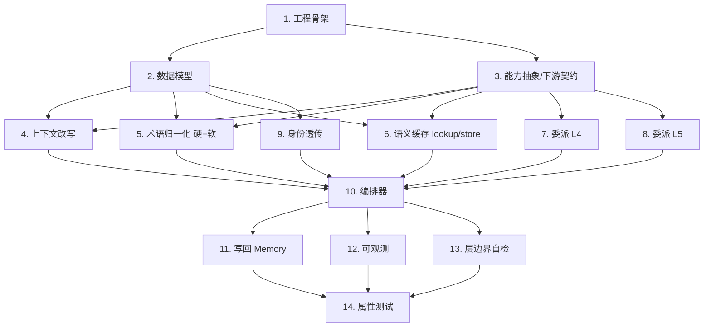

# Implementation Plan: Layer 3 —— query-engine（核心编排引擎）

## Overview

本计划依据 `design.md` 与 `requirements.md` 为 Layer 3 生成实现任务。L3 是 EKS 上的编排器：固定顺序驱动本层节点（上下文改写 → 术语归一化 → 语义缓存）并委派下游（L4 生成 → L5 守卫 →〔执行〕），产出面向当前用户的安全答案。

**语言/技术**：Python 3.11、pytest、hypothesis。Memory/LLM/向量/字典/下游层均以注入抽象接口接入，测试用 mock。

**编码前置（steering）**：实现术语归一化软通道前**先读 SQLBot** `terminology/`、`datasource/embedding/` 借鉴召回思路，**clean-room 重写、不复制源码**。

**本期范围基线（务必遵守）——本期实现除"物理执行/取数"外的全部编排能力**：
- **不执行 SQL**：**跳过执行节点**，不调 `DatasourceAdapter.execute`；`Answer` 携带 **safe_sql（无 rows）**；`AnswerStatus.OK` 本期重定义为"**L5 返回 ALLOWED、已产出 safe_sql**"。
- **语义缓存 store 条件放宽**：完整设计要求"未命中 ∧ L5 通过 ∧ **执行成功**"才存；本期无执行 → 放宽为"**未命中 ∧ L5 通过**"即存 隔离前 SQL（Req 7.1/7.3、Property 9 的本期适配）。
- **本期做**：AgentCore Memory 多轮改写、术语归一化（硬字典+软术语库）、语义缓存（lookup/store/invalidate）、委派 L4、委派 L5、身份透传、可观测。
- **dialect 硬编码** `starrocks`；执行委派接口保留但桩化（未来接 L6/7 再启用）。
- **层边界**：不认证/不限流、不生成 SQL、不注入隔离/只读、不解析用户范围（QueryContext 无 org_ids/ps_ids）。

## Tasks

- [ ] 1. 工程骨架与常量
  - 建立包结构（`query_engine/`：`models.py` / `deps.py` / `orchestrator.py` / `nodes/`（context_rewriter/term_normalizer/semantic_cache）/ `clients/`（memory/layer4/layer5/datasource）/ `observer.py` / `errors.py` / `config.py`）
  - 定义 dialect 常量/配置 `DIALECT = "starrocks"`；配置项 `RECENT_TURNS_LIMIT=5`、`CACHE_SIMILARITY_THRESHOLD=0.95`、命名空间 `semantic_cache`/`glossary`
  - pytest 骨架 + conftest（各抽象 mock fixture）
  - _Requirements: 1.6_

- [ ] 2. 数据模型
- [ ] 2.1 请求/身份/上下文
  - 实现 `CallerIdentity`、`QueryRequest`（request_id/identity/raw_question/session_id/datasource_id/model_id/locale）、`QueryContext`（追加式写入；`request` 不可变；**无 org_ids/ps_ids 字段**）
  - 单测：QueryContext 追加式；request 不可变；断言无范围字段
  - _Requirements: 10.2, 13.5, 13.6_
- [ ] 2.2 产出与中间模型
  - 实现 `AnswerStatus`（OK/NO_SQL/REJECTED/UPSTREAM_ERROR）、`Answer`（**本期 rows 可空、承载 safe_sql**、sql_source、message、request_traces）、`NodeTrace`、`ResolvedEntity`、`ResolvedTerm`、`CacheLookup`、`QuerySource`（CACHE_HIT/PIPELINE）
  - 单测：字段默认值；本期 OK 语义（有 safe_sql 无 rows）
  - _Requirements: 11.2, 11.3, 14.2_

- [ ] 3. 能力抽象接口与下游客户端契约
  - 定义 `MemoryClient`（read_recent_turns / write_turn）、`LlmClient`、`Embedder`、`VectorStore`、`EntityDictionary`、`Layer4Client`（run(PipelineInput)->PipelineResult）、`Layer5GuardFactory.for_identity(identity)->Layer5Guard`（guard(sql,request_id)->GuardResult）、`DatasourceAdapter`（dialect / execute —— **本期桩，不调用**）
  - 单测：接口契约、mock 可替换
  - _Requirements: 1.7, 9.4, 15.2, 15.3_

- [ ] 4. 上下文改写节点 `ContextRewriter`（多轮 · AgentCore Memory）
  - 以 actor_id=user_id、session_id 读取最近 5 轮；历史为空 → standalone=raw_question；非空 → LLM 改写为独立问题
  - Memory 读取失败 → standalone=raw_question + `memory_degraded=True` + warnings 降级记录
  - 单测（mock memory/llm）：空历史、有历史改写、读取失败降级
  - _Requirements: 2.1, 2.2, 2.3, 2.4_

- [ ] 5. 术语归一化节点 `TermNormalizer`
- [ ] 5.1 硬通道 `HardEntityResolver`（确定性）
  - 经 `EntityDictionary` 将候选实体表述映射为带标准 id 的 `ResolvedEntity`；**确定性、不调 LLM、无随机**；无命中不产出且不中断；写入 `resolved_entities`
  - 单测：同一表述恒定同一结果；未命中跳过；确定性
  - _Requirements: 3.1, 3.2, 3.3, 3.4_
- [ ] 5.2 软通道 `SoftGlossaryResolver`（参考 SQLBot 术语库思路，重写）
  - 先读 SQLBot `terminology/` 借鉴思路；clean-room 重写
  - Embedder 向量化 → `glossary` 命名空间 Vector_Store 检索同义词+定义；空/失败均不产出且不中断；写入 `resolved_terms`
  - 单测（mock embedder/vector_store）：命中、空、失败不中断
  - _Requirements: 4.1, 4.2, 4.3, 4.4, 15.1_

- [ ] 6. 语义缓存 `SemanticCache`
- [ ] 6.1 lookup
  - 向量化 standalone_question → `semantic_cache` 命名空间 top_k=1；相似度 ≥ 0.95 → hit=True 带 pre_isolation_sql+相似度；< 0.95 或无结果 → hit=False；lookup 失败按未命中 + warnings
  - 单测：命中/未命中/无结果/失败降级
  - _Requirements: 5.1, 5.2, 5.3, 5.4, 5.5_
- [ ] 6.2 store（本期放宽条件）与 invalidate
  - **本期 store 条件**：未命中 ∧ L5 ALLOWED → 存 `unvalidated_sql`（隔离前 SQL）；**仅存隔离前 SQL，绝不存 safe_sql**
  - 代码显式标注："完整设计还要求执行成功；本期无执行故省略该条件（Property 9 本期适配）"，保留 execution-success 校验位以便未来恢复
  - invalidate：schema 版本/TTL/显式失效
  - 单测：只存隔离前 SQL；本期 store 触发条件；命中路径不 store；invalidate
  - _Requirements: 6.4, 7.1, 7.2, 7.3, 7.4_

- [ ] 7. 委派 Layer 4
  - 未命中时构造 `PipelineInput`（standalone_question + resolved_entities + resolved_terms；**不含 org_ids/ps_ids**）；OK → 写 pre_isolation_sql + sql_source=PIPELINE；NO_SQL → Answer(NO_SQL) 不缓存不执行；ERROR → Answer(UPSTREAM_ERROR)
  - 单测：input 无范围字段；三种 status 分支
  - _Requirements: 8.1, 8.2, 8.3, 8.4, 8.5_

- [ ] 8. 委派 Layer 5（统一守卫入口）
  - 经 `Layer5GuardFactory.for_identity(identity)` 每请求构造 Guard；命中的 pre_isolation_sql 与 L4 未校验 SQL 走**同一** `guard(sql, request_id)`；ALLOWED → safe_sql 进入（本期）答案组装；REJECTED → Answer(REJECTED) 不执行
  - 单测：两来源同一入口；ALLOWED/REJECTED 分支；每请求构造
  - _Requirements: 9.1, 9.2, 9.3, 9.4_

- [ ] 9. 身份透传（不解析范围）
  - CallerIdentity 逐字段一致透传给 Layer5（工厂）；不修改/增删身份声明；QueryContext 无 org_ids/ps_ids；不构造带权限过滤的 SQL
  - 单测：透传逐字段相等；无范围解析
  - _Requirements: 10.1, 10.2, 10.3_

- [ ] 10. 编排器 `QueryOrchestrator`（固定顺序 + 分支汇聚 + 本期执行截断）
  - 固定顺序：context_rewrite → term_normalization → semantic_cache_lookup →（命中: L5 | 未命中: L4 → L5）→ 〔本期跳过 execute〕→ 组装 Answer → 写回 Memory
  - 命中/未命中两分支**必汇聚于 L5 之后**（结构上保证"命中仍过 L5"）
  - **本期执行截断**：不调 `datasource.execute`；L5 ALLOWED 后直接组装 `Answer(status=OK, rows=None, safe_sql=..., sql_source=...)`；执行委派接口保留但桩化并注释"待 L6/7 接入启用"
  - QueryContext 生命周期管理；节点包装（计时+trace+统一异常）
  - 单测：固定顺序；命中/未命中都过 L5；本期 OK 组装（safe_sql 无 rows）；NO_SQL/REJECTED/UPSTREAM_ERROR 映射
  - _Requirements: 1.1, 1.2, 1.3, 1.4, 1.5, 1.6, 1.7, 11.2, 11.3_

- [ ] 11. 写回 Memory
  - 收尾调用 `Memory_Client.write_turn` 写回 standalone_question + 答案摘要；write_turn 失败 → warnings 且仍正常返回 Answer
  - 单测：正常写回；失败降级仍返回
  - _Requirements: 12.1, 12.2_

- [ ] 12. 可观测
  - request_id 贯穿本层并透传 L4（PipelineInput.request_id）与 L5（guard 的 request_id）；每节点追加 NodeTrace（耗时/成败/相似度或下游状态）；暴露缓存命中率/各节点延迟/L5 拒绝率/Memory 降级率；日志脱敏（不落范围/凭证/数据明文）
  - 单测：request_id 贯穿；trace 完整；脱敏
  - _Requirements: 14.1, 14.2, 14.3, 14.4_

- [ ] 13. 层边界自检
  - 断言 L3 不认证/不限流、不生成 SQL、不注入隔离/只读、不持连接池/不物理执行（本期执行节点桩化即体现）
  - 单测：越界检测；QueryContext 无范围字段
  - _Requirements: 13.1, 13.2, 13.3, 13.4_

- [ ] 14. 属性测试（覆盖 10 条正确性属性，含本期适配）
  - hypothesis 覆盖 Property 1~10；其中 **Property 9（存缓存前置）本期为"未命中∧L5通过"**、**Property 10（答案状态映射）本期 OK ⟺ 产出 safe_sql**（无执行）
  - 重点：命中必过 L5（P1）、缓存只存隔离前 SQL（P2）、L4 收独立问题（P3）、L3 不注入/不解析范围（P4）、硬归一化确定性（P5）、编排顺序固定（P6）、身份透传一致（P7）、request 不可变（P8）
  - _Requirements: 1.1, 1.2, 1.3, 1.4, 6.2, 6.3, 7.1, 7.2, 8.1, 8.4, 8.5, 9.1, 9.2, 9.3, 9.4, 10.1, 10.2, 10.3, 3.2, 13.5, 13.6_

## Task Dependency Graph

```json
{
  "waves": [
    { "wave": 1, "tasks": ["1"] },
    { "wave": 2, "tasks": ["2.1", "2.2", "3"] },
    { "wave": 3, "tasks": ["4", "5.1", "5.2", "6.1", "6.2"] },
    { "wave": 4, "tasks": ["7", "8", "9"] },
    { "wave": 5, "tasks": ["10"] },
    { "wave": 6, "tasks": ["11", "12", "13"] },
    { "wave": 7, "tasks": ["14"] }
  ]
}
```



## Notes

- **本期与完整设计的唯一实质差异 = 去掉"物理执行/取数"**：跳过 execute 节点，`Answer` 返回 safe_sql（无 rows），`AnswerStatus.OK` 重定义为"L5 ALLOWED"；缓存 store 放宽为"未命中 ∧ L5 通过"。其余（Memory 多轮、硬+软术语归一化、语义缓存、委派 L4/L5、身份透传、可观测）全部实现。
- **接口保留、行为桩化**：`DatasourceAdapter.execute` 与"执行成功"相关的缓存条件位保留在代码里并注释，未来接入 L6/7 恢复即可，不返工编排骨架。
- **两条红线不受本期影响**：① 缓存命中仍过 L5；② 缓存只存隔离前 SQL、绝不存 safe_sql。
- **SQLBot 参考红线**：术语库软通道（T5.2）先读 SQLBot 借思路、clean-room 重写。
- **依赖顺序**：骨架→模型/抽象→三类本层节点（改写/归一化/缓存）与下游委派→编排器→收尾/观测/边界→属性测试。
- 属性测试用例量大，CI 单独分组。
