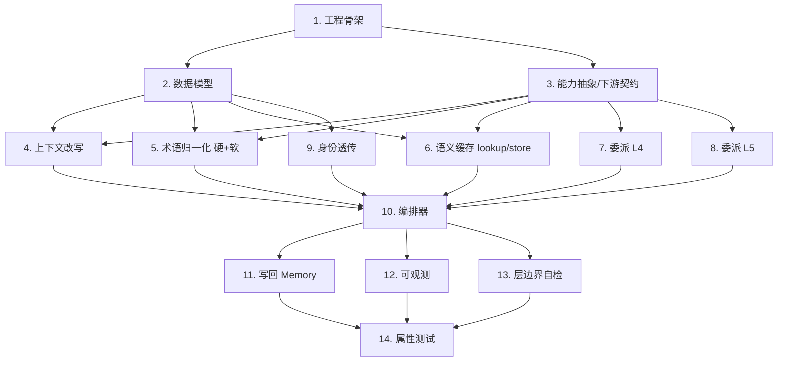

# Implementation Plan: Layer 3 —— query-engine（核心编排引擎）

## Overview

本计划依据 `design.md` 与 `requirements.md` 为 Layer 3 生成实现任务。L3 是 EKS 上的编排器：固定顺序驱动本层节点（上下文改写 → 术语归一化 → 语义缓存）并委派下游（L4 生成 → L5 守卫 →〔执行〕），产出面向当前用户的安全答案。

**语言/技术**：Python 3.11、pytest、hypothesis。Memory/LLM/向量/字典/下游层均以注入抽象接口接入，测试用 mock。

**编码前置（steering）**：实现术语归一化软通道前**先读 SQLBot** `terminology/`、`datasource/embedding/` 借鉴召回思路，**clean-room 重写、不复制源码**。

**本期范围基线（务必遵守）——本期实现除"物理执行/取数"外的全部编排能力**：
- **不执行 SQL**：**跳过执行节点**，不调 `DatasourceAdapter.execute`；`Answer` 携带 **safe_sql（无 rows）**；`AnswerStatus.OK` 本期重定义为"**L5 返回 ALLOWED、已产出 safe_sql**"。
- **语义缓存 store 条件放宽**：完整设计要求"未命中 ∧ L5 通过 ∧ **执行成功**"才存；本期无执行 → 放宽为"**未命中 ∧ L5 通过**"即存 隔离前 SQL（Req 7.1/7.3、Property 9 的本期适配）。
- **本期做**：AgentCore Memory 多轮改写、术语归一化（硬字典+软术语库）、语义缓存（lookup/store/invalidate）、委派 L4、委派 L5、身份透传、可观测。
- **dialect 硬编码** `starrocks`；执行委派接口保留但桩化（未来接 L6/7 再启用）。
- **层边界**：不认证/不限流、不生成 SQL、不注入隔离/只读、不解析用户范围（QueryContext 无 org_ids/ps_ids）。

## Tasks

- [x] 1. 工程骨架与常量
  - 建立包结构（`query_engine/`：`models.py` / `deps.py` / `orchestrator.py` / `nodes/`（context_rewriter/term_normalizer/semantic_cache）/ `clients/`（memory/layer4/layer5/datasource）/ `observer.py` / `errors.py` / `config.py`）
  - 定义 dialect 常量/配置 `DIALECT = "starrocks"`；配置项 `RECENT_TURNS_LIMIT=5`、`CACHE_SIMILARITY_THRESHOLD=0.95`、命名空间 `semantic_cache`/`glossary`
  - pytest 骨架 + conftest（各抽象 mock fixture）
  - _Requirements: 1.6_

- [x] 2. 数据模型
- [x] 2.1 请求/身份/上下文
  - 实现 `CallerIdentity`、`QueryRequest`（request_id/identity/raw_question/session_id/datasource_id/model_id/locale）、`QueryContext`（追加式写入；`request` 不可变；**无 org_ids/ps_ids 字段**）
  - 单测：QueryContext 追加式；request 不可变；断言无范围字段
  - _Requirements: 10.2, 13.5, 13.6_
- [x] 2.2 产出与中间模型
  - 实现 `AnswerStatus`（OK/NO_SQL/REJECTED/UPSTREAM_ERROR）、`Answer`（**本期 rows 可空、承载 safe_sql**、sql_source、message、request_traces）、`NodeTrace`、`ResolvedEntity`、`ResolvedTerm`、`CacheLookup`、`QuerySource`（CACHE_HIT/PIPELINE）
  - 单测：字段默认值；本期 OK 语义（有 safe_sql 无 rows）
  - _Requirements: 11.2, 11.3, 14.2_

- [x] 3. 能力抽象接口与下游客户端契约
  - 定义 `MemoryClient`（read_recent_turns / write_turn）、`LlmClient`、`Embedder`、`VectorStore`、`EntityDictionary`、`Layer4Client`（run(PipelineInput)->PipelineResult）、`Layer5GuardFactory.for_identity(identity)->Layer5Guard`（guard(sql,request_id)->GuardResult）、`DatasourceAdapter`（dialect / execute —— **本期桩，不调用**）
  - 单测：接口契约、mock 可替换
  - _Requirements: 1.7, 9.4, 15.2, 15.3_

- [x] 4. 上下文改写节点 `ContextRewriter`（多轮 · AgentCore Memory）
  - 以 actor_id=user_id、session_id 读取最近 5 轮；历史为空 → standalone=raw_question；非空 → LLM 改写为独立问题
  - Memory 读取失败 → standalone=raw_question + `memory_degraded=True` + warnings 降级记录
  - 单测（mock memory/llm）：空历史、有历史改写、读取失败降级
  - _Requirements: 2.1, 2.2, 2.3, 2.4_

- [x] 5. 术语归一化节点 `TermNormalizer`
- [x] 5.1 硬通道 `HardEntityResolver`（确定性）
  - 经 `EntityDictionary` 将候选实体表述映射为带标准 id 的 `ResolvedEntity`；**确定性、不调 LLM、无随机**；无命中不产出且不中断；写入 `resolved_entities`
  - 单测：同一表述恒定同一结果；未命中跳过；确定性
  - _Requirements: 3.1, 3.2, 3.3, 3.4_
- [x] 5.2 软通道 `SoftGlossaryResolver`（参考 SQLBot 术语库思路，重写）
  - 先读 SQLBot `terminology/` 借鉴思路；clean-room 重写
  - Embedder 向量化 → `glossary` 命名空间 Vector_Store 检索同义词+定义；空/失败均不产出且不中断；写入 `resolved_terms`
  - 单测（mock embedder/vector_store）：命中、空、失败不中断
  - _Requirements: 4.1, 4.2, 4.3, 4.4, 15.1_

- [x] 6. 语义缓存 `SemanticCache`
- [x] 6.1 lookup
  - 向量化 standalone_question → `semantic_cache` 命名空间 top_k=1；相似度 ≥ 0.95 → hit=True 带 pre_isolation_sql+相似度；< 0.95 或无结果 → hit=False；lookup 失败按未命中 + warnings
  - 单测：命中/未命中/无结果/失败降级
  - _Requirements: 5.1, 5.2, 5.3, 5.4, 5.5_
- [x] 6.2 store（本期放宽条件）与 invalidate
  - **本期 store 条件**：未命中 ∧ L5 ALLOWED → 存 `unvalidated_sql`（隔离前 SQL）；**仅存隔离前 SQL，绝不存 safe_sql**
  - 代码显式标注："完整设计还要求执行成功；本期无执行故省略该条件（Property 9 本期适配）"，保留 execution-success 校验位以便未来恢复
  - invalidate：schema 版本/TTL/显式失效
  - 单测：只存隔离前 SQL；本期 store 触发条件；命中路径不 store；invalidate
  - _Requirements: 6.4, 7.1, 7.2, 7.3, 7.4_

- [x] 7. 委派 Layer 4
  - 未命中时构造 `PipelineInput`（standalone_question + resolved_entities + resolved_terms；**不含 org_ids/ps_ids**）；OK → 写 pre_isolation_sql + sql_source=PIPELINE；NO_SQL → Answer(NO_SQL) 不缓存不执行；ERROR → Answer(UPSTREAM_ERROR)
  - 单测：input 无范围字段；三种 status 分支
  - _Requirements: 8.1, 8.2, 8.3, 8.4, 8.5_

- [x] 8. 委派 Layer 5（统一守卫入口）
  - 经 `Layer5GuardFactory.for_identity(identity)` 每请求构造 Guard；命中的 pre_isolation_sql 与 L4 未校验 SQL 走**同一** `guard(sql, request_id)`；ALLOWED → safe_sql 进入（本期）答案组装；REJECTED → Answer(REJECTED) 不执行
  - 单测：两来源同一入口；ALLOWED/REJECTED 分支；每请求构造
  - _Requirements: 9.1, 9.2, 9.3, 9.4_

- [x] 9. 身份透传（不解析范围）
  - CallerIdentity 逐字段一致透传给 Layer5（工厂）；不修改/增删身份声明；QueryContext 无 org_ids/ps_ids；不构造带权限过滤的 SQL
  - 单测：透传逐字段相等；无范围解析
  - _Requirements: 10.1, 10.2, 10.3_

- [x] 10. 编排器 `QueryOrchestrator`（固定顺序 + 分支汇聚 + 本期执行截断）
  - 固定顺序：context_rewrite → term_normalization → semantic_cache_lookup →（命中: L5 | 未命中: L4 → L5）→ 〔本期跳过 execute〕→ 组装 Answer → 写回 Memory
  - 命中/未命中两分支**必汇聚于 L5 之后**（结构上保证"命中仍过 L5"）
  - **本期执行截断**：不调 `datasource.execute`；L5 ALLOWED 后直接组装 `Answer(status=OK, rows=None, safe_sql=..., sql_source=...)`；执行委派接口保留但桩化并注释"待 L6/7 接入启用"
  - QueryContext 生命周期管理；节点包装（计时+trace+统一异常）
  - 单测：固定顺序；命中/未命中都过 L5；本期 OK 组装（safe_sql 无 rows）；NO_SQL/REJECTED/UPSTREAM_ERROR 映射
  - _Requirements: 1.1, 1.2, 1.3, 1.4, 1.5, 1.6, 1.7, 11.2, 11.3_

- [x] 11. 写回 Memory
  - 收尾调用 `Memory_Client.write_turn` 写回 standalone_question + 答案摘要；write_turn 失败 → warnings 且仍正常返回 Answer
  - 单测：正常写回；失败降级仍返回
  - _Requirements: 12.1, 12.2_

- [x] 12. 可观测
  - request_id 贯穿本层并透传 L4（PipelineInput.request_id）与 L5（guard 的 request_id）；每节点追加 NodeTrace（耗时/成败/相似度或下游状态）；暴露缓存命中率/各节点延迟/L5 拒绝率/Memory 降级率；日志脱敏（不落范围/凭证/数据明文）
  - 单测：request_id 贯穿；trace 完整；脱敏
  - _Requirements: 14.1, 14.2, 14.3, 14.4_

- [x] 13. 层边界自检
  - 断言 L3 不认证/不限流、不生成 SQL、不注入隔离/只读、不持连接池/不物理执行（本期执行节点桩化即体现）
  - 单测：越界检测；QueryContext 无范围字段
  - _Requirements: 13.1, 13.2, 13.3, 13.4_

- [x] 14. 属性测试（覆盖 10 条正确性属性，含本期适配）
  - hypothesis 覆盖 Property 1~10；其中 **Property 9（存缓存前置）本期为"未命中∧L5通过"**、**Property 10（答案状态映射）本期 OK ⟺ 产出 safe_sql**（无执行）
  - 重点：命中必过 L5（P1）、缓存只存隔离前 SQL（P2）、L4 收独立问题（P3）、L3 不注入/不解析范围（P4）、硬归一化确定性（P5）、编排顺序固定（P6）、身份透传一致（P7）、request 不可变（P8）
  - _Requirements: 1.1, 1.2, 1.3, 1.4, 6.2, 6.3, 7.1, 7.2, 8.1, 8.4, 8.5, 9.1, 9.2, 9.3, 9.4, 10.1, 10.2, 10.3, 3.2, 13.5, 13.6_

## Task Dependency Graph

```json
{
  "waves": [
    { "wave": 1, "tasks": ["1"] },
    { "wave": 2, "tasks": ["2.1", "2.2", "3"] },
    { "wave": 3, "tasks": ["4", "5.1", "5.2", "6.1", "6.2"] },
    { "wave": 4, "tasks": ["7", "8", "9"] },
    { "wave": 5, "tasks": ["10"] },
    { "wave": 6, "tasks": ["11", "12", "13"] },
    { "wave": 7, "tasks": ["14"] }
  ]
}
```



## Notes

- **本期与完整设计的唯一实质差异 = 去掉"物理执行/取数"**：跳过 execute 节点，`Answer` 返回 safe_sql（无 rows），`AnswerStatus.OK` 重定义为"L5 ALLOWED"；缓存 store 放宽为"未命中 ∧ L5 通过"。其余（Memory 多轮、硬+软术语归一化、语义缓存、委派 L4/L5、身份透传、可观测）全部实现。
- **接口保留、行为桩化**：`DatasourceAdapter.execute` 与"执行成功"相关的缓存条件位保留在代码里并注释，未来接入 L6/7 恢复即可，不返工编排骨架。
- **两条红线不受本期影响**：① 缓存命中仍过 L5；② 缓存只存隔离前 SQL、绝不存 safe_sql。
- **SQLBot 参考红线**：术语库软通道（T5.2）先读 SQLBot 借思路、clean-room 重写。
- **依赖顺序**：骨架→模型/抽象→三类本层节点（改写/归一化/缓存）与下游委派→编排器→收尾/观测/边界→属性测试。
- 属性测试用例量大，CI 单独分组。

## Increment：canonical_rewrite（规范化改写，提升缓存命中率）

> 本增量在既有 L3 之上**新增规范化改写节点**。编排顺序更新为：`context_rewrite → term_normalization →【canonical_rewrite（新）】→ semantic_cache_lookup →（命中: L5 | 未命中: L4 → L5）`，**取代 Task 10 中的三节点顺序**。
> 核心变更：`QueryContext` 新增 `canonical_question`；**缓存 store/lookup 与传给 L4 的问题都改用 `canonical_question`**（两条红线不变：命中仍过 L5；缓存只存隔离前 SQL）。
> 依据：requirements.md Requirement 16；design.md §3.4 / §5.3 / §8.5 与 Property 11/12/13。
> **先读 SQLBot**：确定性替换的 Aho-Corasick 复用硬通道运行时匹配器思路，clean-room 重写、不复制源码。

- [x] 15. 数据模型与配置增量
  - `QueryContext` 新增 `canonical_question: Optional[str]`（追加式，不破坏既有字段）
  - `config.py` 新增 `CANONICAL_LLM_ENABLED=True`、`CANONICAL_REWRITE_MAX_LEN=200`（Rewrite_Max_Len）。注：LLM 模型 id 由 `BedrockLlmClient` 适配器绑定，`LlmClient.complete` 不含 model_id，故不新增 canonical_model_id 常量
  - 单测：默认值；`canonical_question` 追加写入不影响 `request` 不可变
  - _Requirements: 16.9_

- [x] 16. 确定性替换源 `TermReplacer`（synonyms→标准词 · Aho-Corasick）
  - 定义 `TermReplacer` 抽象（`replace(text)->str`）；适配器实现从术语库权威存储（DynamoDB `knowledge_glossary`）加载**启用**术语的 `synonyms→标准词`，构建 Aho-Corasick，最长匹配优先、避免子串误替换；确定性、不调 LLM
  - 枚举值同义词（如产品线：标准词=户用，synonyms=[家用, 家庭户用, residential, ...]）按软通道术语库建模
  - wiring 注入 `deps.term_replacer`
  - 单测（mock 术语库数据）：命中替换、未登记词不动、子串不误替换、同输入同输出（确定性）
  - _Requirements: 16.3_

- [x] 17. 单位/数字规则归一 `UnitNormalizer`（纯函数）
  - 规则归一：`1MW`/`一百万瓦`/`1000000瓦`/`100万w` → `1000000W`；中文数字与量词（万/亿）换算；大小写、全半角统一
  - 单测：覆盖上述各写法；无单位/非数字文本不误改；确定性
  - _Requirements: 16.4_

- [x] 18. `CanonicalRewriter` 节点（三段 A/B/C + 逐级回退）
  - 阶段A：`term_replacer.replace` + `UnitNormalizer.normalize`
  - 阶段B：`temperature=0` LLM 结构规范化，提示词硬约束语义槽位（过滤/比较/阈值/单位/聚合维度/聚合函数/排序方向/排序字段/输出字段）；输出超 `rewrite_max_len` 或调用失败 → 回退阶段A + warning
  - 阶段C：对阶段B 产出再跑一次确定性替换兜底；最差回退 `standalone_question`
  - 写入 `ctx.canonical_question`
  - 单测（mock llm/term_replacer）：阶段A 确定性；LLM 失败/超长回退；全失败回退 standalone；`canonical_question` 恒非空
  - _Requirements: 16.1, 16.2, 16.5, 16.6, 16.7, 16.8, 16.9, 16.13_

- [x] 19. 编排器接线 + 缓存/L4 改用 `canonical_question`
  - 编排器在 term_normalization 后、semantic_cache_lookup 前插入 `canonical_rewrite` 节点（含计时/trace）
  - `SemanticCache.lookup`/`store` 的向量化键改用 `ctx.canonical_question`
  - 委派 L4 的 `PipelineInput` 问题改用 `ctx.canonical_question`
  - 单测/回归：固定顺序含 canonical_rewrite；缓存键与 L4 问题均为 canonical_question；命中仍过 L5；缓存仍只存隔离前 SQL
  - _Requirements: 16.1, 16.10, 16.11, 1.1, 5.1, 8.1_

- [x] 20. 层边界自检增量
  - 断言 `canonical_rewrite` 不解析/写入 org_ids/ps_ids、不构造带权限过滤 SQL
  - 单测：越界检测
  - _Requirements: 16.12_

- [x] 21. 属性测试增量（Property 11/12/13）
  - hypothesis 覆盖：阶段A/C 确定性（P11）；缓存键与 L4 问题恒为 canonical_question（P12）；任一阶段失败逐级回退、canonical_question 恒非空、主流程不中断（P13）
  - _Requirements: 16.3, 16.4, 16.6, 16.7, 16.8, 16.9, 16.10, 16.11, 16.13_

- [x] 22. 缓存召回评测（eval 数据集 + 集成测试 + 报告脚本）
  - 使用 `eval/cache_recall/positives.csv`（24 正例 + 基准 Q0）与 `negatives.csv`（困难反例）
  - 集成测试：独立命名空间只写入 Q0；对每条正例走完整 canonical_rewrite→lookup，断言命中且命中的是 Q0 条目、返回隔离前 SQL、命中后仍过 L5；对反例断言不命中 Q0
  - 报告脚本：产出 正例召回率 / 反例拒绝率 / 误命中数 / 命中缓存键 / 相似度分布；输出改造前后对比
  - 语义槽位保持检查：正例规范化后关键槽位不变；反例槽位差异被保留
  - _Requirements: 5.1, 5.2, 6.2, 6.3, 7.1, 7.2, 16.10, 16.11_

- [ ] 23. 真实依赖冒烟（Bedrock + AOSS）
  - 设好环境变量后，用真实 Embedder/LLM/VectorStore 跑正例+反例召回，记录相似度分布与改写稳定性
  - 观察 0.95 阈值下正例召回与反例拒绝，必要时回报是否需调阈值（阈值改动需另行确认，不在本增量擅自调整）
  - _Requirements: 15.2, 15.3_

### Increment 依赖顺序

```json
{
  "waves": [
    { "wave": 1, "tasks": ["15", "16", "17"] },
    { "wave": 2, "tasks": ["18"] },
    { "wave": 3, "tasks": ["19", "20"] },
    { "wave": 4, "tasks": ["21", "22"] },
    { "wave": 5, "tasks": ["23"] }
  ]
}
```

## Increment：语义槽位指纹缓存门禁（Slot Fingerprint Gate，拒误命中）

> 依据：requirements.md Requirement 17；design.md §5.4 / §6.2 / §8.5 / §8.6 与 Property 14/15/16。
> 动机（实测）：规范化改写把正例相似度抬到 ~0.90–0.98，但嵌入无法区分“升序/降序、大于/小于、单位量级、按电站/按机型”等关键槽位（N5 余弦 0.94–0.997 高于全部正例），换嵌入模型（Cohere ml-v3）也不解决。故在向量召回之上加结构化槽位精确门禁。
> 分工：向量相似度=召回；Semantic_Slots 全等=门禁（fail-safe，绝不误命中）。两条红线不变：命中仍过 L5；缓存只存隔离前 SQL。

- [ ] 24. 数据模型：`SemanticSlots`（models.py）+ `QueryContext.semantic_slots`
  - 字段：comparison/threshold_watts/metric/group_by/agg_func/sort_direction/sort_field/output_entity/product_line/top_n/extra_filters
  - `to_json`/`from_json`（缓存序列化）；`slots_equal` 关键槽位全等比较
  - 单测：序列化往返、相等/不等、缺字段
  - _Requirements: 17.1, 17.7_

- [ ] 25. `CanonicalRewriter` 产出 slots（合并式 LLM 结构化 + 确定性归一 + fail-safe）
  - 阶段B 改为结构化输出 `{"canonical","slots"}`（temperature=0）
  - 归一：单位→瓦整数、方向/运算/聚合→枚举、术语→标准词（复用 UnitNormalizer/TermReplacer）
  - 解析失败/缺失 → `semantic_slots=None`（fail-safe），canonical 仍三段回退
  - 单测（mock llm）：正常抽取+归一；JSON 坏 → slots=None 且 canonical 正常；确定性归一可复现
  - _Requirements: 17.1, 17.2, 17.3_

- [ ] 26. `SemanticCache` 门禁：store 存 slots；lookup=向量召回 top_k + 槽位全等
  - `store(question, pre_isolation_sql, slots)` → payload 增 `slots_json`
  - `lookup(question, slots)`：top_k≥1 召回 → 相似度≥阈值候选 → 首个 `slots_equal` 者命中；任一侧 slots 为空 → 未命中
  - 单测（mock 向量库）：槽位全等才命中；关键槽位不等即未命中（即便 sim=0.99）；slots=None → 未命中
  - _Requirements: 17.4, 17.5, 17.6, 17.7_

- [ ] 27. 编排器接线
  - lookup 传 `ctx.semantic_slots`；store 传 `ctx.semantic_slots`
  - 回归：命中仍过 L5；缓存仍只存隔离前 SQL；固定顺序不变
  - _Requirements: 17.5, 17.8_

- [ ] 28. 属性测试（Property 14/15/16）
  - 关键槽位不等 ⟹ 未命中（即便 sim≥阈值）；任一侧 slots 空 ⟹ 未命中；命中 ⟹ 槽位全等 ∧ sim≥阈值
  - _Requirements: 17.3, 17.5, 17.6, 17.7_

- [ ] 29. eval 重跑（AOSS，公网切换→跑→恢复）
  - 冒烟脚本增加槽位门禁；对正例断言（同槽位）命中、对反例断言（异槽位）不命中；产出召回↑、误命中→0 的对比
  - 阈值可放宽以观察召回上限（阈值默认改动仍作独立议题）
  - _Requirements: 17.5, 17.6, 5.1, 6.2_

### Increment 依赖顺序
```json
{ "waves": [ {"wave":1,"tasks":["24"]}, {"wave":2,"tasks":["25","26"]}, {"wave":3,"tasks":["27","28"]}, {"wave":4,"tasks":["29"]} ] }
```

## Increment：抽取确定性加固（规则型抽取 + 抽取模型独立配置）

> 依据：requirements.md Req 17.10 / 17.11；design.md §5.4。
> 动机（实测）：新型旗舰模型（Opus 5 / Sonnet 5）取消 temperature → 抽取非确定性 → "入库槽位≠查询槽位" → 召回崩（精确率不受影响）。故把最具判别性的槽位改为规则型确定性抽取，并把抽取模型独立可配置、钉在支持 temperature=0 的模型上。

- [x] 30. `LlmClient.complete` 增 `model_id` 形参；`EngineDependencies.canonical_model_id`；`AwsSettings.slot_extraction_model_id`（env `SMARTQUERY_SLOT_MODEL_ID`，默认 Sonnet 4.6）；wiring 注入
- [x] 31. `BedrockLlmClient`：模型拒绝 `temperature` 时自动去参重试（兼容 Opus 5 / Sonnet 5 等）
- [x] 32. `CanonicalRewriter`：规则型确定性抽取 comparison/threshold_watts/sort_direction/top_n（基于 stage_a），覆盖 LLM 值；LLM 调用传 `model_id`
- [x] 33. orchestrator 传 `deps.canonical_model_id`；FakeLlm 接受 `model_id`
- [x] 34. 单测：规则抽取（比较符/阈值/方向/TopN 确定性且覆盖 LLM）、model_id 透传
- _Requirements: 17.2, 17.10, 17.11_
