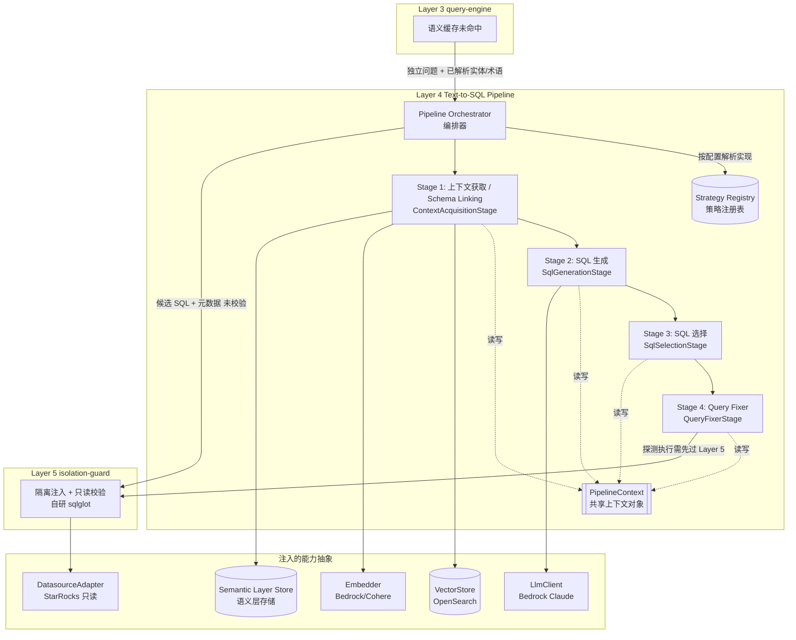
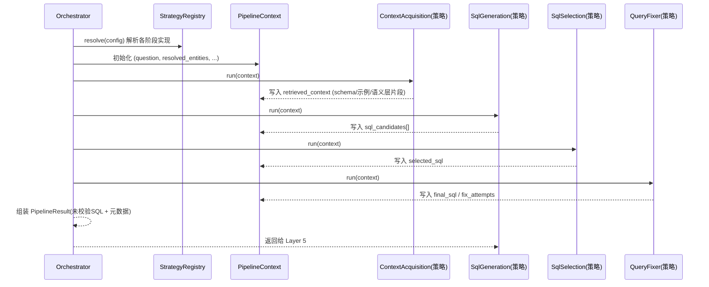
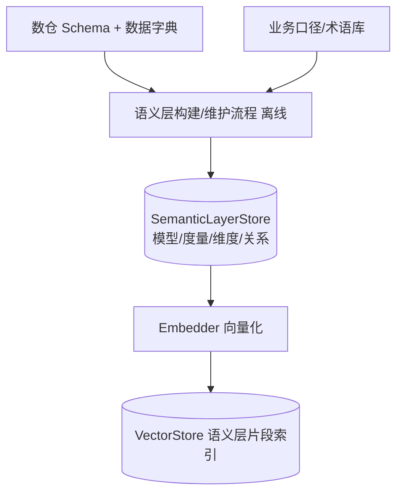
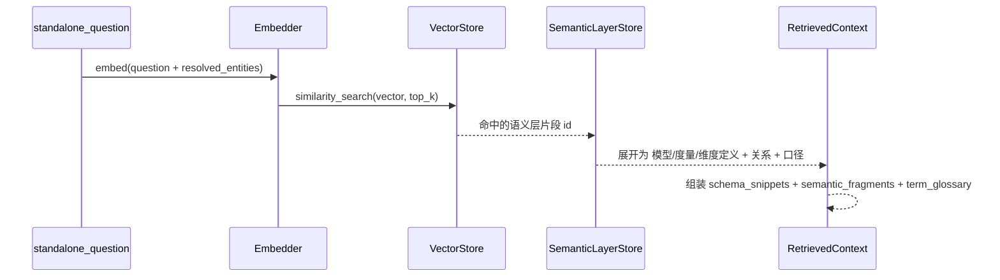

# 设计文档：Layer 4 —— Text-to-SQL Pipeline（插拔式）

> **所属系统**：智能问数（智能数据问答）系统 v2，见 `docs/smart-query-architecture-v2.md`
> **本文档范围**：仅覆盖 **Layer 4（Text-to-SQL Pipeline）** 的设计
> **设计形态**：高层设计（架构 / 组件 / 数据模型 / 扩展点）+ 低层设计（Python 接口签名 / 伪代码 / 分策略契约 / 配置驱动切换）
> **语言约定**：团队以中文协作，本文档正文中文；代码示例用 Python（服务运行于 EKS 的 Python 服务）

---

## Overview

## 1. 目的与范围（Purpose & Scope）

### 1.1 目的

Layer 4 负责把一个**已经改写为独立、自包含的自然语言问题**转换为一条**未经安全校验的候选 SQL**（unvalidated SQL），并将其连同元数据交给 Layer 5（隔离守卫）。其核心设计诉求不是"实现某一条固定链路"，而是把整条链路拆成**可插拔、可配置切换、彼此隔离、易扩展**的若干阶段（Stage），使得未来新增算法（新的上下文获取策略、新的生成器、新的选择器）时，**只新增实现类，不改动上下游阶段**。

### 1.2 核心设计洞察（必须落地）

- Layer 4 **绝不硬编码单一路径**（不能写死 "RAG Schema Linking → SQL Generation"）。
- **"上下文获取"（Context Acquisition）这一步必须是抽象的、可插拔的策略**，具备多个可互换实现，例如：
  - RAG 检索（Bedrock Knowledge Bases）
  - 语义层检索（Semantic Layer Retrieval）——构建语义层，按问题从语义层检索相关上下文，再喂给 LLM 生成 SQL
  - MDL（Modeling Definition Language，借鉴 WrenAI）
  - M-Schema / NL Semantic Layer
- 整条流水线阶段为：**Schema Linking / 上下文获取 → SQL 生成 → SQL 选择 → Query Fixer（查询修复）**。每个阶段都要抽象（可插拔、可配置切换）、良好隔离、可扩展。
- 三大设计目标：**抽象（Abstraction）、隔离（Isolation / 关注点分离）、可扩展（Extensibility）**。

### 1.3 边界：Layer 4 拥有什么 / 不拥有什么

明确边界是本设计的第一原则，务必保持清晰。

| 维度 | 归属 | 说明 |
|------|------|------|
| 入口触发 | 上游 Layer 3（语义缓存**未命中**时） | 缓存命中路径**不经过** Layer 4，直接进 Layer 5 重注隔离 |
| 多轮上下文改写 / 指代消解 | **Layer 3（AgentCore Memory）** | Layer 4 收到的已是"独立问题"，**不在此重复求解** |
| 术语归一化（硬 / 软） | **Layer 3** | Layer 4 接收的输入中已带 Layer 3 解析出的实体 / 术语 |
| Schema Linking / 上下文获取 | ✅ **Layer 4** | 可插拔策略 |
| SQL 生成 | ✅ **Layer 4** | 默认单 LLM，可选多生成器 / Gated 路由 |
| SQL 选择 | ✅ **Layer 4** | 默认直通，可选自一致性 / 选择 Agent |
| Query Fixer（执行失败的有限次修复） | ✅ **Layer 4** | 依赖 Layer 7 的只读探测执行来判定失败 |
| **数据隔离注入（WHERE org_id/ps_id IN ...）** | ❌ **Layer 5（isolation-guard，自研 sqlglot）** | **Layer 4 绝不做行级隔离** |
| **只读强制校验（禁非 SELECT）** | ❌ **Layer 5** | **Layer 4 绝不做只读强制** |
| 权限解析（用户 → org_ids/ps_ids） | ❌ **Layer 5** | Layer 4 不接触用户数据范围 |
| 连接池 / 执行代理 | ❌ **Layer 6（ProxySQL）** | Layer 4 经 `DatasourceAdapter` 间接使用 |

> **铁律**：Layer 4 输出的是"未校验 SQL"。任何隔离与只读的正确性由 Layer 5 保证。**Query Fixer 若需试跑 SQL 探测错误，也必须走 Layer 5 校验后再经 Layer 6/7 执行**（见 §9 权衡），绝不允许 Layer 4 绕过隔离直连数据源。

### 1.4 复用与许可约束

- **借鉴 SQLBot**（DataEase）的分阶段 Pipeline 模式与术语库 / 示例召回思路，但 SQLBot 为 **modified-GPLv3**：**只借鉴 / 重新实现思路，绝不复制其 GPLv3 源码**。
- **WrenAI**（Apache-2.0）的语义层（MDL）方法，未来可作为**一个可插拔的上下文获取策略**接入。
- **vanna** 的可插拔抽象（`SqlRunner` / `ErrorRecoveryStrategy` 等）作为接口分层参考。
- 复用系统既有抽象：`VectorStore`（当前 OpenSearch）、`Embedder`（当前 Bedrock/Cohere）、`DatasourceAdapter`（当前 StarRocks）。LLM 用 Amazon Bedrock（默认 Claude Sonnet，支持模型选择）。

---

## Architecture

## 2. 高层架构（High-Level Architecture）

### 2.1 总体思想

Layer 4 = **一个编排器（Orchestrator）** 顺序驱动 **一串可插拔阶段（Stage）**，阶段之间通过**一个共享的上下文对象（`PipelineContext`）** 传递状态。每个阶段的**具体实现由配置选择**，实现的注册与查找由**策略注册表（Strategy Registry）** 完成。



### 2.2 三个关键机制

1. **共享上下文对象（`PipelineContext`）**：贯穿全流程的不可变式追加状态容器。每个阶段**只读取它需要的字段、只写入它负责产出的字段**，禁止跨阶段直接引用彼此的内部实现。这是"隔离"的载体。
2. **策略注册表（`StrategyRegistry`）**：按 `(stage_type, strategy_name)` 注册与查找阶段实现。新增策略 = 注册一个新实现，编排器无感。
3. **配置驱动选择（Config-Driven Selection）**：每个阶段选用哪个实现，由配置（`PipelineConfig`）决定；编排器在启动时（或每请求）从注册表解析出具体实例。

### 2.3 一次典型执行（缓存未命中）



---

## Components and Interfaces

## 3. 阶段抽象与接口（Stage Abstractions）

所有阶段实现统一的 `PipelineStage` 协议：输入 / 输出都是 `PipelineContext`（追加式写入），从而保证**阶段可任意替换、可独立测试、可 mock**。

### 3.1 阶段一：上下文获取 / Schema Linking（`ContextAcquisitionStage`）

**职责**：给定问题（及已解析实体 / 术语），产出"喂给 LLM 生成 SQL 所需的上下文"——包括相关表 / 列 schema、few-shot 示例、术语定义、或语义层片段。**这是本设计最强调的可插拔点**。

**可插拔策略（互换实现）**：

| 策略名 | 实现思路 | 上下文来源 | 备注 |
|--------|---------|-----------|------|
| `rag` | RAG 检索：问题向量化 → `VectorStore` 检索 schema 片段 / 示例 | Bedrock Knowledge Bases / OpenSearch | 默认策略 |
| `semantic_layer` | 语义层检索：从预建语义层按问题检索相关模型 / 度量 / 维度 | Semantic Layer Store | 见 §6 详解 |
| `mdl` | 基于 MDL 建模（借鉴 WrenAI，Apache-2.0） | MDL 模型仓库 | 未来接入 |
| `m_schema` | M-Schema 结构化 schema 表征 | schema 元数据 | 可选 |
| `nl_semantic_layer` | 自然语言语义层描述 | NL 描述库 | 可选 |

### 3.2 阶段二：SQL 生成（`SqlGenerationStage`）

**职责**：读取 `retrieved_context`，组装 prompt，调用 `LlmClient` 生成一个或多个候选 SQL。

| 策略名 | 实现思路 | 备注 |
|--------|---------|------|
| `single_llm` | 单次 LLM（默认 Bedrock Claude Sonnet） | 默认策略 |
| `multi_generator` | 多生成器（不同模型 / 不同 prompt）并行产多候选 | 供 Selection 阶段挑选 |
| `gated_routing` | 按问题复杂度门控路由到不同模型（Haiku/Sonnet/Opus） | 成本分级 |

### 3.3 阶段三：SQL 选择（`SqlSelectionStage`）

**职责**：从候选集合中选出一条 `selected_sql`。

| 策略名 | 实现思路 | 备注 |
|--------|---------|------|
| `passthrough` | 直通：取唯一 / 第一个候选 | 默认策略 |
| `self_consistency` | 自一致性：多候选投票 / 归一化后择多数 | 需 multi_generator |
| `selection_agent` | 选择 Agent：让 LLM 依据规则 / 打分挑选 | 成本更高 |

### 3.4 阶段四：Query Fixer（`QueryFixerStage`）

**职责**：对选定 SQL 做**有限次**结构化修复。若开启探测执行，需将 SQL 先交 Layer 5 校验、再经 Layer 6/7 只读执行，捕获错误信息 → 回灌 LLM 结构化修复 → 重试（上限 `max_attempts`）。

| 策略名 | 实现思路 | 备注 |
|--------|---------|------|
| `noop` | 不修复，直接透传 | 最轻量 |
| `bounded_retry` | 有限次重试修复（默认） | 依赖探测执行 |

> **隔离要点**：Query Fixer 的探测执行**不得绕过 Layer 5**。它拿到的用户 scope 与主流程一致，探测同样在隔离 + 只读约束下进行（见 §9 权衡 T3）。

---

## Data Models

## 4. 数据模型（Data Models）

### 4.1 输入：`PipelineInput`

Layer 3 在缓存未命中时构造并传入。

```python
from dataclasses import dataclass, field
from enum import Enum
from typing import Any, Optional

@dataclass(frozen=True)
class ResolvedEntity:
    """Layer 3 术语归一化产出的实体（硬归一化：电站名/指标名 → 标准词/id）。"""
    surface: str            # 用户原文提到的表述
    canonical: str          # 标准词
    entity_type: str        # 如 "power_station" | "metric" | "org"
    entity_id: Optional[str] = None   # 映射到的标准 id（若有）

@dataclass(frozen=True)
class ResolvedTerm:
    """Layer 3 软归一化产出的术语（同义词 + 定义）。"""
    term: str
    definition: str
    synonyms: tuple[str, ...] = ()

@dataclass(frozen=True)
class PipelineInput:
    """Layer 4 的入口输入 —— 已是独立、自包含问题。"""
    request_id: str                       # 全链路追踪 id
    standalone_question: str              # 已由 Layer 3 改写为独立问题
    resolved_entities: tuple[ResolvedEntity, ...] = ()
    resolved_terms: tuple[ResolvedTerm, ...] = ()
    datasource_id: str = "starrocks"      # 目标数据源（可插拔，当前仅 StarRocks）
    model_id: Optional[str] = None        # 可选：显式指定 Bedrock 模型
    locale: str = "zh-CN"
    # 注意：此处不携带用户 org_ids/ps_ids —— 数据范围是 Layer 5 的职责，Layer 4 不接触。
```

### 4.2 流转状态：`PipelineContext`（阶段间共享对象）

这是"隔离"的核心载体：**追加式写入**，各阶段只碰自己那块。

```python
@dataclass
class RetrievedContext:
    """上下文获取阶段的产出。"""
    schema_snippets: list[str] = field(default_factory=list)     # 相关表/列 DDL 或结构化描述
    few_shot_examples: list[dict[str, str]] = field(default_factory=list)  # {question, sql}
    term_glossary: list[str] = field(default_factory=list)       # 注入 prompt 的术语定义
    semantic_fragments: list[dict[str, Any]] = field(default_factory=list) # 语义层片段（策略相关）
    strategy_name: str = ""                                       # 实际使用的策略名（可观测）
    debug: dict[str, Any] = field(default_factory=dict)

@dataclass
class SqlCandidate:
    sql: str
    generator_name: str
    model_id: str
    score: Optional[float] = None       # 供 Selection 使用
    rationale: Optional[str] = None
    metadata: dict[str, Any] = field(default_factory=dict)

@dataclass
class StageTrace:
    """每阶段的可观测记录。"""
    stage_type: str
    strategy_name: str
    started_at: float
    ended_at: float
    ok: bool
    error: Optional[str] = None
    attrs: dict[str, Any] = field(default_factory=dict)

@dataclass
class PipelineContext:
    """贯穿全流程的共享状态；各阶段追加写入，禁止跨阶段引用内部实现。"""
    input: PipelineInput
    # —— 各阶段产出（初始为空，按序填充）——
    retrieved_context: Optional[RetrievedContext] = None      # by ContextAcquisitionStage
    sql_candidates: list[SqlCandidate] = field(default_factory=list)  # by SqlGenerationStage
    selected_sql: Optional[SqlCandidate] = None               # by SqlSelectionStage
    final_sql: Optional[SqlCandidate] = None                  # by QueryFixerStage
    fix_attempts: int = 0
    # —— 横切 —— 
    traces: list[StageTrace] = field(default_factory=list)
    warnings: list[str] = field(default_factory=list)
```

### 4.3 输出：`PipelineResult`（交给 Layer 5）

```python
class PipelineStatus(str, Enum):
    OK = "ok"
    NO_SQL = "no_sql"           # 无法生成
    FIXER_EXHAUSTED = "fixer_exhausted"
    ERROR = "error"

@dataclass(frozen=True)
class PipelineResult:
    """Layer 4 的最终产出 —— 未校验 SQL + 元数据，移交 Layer 5。"""
    request_id: str
    status: PipelineStatus
    unvalidated_sql: Optional[str]        # 关键产出：未做隔离/只读校验
    datasource_id: str
    candidates_considered: int
    fix_attempts: int
    stage_strategies: dict[str, str]      # {stage_type: strategy_name} 实际选用
    traces: list[StageTrace]
    warnings: list[str]
    error: Optional[str] = None
```

### 4.4 配置模型：`PipelineConfig`（配置驱动切换）

```python
@dataclass(frozen=True)
class StageConfig:
    strategy: str                          # 注册表中的策略名
    params: dict[str, Any] = field(default_factory=dict)  # 策略私有参数

@dataclass(frozen=True)
class PipelineConfig:
    """决定每个阶段选用哪个实现 —— 配置驱动的核心。"""
    context_acquisition: StageConfig = StageConfig(strategy="rag")
    sql_generation: StageConfig = StageConfig(strategy="single_llm")
    sql_selection: StageConfig = StageConfig(strategy="passthrough")
    query_fixer: StageConfig = StageConfig(strategy="bounded_retry",
                                           params={"max_attempts": 2})
    default_model_id: str = "anthropic.claude-3-5-sonnet-20240620-v1:0"
```

---

## Correctness Properties

以下为 Layer 4 必须成立的正确性属性，作为实现与测试的约束（用全称量化陈述表达）：

### Property 1: 边界不越权
对任意问题与任意策略组合，Layer 4 产出的 `unvalidated_sql` **绝不包含** `org_id` / `ps_id` 之类的权限过滤条件——隔离一律由 Layer 5 注入。
`∀ 输入, ∀ 策略组合: 生成的 SQL 不含权限过滤子句`

**Validates: Requirements 7.1, 7.2, 4.6**

### Property 2: 输入不可变
任意阶段执行后，`PipelineContext.input`（原始问题与已解析实体）保持不变，无副作用。
`∀ stage: stage.run(ctx).input == ctx.input`

**Validates: Requirements 8.1**

### Property 3: 阶段隔离写入
每个阶段只写入自己负责的产出字段，不修改其他阶段的产出。
`∀ stage: 写入字段 ⊆ 该 stage 的声明产出集合`

**Validates: Requirements 8.2, 8.3, 8.4**

### Property 4: 顺序不变式
编排器始终按 `context_acquisition → sql_generation → sql_selection → query_fixer` 顺序执行，且下游阶段执行时其前置字段非空，否则抛 `StagePreconditionError`。

**Validates: Requirements 1.2, 1.3, 1.5**

### Property 5: 修复有界
Query Fixer 的修复重试次数恒不超过上限。
`∀ 执行: ctx.fix_attempts ≤ config.query_fixer.params["max_attempts"]`

**Validates: Requirements 6.1**

### Property 6: 探测不绕过隔离
若 Query Fixer 执行探测（dry_run），则被试跑的 SQL 必然是 `IsolationValidator.validate_for_probe` 的返回值（即已过 Layer 5）。
`∀ 探测执行: 试跑 SQL ∈ validator 校验通过的输出`

**Validates: Requirements 6.2, 6.3, 6.4**

### Property 7: 策略可替换等价性
更换某阶段的策略实现（如 `rag` ↔ `semantic_layer`），不影响其他阶段的接口契约与 `PipelineContext` 结构。

**Validates: Requirements 2.5, 2.6, 9.2**

### Property 8: 结果状态映射
`PipelineResult.status` 与实际产出一致：`OK ⟺ 存在有效 final/selected SQL`；`NO_SQL ⟺ 无候选`；`FIXER_EXHAUSTED ⟺ 修复用尽仍失败`。

**Validates: Requirements 11.1, 11.2, 11.3, 11.4, 11.7**

## 5. 扩展机制与隔离保证（Extension & Isolation）

### 5.1 策略注册与选择

- **注册**：每个策略实现通过装饰器或显式调用注册到 `StrategyRegistry`，键为 `(StageType, strategy_name)`。
- **选择**：编排器读取 `PipelineConfig`，对每个阶段调用 `registry.create(stage_type, cfg.strategy, deps, cfg.params)` 得到实例。
- **新增一个策略的成本**：新建一个实现 `PipelineStage` 协议的类 + 一行注册。**不改编排器、不改其他阶段、不改数据模型**。

```mermaid
graph LR
    NEW[新策略类<br/>impl PipelineStage] -->|@register 或 registry.register| REG[(StrategyRegistry)]
    CFG[PipelineConfig<br/>strategy=新策略名] --> ORCH[Orchestrator]
    ORCH -->|create| REG --> INST[策略实例]
```

### 5.2 隔离（关注点分离）如何被强制

1. **接口契约**：阶段只依赖 `PipelineStage` 协议与 `PipelineContext` 字段，不 import 彼此的实现模块。
2. **单向数据流**：`PipelineContext` 追加式写入；约定每个阶段只写自己产出的字段（`RetrievedContext` / `sql_candidates` / `selected_sql` / `final_sql`）。
3. **依赖注入**：外部能力（`VectorStore` / `Embedder` / `LlmClient` / `DatasourceAdapter` / 语义层存储）通过 `StageDependencies` 注入，阶段不自行 new 具体实现 → 可 mock、可替换。
4. **无跨阶段泄露**：下游阶段若发现上游未产出所需字段，抛显式的 `StagePreconditionError`，而不是隐式读取内部状态。

```python
from typing import Protocol, runtime_checkable

@dataclass
class StageDependencies:
    """注入给各阶段的能力抽象（复用系统既有接口）。"""
    vector_store: "VectorStore"
    embedder: "Embedder"
    llm_client: "LlmClient"
    datasource: "DatasourceAdapter"
    semantic_layer: Optional["SemanticLayerStore"] = None
    # Layer 5 校验入口（仅供 Query Fixer 探测执行使用，见 §9-T3）
    validator: Optional["IsolationValidator"] = None

@runtime_checkable
class PipelineStage(Protocol):
    """所有阶段的统一契约。"""
    stage_type: str        # "context_acquisition" | "sql_generation" | ...
    strategy_name: str

    def run(self, ctx: PipelineContext) -> PipelineContext:
        """读取 ctx 中所需输入，追加写入本阶段产出，返回 ctx。"""
        ...
```

---

## 6. 语义层检索策略详解（Semantic Layer Retrieval）

这是用户特别强调的备选实现：**先构建语义层，再按问题从语义层检索相关上下文，组装进生成 prompt**。

### 6.1 语义层是什么 / 如何构建与维护

- **语义层（Semantic Layer）**：对物理 schema 的业务化建模层，描述**模型（Model / 逻辑实体）、度量（Measure）、维度（Dimension）、关系（Relationship）、以及业务术语与计算口径**。它把"电站发电量""同比""可用率"这类业务概念，映射到具体表 / 列 / 聚合表达式。
- **构建来源**：
  - 从数仓 schema + 数据字典离线抽取初稿；
  - 人工 / 半自动补充业务口径与术语（可复用 Layer 3 术语库）；
  - 借鉴 WrenAI 的 MDL（Apache-2.0）可作为语义层的一种落地格式（未来）。
- **维护**：语义层定义存于 `SemanticLayerStore`（可用 DynamoDB / 对象存储 + 版本化）；其可检索表征（embedding）写入 `VectorStore`。schema 变更时增量重建对应片段。



### 6.2 按问题检索并组装



组装进 prompt 的内容：相关模型的字段与类型、可用度量及其聚合口径、维度与关系（用于 JOIN 提示）、术语定义，以及可选 few-shot 示例。生成阶段据此产出 SQL。

---

## 7. 低层设计：接口签名与伪代码（Python）

### 7.1 注入的能力抽象（复用系统既有接口）

```python
from typing import Protocol, Optional, Any

class Embedder(Protocol):
    def embed(self, texts: list[str]) -> list[list[float]]: ...

class VectorStore(Protocol):
    def similarity_search(self, vector: list[float], top_k: int,
                          namespace: str) -> list[dict[str, Any]]: ...

class LlmClient(Protocol):
    def complete(self, *, model_id: str, system: str, prompt: str,
                 max_tokens: int = 2048, temperature: float = 0.0) -> str: ...

class DatasourceAdapter(Protocol):
    dialect: str                                   # 如 "starrocks"
    def dry_run(self, sql: str) -> None: ...        # 只读探测执行（经 Layer 6 连接池）
    def get_schema_snippet(self, table_names: list[str]) -> list[str]: ...

class SemanticLayerStore(Protocol):
    def fetch_fragments(self, fragment_ids: list[str]) -> list[dict[str, Any]]: ...

class IsolationValidator(Protocol):
    """Layer 5 暴露给 Query Fixer 的最小校验入口（隔离注入 + 只读校验）。"""
    def validate_for_probe(self, sql: str, request_id: str) -> str:
        """返回可安全试跑的、已注入隔离且只读校验通过的 SQL；不合规则抛异常。"""
        ...
```

### 7.2 策略注册表（`StrategyRegistry`）

```python
from collections import defaultdict
from typing import Callable, Type

class StrategyRegistry:
    """按 (stage_type, strategy_name) 注册与创建阶段实现。"""

    def __init__(self) -> None:
        # { stage_type: { strategy_name: factory } }
        self._factories: dict[str, dict[str, Callable[..., PipelineStage]]] = defaultdict(dict)

    def register(self, stage_type: str, strategy_name: str,
                 factory: Callable[..., PipelineStage]) -> None:
        if strategy_name in self._factories[stage_type]:
            raise ValueError(f"策略已存在: {stage_type}/{strategy_name}")
        self._factories[stage_type][strategy_name] = factory

    def create(self, stage_type: str, strategy_name: str,
               deps: "StageDependencies", params: dict[str, Any]) -> PipelineStage:
        try:
            factory = self._factories[stage_type][strategy_name]
        except KeyError:
            raise UnknownStrategyError(stage_type, strategy_name)
        stage = factory(deps=deps, params=params)
        assert isinstance(stage, PipelineStage), "工厂必须返回 PipelineStage"
        return stage

    def available(self, stage_type: str) -> list[str]:
        return sorted(self._factories[stage_type].keys())


REGISTRY = StrategyRegistry()

def register(stage_type: str, strategy_name: str):
    """装饰器：把一个工厂函数注册为策略。"""
    def deco(factory: Callable[..., PipelineStage]):
        REGISTRY.register(stage_type, strategy_name, factory)
        return factory
    return deco
```

### 7.3 编排器（`PipelineOrchestrator`）

```python
import time

STAGE_ORDER = ["context_acquisition", "sql_generation", "sql_selection", "query_fixer"]

class PipelineOrchestrator:
    """按固定阶段顺序驱动，具体实现由配置 + 注册表解析。"""

    def __init__(self, registry: StrategyRegistry, deps: StageDependencies,
                 config: PipelineConfig, observer: "Observer") -> None:
        self._registry = registry
        self._deps = deps
        self._config = config
        self._obs = observer

    def _resolve_stages(self) -> list[PipelineStage]:
        cfg_map = {
            "context_acquisition": self._config.context_acquisition,
            "sql_generation": self._config.sql_generation,
            "sql_selection": self._config.sql_selection,
            "query_fixer": self._config.query_fixer,
        }
        stages = []
        for stage_type in STAGE_ORDER:
            sc = cfg_map[stage_type]
            stages.append(self._registry.create(stage_type, sc.strategy, self._deps, sc.params))
        return stages

    def run(self, pipeline_input: PipelineInput) -> PipelineResult:
        ctx = PipelineContext(input=pipeline_input)
        stages = self._resolve_stages()
        stage_strategies: dict[str, str] = {}

        for stage in stages:
            started = time.monotonic()
            self._obs.on_stage_start(stage.stage_type, stage.strategy_name, ctx)
            try:
                ctx = stage.run(ctx)
                ok, err = True, None
            except StagePreconditionError as e:
                ok, err = False, str(e)
                ctx.warnings.append(f"{stage.stage_type} 前置条件失败: {e}")
                break
            except Exception as e:                       # 阶段内部异常：记录并终止
                ok, err = False, repr(e)
                self._obs.on_stage_error(stage.stage_type, e, ctx)
                break
            finally:
                ended = time.monotonic()
                ctx.traces.append(StageTrace(
                    stage_type=stage.stage_type, strategy_name=stage.strategy_name,
                    started_at=started, ended_at=ended, ok=ok, error=err))
            stage_strategies[stage.stage_type] = stage.strategy_name
            self._obs.on_stage_end(stage.stage_type, ctx)

        return self._assemble_result(ctx, stage_strategies)

    def _assemble_result(self, ctx: PipelineContext,
                         stage_strategies: dict[str, str]) -> PipelineResult:
        final = ctx.final_sql or ctx.selected_sql
        if final is None:
            status = PipelineStatus.NO_SQL
            sql = None
        elif ctx.fix_attempts >= self._config.query_fixer.params.get("max_attempts", 2) \
                and ctx.final_sql is None:
            status = PipelineStatus.FIXER_EXHAUSTED
            sql = None
        else:
            status = PipelineStatus.OK
            sql = final.sql
        return PipelineResult(
            request_id=ctx.input.request_id, status=status,
            unvalidated_sql=sql, datasource_id=ctx.input.datasource_id,
            candidates_considered=len(ctx.sql_candidates),
            fix_attempts=ctx.fix_attempts, stage_strategies=stage_strategies,
            traces=ctx.traces, warnings=ctx.warnings,
            error=next((t.error for t in ctx.traces if not t.ok), None))
```

### 7.4 上下文获取策略契约 —— RAG 实现

```python
class RagContextAcquisition:
    """默认策略：问题向量化 → VectorStore 检索 schema 片段 + few-shot 示例。"""
    stage_type = "context_acquisition"
    strategy_name = "rag"

    def __init__(self, deps: StageDependencies, params: dict[str, Any]) -> None:
        self._embedder = deps.embedder
        self._vs = deps.vector_store
        self._ds = deps.datasource
        self._top_k = params.get("top_k", 8)

    def run(self, ctx: PipelineContext) -> PipelineContext:
        q = ctx.input.standalone_question
        # 把已解析实体也纳入检索语境，提升 schema linking 命中
        enriched = q + " " + " ".join(e.canonical for e in ctx.input.resolved_entities)
        vector = self._embedder.embed([enriched])[0]

        schema_hits = self._vs.similarity_search(vector, self._top_k, namespace="schema")
        example_hits = self._vs.similarity_search(vector, self._top_k, namespace="examples")

        rc = RetrievedContext(strategy_name=self.strategy_name)
        rc.schema_snippets = [h["text"] for h in schema_hits]
        rc.few_shot_examples = [{"question": h["question"], "sql": h["sql"]}
                                for h in example_hits]
        rc.term_glossary = [t.definition for t in ctx.input.resolved_terms]
        rc.debug = {"schema_hits": len(schema_hits), "example_hits": len(example_hits)}
        ctx.retrieved_context = rc
        return ctx

@register("context_acquisition", "rag")
def _make_rag(deps, params):
    return RagContextAcquisition(deps, params)
```

### 7.5 上下文获取策略契约 —— 语义层检索实现

```python
class SemanticLayerContextAcquisition:
    """按问题从语义层检索模型/度量/维度片段，组装为生成上下文。"""
    stage_type = "context_acquisition"
    strategy_name = "semantic_layer"

    def __init__(self, deps: StageDependencies, params: dict[str, Any]) -> None:
        if deps.semantic_layer is None:
            raise ConfigurationError("semantic_layer 策略需要注入 SemanticLayerStore")
        self._embedder = deps.embedder
        self._vs = deps.vector_store
        self._sem = deps.semantic_layer
        self._top_k = params.get("top_k", 6)

    def run(self, ctx: PipelineContext) -> PipelineContext:
        q = ctx.input.standalone_question
        vector = self._embedder.embed([q])[0]
        # 语义层片段有独立命名空间
        hits = self._vs.similarity_search(vector, self._top_k, namespace="semantic_layer")
        fragment_ids = [h["fragment_id"] for h in hits]
        fragments = self._sem.fetch_fragments(fragment_ids)   # 展开为完整定义

        rc = RetrievedContext(strategy_name=self.strategy_name)
        rc.semantic_fragments = fragments
        # 语义层片段同时可投影出 schema 描述与口径，供 prompt 组装
        rc.schema_snippets = [f["physical_projection"] for f in fragments
                              if "physical_projection" in f]
        rc.term_glossary = [f["business_definition"] for f in fragments
                            if "business_definition" in f]
        rc.debug = {"fragments": len(fragments), "fragment_ids": fragment_ids}
        ctx.retrieved_context = rc
        return ctx

@register("context_acquisition", "semantic_layer")
def _make_semantic(deps, params):
    return SemanticLayerContextAcquisition(deps, params)
```

### 7.6 SQL 生成策略契约 —— 单 LLM（含模型选择注入）

```python
class SingleLlmGeneration:
    """默认策略：组装 prompt，单次调用 Bedrock 生成一个候选 SQL。"""
    stage_type = "sql_generation"
    strategy_name = "single_llm"

    def __init__(self, deps: StageDependencies, params: dict[str, Any]) -> None:
        self._llm = deps.llm_client
        self._ds = deps.datasource
        self._default_model = params.get("default_model_id",
                                         "anthropic.claude-3-5-sonnet-20240620-v1:0")

    def _select_model(self, ctx: PipelineContext) -> str:
        # 模型选择优先级：请求显式指定 > 策略默认
        return ctx.input.model_id or self._default_model

    def _build_prompt(self, ctx: PipelineContext) -> tuple[str, str]:
        rc = ctx.retrieved_context
        if rc is None:
            raise StagePreconditionError("sql_generation 需要 retrieved_context")
        system = ("你是资深数据分析工程师。只输出一条 StarRocks 方言的 SELECT 查询，"
                  "不要输出解释。不要添加任何权限过滤条件（隔离由下游负责）。")
        parts = [f"方言: {self._ds.dialect}",
                 "相关 Schema:", *rc.schema_snippets,
                 "术语定义:", *rc.term_glossary]
        if rc.few_shot_examples:
            parts.append("参考示例:")
            parts += [f"Q: {ex['question']}\nSQL: {ex['sql']}" for ex in rc.few_shot_examples]
        if rc.semantic_fragments:
            parts.append(f"语义层片段: {rc.semantic_fragments}")
        parts.append(f"问题: {ctx.input.standalone_question}")
        return system, "\n".join(parts)

    def run(self, ctx: PipelineContext) -> PipelineContext:
        system, prompt = self._build_prompt(ctx)
        model_id = self._select_model(ctx)
        raw = self._llm.complete(model_id=model_id, system=system, prompt=prompt)
        sql = _extract_sql(raw)                    # 去除 markdown 围栏等
        ctx.sql_candidates.append(SqlCandidate(
            sql=sql, generator_name=self.strategy_name, model_id=model_id))
        return ctx

@register("sql_generation", "single_llm")
def _make_single_llm(deps, params):
    return SingleLlmGeneration(deps, params)
```

### 7.7 SQL 选择策略契约 —— 直通（默认）

```python
class PassthroughSelection:
    stage_type = "sql_selection"
    strategy_name = "passthrough"

    def __init__(self, deps: StageDependencies, params: dict[str, Any]) -> None:
        pass

    def run(self, ctx: PipelineContext) -> PipelineContext:
        if not ctx.sql_candidates:
            raise StagePreconditionError("sql_selection 需要至少一个候选 SQL")
        ctx.selected_sql = ctx.sql_candidates[0]
        return ctx

@register("sql_selection", "passthrough")
def _make_passthrough(deps, params):
    return PassthroughSelection(deps, params)
```

### 7.8 Query Fixer 策略契约 —— 有限次重试（探测执行走 Layer 5）

```python
class BoundedRetryFixer:
    """执行失败 → 结构化修复 → 重试，上限 max_attempts。探测执行必须经 Layer 5。"""
    stage_type = "query_fixer"
    strategy_name = "bounded_retry"

    def __init__(self, deps: StageDependencies, params: dict[str, Any]) -> None:
        self._llm = deps.llm_client
        self._ds = deps.datasource
        self._validator = deps.validator      # Layer 5 校验入口（可为 None → 跳过探测）
        self._max_attempts = params.get("max_attempts", 2)

    def run(self, ctx: PipelineContext) -> PipelineContext:
        if ctx.selected_sql is None:
            raise StagePreconditionError("query_fixer 需要 selected_sql")
        candidate = ctx.selected_sql

        # 未注入 validator 时不做探测执行（把校验完全留给 Layer 5 主流程）
        if self._validator is None:
            ctx.final_sql = candidate
            return ctx

        for attempt in range(self._max_attempts + 1):
            try:
                # 关键：先过 Layer 5（隔离注入 + 只读校验），再只读试跑
                probe_sql = self._validator.validate_for_probe(candidate.sql,
                                                               ctx.input.request_id)
                self._ds.dry_run(probe_sql)
                ctx.final_sql = candidate          # 探测通过
                ctx.fix_attempts = attempt
                return ctx
            except Exception as exec_err:
                ctx.fix_attempts = attempt
                if attempt >= self._max_attempts:
                    ctx.warnings.append(f"Query Fixer 用尽重试: {exec_err}")
                    break
                candidate = self._repair(ctx, candidate, str(exec_err))
        # 用尽重试仍失败：final_sql 保持 None，由编排器判为 FIXER_EXHAUSTED
        return ctx

    def _repair(self, ctx: PipelineContext, cand: SqlCandidate, err: str) -> SqlCandidate:
        system = "你是 SQL 修复专家。根据报错修正 SQL，只输出修正后的 SELECT。"
        prompt = (f"原 SQL:\n{cand.sql}\n\n报错:\n{err}\n\n"
                  f"问题:\n{ctx.input.standalone_question}")
        fixed = _extract_sql(self._llm.complete(
            model_id=cand.model_id, system=system, prompt=prompt))
        return SqlCandidate(sql=fixed, generator_name=cand.generator_name,
                            model_id=cand.model_id, metadata={"repaired_from": cand.sql})

@register("query_fixer", "bounded_retry")
def _make_fixer(deps, params):
    return BoundedRetryFixer(deps, params)
```

### 7.9 组装入口（依赖注入 + 配置驱动）

```python
def build_orchestrator(config: PipelineConfig,
                       deps: StageDependencies,
                       observer: "Observer") -> PipelineOrchestrator:
    # 导入触发各策略模块的 @register 副作用（或用显式 import 列表）
    import layer4.strategies  # noqa: F401
    return PipelineOrchestrator(REGISTRY, deps, config, observer)

# 使用示例
def handle_uncached_question(pin: PipelineInput, deps: StageDependencies) -> PipelineResult:
    config = PipelineConfig(
        context_acquisition=StageConfig(strategy="semantic_layer", params={"top_k": 6}),
        sql_generation=StageConfig(strategy="single_llm"),
        sql_selection=StageConfig(strategy="passthrough"),
        query_fixer=StageConfig(strategy="bounded_retry", params={"max_attempts": 2}),
    )
    orch = build_orchestrator(config, deps, observer=StructuredObserver())
    result = orch.run(pin)
    # result.unvalidated_sql 交给 Layer 5 做隔离注入 + 只读校验
    return result
```

---

## Error Handling

## 8. 自定义异常、错误处理与可观测性

### 8.1 异常层次

```python
class Layer4Error(Exception): ...
class ConfigurationError(Layer4Error): ...
class UnknownStrategyError(Layer4Error):
    def __init__(self, stage_type: str, strategy_name: str):
        super().__init__(f"未注册策略: {stage_type}/{strategy_name}")
class StagePreconditionError(Layer4Error):
    """下游阶段发现上游未产出所需字段时抛出（防止跨阶段隐式依赖）。"""
```

### 8.2 错误处理原则

| 场景 | 条件 | 处理 | 恢复 |
|------|------|------|------|
| 未知策略 | 配置引用了未注册的策略名 | 启动/解析时抛 `UnknownStrategyError` | 快速失败，修正配置 |
| 前置条件缺失 | 下游阶段所需 `ctx` 字段为空 | 抛 `StagePreconditionError`，编排器记录并终止 | 返回 `NO_SQL`，上游降级 |
| 上下文检索为空 | 无 schema/语义片段命中 | 记 warning，允许继续（LLM 可能仍生成） | 生成质量下降但不崩 |
| 生成失败 / 空 SQL | LLM 无有效输出 | `sql_candidates` 为空 → 选择阶段抛前置错误 | 返回 `NO_SQL` |
| 探测执行失败 | dry_run 报错 | Query Fixer 有限次修复 | 用尽 → `FIXER_EXHAUSTED` |
| 阶段内部异常 | 任意未预期异常 | 记 `StageTrace(ok=False)`，终止流水线 | 返回 `ERROR` + 追踪信息 |

### 8.3 可观测性钩子（每阶段）

```python
class Observer(Protocol):
    def on_stage_start(self, stage_type: str, strategy_name: str, ctx: PipelineContext) -> None: ...
    def on_stage_end(self, stage_type: str, ctx: PipelineContext) -> None: ...
    def on_stage_error(self, stage_type: str, error: Exception, ctx: PipelineContext) -> None: ...
```

- 每阶段产出 `StageTrace`（策略名、耗时、成功与否、错误、自定义 attrs），随 `PipelineResult` 返回，便于按 `request_id` 全链路追踪。
- 建议以结构化日志 + 指标（每策略的延迟、命中数、修复次数、失败率）落地，作为选型与调优依据。
- **不记录**用户数据范围（Layer 4 本就不接触），也不在日志打印可能含敏感值的最终结果集。

---

## 9. 关键设计权衡（Tradeoffs）

- **T1 固定阶段顺序 vs 完全动态 DAG**：本设计采用**固定四阶段线性顺序**，只让"每阶段的实现"可插拔。这是刻意取舍——固定顺序契合架构文档定义（Schema Linking→Generation→Selection→Fixer），降低编排复杂度与心智负担；代价是若未来需要非线性编排（如并行多路后合流），需扩展编排器。当前 `multi_generator` 的并行在阶段**内部**实现即可，无需改编排骨架。
- **T2 共享可变上下文 vs 每阶段纯函数返回新对象**：选择"追加式写入的共享 `PipelineContext`"，实现简单、追踪方便；代价是需靠约定（各阶段只写自己字段）来维持隔离，而非编译期强制。通过 `StagePreconditionError` 与 code review 约束弥补。
- **T3 Query Fixer 探测执行的隔离**：Fixer 若要"试跑 SQL 看报错"，最安全的是**先过 Layer 5 再只读试跑**（本设计采用），保证 Layer 4 永不绕过隔离；代价是探测执行与主流程存在一次额外的 Layer 5 调用。备选方案是"仅静态修复不试跑"（`validator=None` 时的降级路径），零执行风险但修复能力弱。二者按环境配置切换。
- **T4 语义层 vs RAG 作为默认**：默认 `rag`（落地成本低、与现有 `VectorStore` 直接契合）；`semantic_layer` 作为强表达力备选，需额外构建与维护语义层。二者同为 `context_acquisition` 的可互换实现，可灰度对比后再定默认。
- **T5 借鉴而非复制 SQLBot**：分阶段模板思路借鉴 SQLBot，但因其 modified-GPLv3，**只重新实现思想**，接口与代码全部自研，避免许可污染。

---

## Testing Strategy

## 10. 测试策略（Testability）

**每个阶段独立可测、可 mock** 是本设计的直接收益。

- **单元测试（阶段级）**：为每个策略注入 mock 的 `StageDependencies`（假 `Embedder`/`VectorStore`/`LlmClient`/`DatasourceAdapter`），构造最小 `PipelineContext`，断言其**只写入自己负责的字段**且内容正确。
- **注册表测试**：注册 / 重复注册（应报错）/ 未知策略创建（应抛 `UnknownStrategyError`）/ `available()` 列举。
- **编排器测试**：用 stub 阶段验证顺序、`StageTrace` 记录、异常时的终止与 `PipelineResult` 状态映射（OK / NO_SQL / FIXER_EXHAUSTED / ERROR）。
- **Query Fixer 测试**：mock `IsolationValidator` 与 `dry_run`，覆盖"首次即通过""修复 N 次后通过""用尽重试失败""validator 为 None 的降级"四条路径。
- **契约测试**：断言所有注册实现满足 `PipelineStage` 协议（`isinstance(..., PipelineStage)`）。
- **属性 / 边界测试建议**：对上下文获取策略，验证"检索为空时不崩、warning 被记录"；对生成 prompt 组装，验证不注入任何权限过滤词（隔离归 Layer 5）。
- **集成测试（可选）**：用真实 `VectorStore` / Bedrock 的受限环境跑端到端，但断言止于"产出未校验 SQL"，隔离正确性交由 Layer 5 的测试套件覆盖。

---

## 11. 依赖（Dependencies）

| 依赖 | 用途 | 当前实现 | 说明 |
|------|------|---------|------|
| `Embedder` | 文本 → 向量 | Bedrock / Cohere Embed | 系统既有抽象，注入 |
| `VectorStore` | 相似检索（schema / 示例 / 语义层片段） | OpenSearch Serverless | 系统既有抽象，注入；不同命名空间隔离用途 |
| `LlmClient` | SQL 生成 / 修复 | Amazon Bedrock（默认 Claude Sonnet） | 支持模型选择（请求级 > 策略默认） |
| `DatasourceAdapter` | 方言 / 只读探测执行 / schema 片段 | StarRocks | 系统既有抽象；探测执行经 Layer 6 连接池 |
| `SemanticLayerStore` | 语义层片段存取 | 待建（DynamoDB / 对象存储 + 版本化） | 仅 `semantic_layer` 策略需要 |
| `IsolationValidator` | Layer 5 校验入口（探测执行前置） | Layer 5 自研 sqlglot | 仅 Query Fixer 探测路径使用 |
| `sqlglot`（间接） | 由 Layer 5 使用 | — | **Layer 4 不直接做隔离/只读** |

> 库许可注意：SQLBot（modified-GPLv3）**仅借鉴思路**；WrenAI（Apache-2.0）可作为未来 `mdl` 策略来源；`pandas-ai` 的只读校验思路归 Layer 5。
