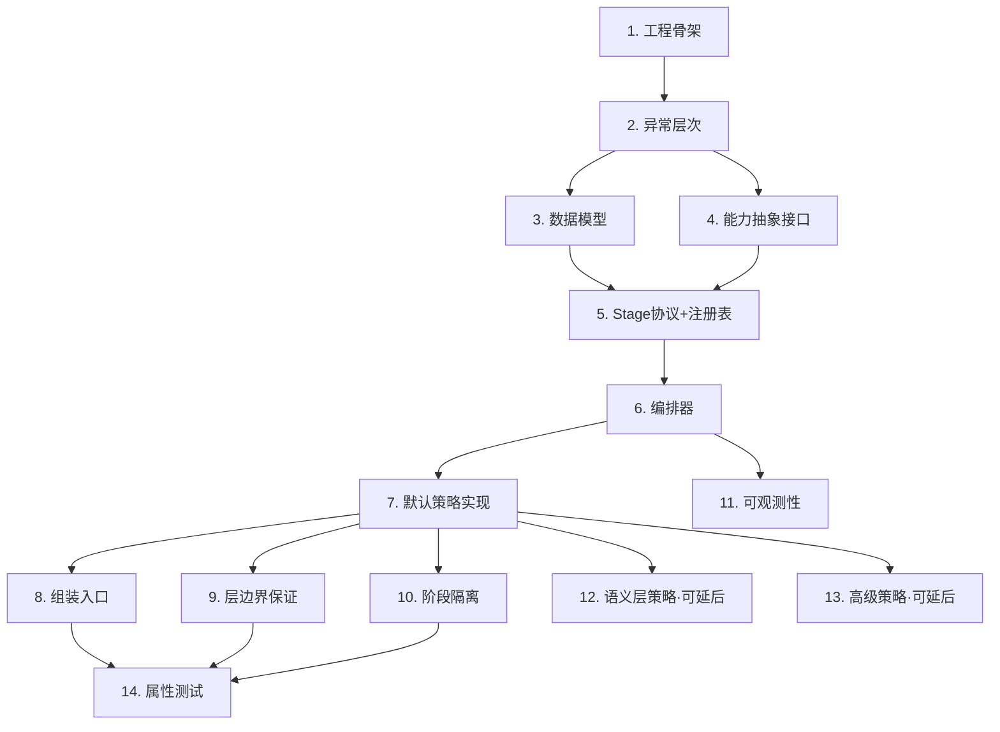

# Implementation Plan: Layer 4 —— Text-to-SQL Pipeline（插拔式）

## Overview

本计划依据 `design.md` 与 `requirements.md` 为 Layer 4 生成实现任务，核心是**可插拔、可配置切换、彼此隔离、易扩展**的分阶段流水线：上下文获取 → SQL 生成 → SQL 选择 → Query Fixer。

**语言/技术**：Python 3.11、pytest、hypothesis（属性测试）。LLM/向量/数据源均以注入的抽象接口（Protocol）接入，测试用 mock。

**编码前置（steering）**：实现每个阶段前**先阅读 SQLBot 对应模块**（`SQLBot/backend/apps/template/*` 分阶段生成器、`terminology/`、`data_training/`、`datasource/embedding/`），**借鉴思路后 clean-room 重写，不复制其 GPLv3 源码**。

**本期范围基线（务必遵守）**：
- **L4 最小可替换**：优先交付默认链路（`rag → single_llm → passthrough → bounded_retry`）；`semantic_layer` 及多生成器/自一致性/门控等高级策略作为可延后任务（框架支持、实现后置）。
- **不执行 SQL**：本期 `DatasourceAdapter.dry_run` 不使用；**Query Fixer 降级为静态校验版**——只调 `IsolationValidator.validate_for_probe`（L5 隔离注入+只读校验，**不 dry_run**），静态失败可回灌修复，重试有上限。
- **dialect 硬编码** `starrocks`（常量/配置注入）。
- **层边界铁律**：只产出未校验 SQL；产出中不得含 `org_id/ps_id` 过滤；不做隔离/只读/权限解析；`PipelineInput` 不带用户数据范围。

## Tasks

- [ ] 1. 工程骨架与常量
  - 建立包结构（`text2sql_pipeline/`：`models.py` / `deps.py` / `registry.py` / `orchestrator.py` / `stages/` / `errors.py` / `config.py` / `observer.py`）
  - 定义 dialect 常量/配置 `DIALECT = "starrocks"`
  - 建立 pytest 骨架与 `conftest.py`（提供各抽象的 mock fixture）
  - _Requirements: 12.2_

- [ ] 2. 异常层次
  - 实现 `StrategyResolutionError`、`UnknownStrategyError`、`DuplicateStrategyError`、`StagePreconditionError`、`ConfigurationError`
  - 单测：各异常语义与信息字段（缺失阶段/字段/策略名）
  - _Requirements: 1.4, 1.5, 5.5, 9.3, 9.4_

- [ ] 3. 数据模型
- [ ] 3.1 输入模型
  - 实现 `ResolvedEntity`、`ResolvedTerm`、`PipelineInput`（standalone_question / resolved_entities / resolved_terms / datasource_id / model_id / locale）
  - **断言 `PipelineInput` 不含 org_ids/ps_ids**（层边界）
  - 单测：input 构造与不可变性
  - _Requirements: 7.5, 7.7_
- [ ] 3.2 流转与产出模型
  - 实现 `RetrievedContext`、`SqlCandidate`、`StageTrace`、`PipelineContext`（追加式写入字段）、`PipelineStatus`、`PipelineResult`
  - 单测：字段默认值、追加式语义
  - _Requirements: 10.1, 11.1_
- [ ] 3.3 配置模型
  - 实现 `StageConfig`、`PipelineConfig`（四阶段默认策略：rag / single_llm / passthrough / bounded_retry(max_attempts)）
  - 单测：默认值正确
  - _Requirements: 1.6, 1.7, 2.3, 4.1, 5.1_

- [ ] 4. 能力抽象接口（Protocol，复用系统既有抽象）
  - 定义 `Embedder`、`VectorStore`、`LlmClient`、`DatasourceAdapter`（dialect / dry_run / get_schema_snippet）、`SemanticLayerStore`、`IsolationValidator`（validate_for_probe）
  - 提供本期最小实现/桩：`DatasourceAdapter.dialect="starrocks"`；`dry_run` 本期不使用（保留接口，标注延后）
  - 单测：接口契约（isinstance / mock 可替换）
  - _Requirements: 12.1, 12.2, 12.3, 12.4, 12.5, 12.6_

- [ ] 5. PipelineStage 协议 + StrategyRegistry
  - 定义 `PipelineStage` 协议（stage_type / strategy_name / run）与 `StageDependencies`
  - 实现 `StrategyRegistry`（register / create / available）与 `@register` 装饰器；重复注册抛 `DuplicateStrategyError`、未知键抛 `UnknownStrategyError`
  - 单测：注册/查找/列举；重复注册保留首个；未知策略报错；空 stage_type 返回空集合
  - _Requirements: 9.1, 9.2, 9.3, 9.4, 9.5, 9.6, 2.1_

- [ ] 6. 编排器 `PipelineOrchestrator`
  - 按 `context_acquisition → sql_generation → sql_selection → query_fixer` 固定顺序解析并驱动；仅前一阶段成功才启动下一阶段
  - 前置字段缺失抛 `StagePreconditionError`（含阶段名+字段名）；启动期策略解析失败抛 `StrategyResolutionError`
  - 每阶段产出 `StageTrace`（ok/error/毫秒时间戳）；阶段异常记录 ok=False 并终止后续
  - `_assemble_result` 状态映射：OK / NO_SQL / FIXER_EXHAUSTED / ERROR；final_sql 优先于 selected_sql
  - 单测：顺序、前置校验、trace、四种状态映射、异常终止
  - _Requirements: 1.1, 1.2, 1.3, 1.4, 1.5, 10.2, 10.3, 10.4, 10.5, 11.1, 11.2, 11.3, 11.4, 11.5, 11.6, 11.7_

- [ ] 7. 默认策略实现（本期主链路）
- [ ] 7.1 上下文获取 `rag`（参考 SQLBot embedding/召回思路，重写）
  - 先读 `SQLBot/backend/apps/datasource/embedding/*` 与 `data_training/`，借鉴召回思路；clean-room 重写
  - 问题（+已解析实体）向量化 → VectorStore 检索 schema 片段与 few-shot 示例 → 写入 `retrieved_context`，记录 strategy_name
  - 检索失败不写部分结果（原子）
  - 单测（mock embedder/vector_store）：命中组装、strategy_name、失败原子性
  - _Requirements: 2.1, 2.4, 2.7, 2.8, 2.9_
- [ ] 7.2 SQL 生成 `single_llm`（参考 SQLBot generate_sql prompt 思路，重写）
  - 先读 `SQLBot/backend/apps/template/generate_sql/` 与 `chat/task/llm.py` 的 prompt 组织，借鉴后重写
  - 组装 prompt（schema/术语/示例/方言），**system 明确禁止输出任何权限过滤条件**；模型选择：请求级 `model_id` > 策略默认（Claude Sonnet）
  - 追加恰好 1 个 `SqlCandidate`（sql/generator_name/model_id 均非空）；抽取 SQL（去 markdown 围栏）
  - 模型不可用 → 拒绝不追加候选；调用失败/60s 超时 → 失败不追加部分候选
  - 单测（mock llm）：候选字段完整、模型优先级、产出无权限过滤、失败路径
  - _Requirements: 4.1, 4.2, 4.3, 4.4, 4.6, 4.7, 4.8, 7.1, 7.2_
- [ ] 7.3 SQL 选择 `passthrough`
  - 取候选生成顺序的第一个写入 `selected_sql`；候选为空抛 `StagePreconditionError`
  - 单测：直通选择、空候选报错
  - _Requirements: 5.1, 5.2, 5.7_
- [ ] 7.4 Query Fixer `bounded_retry`（本期静态校验版，无 dry_run）
  - 先读 `SQLBot/backend/apps/db/db.py::check_sql_read` 的只读思路（仅思路，不抄）
  - **本期路径**：调用 `IsolationValidator.validate_for_probe` 做静态校验（L5 隔离+只读，**不 dry_run**）；通过 → `final_sql`；抛异常（静态失败）→ 回灌 LLM 修复并重试，`fix_attempts` 递增，上限 `max_attempts`
  - 未注入 validator → 跳过校验，`selected_sql` 直接作 `final_sql`（Req 6.4）
  - **dry_run 探测路径保留但本期禁用**（`DatasourceAdapter.dry_run` 不调用），加注释标注"待执行能力接入后启用"
  - 用尽重试仍失败 → 不产出 final_sql（编排器判 FIXER_EXHAUSTED）
  - 单测（mock validator）：静态通过/失败重试/用尽/无 validator 跳过；`fix_attempts ≤ max_attempts`
  - _Requirements: 6.1, 6.2, 6.4, 6.5, 6.6, 6.7_

- [ ] 8. 组装入口与策略注册触发
  - 实现 `build_orchestrator(config, deps, observer)`：导入触发默认策略注册，解析并返回编排器
  - 单测：默认配置端到端（全 mock 依赖）跑通 rag→single_llm→passthrough→bounded_retry
  - _Requirements: 1.1, 1.6, 1.7_

- [ ] 9. 层边界保证与校验
  - 实现"层边界自检"：产出 SQL 不含 `org_id/ps_id` 过滤；本层不做隔离注入/只读强制/权限解析；检测越界 → 返回"层边界违规"错误不产出 SQL
  - 单测：产出 SQL 无权限过滤子句；input 无 scope；越界检测
  - _Requirements: 7.1, 7.2, 7.3, 7.4, 7.6, 7.8, 7.9_

- [ ] 10. 阶段隔离与共享上下文
  - 保证各阶段只写自己声明的产出字段、`PipelineContext.input` 执行后深度相等、不 import 其他阶段内部模块、仅追加式写入
  - 单测：input 不可变（深度相等）；非负责字段不变；mock 全部依赖后各阶段独立可测
  - _Requirements: 8.1, 8.2, 8.3, 8.4, 8.5, 8.6_

- [ ] 11. 可观测性
  - StageTrace 毫秒时间戳、ok/error；失败 error 不含敏感值；PipelineResult 汇总 traces + stage_strategies + request_id
  - 日志不记录用户查询数据字段值/结果集内容
  - 单测：trace 完整性、脱敏、request_id 关联
  - _Requirements: 10.1, 10.2, 10.3, 10.4, 10.5, 10.6, 10.7_

- [ ] 12.（可延后）语义层检索策略 `semantic_layer`
  - 依据 §6：从语义层按问题检索模型/度量/维度片段，组装 `RetrievedContext`；独立命名空间 `semantic_layer`；阈值默认 0.7、片段上限默认 20；未注入 SemanticLayerStore 抛 `ConfigurationError`；无命中返回空 RetrievedContext 不抛异常
  - 语义层构建/维护与增量重建为离线流程，本任务仅实现检索侧策略（构建侧可后置）
  - 单测（mock semantic_layer/vector_store）：阈值/上限过滤、空命中、缺依赖报错
  - _Requirements: 3.1, 3.2, 3.3, 3.4, 3.5, 3.6, 3.7_

- [ ] 13.（可延后）高级生成/选择策略
  - `multi_generator` / `gated_routing`（产 2~10 候选）、`self_consistency` / `selection_agent`
  - 框架已支持注册，此处补实现；单测覆盖候选数量与选择算法
  - _Requirements: 4.5, 5.3, 5.4, 5.6_

- [ ] 14. 属性测试（覆盖 8 条正确性属性）
  - 用 hypothesis 覆盖 Property 1~8：边界不越权、输入不可变、阶段隔离写入、顺序不变式、修复有界、探测不绕过隔离（本期以 validate_for_probe 为准）、策略可替换等价、结果状态映射
  - _Requirements: 7.1, 7.2, 4.6, 8.1, 8.2, 8.3, 8.4, 1.2, 1.3, 1.5, 6.1, 6.2, 6.3, 6.4, 2.5, 2.6, 9.2, 11.1, 11.2, 11.3, 11.4, 11.7_

## Task Dependency Graph

```json
{
  "waves": [
    { "wave": 1, "tasks": ["1"] },
    { "wave": 2, "tasks": ["2"] },
    { "wave": 3, "tasks": ["3.1", "3.2", "3.3", "4"] },
    { "wave": 4, "tasks": ["5"] },
    { "wave": 5, "tasks": ["6"] },
    { "wave": 6, "tasks": ["7.1", "7.2", "7.3", "7.4"] },
    { "wave": 7, "tasks": ["8", "9", "10", "11"] },
    { "wave": 8, "tasks": ["12", "13"] },
    { "wave": 9, "tasks": ["14"] }
  ]
}
```



## Notes

- **顺序**：骨架/异常/模型/抽象（T1~T4）→ 注册表（T5）→ 编排器（T6）→ 默认四策略（T7）→ 组装/边界/隔离/观测（T8~T11）→ 可延后策略（T12~T13）→ 属性测试统一覆盖（T14）。
- **本期主链路 = T1~T11**；T12（semantic_layer）、T13（高级生成/选择）可视排期延后，框架已为其预留注册与配置切换。
- **Query Fixer 本期为静态校验版**：只用 `validate_for_probe`（L5 隔离+只读），**不 dry_run**；`DatasourceAdapter.dry_run` 接口保留但禁用，待未来执行能力接入再启用完整探测修复。
- **SQLBot 参考红线**：T7 各策略实现前先读 SQLBot 对应模块借鉴思路，**clean-room 重写、不复制源码**（见 steering `10-reference-sqlbot.md`）。
- **层边界**：产出仅"未校验 SQL"，隔离/只读/权限一律不在本层；由 Layer 5 保证。
- 属性测试用例量大，建议 CI 单独分组。
