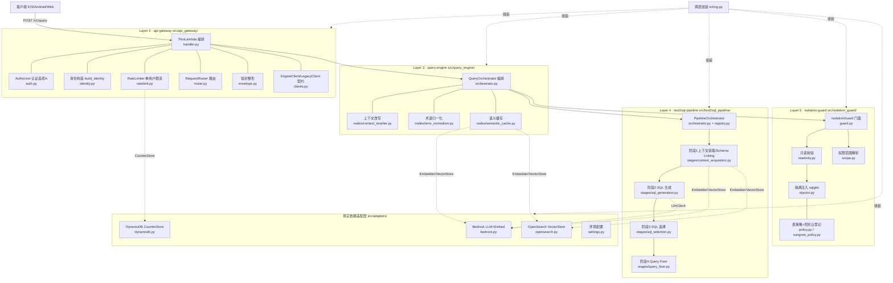

# 设计 ↔ 代码 对应关系（Design-to-Code Mapping）

> 本文把七层架构中**本期已实现的四层（L2/L3/L4/L5）+ 真实依赖适配层**的设计模块，
> 逐一对应到源代码文件，并标注各文件在**对应层自己的** `design.md` 中的章节号
> （章节号取自各源文件 docstring 中作者标注的权威引用；空缺者为常量/错误等无独立章节的文件）。
>
> 设计文档位置：`.kiro/specs/<layer>/design.md` 与 `.kiro/specs/<layer>/requirements.md`
> （layer ∈ api-gateway / query-engine / text2sql-pipeline / isolation-guard）。

---

## 全景流程图（模块 ↔ 文件）

---

## Layer 2 · api-gateway（`src/api_gateway/`）

| 设计模块 / 职责 | design.md 章节 | 源文件 |
|---|---|---|
| 薄 Lambda 编排（解析→限流→路由→透传→调下游→整形；可分块消费点，本期单块） | §2.2 / §9.1 | `handler.py` (`ThinLambda`) |
| 认证 · Lambda Authorizer（选项 A，网关终结，校验 Bearer JWT） | §5.1 / §5.2 | `auth.py` (`Authorizer`) |
| 身份构造 + Token 校验契约（传输无关，不解析数据范围） | §3.5 / §5.3 / §12.3 | `identity.py` (`build_identity` / `TokenVerifier`) |
| 单用户业务限流（RateLimiter + CounterStore 抽象） | §3.3 / §6 | `ratelimit.py` (`RateLimiter` / `CounterStore` / `InMemoryCounterStore`) |
| Legacy/Query 路由（可序列化匹配规格 + 注册表） | §4.5 / §7 | `router.py` (`RequestRouter` / `RuleRegistry` / `RoutingRule`) |
| 请求/响应契约与统一信封（预留流式最终结果事件） | §4.1 / §4.2 / §4.6 | `envelope.py` (`QueryResponse` / `ErrorEnvelope` / `parse_query_request`) |
| 出站客户端契约（调 L3 / legacy，透传身份） | §3.6 / §3.7 | `clients.py` (`EngineClient` / `LegacyClient`) |
| 可观测（结构化日志 + 脱敏 + 指标） | §11 | `observer.py` |
| 错误类型（映射 HTTP 状态） | — | `errors.py` |
| 配置常量（问题长度 / 额度 / 超时） | — | `config.py` |
| 基础设施（API Gateway IaC 草图） | — | `infra/api-gateway.yaml` |

## Layer 3 · query-engine（`src/query_engine/`）

| 设计模块 / 职责 | design.md 章节 | 源文件 |
|---|---|---|
| 查询编排器（改写→归一化→缓存→[命中/未命中]→L5→组装→写 Memory） | §7 | `orchestrator.py` (`QueryOrchestrator`) |
| 上下文改写 / 指代消解（基于 Memory 把追问改为独立问题） | §3 | `nodes/context_rewriter.py` |
| 术语归一化（硬字典 `HardEntityResolver` + 软术语库 `SoftGlossaryResolver`） | §3 | `nodes/term_normalizer.py` |
| 语义复用缓存（只存隔离前 SQL 模板，命中仍过 L5） | §3 / §6 | `nodes/semantic_cache.py` |
| 能力抽象 + 下游客户端契约（Memory/LLM/Embedder/VectorStore/EntityDictionary/Layer4Client/Layer5GuardFactory/DatasourceAdapter） | §3 / §7.1 | `deps.py` |
| 数据模型（QueryRequest/Answer/QueryContext/CallerIdentity/AnswerStatus/QuerySource） | §4 | `models.py` |
| 可观测（日志脱敏，不落数据范围/凭证/结果） | §11 | `observer.py` |
| 配置常量（方言 / 阈值 / 命名空间） | — | `config.py` |

## Layer 4 · text2sql-pipeline（`src/text2sql_pipeline/`）

| 设计模块 / 职责 | design.md 章节 | 源文件 |
|---|---|---|
| 流水线编排器（固定四阶段驱动，状态映射） | §7.3 | `orchestrator.py` (`PipelineOrchestrator` / `build_orchestrator`) |
| 策略注册表（按 stage_type+strategy_name 注册/创建，可插拔核心） | §7.2 | `registry.py` (`StrategyRegistry` / `@register`) |
| 阶段1 上下文获取 / Schema Linking（默认 `rag`：向量检索 schema/示例） | §3.1 / §7.4 | `stages/context_acquisition.py` (`RagContextAcquisition`) |
| 阶段2 SQL 生成（默认 `single_llm`；禁止注入权限过滤） | §3.2 / §7.6 | `stages/sql_generation.py` (`SingleLlmGeneration`) |
| 阶段3 SQL 选择（默认 `passthrough`） | §3.3 / §7.7 | `stages/sql_selection.py` (`PassthroughSelection`) |
| 阶段4 Query Fixer（默认 `bounded_retry`；本期静态校验版，无 dry_run） | §3.4 / §7.8 | `stages/query_fixer.py` (`BoundedRetryFixer`) |
| 阶段统一协议 + 能力抽象 + `StageDependencies`（含到 L5 的 `IsolationValidator`） | §5.2 / §7.1 | `deps.py` |
| 数据模型（PipelineInput/Context/Result/Config/RetrievedContext/SqlCandidate） | §4 | `models.py` |
| 可观测（阶段开始/结束/异常事件） | §7.3 | `observer.py` |
| 错误类型（ConfigurationError/StagePreconditionError/UnknownStrategyError...） | — | `errors.py` |
| 配置常量（方言 / 默认模型 id） | — | `config.py` |

## Layer 5 · isolation-guard（`src/isolation_guard/`）

| 设计模块 / 职责 | design.md 章节 | 源文件 |
|---|---|---|
| 门面 + 双入口（`guard` / `validate_for_probe`）+ 工厂（按身份绑定，DataScope 惰性解析缓存） | §7 | `guard.py` (`IsolationGuard` / `IsolationGuardFactory`) |
| 权限范围解析（阳光云权限表→子查询；做法二子查询注入 + 做法一 `MaterializedScopeSource` 抽象占位） | §4.1 / §5A.3 | `scope.py` (`ScopeResolver` / `SubqueryScopeSource` / `PermissionFilterSpec` / `MaterializedScopeSource`) |
| 隔离注入（在只读校验后的 AST 上，把受控表替换为带隔离过滤的子查询） | §5 / §5A.4 | `injector.py` |
| 只读强制校验（确定性 AST，禁非 SELECT） | §6 | `readonly.py` |
| 表隔离策略与列绑定（表→ColumnBinding；未登记 fail-closed） | §4.2 / §5A.2 | `policy.py` (`TablePolicy` / `ColumnBinding` / `ColTransform`) |
| 阳光云表登记（初始受控表清单：ps_id 类 / ps_key 类 / org 类） | §5A.2 | `sungrow_policy.py` |
| 数据模型（CallerIdentity/ScopeDim/GuardResult/GuardStatus/IsolationDecision） | §4.1 / §4.3 / §5A | `models.py` |
| 可观测 / 审计（每次守卫决策事件） | §11 | `observer.py` |
| 错误类型 / 配置常量 | — | `errors.py` / `config.py` |

---

## 真实依赖适配层（本期新增实现，无独立设计章节；实现各层 `deps.py` 定义的 Protocol）

| 设计中的能力抽象 | 实现文件 | 说明 |
|---|---|---|
| `LlmClient`（L3/L4）+ `Embedder`（L3/L4） | `src/adapters/bedrock.py` (`BedrockLlmClient` / `BedrockEmbedder`) | Bedrock Converse + Titan Embed v2（1024 维） |
| `VectorStore`（L3/L4） | `src/adapters/opensearch.py` (`OpenSearchVectorStore`) | OpenSearch Serverless k-NN，SigV4，单索引 + namespace |
| `CounterStore`（L2） | `src/adapters/dynamodb.py` (`DynamoDbCounterStore`) | DynamoDB 原子条件自增 + TTL |
| 环境驱动配置（模型/区域/端点单点切换） | `src/adapters/settings.py` (`AwsSettings`) | 换模型改 `SMARTQUERY_LLM_MODEL_ID` |

## 跨层组装 & 运维/演示脚本

| 用途 | 文件 |
|---|---|
| 用真实适配器组装 L2→L3→L4→L5（含 RealLayer4Adapter / RealGuardFactoryAdapter / L3EngineClient / InMemoryMemory） | `src/wiring.py` |
| 建 DynamoDB 限流表 | `scripts/create_dynamodb_table.py` |
| 建 AOSS 向量集合（加密/网络/数据访问策略，主体收敛） | `scripts/create_aoss_collection.py` |
| 切 AOSS 网络策略为 VPC-only | `scripts/set_aoss_network.py` |
| 放行 AOSS VPC 端点安全组入站 443（按 VPC CIDR，非 0.0.0.0/0） | `scripts/allow_aoss_sg.py` |
| 向 OpenSearch 灌注演示 schema/示例/术语 | `scripts/ingest_opensearch.py` |
| 端到端演示（一条问题走完 L2→L5） | `scripts/demo_query.py` |

## 测试（`tests/`，与各层同名子目录）

| 目录 | 内容 |
|---|---|
| `tests/api_gateway/` | L2 单测 + 属性测试（`test_l2_properties.py`）+ L2↔L3 集成（`test_integration_l2_l3.py`） |
| `tests/query_engine/` | L3 单测 + L3↔L4↔L5 全链路集成（`test_integration_l3_full.py`） |
| `tests/text2sql_pipeline/` | L4 阶段/编排/注册表单测 + 属性测试 + L4↔L5 集成 |
| `tests/isolation_guard/` | L5 单测 + 边界集成（`test_integration_boundary.py`） |
| `tests/adapters/` | 适配器单测（bedrock/dynamodb/opensearch）+ 全链路 mock 集成（`test_wiring.py`） |

---

## 设计中存在、本期未实现

- **L6 connection-proxy**、**L7 datasource-adapter**：仅在各层 `deps.py` 保留 `DatasourceAdapter` 接口占位（本期不执行 SQL，不取数）。
- **L4 备选上下文获取策略**：`semantic_layer` / `mdl` / `m_schema` / `nl_semantic_layer`（design §3.1 / §6 列出，代码留可插拔位，未落地）。
- **L4 高级生成/选择策略**：多生成器 / Gated 路由 / 自一致性选择（默认 `single_llm` + `passthrough`）。
- **schema 灌注来源**：当前为 `ingest_opensearch.py` 手写种子；真实来源（StarRocks 只读元数据 / DDL 文档）待定。
- **PermissionFilterSpec 标志位规则**（share_type/is_active 等）：占位默认 deny（fail-closed），待业务确定。
